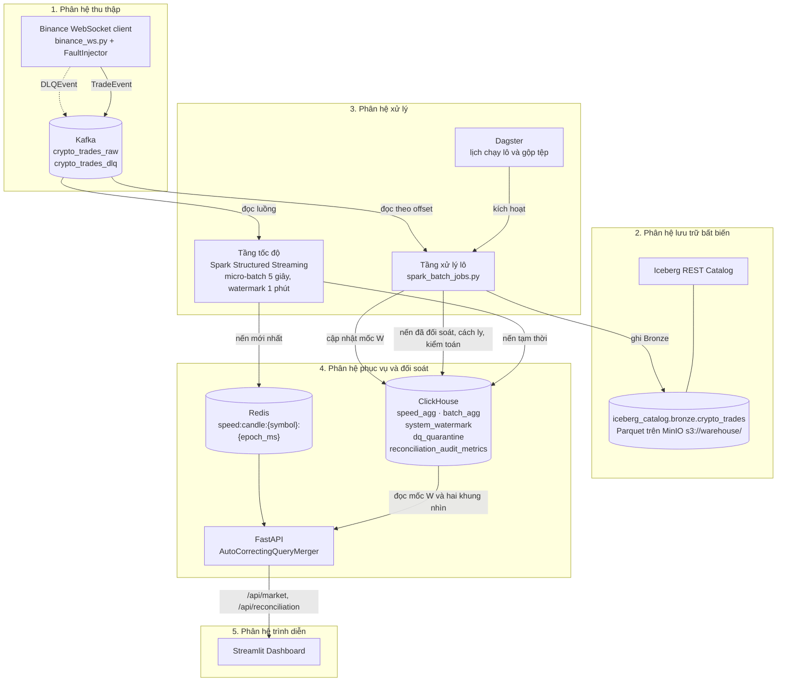
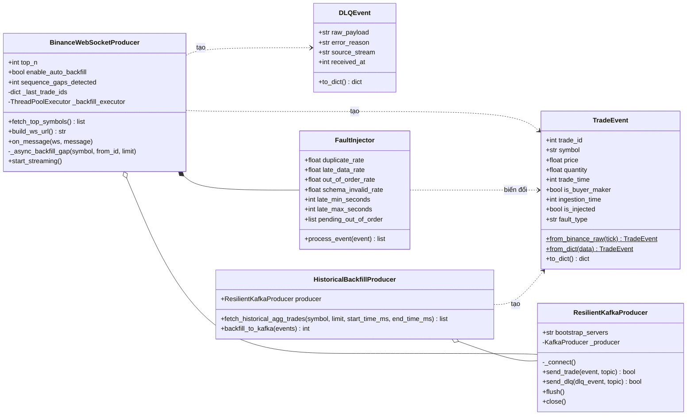
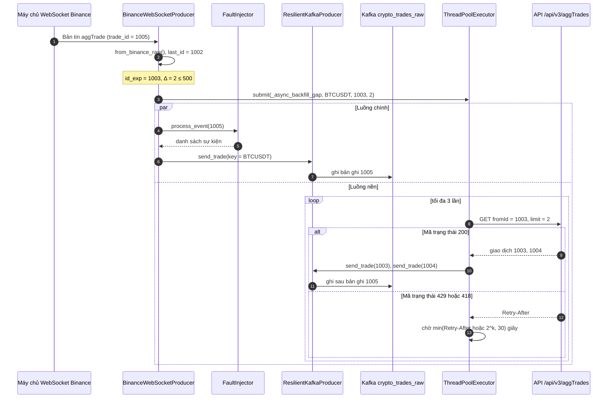
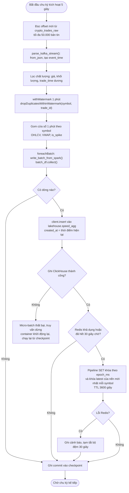

# CHƯƠNG 3: THIẾT KẾ KIẾN TRÚC HỆ THỐNG VÀ HIỆN THỰC HÓA PIPELINE

## 3.1. PHÂN TÍCH YÊU CẦU NGHIỆP VỤ VÀ LUỒNG DỮ LIỆU TỔNG THỂ

Mục này xác lập ba điểm mà mọi thành phần phía sau phải tuân theo: hình dạng dữ liệu đầu vào, định nghĩa chính xác của các chỉ số tài chính, và cách các phân hệ ghép nối với nhau. Sai một điểm thì tầng tốc độ và tầng xử lý lô sẽ cho ra hai con số không so sánh được.

### 3.1.1. Đặc tả luồng dữ liệu WebSocket sàn Binance và Data Contract JSON Schema

Nguồn dữ liệu đầu vào là kênh giao dịch tổng hợp `aggTrade` mà sàn Binance phát công khai qua giao thức WebSocket, với cặp chuẩn `BTCUSDT` cùng một số cặp có thanh khoản cao khác. Mỗi bản tin là một đối tượng JSON rất gọn, dùng khóa một ký tự để tiết kiệm băng thông: `s` là mã cặp giao dịch, `a` là mã giao dịch tổng hợp, `p` và `q` lần lượt là giá và khối lượng ở dạng chuỗi số thập phân, `T` là thời điểm khớp lệnh tính bằng mili-giây, còn `m` cho biết bên mua có phải là bên tạo lập thanh khoản hay không. Định dạng này tiện cho sàn. Nó không tiện cho các tầng xử lý phía sau.

Lớp `TradeEvent` trong `src/ingestion/models.py` là điểm chuyển đổi duy nhất từ bản tin thô sang bản ghi chuẩn hóa. Phương thức `from_binance_raw()` ép kiểu tường minh từng trường: mã cặp được đưa về chữ in hoa, mã giao dịch và thời điểm khớp lệnh được ép sang số nguyên, giá và khối lượng được chuyển từ chuỗi sang số thực. Với khóa có thể vắng mặt, hàm dùng giá trị dự phòng: `a` rồi đến `t` cho mã giao dịch, `T` rồi đến `E` cho thời điểm khớp lệnh, nhờ đó một mô hình đọc được cả kênh `aggTrade` lẫn kênh `trade`. Ngoài sáu trường nghiệp vụ, mô hình gắn thêm ba trường siêu dữ liệu: `ingestion_time` ghi lại thời điểm tầng thu thập nhận gói tin, còn `is_injected` và `fault_type` đánh dấu các bản ghi do bộ tiêm lỗi `FaultInjector` sinh ra để phục vụ thực nghiệm.

Cách ép kiểu này có chủ đích. Hàm không tự loại bỏ giá trị bất hợp lệ, mà điền vào mỗi trường còn thiếu một giá trị canh gác chắc chắn vi phạm hợp đồng: mã cặp rỗng, mã giao dịch bằng `-1`, giá và khối lượng bằng `0.0`. Việc chặn những bản ghi như vậy được dời xuống bộ lọc chất lượng của tầng tốc độ và cổng kiểm định của tầng xử lý lô, nơi các điều kiện này được kiểm tra lại. Ở cửa ngõ thu thập, hàm `on_message()` trong `binance_ws.py` chỉ làm một việc thô hơn: nếu bản tin không phân tích được thành JSON hoặc thiếu khóa `s`, `p`, toàn bộ chuỗi gốc được đóng gói thành `DLQEvent` gồm bốn trường `raw_payload`, `error_reason`, `source_stream`, `received_at`, rồi đẩy sang topic `crypto_trades_dlq`, được dùng làm hàng đợi chứa bản ghi lỗi (Dead-Letter Queue – DLQ). Luồng chính không dừng lại. Bản ghi hỏng vẫn được giữ để điều tra.

Quyết định thiết kế quan trọng nhất của hợp đồng dữ liệu nằm ở việc tách bạch hai mốc thời gian `trade_time` và `ingestion_time`. Theo mô hình Dataflow [1], thời gian sự kiện là lúc sự việc thực sự xảy ra, còn thời gian xử lý là lúc hệ thống quan sát được nó; hai mốc này luôn lệch nhau một khoảng không cố định do độ trễ mạng và độ trễ hàng đợi. Mọi phép gom cửa sổ trong hệ thống đều dựa trên `trade_time`. Trường `ingestion_time` chỉ dùng để đo độ trễ và phân xử bản ghi trùng lặp. Ranh giới này được giữ cả khi dữ liệu thiếu: nếu bản tin không có cả `T` lẫn `E`, hàm đặt `trade_time = 0` thay vì lấy đồng hồ hệ thống. Bản ghi ấy bị loại với mã `trade_time_non_positive`. Thời gian xử lý không bao giờ lọt vào vị trí của thời gian sự kiện.

Hợp đồng được công bố dưới dạng JSON Schema chuẩn Draft 2020-12 tại `datasets/schemas/trade_event_schema.json`, tóm tắt trong Bảng 3.1.

**Bảng 3.1: Đặc tả hợp đồng dữ liệu sự kiện giao dịch khớp lệnh**

| Trường | Kiểu dữ liệu | Ràng buộc | Bắt buộc | Ý nghĩa nghiệp vụ |
| :---: | :---: | :---: | :---: | :---: |
| `trade_id` | integer | `minimum: 0` | Có | Mã giao dịch tổng hợp, khóa khử trùng lặp cùng `symbol` |
| `symbol` | string | `minLength: 1`, chỉ chữ in hoa và chữ số | Có | Mã cặp giao dịch, ví dụ `BTCUSDT` |
| `price` | number | `minimum: 1e-8` | Có | Giá khớp lệnh, đơn vị USDT |
| `quantity` | number | `minimum: 1e-8` | Có | Khối lượng tài sản cơ sở được khớp |
| `trade_time` | integer | `exclusiveMinimum: 0`, mili-giây | Có | Thời gian sự kiện tại bộ khớp lệnh của sàn |
| `is_buyer_maker` | boolean | `true` hoặc `false` | Có | Bên mua là bên tạo lập thanh khoản hay không |
| `ingestion_time` | integer | `minimum: 0`, mili-giây | Có | Thời gian xử lý tại tầng thu thập |
| `is_injected` | boolean | `default: false` | Có | Cờ nhận diện bản ghi lỗi tiêm có kiểm soát |
| `fault_type` | string hoặc null | `duplicate`, `late_data`, `out_of_order`, `schema_invalid`, `negative_price` hoặc null | Không | Loại lỗi được tiêm phục vụ thực nghiệm |

*Nguồn: tổng hợp từ datasets/schemas/trade_event_schema.json và src/ingestion/models.py; mỗi ràng buộc ngữ nghĩa trong lược đồ có một mã lỗi tương ứng trong src/data_quality/dq_checks.py.*

Lược đồ là hợp đồng công bố, không phải trình kiểm tra chạy lúc vận hành. Việc thực thi thuộc về cổng chất lượng, nơi mỗi vi phạm được gán mã lỗi riêng và chuyển vào bảng cách ly thay vì bị loại bỏ âm thầm.

### 3.1.2. Định nghĩa các chỉ số tài chính nghiệp vụ (OHLCV, VWAP, Price Spike)

Một giao dịch đơn lẻ gần như không mang thông tin phân tích. Nhà phân tích cần nến: tập hợp các giao dịch trong một cửa sổ thời gian cố định, không chồng lấn, mặc định dài một phút, được tóm lược thành bộ chỉ số giá mở cửa, cao nhất, thấp nhất, đóng cửa và khối lượng (Open, High, Low, Close, Volume – OHLCV). Xét cửa sổ $W = [T_{\text{start}}, T_{\text{end}})$ chứa $N$ giao dịch, trong đó giao dịch thứ $i$ có giá $P_i$, khối lượng $Q_i$, thời điểm khớp lệnh $t_i$ và mã giao dịch $id_i$. Hệ thống định nghĩa:

$$\text{Open} = P_k,\; k = \arg\min_i (t_i, id_i) \qquad \text{Close} = P_m,\; m = \arg\max_i (t_i, id_i)$$

$$\text{High} = \max_i P_i \qquad \text{Low} = \min_i P_i \qquad V = \sum_{i=1}^{N} Q_i$$

Điểm tinh tế nằm ở giá mở và giá đóng. Nếu lấy giá của bản ghi đầu tiên và cuối cùng đến được hệ thống, tức là sắp theo thời gian xử lý, thì kết quả sẽ phụ thuộc vào thứ tự phân vùng Kafka, độ trễ mạng và cách Spark chia micro-batch, nghĩa là hai lần chạy trên cùng một tập dữ liệu có thể cho ra hai cây nến khác nhau. Tệp `metrics_calculator.py` loại bỏ sự bất định đó bằng cách sắp thứ tự theo thời gian sự kiện [1]. Ở nhánh Python thuần, hàm `calculate_ohlcv_python()` sắp giao dịch theo cặp khóa (`trade_time`, `trade_id`) trước khi đọc phần tử đầu và cuối. Ở nhánh Spark, hàm `get_spark_aggregation_exprs()` dựng cấu trúc `struct(trade_time, trade_id, price)` rồi lấy `min` và `max` của chính cấu trúc đó; vì phép so sánh cấu trúc diễn ra lần lượt theo từng trường, giao dịch khớp sớm nhất cho giá mở, và khi hai giao dịch trùng mili-giây thì mã giao dịch nhỏ hơn được ưu tiên. Kết quả là tất định. Một giao dịch đến trễ ba mươi giây nhưng khớp lệnh ở giây thứ năm của phút vẫn được đặt đúng vị trí của nó, miễn là còn nằm trong ngưỡng watermark một phút của tầng tốc độ.

Chỉ số thứ hai là giá trung bình gia quyền theo khối lượng (Volume-Weighted Average Price – VWAP):

$$\text{VWAP} = \frac{\sum_{i=1}^{N} P_i \times Q_i}{\sum_{i=1}^{N} Q_i}$$

Khác với trung bình cộng giá, VWAP để mỗi giao dịch đóng góp đúng theo khối lượng của nó, nên vài lệnh nhỏ khớp ở mức giá lệch không kéo lệch chỉ số. Hàm `calculate_vwap_python()` làm tròn kết quả đến sáu chữ số thập phân và trả về `0.0` khi tổng khối lượng không dương, tránh lỗi chia cho không; giá trị ghi xuống ClickHouse được làm tròn đến bốn chữ số. VWAP cũng là đại lượng chính dùng để so khớp khung nhìn tốc độ với khung nhìn lô trong Chương 4.

Chỉ số thứ ba là cờ đột biến giá `is_spike`, do `spike_detector.py` tính cho từng nến theo hai tiêu chí độc lập:

$$\Delta P_{\text{step}} = \frac{|\text{Close} - \text{Open}|}{\text{Open}} \qquad \Delta P_{\text{range}} = \frac{\text{High} - \text{Low}}{\text{Low}}$$

$$\text{is\_spike} = \begin{cases} 1 & \text{nếu } \Delta P_{\text{step}} \ge 0.02 \text{ hoặc } \Delta P_{\text{range}} \ge 0.03 \\ 0 & \text{ngược lại} \end{cases}$$

Hai ngưỡng được truyền vào qua tham số `spike_threshold = 0.02` và `volatility_threshold = 0.03` của lớp `WindowAggregator`, sau đó ánh xạ sang `DEFAULT_PRICE_CHANGE_THRESHOLD` và `DEFAULT_RANGE_THRESHOLD` của lớp `SpikeDetector`. Ngưỡng thứ nhất bắt những cú trượt giá một chiều, khi giá đóng cửa cách giá mở cửa từ 2% trở lên chỉ trong một phút. Ngưỡng thứ hai đo một hiện tượng khác hẳn: cây nến có râu dài, giá vọt lên rồi rơi xuống ngay trong phút đó nhưng đóng cửa sát mức mở. Một cây nến như vậy có $\Delta P_{\text{step}}$ gần bằng không. Nó sẽ lọt qua tiêu chí đầu.

Vậy tại sao ngưỡng biên độ lại cao hơn? Vì $\text{Low} \le \text{Open}$ và $|\text{Close} - \text{Open}| \le \text{High} - \text{Low}$, ta luôn có $\Delta P_{\text{range}} \ge \Delta P_{\text{step}}$ với mọi cây nến hợp lệ. Nếu dùng chung mức 2%, tiêu chí thứ nhất trở nên thừa, còn tiêu chí thứ hai báo động trên quá nhiều nến chỉ biến động mạnh bình thường. Nhánh Python còn chặn trước trường hợp giá mở hoặc giá thấp nhất không dương bằng cách trả về `0`. Cả tầng tốc độ lẫn tầng xử lý lô đều gọi cùng một lớp `SpikeDetector` với cùng hai ngưỡng, nên trên cùng một cây nến, hai tầng luôn đưa ra cùng một phán quyết.

### 3.1.3. Thiết kế kiến trúc tổng thể 5 phân hệ và hồ sơ UML tổng quát

Kiến trúc Lambda do Marz và Warren đề xuất [7] chia hệ thống thành ba tầng: tầng xử lý lô tính lại toàn bộ khung nhìn từ tập dữ liệu gốc bất biến, tầng tốc độ bù phần dữ liệu mới mà tầng lô chưa kịp xử lý, và tầng phục vụ hợp nhất hai khung nhìn khi trả lời truy vấn. Đề tài giữ nguyên ba tầng này, đồng thời tách thêm một phân hệ ở mỗi đầu luồng, tổng cộng năm phân hệ:

1. **Phân hệ thu thập:** nhận luồng WebSocket, chuẩn hóa thành `TradeEvent` và ghi vào Kafka.
2. **Phân hệ lưu trữ bất biến:** giữ tập dữ liệu gốc trên MinIO dưới dạng bảng Apache Iceberg.
3. **Phân hệ xử lý:** gồm tầng tốc độ chạy Spark Structured Streaming và tầng xử lý lô do Dagster điều phối.
4. **Phân hệ phục vụ và đối soát:** gồm cơ sở dữ liệu ClickHouse, bộ đệm Redis và cổng giao diện lập trình ứng dụng (Application Programming Interface – API) viết bằng FastAPI.
5. **Phân hệ trình diễn:** giao diện Streamlit cùng bộ phát cảnh báo.

Phân hệ lưu trữ đi theo hướng Lakehouse [3]: dữ liệu gốc nằm trên lưu trữ đối tượng ở dạng tệp Parquet nhưng được quản lý bởi một định dạng bảng mở, nhờ vậy vẫn rẻ như hồ dữ liệu mà có giao dịch nguyên tử và lịch sử phiên bản như kho dữ liệu. ClickHouse đảm nhiệm vai trò xử lý phân tích trực tuyến (Online Analytical Processing – OLAP). Tầng tốc độ chạy micro-batch năm giây một lần, tương ứng với cam kết chất lượng dịch vụ (Service Level Agreement – SLA) độ trễ đầu-cuối dưới năm giây.

Hình 3.1 mô tả hệ thống bằng biểu đồ ca sử dụng theo ngôn ngữ mô hình hóa thống nhất (Unified Modeling Language – UML). Có ba tác nhân. Nhà phân tích thị trường theo dõi nến, nhận cảnh báo đột biến và xem báo cáo đối soát. Kỹ sư dữ liệu kiểm toán sai số, tra cứu bản ghi bị cách ly và điều phối các lượt tái xử lý, gộp tệp. Sàn Binance là tác nhân hệ thống bên ngoài, chỉ cung cấp luồng dữ liệu.

**Hình 3.1: Biểu đồ ca sử dụng tổng quát của hệ thống đối soát dữ liệu thời gian thực**

Hình 3.2 là biểu đồ thành phần, thể hiện đường đi của dữ liệu giữa các container trên mạng `lakehouse-net`. Hai nhánh xử lý cùng đọc topic `crypto_trades_raw` nhưng không gọi trực tiếp lẫn nhau. Điểm tiếp xúc duy nhất của chúng là bảng `lakehouse.system_watermark`.

Sau mỗi lượt chạy, tầng xử lý lô lấy giá trị `window_end` lớn nhất trong các nến vừa tính và gọi `update_watermark()` để chèn thêm một dòng mới cho `layer = 'batch_layer'`, chứ không sửa dòng cũ. Bảng dùng engine `ReplacingMergeTree(updated_at)`, còn `WatermarkReader` ở tầng phục vụ luôn đọc dòng có `updated_at` mới nhất. Từ mốc $W$ đọc được, bộ hợp nhất `AutoCorrectingQueryMerger` phân luồng truy vấn: khoảng thời gian kết thúc trước $W$ được lấy toàn bộ từ `batch_agg`, khoảng bắt đầu từ $W$ trở đi lấy từ `speed_agg`, còn khoảng cắt ngang $W$ được tách đôi ngay tại $W$, sau đó khử trùng theo cặp (`symbol`, `window_start`) và ưu tiên bản ghi đã đối soát. Tầng tốc độ không đọc mốc này. Khi chưa có mốc nào, do ClickHouse mất kết nối hoặc bảng vừa khởi tạo, bộ đọc trả về thời điểm 1970-01-01 và mọi truy vấn rơi về nhánh tốc độ: hệ thống lùi về chế độ chỉ có khung nhìn tốc độ, nhưng không ngừng phục vụ.

**Hình 3.2: Biểu đồ thành phần kiến trúc tổng thể năm phân hệ**

## 3.2. HIỆN THỰC PHÂN HỆ THU THẬP DỮ LIỆU (INGESTION LAYER) VÀ FAULT INJECTOR

Phân hệ thu thập gồm bốn khối mã trong thư mục `src/ingestion/`: client WebSocket nhận dữ liệu từ sàn, producer ghi dữ liệu vào Kafka, bộ tiêm lỗi phục vụ thực nghiệm và hai cơ chế bù dữ liệu bị mất. Bốn khối này cùng tuân theo một nguyên tắc: tiến trình thu thập phải chạy liên tục, kể cả khi đầu vào sai.

### 3.2.1. Xây dựng Binance WebSocket Live Stream Client bất đồng bộ

Lớp `BinanceWebSocketProducer` trong `src/ingestion/binance_ws.py` là cửa ngõ duy nhất giữa hệ thống và sàn Binance. Khi khởi động, phương thức `fetch_top_symbols()` gọi điểm cuối `/api/v3/ticker/24hr`, giữ lại các cặp kết thúc bằng `USDT`, loại các mã đòn bẩy có chứa `UPUSDT`, `DOWNUSDT`, `BEARUSDT`, `BULLUSDT`, rồi sắp giảm dần theo giá trị giao dịch 24 giờ (`quoteVolume`) để chọn ra `top_n` cặp, mặc định là mười. Nếu lời gọi thất bại vì lỗi mạng hoặc quá thời gian chờ mười giây, client không dừng lại mà chuyển sang danh sách tĩnh trong cấu hình. Sau đó `build_ws_url()` ghép mọi kênh `<symbol>@aggTrade` vào một địa chỉ kết nối duy nhất theo cơ chế luồng kết hợp của Binance. Một kết nối, mười cặp giao dịch.

Tính bất đồng bộ của client không đến từ `asyncio`. Nó dựa trên mô hình hàm gọi lại của thư viện `websocket-client`: vòng lặp `run_forever()` giữ kết nối và gọi `on_message()` mỗi khi có bản tin, còn những việc có thể chậm như gọi API bù dữ liệu được chuyển sang một `ThreadPoolExecutor` hai luồng. Luồng nhận bản tin vì vậy không bao giờ phải chờ một lời gọi mạng thứ hai. Hai tham số `ping_interval=30` và `ping_timeout=10` duy trì nhịp tim của kết nối: quá mười giây không nhận được phản hồi thì kết nối bị coi là đã chết và vòng lặp kết thúc. Phương thức `start_streaming()` bọc toàn bộ quá trình trong một vòng `while True`. Khi phát sinh ngoại lệ, thời gian chờ trước lần kết nối lại tăng theo hàm mũ $T_{\text{wait}} = \min(2^{n}, 60)$ giây, với $n$ là số lần thất bại liên tiếp; $n$ trở về 0 ngay khi `run_forever()` kết thúc bình thường, nên một lần đóng kết nối không kèm ngoại lệ sẽ được nối lại tức thì. Khối `finally` luôn gọi `flush()` để bộ đệm của producer không bị bỏ dở giữa hai phiên.

Triết lý thiết kế của client là tách bạch hai việc: tiếp nhận không chặn và kiểm định ngữ nghĩa. Hàm `on_message()` chỉ kiểm tra cấu trúc ở mức tối thiểu. Bản tin phải giải mã được thành JSON, phần dữ liệu phải là một đối tượng và phải có hai khóa `s`, `p`. Bản tin không qua được bước này được đóng gói thành `DLQEvent` với `source_stream="binance_ws"`, gửi sang topic `crypto_trades_dlq`, rồi hàm trả về để đón bản tin tiếp theo. Bản tin qua được thì đi vào `from_binance_raw()`, nơi mọi trường còn thiếu được gán giá trị canh gác: khối lượng vắng mặt trở thành `0.0`, mã giao dịch vắng mặt trở thành `-1`, thời điểm khớp lệnh vắng mặt được thay bằng `E`, và bằng `0` nếu `E` cũng không có. Mọi ngoại lệ khác bị khối `except` ngoài cùng bắt lại và ghi nhật ký. Vòng lặp vẫn chạy.

Lựa chọn này xuất phát từ sự bất cân xứng giữa hai loại sai lầm. Nếu tiến trình thu thập sập vì một bản tin dị thường, toàn bộ giao dịch phát sinh trong lúc khởi động lại sẽ mất hẳn, vì luồng WebSocket không cho phép đọc lại quá khứ. Ngược lại, một bản ghi có khối lượng `0.0` lọt vào Kafka vẫn còn nằm trong nhật ký và sẽ bị chặn ở tầng sau: bộ lọc của tầng tốc độ loại bản ghi có giá hoặc khối lượng không dương trước khi gom cửa sổ, còn cổng kiểm định của tầng xử lý lô gán cho nó mã lỗi `quantity_non_positive` và chuyển vào bảng `lakehouse.dq_quarantine`. Mất dữ liệu thì không sửa được. Dữ liệu bẩn thì sửa được.

Về thời gian, client không thực hiện bất kỳ phép chuyển múi giờ nào. Trường `T` của Binance là số mili-giây tính từ mốc 1970 theo giờ quốc tế, vốn không phụ thuộc múi giờ, nên được giữ nguyên trong `trade_time`. Việc đổi sang kiểu dấu thời gian chỉ diễn ra ở tầng tốc độ, bằng phép chia `trade_time / 1000` trước khi gán watermark.

### 3.2.2. Xây dựng Kafka Producer nạp dữ liệu phân vùng vào topic `crypto_trades_raw`

Kafka tổ chức mỗi topic thành nhiều phân vùng; mỗi phân vùng là một nhật ký chỉ ghi nối, và thứ tự chỉ được bảo đảm bên trong một phân vùng [6]. Lớp `ResilientKafkaProducer` trong `src/ingestion/kafka_producer.py` khai thác đúng tính chất đó: phương thức `send_trade()` gửi mỗi bản ghi kèm khóa `key=event.symbol`. Bộ phân vùng mặc định của thư viện `kafka-python` băm khóa bằng hàm murmur2 rồi lấy phần dư theo số phân vùng:

$$\text{partition} = \text{murmur2}(\texttt{symbol}) \bmod 3$$

Mọi giao dịch `BTCUSDT` rơi vào cùng một phân vùng và được tầng tốc độ đọc theo đúng thứ tự đã gửi. Điều này không thay thế việc sắp theo thời gian sự kiện đã trình bày ở mục 3.1.2, vì giá mở và giá đóng vẫn được chọn theo `trade_time`. Tác dụng thực sự của khóa phân vùng là giảm số bản ghi đến lệch thứ tự, qua đó giảm số bản ghi bị rơi lại sau watermark. Cái giá là lệch tải. Cặp có thanh khoản lớn nhất dồn toàn bộ lưu lượng vào một phân vùng, đúng hiện tượng điểm nóng khi phân vùng theo khóa mà Kleppmann đã phân tích [5].

Các tham số của producer được khai báo trong phương thức `_connect()` và tổng hợp ở Bảng 3.2.

**Bảng 3.2: Tham số cấu hình Kafka Producer và các topic của phân hệ thu thập**

| Tham số | Giá trị | Vị trí khai báo | Mục đích |
| :---: | :---: | :---: | :---: |
| `acks` | `"all"` | `kafka_producer.py` | Chỉ xác nhận khi mọi bản sao đồng bộ đã ghi |
| `retries` | `3` | `kafka_producer.py` | Tự gửi lại khi gặp lỗi tạm thời |
| `max_in_flight_requests_per_connection` | `1` | `kafka_producer.py` | Gửi lại không làm đảo thứ tự trong phân vùng |
| `compression_type` | `"gzip"` | `kafka_producer.py` | Giảm dung lượng truyền và lưu trữ |
| `linger_ms` / `batch_size` | `10` / `16384` byte | `kafka_producer.py` | Gom bản tin nhỏ thành lô trước khi gửi |
| Kết nối lại (`tenacity`) | Chờ hàm mũ 2–30 giây, tối đa 5 lần | `kafka_producer.py` | Chịu được broker khởi động chậm |
| Khóa phân vùng | `symbol`; với DLQ là `source_stream` | `kafka_producer.py` | Giữ thứ tự theo từng cặp giao dịch |
| `crypto_trades_raw` | 3 phân vùng, 86.400.000 ms (24 giờ) | `topics.yaml`, `docker-compose.yml` | Luồng giao dịch chính |
| `crypto_trades_dlq` | Vận hành: 3 phân vùng, 86.400.000 ms (24 giờ); đặc tả ban đầu: 1 phân vùng, 7 ngày | `topics.yaml`, `docker-compose.yml` | Lưu bản tin hỏng để điều tra |

*Nguồn: src/ingestion/kafka_producer.py, configs/kafka/topics.yaml và docker-compose.yml; giá trị vận hành là giá trị khi broker tự tạo topic theo `KAFKA_NUM_PARTITIONS=3` và `KAFKA_LOG_RETENTION_HOURS=24`.*

Với `acks="all"`, broker giữ bản chính (leader) của phân vùng chỉ trả lời producer sau khi mọi bản sao trong tập bản sao đồng bộ đã ghi xong bản ghi [5]. Ghép với `max_in_flight_requests_per_connection=1`, ba lần gửi lại không thể làm hai lô trong cùng phân vùng đổi chỗ cho nhau. Tuy vậy, cấu hình này cần được đọc đúng trong môi trường thực nghiệm. Cụm Kafka chỉ có một broker với hệ số nhân bản bằng 1, nên tập bản sao đồng bộ chỉ gồm đúng bản chính, và `acks="all"` lúc này không mạnh hơn `acks=1`. Giá trị được chọn để vẫn đúng khi cụm mở rộng lên nhiều broker. Hai tham số `linger_ms=10` và `batch_size=16384` đổi tối đa mười mili-giây độ trễ lấy số lần gửi ít hơn; khoảng chờ này rất nhỏ so với chu kỳ micro-batch năm giây của tầng tốc độ, nên không ảnh hưởng đến cam kết SLA.

Có thêm hai giới hạn cần nêu rõ. Thứ nhất, `send()` của `kafka-python` là bất đồng bộ: `send_trade()` trả về `True` khi bản ghi đã vào bộ đệm, chứ không phải khi broker đã xác nhận. Để lỗi phát sinh sau đó không bị bỏ qua, mỗi lần gửi được gắn một hàm xử lý lỗi (errback): khi broker từ chối bản ghi, hàm này ghi nhật ký và tăng bộ đếm `async_send_failures`, nhưng luồng gọi không bị chặn. Thứ hai, producer không bật chế độ lũy đẳng, nên một lần gửi lại có thể tạo bản ghi trùng. Hệ thống chấp nhận cả hai, vì tầng xử lý lô khử trùng theo cặp (`symbol`, `trade_id`) và có thể đọc lại nhật ký Kafka trong 24 giờ.

Dòng `crypto_trades_dlq` của Bảng 3.2 ghi lại một điều chỉnh giữa thiết kế và triển khai. Đặc tả ban đầu dành cho topic DLQ một phân vùng và thời gian lưu bảy ngày, nhưng broker tự tạo topic theo cấu hình mặc định trong `docker-compose.yml`, tức ba phân vùng và 24 giờ. Tệp `configs/kafka/topics.yaml` được thống nhất về giá trị vận hành này, và từ đó trở thành nguồn duy nhất. Lúc khởi động, `_ensure_topic_exists()` của tầng tốc độ đọc tệp qua `get_kafka_topic_specs()` và tạo mọi topic còn thiếu với đúng số phân vùng, hệ số nhân bản, `retention.ms` và `cleanup.policy`; topic đã tồn tại không bị sửa. Vì mọi bản ghi DLQ dùng chung khóa `binance_ws`, chúng vẫn chỉ nằm trên một phân vùng.

### 3.2.3. Xây dựng Module Fault Injector tiêm lỗi chủ động phục vụ đánh giá

Muốn đo độ chính xác của cổng chất lượng dữ liệu hay sai số đối soát, trước hết phải biết chính xác bản ghi nào sai. Dữ liệu thật từ sàn không cho biết điều đó. Lớp `FaultInjector` trong `src/ingestion/fault_injector.py` tạo ra thông tin này bằng cách chủ động làm hỏng một phần luồng dữ liệu và đánh dấu mỗi bản ghi bị can thiệp bằng `is_injected=True` cùng nhãn `fault_type`. Lớp được gọi trong `on_message()`, ngay sau `from_binance_raw()` và trước `send_trade()`; kịch bản `bench_fault.py` cũng dùng nó để sinh dữ liệu ngoại tuyến.

Phương thức `process_event()` rút đúng một số ngẫu nhiên $u \in [0, 1)$ cho mỗi sự kiện, rồi xét bốn loại lỗi theo thứ tự cố định:

1. **`schema_invalid`:** tạo bản ghi mới cùng `trade_id` nhưng giá bằng $-|P|$ và khối lượng bằng `0.0`. Bản ghi gốc bị thay thế, không được gửi đi. Cổng kiểm định phải bắt được nó qua mã `price_non_positive`.
2. **`late_data`:** lùi `trade_time` một khoảng ngẫu nhiên trong đoạn $[60\,000; 300\,000]$ mili-giây, tương ứng `late_min_seconds = 60` và `late_max_seconds = 300`, còn `ingestion_time` lấy theo đồng hồ hiện tại. Độ trễ nhỏ nhất đã bằng ngưỡng watermark một phút, nên tầng tốc độ sẽ bỏ qua bản ghi; tầng xử lý lô phải xếp nó lại đúng cửa sổ.
3. **`out_of_order`:** bản sao của sự kiện bị giữ trong danh sách `pending_out_of_order` thay vì gửi ngay. Mỗi khi có một sự kiện bình thường đi qua, với xác suất 0,3, phần tử cũ nhất trong danh sách được lấy ra và phát nối theo sau sự kiện mới hơn nó.
4. **`duplicate`:** sự kiện gốc vẫn được gửi, kèm thêm một bản sao giống hệt về `trade_id`, giá và `trade_time`, chỉ khác ở `ingestion_time` được cộng thêm 10–500 mili-giây. Đây là phép thử trực tiếp cho khóa khử trùng (`symbol`, `trade_id`).

Lỗi `late_data` cần được hiểu đúng. Bản ghi gốc bị thay thế, nên bộ tiêm không thêm giao dịch mới mà chỉ dời một giao dịch sang cửa sổ sớm hơn. Với tầng xử lý lô, `trade_time` sau khi lùi chính là thời gian sự kiện của bản ghi, nên nó được tính vào cửa sổ sớm hơn ấy. Sai số mà bài đo ghi nhận là phần khối lượng tầng tốc độ đã bỏ qua ở cửa sổ đó.

Ba loại lỗi đầu kết thúc hàm ngay khi được chọn, nên chúng loại trừ nhau. Vì cả bốn phép so sánh dùng chung một giá trị $u$, các tỷ lệ không thể được so trực tiếp với $u$: loại lỗi xét trước sẽ che mất loại xét sau. Hàm vì vậy dựng các ngưỡng cộng dồn. Gọi $s, l, o, d$ lần lượt là các tham số `schema_invalid_rate`, `late_data_rate`, `out_of_order_rate`, `duplicate_rate`:

$$t_1 = s,\quad t_2 = s + l,\quad t_3 = s + l + o,\quad t_4 = s + l + o + d$$

Loại lỗi thứ $k$ được chọn khi $t_{k-1} \le u < t_k$ (với $t_0 = 0$). Bốn đoạn này rời nhau, nên xác suất thực tế của mỗi loại lỗi bằng đúng tham số cấu hình, miễn là $s + l + o + d \le 1$. Với `fault_rate = 0.20` của `bench_fault.py`, tỷ lệ là 4%, 5%, 4% và 7%. Bộ đệm `out_of_order` cần thêm một bước khi dừng: phương thức `drain_pending()` lấy ra mọi phần tử còn tồn, và client gọi nó rồi phát nốt các phần tử này khi nhận tín hiệu ngắt, để chúng không mất theo tiến trình.

**Hình 3.3: Biểu đồ lớp của phân hệ thu thập dữ liệu**

Hình 3.3 cho thấy `BinanceWebSocketProducer` sở hữu một `FaultInjector`, vì nếu không được truyền vào, client tự tạo một bộ tiêm với mọi tỷ lệ bằng 0, tức là không can thiệp gì. Producer Kafka thì được dùng chung theo quan hệ kết tập. Chỉ có hai lớp tạo ra `TradeEvent` từ dữ liệu bên ngoài, và chỉ luồng trực tiếp mới đi qua bộ tiêm lỗi.

### 3.2.4. Xây dựng Historical Backfill Client khắc phục lỗ hổng chuỗi (Sequence Gap Healing)

Mã giao dịch tổng hợp của Binance tăng đúng một đơn vị sau mỗi giao dịch của cùng một cặp. Tính chất này biến việc phát hiện mất dữ liệu thành một phép so sánh số nguyên. Client lưu mã lớn nhất đã thấy của từng cặp trong từ điển `_last_trade_ids`. Khi bản ghi mới có mã $id$ lớn hơn giá trị kỳ vọng $id_{\text{exp}} = id_{\text{last}} + 1$, độ dài lỗ hổng được tính bằng $\Delta = id - id_{\text{exp}}$; bộ đếm `sequence_gaps_detected` tăng thêm một và nhật ký ghi lại cảnh báo. Sau đó $id_{\text{last}}$ được cập nhật bằng $\max(id_{\text{last}}, id)$, nên một bản ghi cũ đến muộn không thể kéo mốc lùi lại. Phép kiểm tra này chạy trước `FaultInjector`. Lỗi tiêm vào vì thế không bao giờ bị nhầm thành lỗ hổng thật.

Từ điển `_last_trade_ids` chỉ nằm trong bộ nhớ. Khi chỉ mất kết nối WebSocket mà tiến trình vẫn sống, mốc được giữ nguyên và lỗ hổng do đứt kết nối lộ ra ngay ở bản tin đầu tiên sau khi nối lại. Khi tiến trình khởi động lại, mọi chuyện khác hẳn: bản tin đầu tiên của mỗi cặp chỉ dùng để đặt mốc, nên khoảng giao dịch bị mất trong lúc tiến trình dừng không được tầng thu thập phát hiện.

Khi $0 < \Delta \le 500$ và cờ `enable_auto_backfill` đang bật, client gửi tác vụ `_async_backfill_gap(symbol, id_exp, Δ)` vào nhóm luồng nền rồi tiếp tục xử lý bản tin hiện tại. Tác vụ gọi `/api/v3/aggTrades` với tham số `fromId` bằng $id_{\text{exp}}$ và `limit` bằng $\Delta$, thử tối đa ba lần. Nếu sàn trả mã trạng thái 429 hoặc 418, tức là đã vượt hoặc sắp bị chặn vì vượt giới hạn tần suất, tác vụ đọc tiêu đề `Retry-After`; khi thiếu tiêu đề này thì dùng $2^{k}$ giây với $k$ là số thứ tự lần thử, và chờ không quá 30 giây. Khi thành công, mỗi giao dịch trả về được dựng lại thành từ điển theo khóa của bản tin WebSocket, đưa qua `from_binance_raw()` và gửi bằng `send_trade()` với cùng khóa phân vùng. Mọi mã trạng thái khác khiến tác vụ dừng ngay mà không thử lại, kèm một cảnh báo trong nhật ký ghi rõ mã trạng thái và khoảng mã bị bỏ dở.

Thiết kế này có ba hệ quả mà người vận hành cần biết. Bản ghi bù đi thẳng vào Kafka, không qua bộ tiêm lỗi. Chúng đến muộn hơn bản ghi có mã lớn hơn, nên trong phân vùng chúng nằm sau và có `trade_time` cũ hơn; nếu quá một phút, tầng tốc độ bỏ qua và chỉ tầng xử lý lô mới tính được chúng. Còn lỗ hổng dài hơn 500 giao dịch thì chỉ được ghi nhật ký. Ngưỡng 500 giữ cho mỗi lần bù chỉ cần một lời gọi API, đúng với giới hạn `min(limit, 500)` trong mã.

Lỗ hổng lớn hơn thuộc về lớp `HistoricalBackfillProducer` trong `historical_backfill.py`. Phương thức `fetch_historical_agg_trades()` tải tối đa 1.000 giao dịch trong khoảng `start_time_ms` đến `end_time_ms`, còn `backfill_to_kafka()` gửi lần lượt từng bản ghi, gọi `flush()` và trả về số bản ghi đã vào bộ đệm. Khác với `from_binance_raw()`, lớp này đọc khóa một cách nghiêm ngặt (`t["a"]`, `t["p"]`): chỉ một giao dịch thiếu trường là cả lời gọi trả về danh sách rỗng. Bù hàng loạt cho phép chậm, nhưng không chấp nhận dữ liệu thiếu. Lớp được xuất trong gói `src.ingestion` để chạy thủ công; pipeline hiện tại chưa có lịch tự động gọi đến nó.

**Hình 3.4: Biểu đồ tuần tự phát hiện lỗ hổng chuỗi và bù dữ liệu tự động**

## 3.3. HIỆN THỰC PHÂN HỆ XỬ LÝ TỐC ĐỘ (SPEED LAYER)

Tầng tốc độ biến luồng giao dịch trong topic `crypto_trades_raw` thành các cây nến một phút tạm thời, ghi vào ClickHouse và Redis sau mỗi chu kỳ năm giây. Toàn bộ mã nằm trong `src/speed_layer/` và chạy trong container `lakehouse-speed-layer` với giới hạn bộ nhớ 2 GB.

### 3.3.1. Thiết kế Spark Structured Streaming Pipeline đọc luồng Kafka

Spark Structured Streaming xử lý luồng dữ liệu như một bảng không có điểm kết thúc, được bổ sung dần qua từng micro-batch, nhờ đó cùng một động cơ tối ưu truy vấn phục vụ được cả xử lý lô lẫn xử lý luồng [8]. Điểm vào của tầng tốc độ là `src/speed_layer/spark_streaming.py`. Hàm `create_spark_session()` dựng phiên Spark ở chế độ cục bộ `local[2]`, tức là hai luồng thực thi trong cùng một tiến trình, không cần cụm Spark riêng. Lớp `SpeedLayerStreamingJob` nhận phiên này, tạo `WindowAggregator` và `ClickHouseSpeedWriter`, rồi lắp ráp truy vấn luồng trong phương thức `run()`.

Trình tự trong `run()` khá ngắn. Trước tiên, `_ensure_topic_exists()` dùng `KafkaAdminClient` tạo topic với ba phân vùng nếu topic chưa có; lỗi ở bước này chỉ được ghi nhật ký. Tiếp đó, hàm `kafka_source_options()` dựng bộ tùy chọn nguồn Kafka và từ chối giá trị `startingOffsets` rỗng. Luồng thô được chuyển cho `parse_kafka_stream()` và `aggregate_tumbling_window()`, rồi đi vào `writeStream` ở chế độ xuất `update` với `foreachBatch` trỏ tới `write_batch_from_spark()`. Mặc định truy vấn được kích hoạt theo chu kỳ xử lý; khi chạy với cờ `--once`, Spark dùng `availableNow=True`, đọc hết phần dữ liệu đang có rồi dừng. Chế độ này dùng cho kiểm thử. Bảng 3.3 tổng hợp các tham số vận hành.

**Bảng 3.3: Cấu hình tham số vận hành Spark Structured Streaming và quản lý trạng thái tại Speed Layer**

| Tham số | Giá trị mặc định trong mã | Giá trị khi chạy trong Docker | Mục đích |
| :---: | :---: | :---: | :---: |
| `master` | `local[2]` | `local[2]` (`SPARK_MASTER_URL`) | Hai luồng thực thi trong một tiến trình |
| `spark.sql.shuffle.partitions` | `4` | `4` | Số phân vùng trạng thái và trộn dữ liệu |
| `spark.default.parallelism` | `4` | `4` | Mức song song mặc định của tác vụ |
| `stateStore.providerClass` | `RocksDBStateStoreProvider` (trừ Windows) | Bật (`USE_ROCKSDB_STATESTORE=true`) | Đưa trạng thái ra khỏi bộ nhớ heap |
| `stateStore.maintenanceInterval` | `60s` | `60s` | Chu kỳ dọn phiên bản trạng thái cũ |
| `stateStore.minDeltasForSnapshot` | `10` | `10` | Số delta trước khi gộp thành snapshot |
| Chu kỳ kích hoạt | `5 seconds` (`SPEED_TRIGGER_INTERVAL`) | `5 seconds` (biến môi trường và `--trigger`) | Nhịp micro-batch |
| `maxOffsetsPerTrigger` | `50000` | `50000` | Giới hạn số bản tin mỗi micro-batch |
| `startingOffsets` | `latest` | `latest` | Điểm đọc khi chưa có checkpoint |
| `failOnDataLoss` | `true` | `true` | Dừng khi offset đã bị xóa |
| Thư mục checkpoint | `.checkpoints/speed_layer` (thư mục chạy) | `/app/checkpoints/speed_layer` (volume `speed-checkpoints`) | Lưu offset, nhật ký commit và trạng thái |
| Watermark / cửa sổ | `1 minute` / `1 minute` | `1 minute` / `1 minute` | Giới hạn độ trễ chấp nhận và độ dài nến |

*Nguồn: src/speed_layer/spark_streaming.py, src/speed_layer/window_aggregator.py, docker-compose.yml và Dockerfile.speed; tiền tố `spark.sql.streaming.` được lược bỏ ở ba dòng `stateStore`.*

Ba tham số trạng thái trong bảng đều phục vụ mục tiêu chạy liên tục 24/7. Mặc định, Spark giữ trạng thái của các cửa sổ đang mở và tập khóa khử trùng trong bộ nhớ heap của máy ảo Java (Java Virtual Machine – JVM); trạng thái càng lớn thì bộ thu gom rác càng phải làm việc nhiều. `RocksDBStateStoreProvider` chuyển phần trạng thái này sang một kho khóa–giá trị nhúng trên đĩa, được sao lưu theo từng phiên bản vào thư mục checkpoint. Trên Windows, mã chủ động bỏ qua cấu hình này. Tham số `spark.sql.shuffle.partitions = 4` cũng cần được chọn ngay từ đầu, vì với truy vấn có trạng thái, số phân vùng này được ghi cố định vào checkpoint và không thể đổi nếu không xóa checkpoint. Nhà cung cấp kho trạng thái cũng bị checkpoint khóa lại theo cùng cách. Khi truy vấn khởi động lại trên một checkpoint cũ được tạo với `HDFSBackedStateStoreProvider`, Spark ghi cảnh báo và tiếp tục dùng nhà cung cấp cũ, bất kể cấu hình RocksDB. Muốn chuyển sang RocksDB, phải bắt đầu với checkpoint mới.

Checkpoint là nơi giữ ba thứ: offset đã đọc của từng phân vùng Kafka, nhật ký các micro-batch đã hoàn tất và ảnh chụp trạng thái. Khi container khởi động lại, Spark đọc checkpoint và tiếp tục từ micro-batch chưa được commit; giá trị `startingOffsets = latest` chỉ có tác dụng ở lần chạy đầu tiên, khi checkpoint còn trống. Ngược lại, `failOnDataLoss = true` buộc truy vấn dừng hẳn nếu offset ghi trong checkpoint đã bị chính sách lưu giữ 24 giờ của Kafka xóa mất. Hệ thống chọn dừng thay vì lặng lẽ bỏ qua khoảng dữ liệu bị mất. Người vận hành phải chủ động chọn cách phục hồi, chẳng hạn chạy lại với cờ `--allow-data-loss`.

Giới hạn `maxOffsetsPerTrigger = 50000` là chốt chặn áp lực ngược. Khi thị trường biến động mạnh và lưu lượng tăng đột ngột, mỗi micro-batch chỉ đọc tối đa năm mươi nghìn bản tin, phần còn lại chờ ở các chu kỳ sau. Độ trễ tăng lên tạm thời. Bộ nhớ thì không bị đẩy tới mức tràn bộ nhớ (Out-Of-Memory – OOM).

### 3.3.2. Hiện thực hóa Tumbling Window, Watermark và tính toán chỉ số trực tiếp

Lớp `WindowAggregator` trong `window_aggregator.py` đảm nhận toàn bộ phần biến đổi. Phương thức tĩnh `parse_kafka_stream()` ép cột `value` của bản tin Kafka sang chuỗi, giải mã bằng `from_json` theo lược đồ của `get_trade_event_spark_schema()` trong `trade_schema.py`, rồi thêm cột `event_time` bằng phép chia `trade_time / 1000.0` và ép sang kiểu dấu thời gian. Lược đồ được tách thành tệp riêng và chỉ nhập `pyspark` khi hàm được gọi lần đầu, để kiểm thử đơn vị vẫn chạy được mà không cần khởi động JVM.

Một chi tiết của lược đồ ảnh hưởng trực tiếp đến kết quả: `trade_id` được khai báo là `LongType`, khớp với kiểu số nguyên của hợp đồng dữ liệu ở Bảng 3.1. Nếu khai báo là chuỗi, bộ giải mã JSON của Spark vẫn đọc được giá trị, nhưng trong cấu trúc `struct(trade_time, trade_id, price)` dùng để chọn giá mở và giá đóng, hai mã giao dịch trùng mili-giây sẽ bị so theo thứ tự từ điển, và `"999"` sẽ đứng sau `"1000"`. Với kiểu số nguyên, phép so sánh diễn ra theo giá trị số. Tầng xử lý lô cũng sắp `trade_id` theo số nguyên. Hai tầng vì vậy luôn chọn cùng một giao dịch làm giá mở và giá đóng, kể cả trong trường hợp hiếm khi hai giao dịch trùng mili-giây.

Phương thức `aggregate_tumbling_window()` xử lý theo bốn bước. Bước đầu là bộ lọc chất lượng trên luồng, loại bản ghi có `trade_id` âm hoặc rỗng, `symbol` rỗng, giá hoặc khối lượng không dương, `trade_time` không dương. Đây là nơi các bản ghi lỗi `schema_invalid` từ mục 3.2.3 bị chặn lần đầu. Bước thứ hai gắn watermark `withWatermark("event_time", "1 minute")`. Theo mô hình Dataflow [1], watermark là phát biểu của hệ thống rằng dữ liệu có thời gian sự kiện cũ hơn mốc này sẽ không còn đến nữa; trong Spark, mốc được tính bằng thời gian sự kiện lớn nhất đã thấy trừ đi một phút. Một cửa sổ có thời điểm kết thúc nhỏ hơn mốc watermark sẽ bị đóng, trạng thái của nó được giải phóng, và bản ghi đến sau cho cửa sổ ấy bị bỏ qua.

Bước thứ ba gọi `dropDuplicatesWithinWatermark(["symbol", "trade_id"])`, phương thức có từ Spark 3.5. Khóa khử trùng chỉ được giữ trong phạm vi watermark, nên bộ nhớ dành cho nó không tăng vô hạn. Mã có nhánh dự phòng `dropDuplicates()` cho phiên bản cũ hơn, nhưng nhánh này giữ khóa vô thời hạn, vì Spark chỉ dọn trạng thái khử trùng khi cột thời gian sự kiện nằm trong khóa. Ảnh Docker dùng Spark 3.5.9, nên nhánh dự phòng không được kích hoạt. Bước cuối cùng nhóm theo `window(event_time, "1 minute")` và `symbol`, áp dụng các biểu thức của `MetricsCalculator.get_spark_aggregation_exprs()` đã định nghĩa ở mục 3.1.2, rồi làm tròn giá và VWAP đến bốn chữ số, khối lượng đến sáu chữ số.

Chế độ xuất `update` quyết định bản chất của dữ liệu tầng tốc độ. Ở mỗi micro-batch, Spark chỉ xuất những cửa sổ có thay đổi trong lượt đó, dưới dạng giá trị tích lũy hiện tại của cả cửa sổ. Một cây nến một phút vì vậy được ghi ra nhiều lần, mỗi micro-batch có giao dịch mới là một lần, và lần sau đầy đủ hơn lần trước. Đó là lý do bảng `speed_agg` phải giữ được bản ghi mới nhất cho mỗi khóa (`symbol`, `window_start`). Nến chưa đóng không phải là lỗi. Nó là trạng thái tạm thời được công bố sớm, đúng tinh thần đánh đổi giữa độ trễ và độ đầy đủ mà mô hình Dataflow mô tả [1].

### 3.3.3. Module phát hiện đột biến giá và biên độ dao động cực đoan (Price & Volatility Spike Detector)

Lớp `SpikeDetector` trong `spike_detector.py` cung cấp hai cách tính cùng một quy tắc: `get_spark_spike_expr()` trả về biểu thức cột cho tầng tốc độ, còn `is_spike_python()` tính trên từng từ điển cho tầng xử lý lô. `WindowAggregator` khởi tạo bộ phát hiện với hai tham số `spike_threshold = 0.02` và `volatility_threshold = 0.03`, ánh xạ sang `price_change_threshold` và `range_threshold`. Định nghĩa toán học của hai tiêu chí đã được trình bày ở mục 3.1.2; mục này phân tích cách quy tắc hoạt động khi chạy trên luồng.

Biểu thức được gắn bằng `withColumn("is_spike", ...)` sau bước gom nhóm, tức là được tính trên mỗi dòng tổng hợp chứ không phải trên từng giao dịch. Chi phí vì vậy gần như bằng không: mỗi cặp giao dịch chỉ có một hoặc hai cửa sổ thay đổi trong mỗi micro-batch. Biểu thức được viết hoàn toàn bằng hàm cột của Spark, nên được động cơ tối ưu Catalyst biên dịch cùng phần còn lại của truy vấn [8], không phải chuyển dữ liệu sang tiến trình Python như một hàm do người dùng tự định nghĩa. Phép chia cho `open_price` và `low_price` cũng không cần chốt an toàn: bộ lọc ở bước đầu đã bảo đảm mọi giá trong cửa sổ đều dương.

Điểm đáng phân tích nằm ở việc cờ được tính lại trên nến chưa đóng. Với chế độ `update`, mỗi lần một cửa sổ thay đổi, `is_spike` được tính lại từ giá trị tích lũy mới. Hai tiêu chí hành xử khác nhau trong quá trình này. Giá cao nhất chỉ có thể tăng và giá thấp nhất chỉ có thể giảm khi có thêm giao dịch, nên $\Delta P_{\text{range}}$ không bao giờ giảm trong suốt vòng đời của một cửa sổ: một khi đã vượt 3%, cờ sẽ giữ giá trị 1 cho đến khi nến đóng. Tiêu chí $\Delta P_{\text{step}}$ thì không có tính đơn điệu đó. Giá đóng cửa thay đổi theo từng giao dịch mới, và giá mở cửa cũng có thể đổi khi một giao dịch có `trade_time` sớm hơn đến muộn nhưng vẫn trong watermark. Một cây nến có thể được gắn cờ ở giây thứ hai mươi rồi mất cờ ở giây thứ năm mươi. Người dùng chỉ thấy được giá trị cuối, vì ClickHouse giữ bản ghi mới nhất.

Hai tiêu chí tương ứng đúng với hai thành phần trong tên mô-đun: đột biến giá là $\Delta P_{\text{step}}$, còn biên độ dao động cực đoan là $\Delta P_{\text{range}}$. Mô-đun không có tiêu chí nào cho khối lượng. Cảnh báo dựa trên khối lượng của hệ thống nằm ở nơi khác: `src/utils/alerting.py` phát cảnh báo khi độ lệch khối lượng giữa khung nhìn tốc độ và khung nhìn lô vượt `ALERT_DRIFT_THRESHOLD_PCT = 5.0`, và hàm này được tầng phục vụ gọi khi lập báo cáo đối soát. Đó là phép đo chất lượng đối soát, không phải tín hiệu thị trường.

Cờ `is_spike` có quy tắc cảnh báo riêng trong `alerting.py`. Khi `is_spike == 1`, phương thức `AlertManager.check_price_spike()` tính lại hai biên độ theo phần trăm và phát cảnh báo loại `PRICE_SPIKE`. Mức độ là `CRITICAL` nếu biên độ đóng–mở từ 5% hoặc biên độ đỉnh–đáy từ 6% trở lên, ngược lại là `WARNING`. Phương thức được `merge_query()` của tầng phục vụ gọi cho mọi nến trả về. Giao diện Streamlit truy vấn lặp lại cùng một khoảng thời gian, nên mỗi cặp (`symbol`, `window_start`) chỉ phát cảnh báo một lần. Cảnh báo được lưu trong lịch sử của `AlertManager`, trả qua API `/api/system/alerts` và gửi tới webhook nếu biến `ALERT_WEBHOOK_URL` được cấu hình. Song song đó, thẻ đột biến trên Streamlit lọc nến theo `is_spike == 1` và hiển thị cả hai biên độ.

Vì cả hai tầng dùng chung lớp `SpikeDetector` với cùng hai ngưỡng, cờ trên khung nhìn lô là phán quyết cuối cùng cho mỗi cây nến. Khi tầng phục vụ thay thế nến tạm thời bằng nến đã đối soát, cờ đột biến cũng được thay theo. Không cần thêm bước đối soát riêng cho nó.

### 3.3.4. Ghi dữ liệu vi mô vào ClickHouse (speed_agg) và đồng bộ Redis Hot Cache

Ở mỗi micro-batch, Spark gọi `write_batch_from_spark(batch_df, batch_id)` của lớp `ClickHouseSpeedWriter`. Hàm chỉ thực thi một hành động Spark duy nhất là `batch_df.collect()`, kéo toàn bộ kết quả về tiến trình điều khiển, thay vì gọi thêm `count()` vốn sẽ chạy lại cả đồ thị tính toán. Lựa chọn này an toàn vì dữ liệu kéo về là các dòng nến đã tổng hợp, mỗi dòng tương ứng một cặp giao dịch và một cửa sổ, chứ không phải giao dịch thô. Nếu micro-batch rỗng, hàm trả về ngay.

Hàm `write_records()` ghi theo thứ tự tuần tự, không song song. ClickHouse được ghi trước: mỗi dòng được chuyển thành danh sách giá trị theo đúng thứ tự cột của bảng `lakehouse.speed_agg`, với `created_at` được gán tường minh bằng thời điểm hiện tại theo giờ quốc tế, rồi gửi bằng một lệnh `client.insert()`. Bảng dùng engine `ReplacingMergeTree(created_at)` với khóa sắp xếp (`symbol`, `window_start`). Khi các phần dữ liệu được gộp ở nền, ClickHouse giữ lại dòng có `created_at` lớn nhất cho mỗi khóa [4]. Việc gộp không diễn ra ngay, nên tầng phục vụ đọc bảng với từ khóa `FINAL` để luôn thấy phiên bản mới nhất của mỗi cây nến. Cơ chế này giải quyết cùng lúc hai nguồn trùng lặp: các phiên bản nối tiếp của một nến chưa đóng do chế độ `update` sinh ra, và việc ghi lại một micro-batch khi Spark chạy lại sau sự cố.

Chỉ khi ClickHouse ghi xong, `RedisSpeedWriter.write_records()` mới được gọi. Mỗi nến được chuẩn hóa thành JSON, kèm `"status": "provisional"` và dấu thời gian `cached_at`, rồi ghi vào khóa `speed:candle:{symbol}:{epoch_ms}` theo thời điểm bắt đầu cửa sổ. Khóa thứ hai, `speed:candle:{symbol}:latest`, phục vụ API `/api/speed/latest`, nên được xử lý riêng. Một micro-batch ở chế độ `update` có thể chứa cả cửa sổ cũ vừa được bổ sung giao dịch trễ, nên `write_records()` giữ một từ điển ghi lại nến có `window_start` lớn nhất cho từng `symbol`, và chỉ ghi khóa `latest` một lần cho mỗi cặp sau khi duyệt hết lô. Tất cả lệnh ghi được gửi trong cùng một pipeline của redis-py.

Thời gian tồn tại (Time-To-Live – TTL) và tiền tố khóa được `RedisConfig` trong `src/utils/config.py` đọc theo thứ tự ưu tiên: biến môi trường trước, rồi đến tệp `configs/redis/redis.yaml`, cuối cùng là giá trị mặc định. Thư mục `configs/` được gắn chỉ đọc vào container của tầng tốc độ và tầng phục vụ, nên API `/api/speed/latest` dùng cùng tiền tố với bên ghi. Khi chạy trong Docker, TTL thực tế là `REDIS_TTL_SECONDS = 3600`, trùng với `ttl_seconds` trong tệp YAML. Redis chạy với `--maxmemory 256mb`, chính sách `allkeys-lru` và không lưu xuống đĩa, nên nó đúng nghĩa là bộ đệm có thể mất bất cứ lúc nào.

Hai đích ghi có ngữ nghĩa lỗi khác nhau. Lỗi ở ClickHouse không bị bắt trong `write_batch_from_spark()`, nên micro-batch thất bại và truy vấn luồng dừng lại. Container khởi động lại theo chính sách `unless-stopped`, Spark đọc checkpoint và chạy lại đúng micro-batch chưa commit. Cách phối hợp này cho ngữ nghĩa ghi ít nhất một lần: `foreachBatch` có thể chạy lại cùng một `batch_id`, và tính lũy đẳng được bảo đảm ở phía ClickHouse chứ không phải phía Spark. Ngược lại, mọi lỗi Redis đều bị bắt và chỉ ghi cảnh báo. Khi kết nối hoặc lệnh ghi pipeline thất bại, `RedisSpeedWriter` đặt cờ `_available = False`, lưu thời điểm lỗi và hủy client hiện tại. Trong 30 giây kế tiếp, theo tham số `reconnect_cooldown_seconds = 30.0`, mọi micro-batch bỏ qua Redis. Hết khoảng chờ, lần gọi `get_client()` kế tiếp tự thử kết nối lại. Bộ đệm tự hồi phục mà không cần khởi động lại tiến trình, và một Redis đang sập cũng không bị dội yêu cầu kết nối sau mỗi năm giây. ClickHouse là nguồn sự thật của tầng tốc độ. Redis thì không.

**Hình 3.5: Biểu đồ hoạt động luồng xử lý vi lô và cơ chế ghi kép tại Speed Layer (UML Activity Diagram)**
