# CHƯƠNG 3: THIẾT KẾ KIẾN TRÚC HỆ THỐNG VÀ HIỆN THỰC HÓA PIPELINE

## 3.1. PHÂN TÍCH YÊU CẦU NGHIỆP VỤ VÀ LUỒNG DỮ LIỆU TỔNG THỂ

Mục này xác lập ba điểm mà mọi thành phần phía sau phải tuân theo: hình dạng dữ liệu đầu vào, định nghĩa chính xác của các chỉ số tài chính, và cách các phân hệ ghép nối với nhau. Sai một điểm thì tầng tốc độ và tầng xử lý lô sẽ cho ra hai con số không so sánh được.

### 3.1.1. Đặc tả luồng dữ liệu WebSocket sàn Binance và Data Contract JSON Schema

Nguồn dữ liệu đầu vào là kênh giao dịch tổng hợp `aggTrade` mà sàn Binance phát công khai qua giao thức WebSocket, với cặp chuẩn `BTCUSDT` cùng một số cặp có thanh khoản cao khác. Mỗi bản tin là một đối tượng JSON rất gọn, dùng khóa một ký tự để tiết kiệm băng thông: `s` là mã cặp giao dịch, `a` là mã giao dịch tổng hợp, `p` và `q` lần lượt là giá và khối lượng ở dạng chuỗi số thập phân, `T` là thời điểm khớp lệnh tính bằng mili-giây, còn `m` cho biết bên mua có phải là bên tạo lập thanh khoản hay không. Định dạng này tiện cho sàn. Nó không tiện cho các tầng xử lý phía sau.

Lớp `TradeEvent` trong `src/ingestion/models.py` là điểm chuyển đổi duy nhất từ bản tin thô sang bản ghi chuẩn hóa. Phương thức `from_binance_raw()` ép kiểu tường minh từng trường: mã cặp được đưa về chữ in hoa, mã giao dịch và thời điểm khớp lệnh được ép sang số nguyên, giá và khối lượng được chuyển từ chuỗi sang số thực. Với khóa có thể vắng mặt, hàm dùng giá trị dự phòng: `a` rồi đến `t` cho mã giao dịch, `T` rồi đến `E` cho thời điểm khớp lệnh, nhờ đó một mô hình đọc được cả kênh `aggTrade` lẫn kênh `trade`. Ngoài sáu trường nghiệp vụ, mô hình gắn thêm ba trường siêu dữ liệu: `ingestion_time` ghi lại thời điểm tầng thu thập nhận gói tin, còn `is_injected` và `fault_type` đánh dấu các bản ghi do bộ tiêm lỗi `FaultInjector` sinh ra để phục vụ thực nghiệm.

Cách ép kiểu này có chủ đích. Hàm không tự loại bỏ giá trị bất hợp lệ, mà điền vào mỗi trường còn thiếu một giá trị canh gác chắc chắn vi phạm hợp đồng: mã cặp rỗng, mã giao dịch bằng `-1`, giá và khối lượng bằng `0.0`. Việc chặn những bản ghi như vậy được dời xuống bộ lọc chất lượng của tầng tốc độ và cổng kiểm định của tầng xử lý lô, nơi các điều kiện này được kiểm tra lại. Ở cửa ngõ thu thập, hàm `on_message()` trong `binance_ws.py` chỉ làm một việc thô hơn: nếu bản tin không phân tích được thành JSON hoặc thiếu khóa `s`, `p`, toàn bộ chuỗi gốc được đóng gói thành `DLQEvent` gồm bốn trường `raw_payload`, `error_reason`, `source_stream`, `received_at`, rồi đẩy sang topic `crypto_trades_dlq`, được dùng làm hàng đợi chứa bản ghi lỗi (Dead-Letter Queue – DLQ). Luồng chính không dừng lại. Bản ghi hỏng vẫn được giữ để điều tra.

Quyết định thiết kế quan trọng nhất của hợp đồng dữ liệu nằm ở việc tách bạch hai mốc thời gian `trade_time` và `ingestion_time`. Theo mô hình Dataflow [1], thời gian sự kiện là lúc sự việc thực sự xảy ra, còn thời gian xử lý là lúc hệ thống quan sát được nó; hai mốc này luôn lệch nhau một khoảng không cố định do độ trễ mạng và độ trễ hàng đợi. Mọi phép gom cửa sổ trong hệ thống đều dựa trên `trade_time`. Trường `ingestion_time` chỉ dùng để đo độ trễ và phân xử bản ghi trùng lặp. Ranh giới này được giữ cả khi dữ liệu thiếu: nếu bản tin không có cả `T` lẫn `E`, hàm đặt `trade_time = 0` thay vì lấy đồng hồ hệ thống. Bản ghi ấy bị loại với mã `trade_time_non_positive`. Thời gian xử lý không bao giờ lọt vào vị trí của thời gian sự kiện.

Hợp đồng được công bố dưới dạng JSON Schema chuẩn Draft 2020-12 tại `datasets/schemas/trade_event_schema.json`, tóm tắt trong Bảng 3.1.

**Bảng 3.1: Đặc tả hợp đồng dữ liệu sự kiện giao dịch khớp lệnh**

| Trường | Kiểu dữ liệu | Ràng buộc | Bắt buộc | Ý nghĩa nghiệp vụ |
| :---: | :---: | :---: | :---: | :---: |
| `trade_id` | integer | `minimum: 0` | Có | Mã giao dịch tổng hợp, khóa khử trùng lặp cùng `symbol` |
| `symbol` | string | `minLength: 1`, chỉ chữ in hoa và chữ số | Có | Mã cặp giao dịch, ví dụ `BTCUSDT` |
| `price` | number | `minimum: 1e-8` | Có | Giá khớp lệnh, đơn vị USDT |
| `quantity` | number | `minimum: 1e-8` | Có | Khối lượng tài sản cơ sở được khớp |
| `trade_time` | integer | `exclusiveMinimum: 0`, mili-giây | Có | Thời gian sự kiện tại bộ khớp lệnh của sàn |
| `is_buyer_maker` | boolean | `true` hoặc `false` | Có | Bên mua là bên tạo lập thanh khoản hay không |
| `ingestion_time` | integer | `minimum: 0`, mili-giây | Có | Thời gian xử lý tại tầng thu thập |
| `is_injected` | boolean | `default: false` | Có | Cờ nhận diện bản ghi lỗi tiêm có kiểm soát |
| `fault_type` | string hoặc null | `duplicate`, `late_data`, `out_of_order`, `schema_invalid`, `negative_price` hoặc null | Không | Loại lỗi được tiêm phục vụ thực nghiệm |

*Nguồn: tổng hợp từ datasets/schemas/trade_event_schema.json và src/ingestion/models.py; mỗi ràng buộc ngữ nghĩa trong lược đồ có một mã lỗi tương ứng trong src/data_quality/dq_checks.py.*

Lược đồ là hợp đồng công bố, không phải trình kiểm tra chạy lúc vận hành. Việc thực thi thuộc về cổng chất lượng, nơi mỗi vi phạm được gán mã lỗi riêng và chuyển vào bảng cách ly thay vì bị loại bỏ âm thầm.

### 3.1.2. Định nghĩa các chỉ số tài chính nghiệp vụ (OHLCV, VWAP, Price Spike)

Một giao dịch đơn lẻ gần như không mang thông tin phân tích. Nhà phân tích cần nến: tập hợp các giao dịch trong một cửa sổ thời gian cố định, không chồng lấn, mặc định dài một phút, được tóm lược thành bộ chỉ số giá mở cửa, cao nhất, thấp nhất, đóng cửa và khối lượng (Open, High, Low, Close, Volume – OHLCV). Xét cửa sổ $W = [T_{\text{start}}, T_{\text{end}})$ chứa $N$ giao dịch, trong đó giao dịch thứ $i$ có giá $P_i$, khối lượng $Q_i$, thời điểm khớp lệnh $t_i$ và mã giao dịch $id_i$. Hệ thống định nghĩa:

$$\text{Open} = P_k,\; k = \arg\min_i (t_i, id_i) \qquad \text{Close} = P_m,\; m = \arg\max_i (t_i, id_i)$$

$$\text{High} = \max_i P_i \qquad \text{Low} = \min_i P_i \qquad V = \sum_{i=1}^{N} Q_i$$

Điểm tinh tế nằm ở giá mở và giá đóng. Nếu lấy giá của bản ghi đầu tiên và cuối cùng đến được hệ thống, tức là sắp theo thời gian xử lý, thì kết quả sẽ phụ thuộc vào thứ tự phân vùng Kafka, độ trễ mạng và cách Spark chia micro-batch, nghĩa là hai lần chạy trên cùng một tập dữ liệu có thể cho ra hai cây nến khác nhau. Tệp `metrics_calculator.py` loại bỏ sự bất định đó bằng cách sắp thứ tự theo thời gian sự kiện [1]. Ở nhánh Python thuần, hàm `calculate_ohlcv_python()` sắp giao dịch theo cặp khóa (`trade_time`, `trade_id`) trước khi đọc phần tử đầu và cuối. Ở nhánh Spark, hàm `get_spark_aggregation_exprs()` dựng cấu trúc `struct(trade_time, trade_id, price)` rồi lấy `min` và `max` của chính cấu trúc đó; vì phép so sánh cấu trúc diễn ra lần lượt theo từng trường, giao dịch khớp sớm nhất cho giá mở, và khi hai giao dịch trùng mili-giây thì mã giao dịch nhỏ hơn được ưu tiên. Kết quả là tất định. Một giao dịch đến trễ ba mươi giây nhưng khớp lệnh ở giây thứ năm của phút vẫn được đặt đúng vị trí của nó, miễn là còn nằm trong ngưỡng watermark một phút của tầng tốc độ.

Chỉ số thứ hai là giá trung bình gia quyền theo khối lượng (Volume-Weighted Average Price – VWAP):

$$\text{VWAP} = \frac{\sum_{i=1}^{N} P_i \times Q_i}{\sum_{i=1}^{N} Q_i}$$

Khác với trung bình cộng giá, VWAP để mỗi giao dịch đóng góp đúng theo khối lượng của nó, nên vài lệnh nhỏ khớp ở mức giá lệch không kéo lệch chỉ số. Hàm `calculate_vwap_python()` làm tròn kết quả đến sáu chữ số thập phân và trả về `0.0` khi tổng khối lượng không dương, tránh lỗi chia cho không; giá trị ghi xuống ClickHouse được làm tròn đến bốn chữ số. VWAP cũng là đại lượng chính dùng để so khớp khung nhìn tốc độ với khung nhìn lô trong Chương 4.

Chỉ số thứ ba là cờ đột biến giá `is_spike`, do `spike_detector.py` tính cho từng nến theo hai tiêu chí độc lập:

$$\Delta P_{\text{step}} = \frac{|\text{Close} - \text{Open}|}{\text{Open}} \qquad \Delta P_{\text{range}} = \frac{\text{High} - \text{Low}}{\text{Low}}$$

$$\text{is\_spike} = \begin{cases} 1 & \text{nếu } \Delta P_{\text{step}} \ge 0.02 \text{ hoặc } \Delta P_{\text{range}} \ge 0.03 \\ 0 & \text{ngược lại} \end{cases}$$

Hai ngưỡng được truyền vào qua tham số `spike_threshold = 0.02` và `volatility_threshold = 0.03` của lớp `WindowAggregator`, sau đó ánh xạ sang `DEFAULT_PRICE_CHANGE_THRESHOLD` và `DEFAULT_RANGE_THRESHOLD` của lớp `SpikeDetector`. Ngưỡng thứ nhất bắt những cú trượt giá một chiều, khi giá đóng cửa cách giá mở cửa từ 2% trở lên chỉ trong một phút. Ngưỡng thứ hai đo một hiện tượng khác hẳn: cây nến có râu dài, giá vọt lên rồi rơi xuống ngay trong phút đó nhưng đóng cửa sát mức mở. Một cây nến như vậy có $\Delta P_{\text{step}}$ gần bằng không. Nó sẽ lọt qua tiêu chí đầu.

Vậy tại sao ngưỡng biên độ lại cao hơn? Vì $\text{Low} \le \text{Open}$ và $|\text{Close} - \text{Open}| \le \text{High} - \text{Low}$, ta luôn có $\Delta P_{\text{range}} \ge \Delta P_{\text{step}}$ với mọi cây nến hợp lệ. Nếu dùng chung mức 2%, tiêu chí thứ nhất trở nên thừa, còn tiêu chí thứ hai báo động trên quá nhiều nến chỉ biến động mạnh bình thường. Nhánh Python còn chặn trước trường hợp giá mở hoặc giá thấp nhất không dương bằng cách trả về `0`. Cả tầng tốc độ lẫn tầng xử lý lô đều gọi cùng một lớp `SpikeDetector` với cùng hai ngưỡng, nên trên cùng một cây nến, hai tầng luôn đưa ra cùng một phán quyết.

### 3.1.3. Thiết kế kiến trúc tổng thể 5 phân hệ và hồ sơ UML tổng quát

Kiến trúc Lambda do Marz và Warren đề xuất [7] chia hệ thống thành ba tầng: tầng xử lý lô tính lại toàn bộ khung nhìn từ tập dữ liệu gốc bất biến, tầng tốc độ bù phần dữ liệu mới mà tầng lô chưa kịp xử lý, và tầng phục vụ hợp nhất hai khung nhìn khi trả lời truy vấn. Đề tài giữ nguyên ba tầng này, đồng thời tách thêm một phân hệ ở mỗi đầu luồng, tổng cộng năm phân hệ:

1. **Phân hệ thu thập:** nhận luồng WebSocket, chuẩn hóa thành `TradeEvent` và ghi vào Kafka.
2. **Phân hệ lưu trữ bất biến:** giữ tập dữ liệu gốc trên MinIO dưới dạng bảng Apache Iceberg.
3. **Phân hệ xử lý:** gồm tầng tốc độ chạy Spark Structured Streaming và tầng xử lý lô do Dagster điều phối.
4. **Phân hệ phục vụ và đối soát:** gồm cơ sở dữ liệu ClickHouse, bộ đệm Redis và cổng giao diện lập trình ứng dụng (Application Programming Interface – API) viết bằng FastAPI.
5. **Phân hệ trình diễn:** giao diện Streamlit cùng bộ phát cảnh báo.

Phân hệ lưu trữ đi theo hướng Lakehouse [3]: dữ liệu gốc nằm trên lưu trữ đối tượng ở dạng tệp Parquet nhưng được quản lý bởi một định dạng bảng mở, nhờ vậy vẫn rẻ như hồ dữ liệu mà có giao dịch nguyên tử và lịch sử phiên bản như kho dữ liệu. ClickHouse đảm nhiệm vai trò xử lý phân tích trực tuyến (Online Analytical Processing – OLAP). Tầng tốc độ chạy micro-batch năm giây một lần, tương ứng với cam kết chất lượng dịch vụ (Service Level Agreement – SLA) độ trễ đầu-cuối dưới năm giây.

Hình 3.1 mô tả hệ thống bằng biểu đồ ca sử dụng theo ngôn ngữ mô hình hóa thống nhất (Unified Modeling Language – UML). Có ba tác nhân. Nhà phân tích thị trường theo dõi nến, nhận cảnh báo đột biến và xem báo cáo đối soát. Kỹ sư dữ liệu kiểm toán sai số, tra cứu bản ghi bị cách ly và điều phối các lượt tái xử lý, gộp tệp. Sàn Binance là tác nhân hệ thống bên ngoài, chỉ cung cấp luồng dữ liệu.

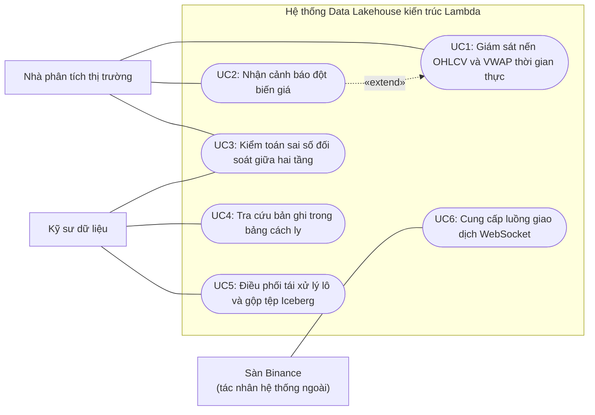

**Hình 3.1: Biểu đồ ca sử dụng tổng quát của hệ thống đối soát dữ liệu thời gian thực**

Hình 3.2 là biểu đồ thành phần, thể hiện đường đi của dữ liệu giữa các container trên mạng `lakehouse-net`. Hai nhánh xử lý cùng đọc topic `crypto_trades_raw` nhưng không gọi trực tiếp lẫn nhau. Điểm tiếp xúc duy nhất của chúng là bảng `lakehouse.system_watermark`.

Sau mỗi lượt chạy, tầng xử lý lô lấy giá trị `window_end` lớn nhất trong các nến vừa tính và gọi `update_watermark()` để chèn thêm một dòng mới cho `layer = 'batch_layer'`, chứ không sửa dòng cũ. Bảng dùng engine `ReplacingMergeTree(updated_at)`, còn `WatermarkReader` ở tầng phục vụ luôn đọc dòng có `updated_at` mới nhất. Từ mốc $W$ đọc được, bộ hợp nhất `AutoCorrectingQueryMerger` phân luồng truy vấn: khoảng thời gian kết thúc trước $W$ được lấy toàn bộ từ `batch_agg`, khoảng bắt đầu từ $W$ trở đi lấy từ `speed_agg`, còn khoảng cắt ngang $W$ được tách đôi ngay tại $W$, sau đó khử trùng theo cặp (`symbol`, `window_start`) và ưu tiên bản ghi đã đối soát. Tầng tốc độ không đọc mốc này. Khi chưa có mốc nào, do ClickHouse mất kết nối hoặc bảng vừa khởi tạo, bộ đọc trả về thời điểm 1970-01-01 và mọi truy vấn rơi về nhánh tốc độ: hệ thống lùi về chế độ chỉ có khung nhìn tốc độ, nhưng không ngừng phục vụ.

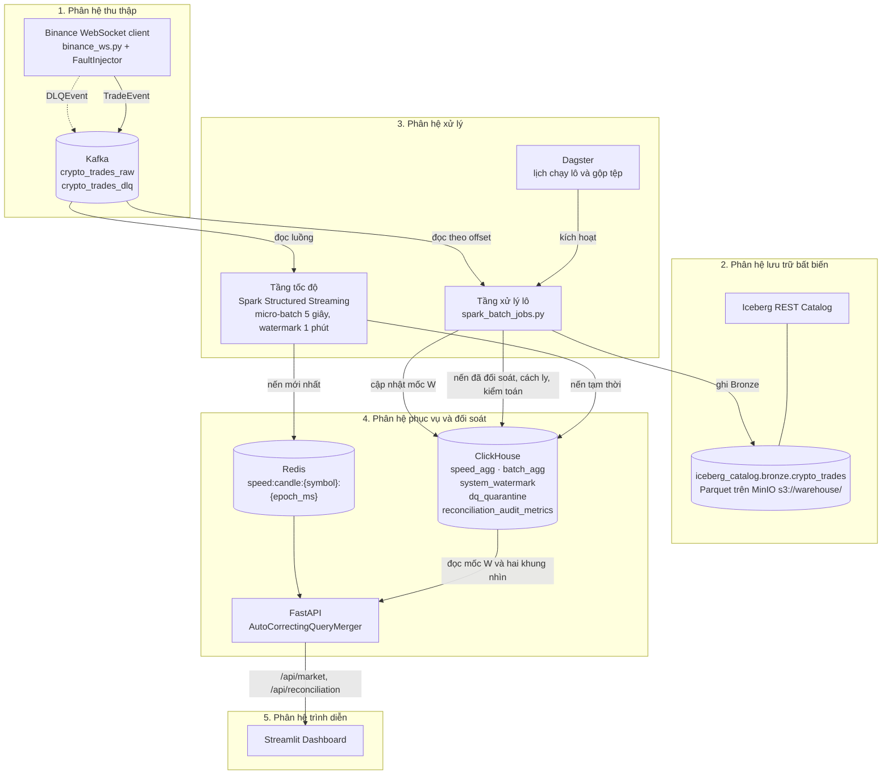

**Hình 3.2: Biểu đồ thành phần kiến trúc tổng thể năm phân hệ**

## 3.2. HIỆN THỰC PHÂN HỆ THU THẬP DỮ LIỆU (INGESTION LAYER) VÀ FAULT INJECTOR

Phân hệ thu thập gồm bốn khối mã trong thư mục `src/ingestion/`: client WebSocket nhận dữ liệu từ sàn, producer ghi dữ liệu vào Kafka, bộ tiêm lỗi phục vụ thực nghiệm và hai cơ chế bù dữ liệu bị mất. Bốn khối này cùng tuân theo một nguyên tắc: tiến trình thu thập phải chạy liên tục, kể cả khi đầu vào sai.

### 3.2.1. Xây dựng Binance WebSocket Live Stream Client bất đồng bộ

Lớp `BinanceWebSocketProducer` trong `src/ingestion/binance_ws.py` là cửa ngõ duy nhất giữa hệ thống và sàn Binance. Khi khởi động, phương thức `fetch_top_symbols()` gọi điểm cuối `/api/v3/ticker/24hr`, giữ lại các cặp kết thúc bằng `USDT`, loại các mã đòn bẩy có chứa `UPUSDT`, `DOWNUSDT`, `BEARUSDT`, `BULLUSDT`, rồi sắp giảm dần theo giá trị giao dịch 24 giờ (`quoteVolume`) để chọn ra `top_n` cặp, mặc định là mười. Nếu lời gọi thất bại vì lỗi mạng hoặc quá thời gian chờ mười giây, client không dừng lại mà chuyển sang danh sách tĩnh trong cấu hình. Sau đó `build_ws_url()` ghép mọi kênh `<symbol>@aggTrade` vào một địa chỉ kết nối duy nhất theo cơ chế luồng kết hợp của Binance. Một kết nối, mười cặp giao dịch.

Tính bất đồng bộ của client không đến từ `asyncio`. Nó dựa trên mô hình hàm gọi lại của thư viện `websocket-client`: vòng lặp `run_forever()` giữ kết nối và gọi `on_message()` mỗi khi có bản tin, còn những việc có thể chậm như gọi API bù dữ liệu được chuyển sang một `ThreadPoolExecutor` hai luồng. Luồng nhận bản tin vì vậy không bao giờ phải chờ một lời gọi mạng thứ hai. Hai tham số `ping_interval=30` và `ping_timeout=10` duy trì nhịp tim của kết nối: quá mười giây không nhận được phản hồi thì kết nối bị coi là đã chết và vòng lặp kết thúc. Phương thức `start_streaming()` bọc toàn bộ quá trình trong một vòng `while True`. Khi phát sinh ngoại lệ, thời gian chờ trước lần kết nối lại tăng theo hàm mũ $T_{\text{wait}} = \min(2^{n}, 60)$ giây, với $n$ là số lần thất bại liên tiếp; $n$ trở về 0 ngay khi `run_forever()` kết thúc bình thường, nên một lần đóng kết nối không kèm ngoại lệ sẽ được nối lại tức thì. Khối `finally` luôn gọi `flush()` để bộ đệm của producer không bị bỏ dở giữa hai phiên.

Triết lý thiết kế của client là tách bạch hai việc: tiếp nhận không chặn và kiểm định ngữ nghĩa. Hàm `on_message()` chỉ kiểm tra cấu trúc ở mức tối thiểu. Bản tin phải giải mã được thành JSON, phần dữ liệu phải là một đối tượng và phải có hai khóa `s`, `p`. Bản tin không qua được bước này được đóng gói thành `DLQEvent` với `source_stream="binance_ws"`, gửi sang topic `crypto_trades_dlq`, rồi hàm trả về để đón bản tin tiếp theo. Bản tin qua được thì đi vào `from_binance_raw()`, nơi mọi trường còn thiếu được gán giá trị canh gác: khối lượng vắng mặt trở thành `0.0`, mã giao dịch vắng mặt trở thành `-1`, thời điểm khớp lệnh vắng mặt được thay bằng `E`, và bằng `0` nếu `E` cũng không có. Mọi ngoại lệ khác bị khối `except` ngoài cùng bắt lại và ghi nhật ký. Vòng lặp vẫn chạy.

Lựa chọn này xuất phát từ sự bất cân xứng giữa hai loại sai lầm. Nếu tiến trình thu thập sập vì một bản tin dị thường, toàn bộ giao dịch phát sinh trong lúc khởi động lại sẽ mất hẳn, vì luồng WebSocket không cho phép đọc lại quá khứ. Ngược lại, một bản ghi có khối lượng `0.0` lọt vào Kafka vẫn còn nằm trong nhật ký và sẽ bị chặn ở tầng sau: bộ lọc của tầng tốc độ loại bản ghi có giá hoặc khối lượng không dương trước khi gom cửa sổ, còn cổng kiểm định của tầng xử lý lô gán cho nó mã lỗi `quantity_non_positive` và chuyển vào bảng `lakehouse.dq_quarantine`. Mất dữ liệu thì không sửa được. Dữ liệu bẩn thì sửa được.

Về thời gian, client không thực hiện bất kỳ phép chuyển múi giờ nào. Trường `T` của Binance là số mili-giây tính từ mốc 1970 theo giờ quốc tế, vốn không phụ thuộc múi giờ, nên được giữ nguyên trong `trade_time`. Việc đổi sang kiểu dấu thời gian chỉ diễn ra ở tầng tốc độ, bằng phép chia `trade_time / 1000` trước khi gán watermark.

### 3.2.2. Xây dựng Kafka Producer nạp dữ liệu phân vùng vào topic `crypto_trades_raw`

Kafka tổ chức mỗi topic thành nhiều phân vùng; mỗi phân vùng là một nhật ký chỉ ghi nối, và thứ tự chỉ được bảo đảm bên trong một phân vùng [6]. Lớp `ResilientKafkaProducer` trong `src/ingestion/kafka_producer.py` khai thác đúng tính chất đó: phương thức `send_trade()` gửi mỗi bản ghi kèm khóa `key=event.symbol`. Bộ phân vùng mặc định của thư viện `kafka-python` băm khóa bằng hàm murmur2 rồi lấy phần dư theo số phân vùng:

$$\text{partition} = \text{murmur2}(\texttt{symbol}) \bmod 3$$

Mọi giao dịch `BTCUSDT` rơi vào cùng một phân vùng và được tầng tốc độ đọc theo đúng thứ tự đã gửi. Điều này không thay thế việc sắp theo thời gian sự kiện đã trình bày ở mục 3.1.2, vì giá mở và giá đóng vẫn được chọn theo `trade_time`. Tác dụng thực sự của khóa phân vùng là giảm số bản ghi đến lệch thứ tự, qua đó giảm số bản ghi bị rơi lại sau watermark. Cái giá là lệch tải. Cặp có thanh khoản lớn nhất dồn toàn bộ lưu lượng vào một phân vùng, đúng hiện tượng điểm nóng khi phân vùng theo khóa mà Kleppmann đã phân tích [5].

Các tham số của producer được khai báo trong phương thức `_connect()` và tổng hợp ở Bảng 3.2.

**Bảng 3.2: Tham số cấu hình Kafka Producer và các topic của phân hệ thu thập**

| Tham số | Giá trị | Vị trí khai báo | Mục đích |
| :---: | :---: | :---: | :---: |
| `acks` | `"all"` | `kafka_producer.py` | Chỉ xác nhận khi mọi bản sao đồng bộ đã ghi |
| `retries` | `3` | `kafka_producer.py` | Tự gửi lại khi gặp lỗi tạm thời |
| `max_in_flight_requests_per_connection` | `1` | `kafka_producer.py` | Gửi lại không làm đảo thứ tự trong phân vùng |
| `compression_type` | `"gzip"` | `kafka_producer.py` | Giảm dung lượng truyền và lưu trữ |
| `linger_ms` / `batch_size` | `10` / `16384` byte | `kafka_producer.py` | Gom bản tin nhỏ thành lô trước khi gửi |
| Kết nối lại (`tenacity`) | Chờ hàm mũ 2–30 giây, tối đa 5 lần | `kafka_producer.py` | Chịu được broker khởi động chậm |
| Khóa phân vùng | `symbol`; với DLQ là `source_stream` | `kafka_producer.py` | Giữ thứ tự theo từng cặp giao dịch |
| `crypto_trades_raw` | 3 phân vùng, 86.400.000 ms (24 giờ) | `topics.yaml`, `docker-compose.yml` | Luồng giao dịch chính |
| `crypto_trades_dlq` | Vận hành: 3 phân vùng, 86.400.000 ms (24 giờ); đặc tả ban đầu: 1 phân vùng, 7 ngày | `topics.yaml`, `docker-compose.yml` | Lưu bản tin hỏng để điều tra |

*Nguồn: src/ingestion/kafka_producer.py, configs/kafka/topics.yaml và docker-compose.yml; giá trị vận hành là giá trị khi broker tự tạo topic theo `KAFKA_NUM_PARTITIONS=3` và `KAFKA_LOG_RETENTION_HOURS=24`.*

Với `acks="all"`, broker giữ bản chính (leader) của phân vùng chỉ trả lời producer sau khi mọi bản sao trong tập bản sao đồng bộ đã ghi xong bản ghi [5]. Ghép với `max_in_flight_requests_per_connection=1`, ba lần gửi lại không thể làm hai lô trong cùng phân vùng đổi chỗ cho nhau. Tuy vậy, cấu hình này cần được đọc đúng trong môi trường thực nghiệm. Cụm Kafka chỉ có một broker với hệ số nhân bản bằng 1, nên tập bản sao đồng bộ chỉ gồm đúng bản chính, và `acks="all"` lúc này không mạnh hơn `acks=1`. Giá trị được chọn để vẫn đúng khi cụm mở rộng lên nhiều broker. Hai tham số `linger_ms=10` và `batch_size=16384` đổi tối đa mười mili-giây độ trễ lấy số lần gửi ít hơn; khoảng chờ này rất nhỏ so với chu kỳ micro-batch năm giây của tầng tốc độ, nên không ảnh hưởng đến cam kết SLA.

Có thêm hai giới hạn cần nêu rõ. Thứ nhất, `send()` của `kafka-python` là bất đồng bộ: `send_trade()` trả về `True` khi bản ghi đã vào bộ đệm, chứ không phải khi broker đã xác nhận. Để lỗi phát sinh sau đó không bị bỏ qua, mỗi lần gửi được gắn một hàm xử lý lỗi (errback): khi broker từ chối bản ghi, hàm này ghi nhật ký và tăng bộ đếm `async_send_failures`, nhưng luồng gọi không bị chặn. Thứ hai, producer không bật chế độ lũy đẳng, nên một lần gửi lại có thể tạo bản ghi trùng. Hệ thống chấp nhận cả hai, vì tầng xử lý lô khử trùng theo cặp (`symbol`, `trade_id`) và có thể đọc lại nhật ký Kafka trong 24 giờ.

Dòng `crypto_trades_dlq` của Bảng 3.2 ghi lại một điều chỉnh giữa thiết kế và triển khai. Đặc tả ban đầu dành cho topic DLQ một phân vùng và thời gian lưu bảy ngày, nhưng broker tự tạo topic theo cấu hình mặc định trong `docker-compose.yml`, tức ba phân vùng và 24 giờ. Tệp `configs/kafka/topics.yaml` được thống nhất về giá trị vận hành này, và từ đó trở thành nguồn duy nhất. Lúc khởi động, `_ensure_topic_exists()` của tầng tốc độ đọc tệp qua `get_kafka_topic_specs()` và tạo mọi topic còn thiếu với đúng số phân vùng, hệ số nhân bản, `retention.ms` và `cleanup.policy`; topic đã tồn tại không bị sửa. Vì mọi bản ghi DLQ dùng chung khóa `binance_ws`, chúng vẫn chỉ nằm trên một phân vùng.

### 3.2.3. Xây dựng Module Fault Injector tiêm lỗi chủ động phục vụ đánh giá

Muốn đo độ chính xác của cổng chất lượng dữ liệu hay sai số đối soát, trước hết phải biết chính xác bản ghi nào sai. Dữ liệu thật từ sàn không cho biết điều đó. Lớp `FaultInjector` trong `src/ingestion/fault_injector.py` tạo ra thông tin này bằng cách chủ động làm hỏng một phần luồng dữ liệu và đánh dấu mỗi bản ghi bị can thiệp bằng `is_injected=True` cùng nhãn `fault_type`. Lớp được gọi trong `on_message()`, ngay sau `from_binance_raw()` và trước `send_trade()`; kịch bản `bench_fault.py` cũng dùng nó để sinh dữ liệu ngoại tuyến.

Phương thức `process_event()` rút đúng một số ngẫu nhiên $u \in [0, 1)$ cho mỗi sự kiện, rồi xét bốn loại lỗi theo thứ tự cố định:

1. **`schema_invalid`:** tạo bản ghi mới cùng `trade_id` nhưng giá bằng $-|P|$ và khối lượng bằng `0.0`. Bản ghi gốc bị thay thế, không được gửi đi. Cổng kiểm định phải bắt được nó qua mã `price_non_positive`.
2. **`late_data`:** lùi `trade_time` một khoảng ngẫu nhiên trong đoạn $[60\,000; 300\,000]$ mili-giây, tương ứng `late_min_seconds = 60` và `late_max_seconds = 300`, còn `ingestion_time` lấy theo đồng hồ hiện tại. Độ trễ nhỏ nhất đã bằng ngưỡng watermark một phút, nên tầng tốc độ sẽ bỏ qua bản ghi; tầng xử lý lô phải xếp nó lại đúng cửa sổ.
3. **`out_of_order`:** bản sao của sự kiện bị giữ trong danh sách `pending_out_of_order` thay vì gửi ngay. Mỗi khi có một sự kiện bình thường đi qua, với xác suất 0,3, phần tử cũ nhất trong danh sách được lấy ra và phát nối theo sau sự kiện mới hơn nó.
4. **`duplicate`:** sự kiện gốc vẫn được gửi, kèm thêm một bản sao giống hệt về `trade_id`, giá và `trade_time`, chỉ khác ở `ingestion_time` được cộng thêm 10–500 mili-giây. Đây là phép thử trực tiếp cho khóa khử trùng (`symbol`, `trade_id`).

Lỗi `late_data` cần được hiểu đúng. Bản ghi gốc bị thay thế, nên bộ tiêm không thêm giao dịch mới mà chỉ dời một giao dịch sang cửa sổ sớm hơn. Với tầng xử lý lô, `trade_time` sau khi lùi chính là thời gian sự kiện của bản ghi, nên nó được tính vào cửa sổ sớm hơn ấy. Sai số mà bài đo ghi nhận là phần khối lượng tầng tốc độ đã bỏ qua ở cửa sổ đó.

Ba loại lỗi đầu kết thúc hàm ngay khi được chọn, nên chúng loại trừ nhau. Vì cả bốn phép so sánh dùng chung một giá trị $u$, các tỷ lệ không thể được so trực tiếp với $u$: loại lỗi xét trước sẽ che mất loại xét sau. Hàm vì vậy dựng các ngưỡng cộng dồn. Gọi $s, l, o, d$ lần lượt là các tham số `schema_invalid_rate`, `late_data_rate`, `out_of_order_rate`, `duplicate_rate`:

$$t_1 = s,\quad t_2 = s + l,\quad t_3 = s + l + o,\quad t_4 = s + l + o + d$$

Loại lỗi thứ $k$ được chọn khi $t_{k-1} \le u < t_k$ (với $t_0 = 0$). Bốn đoạn này rời nhau, nên xác suất thực tế của mỗi loại lỗi bằng đúng tham số cấu hình, miễn là $s + l + o + d \le 1$. Với `fault_rate = 0.20` của `bench_fault.py`, tỷ lệ là 4%, 5%, 4% và 7%. Bộ đệm `out_of_order` cần thêm một bước khi dừng: phương thức `drain_pending()` lấy ra mọi phần tử còn tồn, và client gọi nó rồi phát nốt các phần tử này khi nhận tín hiệu ngắt, để chúng không mất theo tiến trình.

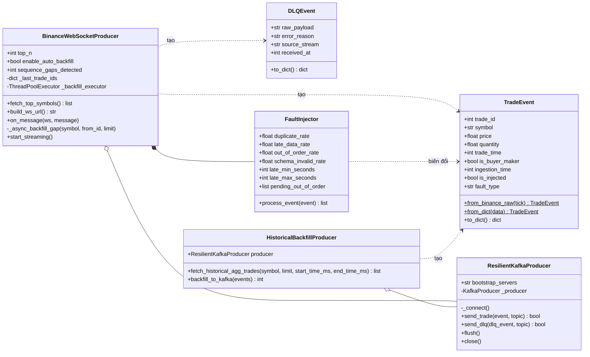

**Hình 3.3: Biểu đồ lớp của phân hệ thu thập dữ liệu**

Hình 3.3 cho thấy `BinanceWebSocketProducer` sở hữu một `FaultInjector`, vì nếu không được truyền vào, client tự tạo một bộ tiêm với mọi tỷ lệ bằng 0, tức là không can thiệp gì. Producer Kafka thì được dùng chung theo quan hệ kết tập. Chỉ có hai lớp tạo ra `TradeEvent` từ dữ liệu bên ngoài, và chỉ luồng trực tiếp mới đi qua bộ tiêm lỗi.

### 3.2.4. Xây dựng Historical Backfill Client khắc phục lỗ hổng chuỗi (Sequence Gap Healing)

Mã giao dịch tổng hợp của Binance tăng đúng một đơn vị sau mỗi giao dịch của cùng một cặp. Tính chất này biến việc phát hiện mất dữ liệu thành một phép so sánh số nguyên. Client lưu mã lớn nhất đã thấy của từng cặp trong từ điển `_last_trade_ids`. Khi bản ghi mới có mã $id$ lớn hơn giá trị kỳ vọng $id_{\text{exp}} = id_{\text{last}} + 1$, độ dài lỗ hổng được tính bằng $\Delta = id - id_{\text{exp}}$; bộ đếm `sequence_gaps_detected` tăng thêm một và nhật ký ghi lại cảnh báo. Sau đó $id_{\text{last}}$ được cập nhật bằng $\max(id_{\text{last}}, id)$, nên một bản ghi cũ đến muộn không thể kéo mốc lùi lại. Phép kiểm tra này chạy trước `FaultInjector`. Lỗi tiêm vào vì thế không bao giờ bị nhầm thành lỗ hổng thật.

Từ điển `_last_trade_ids` chỉ nằm trong bộ nhớ. Khi chỉ mất kết nối WebSocket mà tiến trình vẫn sống, mốc được giữ nguyên và lỗ hổng do đứt kết nối lộ ra ngay ở bản tin đầu tiên sau khi nối lại. Khi tiến trình khởi động lại, mọi chuyện khác hẳn: bản tin đầu tiên của mỗi cặp chỉ dùng để đặt mốc, nên khoảng giao dịch bị mất trong lúc tiến trình dừng không được tầng thu thập phát hiện.

Khi $0 < \Delta \le 500$ và cờ `enable_auto_backfill` đang bật, client gửi tác vụ `_async_backfill_gap(symbol, id_exp, Δ)` vào nhóm luồng nền rồi tiếp tục xử lý bản tin hiện tại. Tác vụ gọi `/api/v3/aggTrades` với tham số `fromId` bằng $id_{\text{exp}}$ và `limit` bằng $\Delta$, thử tối đa ba lần. Nếu sàn trả mã trạng thái 429 hoặc 418, tức là đã vượt hoặc sắp bị chặn vì vượt giới hạn tần suất, tác vụ đọc tiêu đề `Retry-After`; khi thiếu tiêu đề này thì dùng $2^{k}$ giây với $k$ là số thứ tự lần thử, và chờ không quá 30 giây. Khi thành công, mỗi giao dịch trả về được dựng lại thành từ điển theo khóa của bản tin WebSocket, đưa qua `from_binance_raw()` và gửi bằng `send_trade()` với cùng khóa phân vùng. Mọi mã trạng thái khác khiến tác vụ dừng ngay mà không thử lại, kèm một cảnh báo trong nhật ký ghi rõ mã trạng thái và khoảng mã bị bỏ dở.

Thiết kế này có ba hệ quả mà người vận hành cần biết. Bản ghi bù đi thẳng vào Kafka, không qua bộ tiêm lỗi. Chúng đến muộn hơn bản ghi có mã lớn hơn, nên trong phân vùng chúng nằm sau và có `trade_time` cũ hơn; nếu quá một phút, tầng tốc độ bỏ qua và chỉ tầng xử lý lô mới tính được chúng. Còn lỗ hổng dài hơn 500 giao dịch thì chỉ được ghi nhật ký. Ngưỡng 500 giữ cho mỗi lần bù chỉ cần một lời gọi API, đúng với giới hạn `min(limit, 500)` trong mã.

Lỗ hổng lớn hơn thuộc về lớp `HistoricalBackfillProducer` trong `historical_backfill.py`. Phương thức `fetch_historical_agg_trades()` tải tối đa 1.000 giao dịch trong khoảng `start_time_ms` đến `end_time_ms`, còn `backfill_to_kafka()` gửi lần lượt từng bản ghi, gọi `flush()` và trả về số bản ghi đã vào bộ đệm. Khác với `from_binance_raw()`, lớp này đọc khóa một cách nghiêm ngặt (`t["a"]`, `t["p"]`): chỉ một giao dịch thiếu trường là cả lời gọi trả về danh sách rỗng. Bù hàng loạt cho phép chậm, nhưng không chấp nhận dữ liệu thiếu. Lớp được xuất trong gói `src.ingestion` để chạy thủ công; pipeline hiện tại chưa có lịch tự động gọi đến nó.

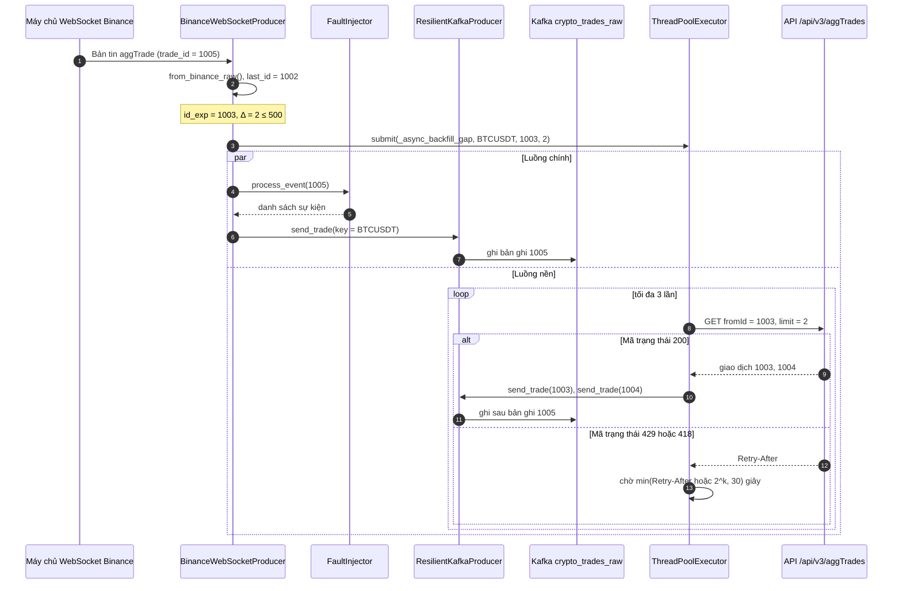

**Hình 3.4: Biểu đồ tuần tự phát hiện lỗ hổng chuỗi và bù dữ liệu tự động**

## 3.3. HIỆN THỰC PHÂN HỆ XỬ LÝ TỐC ĐỘ (SPEED LAYER)

Tầng tốc độ biến luồng giao dịch trong topic `crypto_trades_raw` thành các cây nến một phút tạm thời, ghi vào ClickHouse và Redis sau mỗi chu kỳ năm giây. Toàn bộ mã nằm trong `src/speed_layer/` và chạy trong container `lakehouse-speed-layer` với giới hạn bộ nhớ 2 GB.

### 3.3.1. Thiết kế Spark Structured Streaming Pipeline đọc luồng Kafka

Spark Structured Streaming xử lý luồng dữ liệu như một bảng không có điểm kết thúc, được bổ sung dần qua từng micro-batch, nhờ đó cùng một động cơ tối ưu truy vấn phục vụ được cả xử lý lô lẫn xử lý luồng [8]. Điểm vào của tầng tốc độ là `src/speed_layer/spark_streaming.py`. Hàm `create_spark_session()` dựng phiên Spark ở chế độ cục bộ `local[2]`, tức là hai luồng thực thi trong cùng một tiến trình, không cần cụm Spark riêng. Lớp `SpeedLayerStreamingJob` nhận phiên này, tạo `WindowAggregator` và `ClickHouseSpeedWriter`, rồi lắp ráp truy vấn luồng trong phương thức `run()`.

Trình tự trong `run()` khá ngắn. Trước tiên, `_ensure_topic_exists()` dùng `KafkaAdminClient` tạo topic với ba phân vùng nếu topic chưa có; lỗi ở bước này chỉ được ghi nhật ký. Tiếp đó, hàm `kafka_source_options()` dựng bộ tùy chọn nguồn Kafka và từ chối giá trị `startingOffsets` rỗng. Luồng thô được chuyển cho `parse_kafka_stream()` và `aggregate_tumbling_window()`, rồi đi vào `writeStream` ở chế độ xuất `update` với `foreachBatch` trỏ tới `write_batch_from_spark()`. Mặc định truy vấn được kích hoạt theo chu kỳ xử lý; khi chạy với cờ `--once`, Spark dùng `availableNow=True`, đọc hết phần dữ liệu đang có rồi dừng. Chế độ này dùng cho kiểm thử. Bảng 3.3 tổng hợp các tham số vận hành.

**Bảng 3.3: Cấu hình tham số vận hành Spark Structured Streaming và quản lý trạng thái tại Speed Layer**

| Tham số | Giá trị mặc định trong mã | Giá trị khi chạy trong Docker | Mục đích |
| :---: | :---: | :---: | :---: |
| `master` | `local[2]` | `local[2]` (`SPARK_MASTER_URL`) | Hai luồng thực thi trong một tiến trình |
| `spark.sql.shuffle.partitions` | `4` | `4` | Số phân vùng trạng thái và trộn dữ liệu |
| `spark.default.parallelism` | `4` | `4` | Mức song song mặc định của tác vụ |
| `stateStore.providerClass` | `RocksDBStateStoreProvider` (trừ Windows) | Bật (`USE_ROCKSDB_STATESTORE=true`) | Đưa trạng thái ra khỏi bộ nhớ heap |
| `stateStore.maintenanceInterval` | `60s` | `60s` | Chu kỳ dọn phiên bản trạng thái cũ |
| `stateStore.minDeltasForSnapshot` | `10` | `10` | Số delta trước khi gộp thành snapshot |
| Chu kỳ kích hoạt | `5 seconds` (`SPEED_TRIGGER_INTERVAL`) | `5 seconds` (biến môi trường và `--trigger`) | Nhịp micro-batch |
| `maxOffsetsPerTrigger` | `50000` | `50000` | Giới hạn số bản tin mỗi micro-batch |
| `startingOffsets` | `latest` | `latest` | Điểm đọc khi chưa có checkpoint |
| `failOnDataLoss` | `true` | `true` | Dừng khi offset đã bị xóa |
| Thư mục checkpoint | `.checkpoints/speed_layer` (thư mục chạy) | `/app/checkpoints/speed_layer` (volume `speed-checkpoints`) | Lưu offset, nhật ký commit và trạng thái |
| Watermark / cửa sổ | `1 minute` / `1 minute` | `1 minute` / `1 minute` | Giới hạn độ trễ chấp nhận và độ dài nến |

*Nguồn: src/speed_layer/spark_streaming.py, src/speed_layer/window_aggregator.py, docker-compose.yml và Dockerfile.speed; tiền tố `spark.sql.streaming.` được lược bỏ ở ba dòng `stateStore`.*

Ba tham số trạng thái trong bảng đều phục vụ mục tiêu chạy liên tục 24/7. Mặc định, Spark giữ trạng thái của các cửa sổ đang mở và tập khóa khử trùng trong bộ nhớ heap của máy ảo Java (Java Virtual Machine – JVM); trạng thái càng lớn thì bộ thu gom rác càng phải làm việc nhiều. `RocksDBStateStoreProvider` chuyển phần trạng thái này sang một kho khóa–giá trị nhúng trên đĩa, được sao lưu theo từng phiên bản vào thư mục checkpoint. Trên Windows, mã chủ động bỏ qua cấu hình này. Tham số `spark.sql.shuffle.partitions = 4` cũng cần được chọn ngay từ đầu, vì với truy vấn có trạng thái, số phân vùng này được ghi cố định vào checkpoint và không thể đổi nếu không xóa checkpoint. Nhà cung cấp kho trạng thái cũng bị checkpoint khóa lại theo cùng cách. Khi truy vấn khởi động lại trên một checkpoint cũ được tạo với `HDFSBackedStateStoreProvider`, Spark ghi cảnh báo và tiếp tục dùng nhà cung cấp cũ, bất kể cấu hình RocksDB. Muốn chuyển sang RocksDB, phải bắt đầu với checkpoint mới.

Checkpoint là nơi giữ ba thứ: offset đã đọc của từng phân vùng Kafka, nhật ký các micro-batch đã hoàn tất và ảnh chụp trạng thái. Khi container khởi động lại, Spark đọc checkpoint và tiếp tục từ micro-batch chưa được commit; giá trị `startingOffsets = latest` chỉ có tác dụng ở lần chạy đầu tiên, khi checkpoint còn trống. Ngược lại, `failOnDataLoss = true` buộc truy vấn dừng hẳn nếu offset ghi trong checkpoint đã bị chính sách lưu giữ 24 giờ của Kafka xóa mất. Hệ thống chọn dừng thay vì lặng lẽ bỏ qua khoảng dữ liệu bị mất. Người vận hành phải chủ động chọn cách phục hồi, chẳng hạn chạy lại với cờ `--allow-data-loss`.

Giới hạn `maxOffsetsPerTrigger = 50000` là chốt chặn áp lực ngược. Khi thị trường biến động mạnh và lưu lượng tăng đột ngột, mỗi micro-batch chỉ đọc tối đa năm mươi nghìn bản tin, phần còn lại chờ ở các chu kỳ sau. Độ trễ tăng lên tạm thời. Bộ nhớ thì không bị đẩy tới mức tràn bộ nhớ (Out-Of-Memory – OOM).

### 3.3.2. Hiện thực hóa Tumbling Window, Watermark và tính toán chỉ số trực tiếp

Lớp `WindowAggregator` trong `window_aggregator.py` đảm nhận toàn bộ phần biến đổi. Phương thức tĩnh `parse_kafka_stream()` ép cột `value` của bản tin Kafka sang chuỗi, giải mã bằng `from_json` theo lược đồ của `get_trade_event_spark_schema()` trong `trade_schema.py`, rồi thêm cột `event_time` bằng phép chia `trade_time / 1000.0` và ép sang kiểu dấu thời gian. Lược đồ được tách thành tệp riêng và chỉ nhập `pyspark` khi hàm được gọi lần đầu, để kiểm thử đơn vị vẫn chạy được mà không cần khởi động JVM.

Một chi tiết của lược đồ ảnh hưởng trực tiếp đến kết quả: `trade_id` được khai báo là `LongType`, khớp với kiểu số nguyên của hợp đồng dữ liệu ở Bảng 3.1. Nếu khai báo là chuỗi, bộ giải mã JSON của Spark vẫn đọc được giá trị, nhưng trong cấu trúc `struct(trade_time, trade_id, price)` dùng để chọn giá mở và giá đóng, hai mã giao dịch trùng mili-giây sẽ bị so theo thứ tự từ điển, và `"999"` sẽ đứng sau `"1000"`. Với kiểu số nguyên, phép so sánh diễn ra theo giá trị số. Tầng xử lý lô cũng sắp `trade_id` theo số nguyên. Hai tầng vì vậy luôn chọn cùng một giao dịch làm giá mở và giá đóng, kể cả trong trường hợp hiếm khi hai giao dịch trùng mili-giây.

Phương thức `aggregate_tumbling_window()` xử lý theo bốn bước. Bước đầu là bộ lọc chất lượng trên luồng, loại bản ghi có `trade_id` âm hoặc rỗng, `symbol` rỗng, giá hoặc khối lượng không dương, `trade_time` không dương. Đây là nơi các bản ghi lỗi `schema_invalid` từ mục 3.2.3 bị chặn lần đầu. Bước thứ hai gắn watermark `withWatermark("event_time", "1 minute")`. Theo mô hình Dataflow [1], watermark là phát biểu của hệ thống rằng dữ liệu có thời gian sự kiện cũ hơn mốc này sẽ không còn đến nữa; trong Spark, mốc được tính bằng thời gian sự kiện lớn nhất đã thấy trừ đi một phút. Một cửa sổ có thời điểm kết thúc nhỏ hơn mốc watermark sẽ bị đóng, trạng thái của nó được giải phóng, và bản ghi đến sau cho cửa sổ ấy bị bỏ qua.

Bước thứ ba gọi `dropDuplicatesWithinWatermark(["symbol", "trade_id"])`, phương thức có từ Spark 3.5. Khóa khử trùng chỉ được giữ trong phạm vi watermark, nên bộ nhớ dành cho nó không tăng vô hạn. Mã có nhánh dự phòng `dropDuplicates()` cho phiên bản cũ hơn, nhưng nhánh này giữ khóa vô thời hạn, vì Spark chỉ dọn trạng thái khử trùng khi cột thời gian sự kiện nằm trong khóa. Ảnh Docker dùng Spark 3.5.9, nên nhánh dự phòng không được kích hoạt. Bước cuối cùng nhóm theo `window(event_time, "1 minute")` và `symbol`, áp dụng các biểu thức của `MetricsCalculator.get_spark_aggregation_exprs()` đã định nghĩa ở mục 3.1.2, rồi làm tròn giá và VWAP đến bốn chữ số, khối lượng đến sáu chữ số.

Chế độ xuất `update` quyết định bản chất của dữ liệu tầng tốc độ. Ở mỗi micro-batch, Spark chỉ xuất những cửa sổ có thay đổi trong lượt đó, dưới dạng giá trị tích lũy hiện tại của cả cửa sổ. Một cây nến một phút vì vậy được ghi ra nhiều lần, mỗi micro-batch có giao dịch mới là một lần, và lần sau đầy đủ hơn lần trước. Đó là lý do bảng `speed_agg` phải giữ được bản ghi mới nhất cho mỗi khóa (`symbol`, `window_start`). Nến chưa đóng không phải là lỗi. Nó là trạng thái tạm thời được công bố sớm, đúng tinh thần đánh đổi giữa độ trễ và độ đầy đủ mà mô hình Dataflow mô tả [1].

### 3.3.3. Module phát hiện đột biến giá và biên độ dao động cực đoan (Price & Volatility Spike Detector)

Lớp `SpikeDetector` trong `spike_detector.py` cung cấp hai cách tính cùng một quy tắc: `get_spark_spike_expr()` trả về biểu thức cột cho tầng tốc độ, còn `is_spike_python()` tính trên từng từ điển cho tầng xử lý lô. `WindowAggregator` khởi tạo bộ phát hiện với hai tham số `spike_threshold = 0.02` và `volatility_threshold = 0.03`, ánh xạ sang `price_change_threshold` và `range_threshold`. Định nghĩa toán học của hai tiêu chí đã được trình bày ở mục 3.1.2; mục này phân tích cách quy tắc hoạt động khi chạy trên luồng.

Biểu thức được gắn bằng `withColumn("is_spike", ...)` sau bước gom nhóm, tức là được tính trên mỗi dòng tổng hợp chứ không phải trên từng giao dịch. Chi phí vì vậy gần như bằng không: mỗi cặp giao dịch chỉ có một hoặc hai cửa sổ thay đổi trong mỗi micro-batch. Biểu thức được viết hoàn toàn bằng hàm cột của Spark, nên được động cơ tối ưu Catalyst biên dịch cùng phần còn lại của truy vấn [8], không phải chuyển dữ liệu sang tiến trình Python như một hàm do người dùng tự định nghĩa. Phép chia cho `open_price` và `low_price` cũng không cần chốt an toàn: bộ lọc ở bước đầu đã bảo đảm mọi giá trong cửa sổ đều dương.

Điểm đáng phân tích nằm ở việc cờ được tính lại trên nến chưa đóng. Với chế độ `update`, mỗi lần một cửa sổ thay đổi, `is_spike` được tính lại từ giá trị tích lũy mới. Hai tiêu chí hành xử khác nhau trong quá trình này. Giá cao nhất chỉ có thể tăng và giá thấp nhất chỉ có thể giảm khi có thêm giao dịch, nên $\Delta P_{\text{range}}$ không bao giờ giảm trong suốt vòng đời của một cửa sổ: một khi đã vượt 3%, cờ sẽ giữ giá trị 1 cho đến khi nến đóng. Tiêu chí $\Delta P_{\text{step}}$ thì không có tính đơn điệu đó. Giá đóng cửa thay đổi theo từng giao dịch mới, và giá mở cửa cũng có thể đổi khi một giao dịch có `trade_time` sớm hơn đến muộn nhưng vẫn trong watermark. Một cây nến có thể được gắn cờ ở giây thứ hai mươi rồi mất cờ ở giây thứ năm mươi. Người dùng chỉ thấy được giá trị cuối, vì ClickHouse giữ bản ghi mới nhất.

Hai tiêu chí tương ứng đúng với hai thành phần trong tên mô-đun: đột biến giá là $\Delta P_{\text{step}}$, còn biên độ dao động cực đoan là $\Delta P_{\text{range}}$. Mô-đun không có tiêu chí nào cho khối lượng. Cảnh báo dựa trên khối lượng của hệ thống nằm ở nơi khác: `src/utils/alerting.py` phát cảnh báo khi độ lệch khối lượng giữa khung nhìn tốc độ và khung nhìn lô vượt `ALERT_DRIFT_THRESHOLD_PCT = 5.0`, và hàm này được tầng phục vụ gọi khi lập báo cáo đối soát. Đó là phép đo chất lượng đối soát, không phải tín hiệu thị trường.

Cờ `is_spike` có quy tắc cảnh báo riêng trong `alerting.py`. Khi `is_spike == 1`, phương thức `AlertManager.check_price_spike()` tính lại hai biên độ theo phần trăm và phát cảnh báo loại `PRICE_SPIKE`. Mức độ là `CRITICAL` nếu biên độ đóng–mở từ 5% hoặc biên độ đỉnh–đáy từ 6% trở lên, ngược lại là `WARNING`. Phương thức được `merge_query()` của tầng phục vụ gọi cho mọi nến trả về. Giao diện Streamlit truy vấn lặp lại cùng một khoảng thời gian, nên mỗi cặp (`symbol`, `window_start`) chỉ phát cảnh báo một lần. Cảnh báo được lưu trong lịch sử của `AlertManager`, trả qua API `/api/system/alerts` và gửi tới webhook nếu biến `ALERT_WEBHOOK_URL` được cấu hình. Song song đó, thẻ đột biến trên Streamlit lọc nến theo `is_spike == 1` và hiển thị cả hai biên độ.

Vì cả hai tầng dùng chung lớp `SpikeDetector` với cùng hai ngưỡng, cờ trên khung nhìn lô là phán quyết cuối cùng cho mỗi cây nến. Khi tầng phục vụ thay thế nến tạm thời bằng nến đã đối soát, cờ đột biến cũng được thay theo. Không cần thêm bước đối soát riêng cho nó.

### 3.3.4. Ghi dữ liệu vi mô vào ClickHouse (speed_agg) và đồng bộ Redis Hot Cache

Ở mỗi micro-batch, Spark gọi `write_batch_from_spark(batch_df, batch_id)` của lớp `ClickHouseSpeedWriter`. Hàm chỉ thực thi một hành động Spark duy nhất là `batch_df.collect()`, kéo toàn bộ kết quả về tiến trình điều khiển, thay vì gọi thêm `count()` vốn sẽ chạy lại cả đồ thị tính toán. Lựa chọn này an toàn vì dữ liệu kéo về là các dòng nến đã tổng hợp, mỗi dòng tương ứng một cặp giao dịch và một cửa sổ, chứ không phải giao dịch thô. Nếu micro-batch rỗng, hàm trả về ngay.

Hàm `write_records()` ghi theo thứ tự tuần tự, không song song. ClickHouse được ghi trước: mỗi dòng được chuyển thành danh sách giá trị theo đúng thứ tự cột của bảng `lakehouse.speed_agg`, với `created_at` được gán tường minh bằng thời điểm hiện tại theo giờ quốc tế, rồi gửi bằng một lệnh `client.insert()`. Bảng dùng engine `ReplacingMergeTree(created_at)` với khóa sắp xếp (`symbol`, `window_start`). Khi các phần dữ liệu được gộp ở nền, ClickHouse giữ lại dòng có `created_at` lớn nhất cho mỗi khóa [4]. Việc gộp không diễn ra ngay, nên tầng phục vụ đọc bảng với từ khóa `FINAL` để luôn thấy phiên bản mới nhất của mỗi cây nến. Cơ chế này giải quyết cùng lúc hai nguồn trùng lặp: các phiên bản nối tiếp của một nến chưa đóng do chế độ `update` sinh ra, và việc ghi lại một micro-batch khi Spark chạy lại sau sự cố.

Chỉ khi ClickHouse ghi xong, `RedisSpeedWriter.write_records()` mới được gọi. Mỗi nến được chuẩn hóa thành JSON, kèm `"status": "provisional"` và dấu thời gian `cached_at`, rồi ghi vào khóa `speed:candle:{symbol}:{epoch_ms}` theo thời điểm bắt đầu cửa sổ. Khóa thứ hai, `speed:candle:{symbol}:latest`, phục vụ API `/api/speed/latest`, nên được xử lý riêng. Một micro-batch ở chế độ `update` có thể chứa cả cửa sổ cũ vừa được bổ sung giao dịch trễ, nên `write_records()` giữ một từ điển ghi lại nến có `window_start` lớn nhất cho từng `symbol`, và chỉ ghi khóa `latest` một lần cho mỗi cặp sau khi duyệt hết lô. Tất cả lệnh ghi được gửi trong cùng một pipeline của redis-py.

Thời gian tồn tại (Time-To-Live – TTL) và tiền tố khóa được `RedisConfig` trong `src/utils/config.py` đọc theo thứ tự ưu tiên: biến môi trường trước, rồi đến tệp `configs/redis/redis.yaml`, cuối cùng là giá trị mặc định. Thư mục `configs/` được gắn chỉ đọc vào container của tầng tốc độ và tầng phục vụ, nên API `/api/speed/latest` dùng cùng tiền tố với bên ghi. Khi chạy trong Docker, TTL thực tế là `REDIS_TTL_SECONDS = 3600`, trùng với `ttl_seconds` trong tệp YAML. Redis chạy với `--maxmemory 256mb`, chính sách `allkeys-lru` và không lưu xuống đĩa, nên nó đúng nghĩa là bộ đệm có thể mất bất cứ lúc nào.

Hai đích ghi có ngữ nghĩa lỗi khác nhau. Lỗi ở ClickHouse không bị bắt trong `write_batch_from_spark()`, nên micro-batch thất bại và truy vấn luồng dừng lại. Container khởi động lại theo chính sách `unless-stopped`, Spark đọc checkpoint và chạy lại đúng micro-batch chưa commit. Cách phối hợp này cho ngữ nghĩa ghi ít nhất một lần: `foreachBatch` có thể chạy lại cùng một `batch_id`, và tính lũy đẳng được bảo đảm ở phía ClickHouse chứ không phải phía Spark. Ngược lại, mọi lỗi Redis đều bị bắt và chỉ ghi cảnh báo. Khi kết nối hoặc lệnh ghi pipeline thất bại, `RedisSpeedWriter` đặt cờ `_available = False`, lưu thời điểm lỗi và hủy client hiện tại. Trong 30 giây kế tiếp, theo tham số `reconnect_cooldown_seconds = 30.0`, mọi micro-batch bỏ qua Redis. Hết khoảng chờ, lần gọi `get_client()` kế tiếp tự thử kết nối lại. Bộ đệm tự hồi phục mà không cần khởi động lại tiến trình, và một Redis đang sập cũng không bị dội yêu cầu kết nối sau mỗi năm giây. ClickHouse là nguồn sự thật của tầng tốc độ. Redis thì không.


**Hình 3.5: Biểu đồ hoạt động luồng xử lý vi lô và cơ chế ghi kép tại Speed Layer (UML Activity Diagram)**

## 3.4. HIỆN THỰC PHÂN HỆ LƯU TRỮ BẤT BIẾN VÀ XỬ LÝ LÔ (BATCH LAYER)

Tầng xử lý lô tạo ra khung nhìn đã đối soát, tức phiên bản nến mà tầng phục vụ coi là chuẩn cho mọi cửa sổ nằm dưới mốc watermark. Mã nguồn nằm trong `src/batch_layer/` và `src/data_quality/`, chạy trong container `lakehouse-batch-pipeline` dựng từ `Dockerfile.batch` với giới hạn bộ nhớ 3 GB. Khác với tầng tốc độ, container này không chạy thường trực mà thoát sau mỗi lượt xử lý.

### 3.4.1. Tầng Bronze: Ghi dữ liệu giao dịch bất biến vào bảng Apache Iceberg trên MinIO

Kiến trúc Lakehouse đặt dữ liệu trên kho lưu trữ đối tượng giá rẻ nhưng bổ sung một tầng siêu dữ liệu, nhờ đó các tệp Parquet rời rạc được đọc ghi như một bảng có tính nguyên tử, nhất quán, cô lập và bền vững (Atomicity, Consistency, Isolation, Durability – ACID) [3]. Với Apache Iceberg, mỗi trạng thái của bảng là một snapshot do một tệp siêu dữ liệu mô tả, và việc cam kết một lần ghi chỉ là thao tác hoán đổi nguyên tử con trỏ tới tệp siêu dữ liệu mới trong catalog [2]. Trong hệ thống, catalog là dịch vụ REST tại `http://iceberg-rest:8181`, còn tệp dữ liệu nằm trong bucket `s3://warehouse/` của MinIO.

Hàm `get_spark_session()` trong `src/batch_layer/iceberg_utils.py` dựng phiên Spark [8] ở chế độ `local[2]`, tải các gói `iceberg-spark-runtime-3.5_2.12:1.5.2`, `iceberg-aws-bundle:1.5.2` và `hadoop-aws:3.3.4`. Phần mở rộng `IcebergSparkSessionExtensions` được bật để Spark hiểu cú pháp `CALL` của các thủ tục bảo trì ở mục 3.4.5. Catalog `iceberg_catalog` dùng `S3FileIO` với chế độ địa chỉ theo đường dẫn, vì MinIO định danh bucket bằng đường dẫn thay vì tên miền con. Mã còn tắt sinh mã toàn tầng (`spark.sql.codegen.wholeStage = false`) và bộ đọc Parquet vector hóa; chú thích trong mã giải thích rằng JVM trên Docker Desktop có thể sập khi quét bảng Iceberg bằng mã sinh tự động. Thông lượng bị đánh đổi lấy sự ổn định.

Bảng được tạo bằng hằng `BRONZE_CREATE_DDL`, gồm mười hai cột: chín trường của `TradeEvent` cộng thêm `trade_time_ts`, `batch_run_id` và `bronze_written_at`. Mệnh đề `PARTITIONED BY (days(trade_time_ts))` dùng cơ chế phân vùng ẩn của Iceberg: truy vấn chỉ cần lọc trên `trade_time_ts`, Iceberg tự loại bỏ các phân vùng ngày không liên quan mà người đọc không phải biết cấu trúc thư mục [2]. Các thuộc tính bảng gồm định dạng Parquet nén Snappy, `write.target-file-size-bytes = 134217728` (128 MB), `write.distribution-mode = hash`, `history.expire.max-snapshot-age-ms = 604800000` (bảy ngày), `write.metadata.metrics.default = truncate(16)` và `format-version = 2`.

Tệp `configs/iceberg/tables.yaml` mô tả cùng catalog, cùng địa chỉ và cùng kho `s3://warehouse/`, và được đồng bộ với câu lệnh tạo bảng: phân vùng khai báo là `days` trên cột `trade_time_ts`, khối `properties` liệt kê đúng bảy thuộc tính nêu trên. Phép biến đổi theo ngày của Iceberg chỉ áp dụng cho kiểu ngày hoặc dấu thời gian, còn `trade_time` là số nguyên mili-giây, nên mã phải sinh thêm cột `trade_time_ts`. `Dockerfile.batch` sao chép thư mục `configs/` vào ảnh để container có đủ tệp cấu hình. Tuy vậy, không có tệp Python nào nạp tệp YAML này; nguồn được thực thi vẫn là `BRONZE_CREATE_DDL` trong `iceberg_utils.py`, còn tệp YAML đóng vai trò tài liệu cấu hình khớp với mã.

Phương thức `write_to_bronze()` của lớp `IcebergTableManager` kiểm tra bảng bằng `DESCRIBE TABLE` và tạo bảng nếu chưa có. Hàm `_enrich_for_bronze()` tính `trade_time_ts` bằng phép chia `trade_time / 1000` rồi ép sang dấu thời gian, gắn `batch_run_id` và `bronze_written_at`, sau đó sắp cột theo đúng `BRONZE_SCHEMA`. Dữ liệu được nối vào bảng bằng `writeTo(...).append()`, rồi mã snapshot mới được đọc từ bảng siêu dữ liệu `.snapshots`. Mô-đun không có thao tác ghi đè hay xóa nào. Mỗi lần ghi sinh một snapshot mới, và `read_bronze(snapshot_id=...)` đọc lại đúng trạng thái của một snapshot cũ. Tính bất biến của tầng Bronze nằm ở đây.

Tầng Bronze nhận đúng dữ liệu thô. Trong `run_batch_pipeline()` của `spark_batch_jobs.py`, hàm `write_bronze_to_iceberg()` được gọi với `raw_records` trước khi cổng kiểm soát chất lượng ở mục 3.4.2 chạy, giống hệt tài sản `bronze_crypto_trades` của Dagster; bản ghi sai và bản ghi trùng vì vậy vẫn được lưu nguyên trong Bronze, còn việc tách bản ghi bị loại sang ClickHouse diễn ra ở bước sau. Trước khi khởi động Spark, hàm `check_iceberg_services_reachable()` gọi `/minio/health/live` và `/v1/config` với thời gian chờ năm giây. Lệnh mặc định của container là `spark_batch_jobs.py --write-iceberg --iceberg-strict`, nên khi một trong hai dịch vụ không phản hồi, lượt chạy dừng với lỗi rõ ràng. Biến `BATCH_WRITE_ICEBERG=true` trong `Dockerfile.batch` được cả tài sản Dagster lẫn giao diện dòng lệnh đọc: giá trị `true` hoặc `1` đặt mặc định cho cờ `--write-iceberg`, nên việc ghi Bronze không còn phụ thuộc vào việc lệnh khởi động có ghi cờ hay không.

### 3.4.2. Tầng Silver: Làm sạch, khử trùng lặp và cổng kiểm soát chất lượng dữ liệu

Tầng Silver trong mã không phải một bảng vật lý. Phương thức `create_all_namespaces()` có tạo không gian tên `silver` và `gold` trong catalog Iceberg, nhưng không có câu lệnh nào tạo bảng trong đó. Dữ liệu Silver thực chất là danh sách từ điển do hàm `clean_and_deduplicate()` trong `src/data_quality/dq_checks.py` trả về. Hàm viết bằng Python thuần, nên cùng một quy tắc được dùng lại ở giao diện dòng lệnh, ở tài sản `silver_cleaned_trades` của Dagster và trong kiểm thử đơn vị mà không cần JVM. Mô hình dbt cùng tên chỉ là tài liệu tham chiếu (mục 3.5).

Đầu vào có hai nguồn. Ở chế độ tệp, `load_default_records()` đọc thư mục đầu tiên có dữ liệu trong `datasets/mock/aggtrades`, `datasets/raw/aggtrades` và `datasets/sample`. Ở chế độ Kafka, `read_kafka_records()` đọc tiếp từ offset lưu trong `results/logs/batch_kafka_offsets.json`; không có bản ghi mới thì lượt chạy không làm gì.

Mỗi bản ghi đi qua hai bước. Hàm `normalize_trade_record()` kiểm tra năm trường bắt buộc `trade_id`, `symbol`, `price`, `quantity`, `trade_time`; trường vắng mặt, rỗng hoặc bằng `None` làm hàm ném `ValueError` với thông điệp `missing required fields: ...`. Bước ép kiểu cũng ném ngoại lệ khi gặp giá trị như `"abc"` ở cột giá. Cả hai loại ngoại lệ đều bị `clean_and_deduplicate()` bắt lại, và chính thông điệp của ngoại lệ trở thành lý do loại bỏ. Hai cột logic được đọc qua `_to_bool()`, vì trong Python `bool("False")` cho kết quả `True` và tệp CSV lưu giá trị logic dưới dạng chuỗi.

Bước thứ hai là `validate_trade_record()`, kiểm tra lần lượt bảy luật và dừng ở luật đầu tiên bị vi phạm: `trade_id` âm, `symbol` rỗng, giá không hữu hạn, khối lượng không hữu hạn, giá không dương, khối lượng không dương, `trade_time` không dương. Luật hữu hạn phải đứng trước luật dấu. Mọi phép so sánh với `NaN` đều trả về sai, nên `NaN <= 0` không bắt được giá trị này; trong khi đó `json.loads` của Python vẫn chấp nhận `NaN` và `Infinity` từ bản tin Kafka. Mỗi bản ghi bị loại chỉ mang đúng một mã lỗi. Thống kê theo mã lỗi vì vậy phụ thuộc thứ tự luật: một bản ghi vừa có `trade_id` âm vừa có giá âm chỉ được tính là `trade_id_negative`.

Khử trùng lặp dùng khóa (`symbol`, `trade_id`) và một từ điển. Khi gặp lại khóa đã có, bộ đếm `duplicate_count` tăng một, và bản ghi mới chỉ thay bản ghi cũ nếu `ingestion_time` lớn hơn hẳn; nếu bằng nhau, bản đến trước được giữ. Kết quả cuối được sắp theo (`symbol`, `trade_time`, `trade_id`). Khác với `dropDuplicatesWithinWatermark()` ở tầng tốc độ vốn chỉ nhớ khóa trong phạm vi watermark (mục 3.3.2), phép khử trùng ở đây xét toàn bộ tập đầu vào của lượt chạy. Kết quả là tất định. Bản trùng không bị coi là lỗi, không vào bảng cách ly, mà chỉ được đếm.

Hàm trả về thêm đối tượng `QualityReport`, một lớp dữ liệu bất biến gồm `total_records`, `valid_records`, `rejected_records`, `duplicates_removed`, cùng thuộc tính `pass_rate` tính bằng tỷ lệ phần trăm bản ghi hợp lệ trên tổng số, làm tròn hai chữ số. Tổng số bằng hợp lệ cộng bị loại cộng trùng lặp, nên tỷ lệ đạt luôn dưới một trăm phần trăm khi đầu vào có bản trùng, kể cả khi không bản ghi nào sai.

Phạm vi khử trùng của `clean_and_deduplicate()` chỉ là một lượt chạy, trong khi ở chế độ Kafka hai lượt liên tiếp có thể nhận cùng một giao dịch. Lớp `SilverTradeStore` trong `src/batch_layer/silver_store.py` mở rộng cùng quy tắc ra nhiều lượt: bản ghi sạch được lưu thêm vào các tệp JSON theo dòng, phân vùng theo cặp giao dịch, ngày và giờ, tại `datasets/processed/silver_store`. Bản ghi trùng khóa với dữ liệu đã lưu được đếm riêng vào `cross_run_duplicates`. Vai trò của kho này đối với tầng Gold được phân tích ở mục 3.4.4.

### 3.4.3. Module Quarantine: Phân loại và cách ly dữ liệu sai hỏng

Mẫu bảng cách ly xử lý bản ghi sai theo nguyên tắc không xóa và không dừng: đường ống tiếp tục với phần dữ liệu tốt, còn phần dữ liệu xấu được giữ lại cùng lý do để kiểm toán. Trên đường chạy thực tế, `run_batch_pipeline()` chuyển danh sách bị loại cho `ClickHouseBatchSync.insert_quarantine_records()`. Phương thức chuyển từng trường sang chuỗi, lấy `dq_error` làm mã lỗi (mặc định `unknown`), tuần tự hóa toàn bộ bản ghi gốc vào cột `raw_record` bằng `json.dumps(rec, default=str)`, gắn `quarantined_at` theo giờ quốc tế rồi ghi bằng một lệnh `insert` duy nhất cho mỗi lượt. Mọi cột dữ liệu đều có kiểu `String`, nên một giá viết sai như `"abc"` vẫn được lưu nguyên dạng. Bảng 3.4 liệt kê các mã lỗi mà mã nguồn thực sự sinh ra.

**Bảng 3.4: Danh mục mã lỗi kiểm soát chất lượng dữ liệu tại tầng xử lý lô và bảng cách ly `lakehouse.dq_quarantine`**

| Giá trị `dq_error` | Điều kiện phát sinh trong mã | Hàm phát hiện | Lưu vào `dq_quarantine` |
| :---: | :---: | :---: | :---: |
| `missing required fields: <danh sách>` | Thiếu, rỗng hoặc `None` ở một trong năm trường bắt buộc | `normalize_trade_record()` | Có |
| Thông điệp ngoại lệ ép kiểu | `int()` hoặc `float()` không chuyển đổi được giá trị | `normalize_trade_record()` | Có |
| `trade_id_negative` | `trade_id < 0` (gồm giá trị canh gác `-1`) | `validate_trade_record()` | Có |
| `symbol_empty` | `symbol` là chuỗi rỗng | `validate_trade_record()` | Có |
| `price_not_finite` | `price` là `NaN` hoặc vô cực | `validate_trade_record()` | Có |
| `quantity_not_finite` | `quantity` là `NaN` hoặc vô cực | `validate_trade_record()` | Có |
| `price_non_positive` | `price <= 0` | `validate_trade_record()` | Có |
| `quantity_non_positive` | `quantity <= 0` | `validate_trade_record()` | Có |
| `trade_time_non_positive` | `trade_time <= 0` | `validate_trade_record()` | Có |
| Không có mã | Trùng khóa (`symbol`, `trade_id`) | `clean_and_deduplicate()` | Không, chỉ cộng vào `duplicates_removed` |

*Nguồn: src/data_quality/dq_checks.py và src/batch_layer/clickhouse_sync.py; các luật được kiểm tra theo đúng thứ tự từ trên xuống, mỗi bản ghi nhận mã của luật đầu tiên bị vi phạm.*

Bảng không có mã nào cho dữ liệu đến trễ, và đó là chủ đích. Tầng xử lý lô tồn tại chính là để thu nhận sự kiện trễ mà tầng tốc độ đã bỏ qua [7], nên việc cách ly chúng sẽ đi ngược thiết kế. Bảng `lakehouse.dq_quarantine` dùng engine `MergeTree` thường, phân vùng theo tháng của `quarantined_at` và sắp theo (`batch_run_id`, `quarantined_at`). Do không có cơ chế thay thế, chạy lại cùng một tập dữ liệu sẽ sinh thêm các dòng mới dưới mã lượt chạy khác; mỗi lượt là một sự kiện kiểm toán riêng. Câu lệnh tạo bảng được khai báo ở hai nơi với định nghĩa trùng khớp: `configs/clickhouse/init.sql` tạo bảng ngay khi ClickHouse khởi tạo, còn `initialize_tables()` tạo lại nếu bảng chưa tồn tại ở lần ghi đầu tiên.

Tệp `src/data_quality/quarantine.py` định nghĩa lớp `QuarantineManager` với cùng hợp đồng bảng. Phương thức tĩnh `wrap_record()` đóng gói một bản ghi thành lớp dữ liệu bất biến `QuarantineRecord`; `format_for_clickhouse()` và `save_to_clickhouse()` chuẩn bị và ghi các dòng; `save_to_json()` xuất ra tệp để kiểm toán ngoại tuyến; `get_error_summary()` đếm số bản ghi theo mã lỗi và theo cặp giao dịch. Tuy vậy, cả `run_batch_pipeline()` lẫn các tài sản Dagster đều không gọi lớp này. Nó được dùng trong kiểm thử đơn vị và phân tích ngoại tuyến.

Tệp `dq_metrics.py` cung cấp `DQMetricsCollector`. Phương thức `compute_basic_metrics()` chuyển `QualityReport` thành `DQMetricsSummary` với tỷ lệ đạt, tỷ lệ loại và tỷ lệ trùng. Phương thức `evaluate_fault_injection()` so nhãn `is_injected` với kết quả phân loại để tính ma trận nhầm lẫn, độ chính xác, độ phủ và điểm F1. Cách đếm của phương thức này coi mọi bản ghi tiêm lỗi còn lại trong tập sạch là bỏ sót, kể cả bản ghi `late_data` hay `out_of_order` vốn hoàn toàn hợp lệ. Vì thế, kịch bản đánh giá `bench_fault.py` tự tính ma trận nhầm lẫn và chỉ xét hai loại lỗi mà cổng phải chặn là `schema_invalid` và `negative_price`.

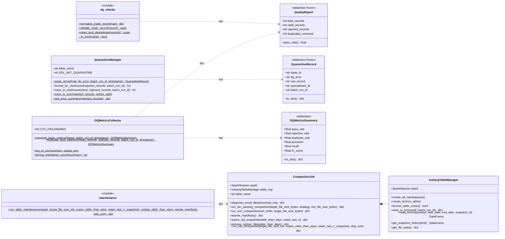

**Hình 3.6: Biểu đồ lớp phân hệ kiểm soát chất lượng dữ liệu và quản trị bảng Iceberg (UML Class Diagram)**

Hình 3.6 chia phân hệ thành hai cụm không phụ thuộc nhau. Cụm chất lượng dữ liệu chỉ dùng Python chuẩn. Cụm Iceberg cần phiên Spark: `CompactionJob` tự khởi tạo một `IcebergTableManager` trong hàm dựng để đọc thống kê tệp, còn `maintenance.py` là một mô-đun hàm, không có lớp nào mang tên `IcebergMaintenance`.

### 3.4.4. Tầng Gold: Tính toán nến chuẩn OHLCV/VWAP và đồng bộ ClickHouse `batch_agg`

Dù nằm trong tệp có tên `spark_batch_jobs.py`, hàm `aggregate_gold_candles()` không dùng Spark. Hàm gom bản ghi sạch theo khóa (`symbol`, `window_start`), trong đó `window_start` là `trade_time` đổi sang giờ quốc tế rồi làm tròn xuống đầu phút. Trong mỗi nhóm, giao dịch được sắp theo (`trade_time`, `trade_id`) với `trade_id` là số nguyên, đúng quy tắc phá thế hòa của tầng tốc độ ở mục 3.3.2. Các chỉ số OHLCV và VWAP được tính theo đúng định nghĩa ở mục 3.1.2, làm tròn như tầng tốc độ. Cờ `is_spike` được tính bằng `SpikeDetector.is_spike_python()` với cùng hai ngưỡng.

Kết quả được gọi là chuẩn vì không có watermark nào chặn đường. Một giao dịch đến trễ năm phút vẫn được đặt vào đúng cửa sổ theo thời gian sự kiện của nó [1]. Đây cũng là định nghĩa khung nhìn lô của kiến trúc Lambda: tính lại từ tập dữ liệu gốc thay vì cập nhật dần [7].

Chế độ Kafka đặt ra một vấn đề riêng. Bảng đích dùng `ReplacingMergeTree(created_at)` với khóa (`symbol`, `window_start`); khi gộp phần dữ liệu, ClickHouse giữ nguyên dòng có `created_at` lớn nhất và bỏ các dòng còn lại, chứ không cộng dồn [4]. Nếu mỗi lượt chỉ gộp phần offset mới, một phút có giao dịch rơi vào hai lượt sẽ bị nến thiếu của lượt sau đè lên. Hàm `build_incremental_gold_candles()` tránh điều này: bản ghi mới được nạp vào `SilverTradeStore`, kho trả về tập cửa sổ bị ảnh hưởng, rồi toàn bộ bản ghi đã biết của các cửa sổ đó được đọc lại, khử trùng và tính lại từ đầu. Nến ghi xuống ClickHouse vì vậy luôn đầy đủ.

Phương thức `ClickHouseBatchSync.insert_batch_aggregates()` gọi `initialize_tables()` để bảo đảm bốn bảng `batch_agg`, `system_watermark`, `dq_quarantine` và `reconciliation_audit_metrics` tồn tại, rồi ghi toàn bộ nến bằng một lệnh `insert` gồm mười ba cột, với `created_at` là thời điểm hiện tại. Định nghĩa `batch_agg` trong mã trùng khớp `init.sql`. Chạy lại một lượt chỉ sinh phiên bản mới hơn của cùng nến, và tầng phục vụ đọc bảng với từ khóa `FINAL`.

Mốc watermark được tính trong `compute_watermark_candidate()`. Ở chế độ tệp, tập đầu vào là đầy đủ nên mốc bằng `window_end` lớn nhất. Ở chế độ Kafka, phút cuối có thể còn đang nhận giao dịch, nên mốc chỉ được chốt tới đầu phút của thời điểm sự kiện lớn nhất trừ đi `BATCH_WATERMARK_LATENESS_SECONDS = 60` giây. Phương thức `update_watermark()` đọc `max(watermark_time)` qua `get_current_watermark()` và chỉ ghi dòng mới (`layer = 'batch_layer'`, `watermark_time`, `updated_at`) khi ứng viên lớn hơn mốc hiện tại. Ràng buộc đơn điệu này phải đặt ở phía ghi. Bảng `system_watermark` dùng `ReplacingMergeTree(updated_at)` sắp theo `layer`, nên khi gộp, ClickHouse chỉ giữ dòng có `updated_at` mới nhất; một mốc nhỏ hơn ghi sau sẽ xóa vĩnh viễn mốc lớn hơn.

Thứ tự trong `run_batch_pipeline()` là ghi Bronze từ `raw_records` (nếu được bật), lọc chất lượng, ghi bảng cách ly, ghi `batch_agg`, nâng watermark, lập bảng kiểm toán đối soát, commit offset Kafka, cuối cùng ghi nhật ký `results/logs/batch_pipeline_runs.csv`. Bước kiểm toán `sync_reconciliation_audit()` đọc `speed_agg` cho cùng khoảng thời gian và gán trạng thái `MATCHED` khi chênh lệch VWAP nhỏ hơn `1e-4` và độ lệch khối lượng nhỏ hơn `1e-4` phần trăm, `RECONCILED_AND_HEALED` khi vượt ngưỡng, `BATCH_ONLY` khi tầng tốc độ không có nến tương ứng. Watermark được nâng sau khi `batch_agg` đã ghi xong. Nếu tiến trình dừng giữa hai bước, mốc vẫn ở giá trị cũ và tầng phục vụ tạm lấy các cửa sổ đó từ tầng tốc độ. Sai về phía an toàn.

Offset Kafka chỉ được commit khi ClickHouse kết nối được. Nếu không, lượt sau sẽ đọc lại đúng lô đó. Đây là ngữ nghĩa giao nhận ít nhất một lần, và việc đọc lại vô hại nhờ hai đích ghi đều lũy đẳng: kho Silver bỏ qua bản ghi đã có, `ReplacingMergeTree` thay nến cũ bằng nến tính lại [5].

### 3.4.5. Cơ chế quản lý vòng đời bảng Iceberg: Compaction nén tệp nhỏ và dọn dẹp Snapshot

Mỗi lần `write_to_bronze()` được gọi, Iceberg ghi ít nhất một tệp Parquet cho mỗi phân vùng ngày có dữ liệu, kèm một tệp danh sách dữ liệu và một snapshot mới. Ngưỡng 128 MB chỉ giới hạn kích thước tối đa của tệp, không ngăn tệp nhỏ: một lần ghi vài chục bản ghi vẫn sinh một tệp vài kilobyte. Khi lần ghi nhỏ diễn ra thường xuyên, số tệp tăng nhanh và mỗi truy vấn phải mở từng tệp, đọc từng mục siêu dữ liệu, gửi từng yêu cầu GET tới MinIO. Kịch bản `prepare_small_files.py` tái hiện hiện tượng này bằng các lô 25 bản ghi.

Lớp `CompactionJob` trong `src/batch_layer/compaction.py` không tự đọc rồi ghi lại DataFrame. Phương thức `run_bin_packing_compaction()` gọi thủ tục có sẵn của Iceberg qua Spark SQL: `CALL iceberg_catalog.system.rewrite_data_files(table => 'bronze.crypto_trades', strategy => 'binpack', options => map(...))`, với ba tùy chọn `target-file-size-bytes = 134217728`, `min-file-size-bytes = 67108864` và `max-concurrent-file-group-rewrites = 2`. Mọi tệp nhỏ hơn 64 MB đều là ứng viên gộp. Iceberg tự lập nhóm tệp, dùng Spark [8] ghi lại dữ liệu, rồi cam kết một snapshot loại thay thế một cách nguyên tử; tệp cũ vẫn được các snapshot trước tham chiếu cho tới khi hết hạn [2]. Thống kê trước và sau được đọc từ bảng siêu dữ liệu `.files`. Kết quả trả về được đọc qua hàm phụ `_result_count()`, hàm này chuyển dòng kết quả sang từ điển bằng `asDict()` rồi ưu tiên tên cột của Iceberg 1.5.2 (`rewritten_data_files_count`, `added_data_files_count`), dự phòng tên cũ (`rewritten_files_count`, `added_files_count`) để chạy được trên nhiều phiên bản Iceberg.

Lớp còn có `run_sort_compaction()` sắp dữ liệu theo `symbol ASC, trade_time_ts ASC` và đọc kết quả bằng cùng hàm `_result_count()`, kèm `rewritten_bytes_count`; `rewrite_manifests()` gộp tệp danh sách; `expire_old_snapshots()` gọi `expire_snapshots` với `older_than` bảy ngày và `retain_last = 3`, chuyển dòng kết quả sang từ điển bằng `asDict()` rồi trả về số tệp dữ liệu và tệp danh sách đã xóa; cùng `remove_orphan_files()` xóa tệp không còn snapshot nào tham chiếu. Phương thức `diagnose_small_files()` tính tỷ lệ tệp dưới 64 MB để đưa ra khuyến nghị. Mô-đun `maintenance.py` không có lớp nào; hàm `run_table_maintenance()` chạy tuần tự gộp tệp theo bin-packing, hết hạn snapshot, xóa tệp mồ côi cũ hơn ba ngày và gộp tệp danh sách. Mỗi bước được bọc trong khối bắt ngoại lệ riêng, bước lỗi được ghi `skipped` kèm lý do và không chặn các bước sau; vì các phương thức đọc kết quả thủ tục qua `asDict()`, trạng thái `skipped` chỉ xuất hiện khi thủ tục Iceberg thực sự thất bại. Ngưỡng ba ngày cho tệp mồ côi tránh xóa nhầm tệp của một lần ghi đang diễn ra.

Tài sản `iceberg_small_files_compaction` của Dagster gọi `run_table_maintenance()` mỗi hai giờ theo biểu thức `0 */2 * * *`, sau đó chạy `OPTIMIZE TABLE ... FINAL` trên `batch_agg` và `speed_agg` để ClickHouse gộp các phần dữ liệu. Lịch này độc lập với lịch nạp lô mười lăm phút, nên một lần gộp tệp có thể trùng với một lần ghi Bronze. Iceberg xử lý tình huống này bằng kiểm soát đồng thời lạc quan (Optimistic Concurrency Control – OCC): mỗi bên chuẩn bị snapshot riêng, khi cam kết thì kiểm tra lại snapshot gốc và thử lại nếu bên kia đã cam kết trước [2]. Lần ghi Bronze chỉ thêm tệp mới, không đụng tới tệp đang được viết lại, nên hai thao tác không loại trừ nhau.

Kết quả đo hiệu quả do `scripts/benchmarks/bench_compaction.py` ghi lại. Chế độ mặc định chạy thật trên bảng Iceberg. Cờ `--simulate` sinh số liệu mô phỏng được đánh dấu `simulated = True`, và khi chế độ thật thất bại, kịch bản thoát với mã lỗi thay vì thay bằng số liệu mô phỏng. Chỉ các dòng `mode = real` được dùng để kết luận. Ở đợt chính thức, số tệp giảm từ 118 xuống 10, kích thước tệp trung bình tăng từ 0,97 MB lên 10,60 MB, thời gian gộp là 17,54 giây. Trung vị độ trễ đọc ở trạng thái nóng giảm từ 1.821,8 ms xuống 1.206,4 ms, tương đương khoảng 1,5 lần. Phân tích chi tiết được trình bày ở Chương 4. Hình 3.7 tổng hợp toàn bộ luồng của tầng xử lý lô.

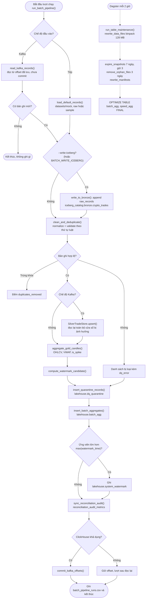

**Hình 3.7: Biểu đồ hoạt động đường ống xử lý lô Medallion và cơ chế cách ly lỗi (UML Activity Diagram)**

## 3.5. ĐIỀU PHỐI LUỒNG XỬ LÝ TỰ ĐỘNG VỚI DAGSTER VÀ BIẾN ĐỔI DBT

Mục này trình bày hai lớp bao quanh các hàm của mục 3.4: Dagster quyết định khi nào và theo thứ tự nào các bước chạy, còn dbt diễn đạt lại chuỗi Bronze, Silver, Gold bằng SQL khai báo.

### 3.5.1. Thiết lập Software-Defined Assets trong Dagster

Các công cụ điều phối truyền thống mô tả luồng công việc như một chuỗi tác vụ, và trạng thái thành công của tác vụ không cho biết dữ liệu nào đã được tạo ra. Dagster đảo góc nhìn này bằng mô hình tài sản dữ liệu định nghĩa bằng phần mềm (Software-Defined Assets – SDA): mỗi hàm Python được trang trí bằng `@asset` khai báo một tài sản dữ liệu, và quan hệ phụ thuộc giữa các hàm chính là quan hệ dòng dõi giữa các tài sản. Toàn bộ định nghĩa nằm trong một tệp duy nhất, `dagster_project/repository.py`.

Tệp khai báo bảy tài sản trong hai nhóm. Nhóm `lakehouse_batch` gồm sáu tài sản nạp dữ liệu; nhóm `lakehouse_maintenance` chỉ có `iceberg_small_files_compaction`, không nhận đầu vào nào. Không tài sản nào chứa logic xử lý riêng. Mỗi hàm chỉ gọi lại các hàm của `spark_batch_jobs.py`, `dq_checks.py` và `clickhouse_sync.py` ở mục 3.4, nên giao diện dòng lệnh và Dagster chia sẻ một bộ quy tắc duy nhất.

Quan hệ phụ thuộc được khai báo tường minh qua tham số `ins` với `AssetIn`. Tài sản Silver nhận đầu vào `bronze` từ `bronze_crypto_trades`; cả `gold_market_aggregates` lẫn `clickhouse_quarantine_sync` cùng nhận `silver`; `clickhouse_batch_sync` nhận `gold`; còn `system_watermark_sync` nhận `ch_sync`. Đồ thị vì vậy rẽ thành hai nhánh ngay sau tầng Silver. Nhánh cách ly kết thúc tại bảng `lakehouse.dq_quarantine`, trong khi nhánh chính đi tiếp tới `batch_agg` và mốc watermark.

Dữ liệu chảy giữa các tài sản dưới dạng từ điển Python bọc trong đối tượng `Output`. Từ điển Bronze mang `batch_run_id`, danh sách `records`, kết quả ghi Iceberg, cờ `incremental` và đối tượng `kafka_read` chứa offset chưa commit; mỗi tầng sau chép tiếp những khóa mà tầng dưới cần. Mã không khai báo trình quản lý vào ra riêng, nên Dagster dùng trình quản lý mặc định: giá trị trả về được tuần tự hóa và lưu dưới thư mục `DAGSTER_HOME`, ở đây là volume `dagster-home`. Cách truyền này có cái giá rõ ràng: toàn bộ danh sách giao dịch bị ghi ra đĩa ở mỗi ranh giới tài sản, chấp nhận được với lượt mười lăm phút nhưng sẽ thành điểm nghẽn khi lượt chạy lớn dần. Mỗi `Output` còn gắn siêu dữ liệu hiển thị trên giao diện như số bản ghi nạp, tỷ lệ đạt chất lượng, số nến và mốc watermark mới.

Tài sản Bronze chứa hai quyết định cần phân tích. Thứ nhất, việc ghi Iceberg phụ thuộc biến `BATCH_WRITE_ICEBERG`. Dagster dùng cùng quy tắc với giao diện dòng lệnh sau bản sửa ở mục 3.4.1: giá trị được bỏ khoảng trắng, đưa về chữ thường, và chấp nhận cả `true` lẫn `1`. Docker Compose đặt `BATCH_WRITE_ICEBERG=true` cho container `lakehouse-dagster`. Thứ hai, offset Kafka được đọc ở tài sản đầu tiên nhưng chỉ được commit ở tài sản cuối cùng, sau khi ClickHouse đã nhận dữ liệu.

Về đóng gói, `Dockerfile.dagster` dựng từ `python:3.10-slim`, cài thêm môi trường chạy Java để khởi tạo phiên Spark [8] và khởi động bằng `dagster dev -h 0.0.0.0 -p 3000 -f dagster_project/repository.py`. Lệnh này nạp trực tiếp tệp Python, nên `configs/dagster/workspace.yaml` với vị trí mã `lambda_lakehouse_pipeline` không được dùng. Tệp `repository.py` định nghĩa cả hàm `lambda_lakehouse_repo` mang `@repository` lẫn đối tượng `defs` kiểu `Definitions`; Dagster nạp `defs`, còn hàm kho cũ phục vụ kiểm thử. Năm ca kiểm thử trong `test_dagster_pipeline.py` xác nhận đủ bảy tài sản, hai công việc, hai biểu thức lịch, năm quan hệ cha con của Hình 3.8 và việc vật chất hóa thành công sáu tài sản của nhóm nạp dữ liệu.

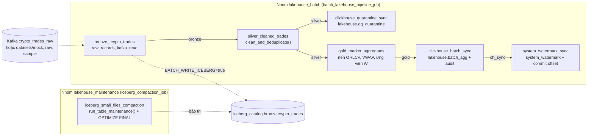

**Hình 3.8: Đồ thị phụ thuộc tài sản dữ liệu trên nền tảng điều phối Dagster (SDA Lineage DAG)**

### 3.5.2. Lập lịch tự động (Schedules) và đồng bộ System Watermark

Bảy tài sản được gom thành hai công việc bằng `define_asset_job`. Công việc `batch_lakehouse_pipeline_job` chọn sáu tài sản của nhóm nạp dữ liệu, còn `iceberg_compaction_job` chỉ chọn `iceberg_small_files_compaction`. Cả hai dùng `in_process_executor`: mọi bước chạy tuần tự trong cùng một tiến trình thay vì mỗi bước một tiến trình con, điều cần thiết với container giới hạn 1 GB bộ nhớ.

Hai đối tượng `ScheduleDefinition` gắn biểu thức thời gian cho hai công việc: `batch_pipeline_schedule` chạy theo `*/15 * * * *`, tức mười lăm phút một lần, còn `compaction_schedule` chạy theo `0 */2 * * *`, tức đầu mỗi giờ chẵn. Lệnh `dagster dev` khởi động cả tiến trình nền đánh giá lịch. Mặc định Dagster để lịch ở trạng thái dừng, nên cả hai lịch khai báo `default_status=DefaultScheduleStatus.RUNNING`. Nhờ đó lịch tự hoạt động ngay khi container nạp vị trí mã, người vận hành không phải bật tay trên giao diện ở cổng 3000. Nếu người vận hành tắt lịch trên giao diện, trạng thái đó được lưu trong `DAGSTER_HOME` và được ưu tiên hơn giá trị mặc định. Kho mã cũng không có tệp `dagster.yaml` giới hạn số lượt chạy đồng thời. Hai lượt chồng nhau ở chế độ Kafka có thể đọc cùng một khoảng offset chưa commit, và điều này không gây sai số nhờ hai đích ghi đều lũy đẳng (mục 3.4.4) [5].

Mốc watermark không được tính ở tài sản cuối cùng. Tài sản `gold_market_aggregates` gọi `compute_watermark_candidate()` ngay sau khi tính nến, nên công thức phụ thuộc chế độ đầu vào. Ở chế độ tệp, ứng viên bằng `window_end` lớn nhất. Ở chế độ Kafka, ứng viên là đầu phút của thời điểm sự kiện lớn nhất sau khi lùi `BATCH_WATERMARK_LATENESS_SECONDS = 60` giây, vì phút cuối của một lô Kafka có thể còn đang nhận giao dịch. Ứng viên đi theo từ điển `gold` sang `clickhouse_batch_sync`, nơi nến được ghi vào `batch_agg` và bảng kiểm toán `reconciliation_audit_metrics` được lập.

Tài sản `system_watermark_sync` thực hiện hai việc cuối cùng của lượt chạy. Nó gọi `ClickHouseBatchSync().update_watermark()`, phương thức chỉ ghi dòng mới vào `lakehouse.system_watermark` khi ứng viên lớn hơn `max(watermark_time)` hiện có. Mốc không bao giờ lùi. Sau đó tài sản kiểm tra cờ `clickhouse_available` do bước trước trả về và chỉ commit offset Kafka khi cờ này đúng; nếu ClickHouse không kết nối được, nhật ký ghi cảnh báo và lô sẽ được đọc lại ở lượt sau. Quan hệ phụ thuộc bảo đảm watermark chỉ được nâng khi nến đã nằm trong `batch_agg`, nên tầng phục vụ không bao giờ trỏ tới một cửa sổ đối soát còn trống.

Thứ tự này khác giao diện dòng lệnh ở một điểm. Trong `run_batch_pipeline()`, bảng cách ly được ghi trước `batch_agg` trên cùng một luồng. Trong Dagster, `clickhouse_quarantine_sync` là nhánh song song và không phải tổ tiên của `system_watermark_sync`. Khi một bước thất bại, Dagster chỉ bỏ qua các bước phụ thuộc vào nó, nên nếu bước ghi cách ly ném ngoại lệ, nhánh chính vẫn có thể nâng watermark và commit offset; những bản ghi bị loại của lô đó khi ấy chỉ còn trong Bronze. Rủi ro này nhỏ trên thực tế, vì `insert_quarantine_records()` trả về 0 thay vì ném lỗi khi không có kết nối, nhưng nó là hệ quả trực tiếp của hình dạng đồ thị.

Công việc bảo trì chạy độc lập. Tài sản `iceberg_small_files_compaction` khởi tạo phiên Spark với `SPARK_MASTER_URL=spark://spark-master:7077` do Docker Compose cấp, gọi `run_table_maintenance()` với tệp đích 128 MB, hết hạn snapshot sau bảy ngày, xóa tệp mồ côi cũ hơn ba ngày, rồi chạy `OPTIMIZE TABLE ... FINAL` trên `batch_agg` và `speed_agg`. Mọi lỗi đều được bắt lại và ghi vào siêu dữ liệu `skipped` hoặc `clickhouse_optimized`, nên lượt bảo trì luôn được đánh dấu thành công. Thiết kế này ưu tiên tính liên tục của lịch hơn là báo lỗi sớm.

### 3.5.3. Tích hợp mô hình biến đổi dữ liệu dbt-spark (Medallion models)

Kiến trúc Lakehouse cho phép bộ máy SQL truy vấn trực tiếp bảng định dạng mở trên kho đối tượng [3], và dự án `dbt_project/` dùng khả năng đó để diễn đạt lại chuỗi Medallion trên Spark [8]. Tuy vậy, dbt không nằm trên đường chạy: `repository.py` không gọi dbt, và dữ liệu tầng phục vụ đọc chỉ đến từ các hàm Python ở mục 3.4. Dự án dbt là hiện vật tham chiếu, chạy thủ công qua `scripts/verify_dbt.py`.

Tệp `profiles.yml` khai báo hồ sơ `lambda_spark` kiểu `spark`, phương thức `thrift`, máy chủ lấy từ `DBT_SPARK_HOST` (mặc định `localhost`), cổng 10000, lược đồ `default`, chờ kết nối 120 giây và thử lại năm lần. Container `lakehouse-spark-thrift` đăng ký catalog `iceberg_catalog`, nên mô hình Bronze đọc được bảng Iceberg [2], nhưng không đặt `spark.sql.warehouse.dir`, vì vậy các bảng dbt tạo ra là bảng Parquet thường trên đĩa của container, không phải bảng Iceberg và không được đồng bộ sang ClickHouse. Tệp `dbt_project.yml` đặt `+file_format: parquet` và vật chất hóa `view` cho Bronze, `incremental` cho Silver, `table` cho Gold, như tóm tắt ở Bảng 3.5.

**Bảng 3.5: Đặc tả các mô hình biến đổi dữ liệu khai báo trên `dbt-spark` (`dbt_project/models/`)**

| Mô hình | Vật chất hóa | Nguồn đọc | Logic SQL chính | Khác biệt so với đường chạy Python |
| :---: | :---: | :---: | :---: | :---: |
| `bronze_crypto_trades` | `view` | `iceberg_catalog.bronze.crypto_trades` | Ép kiểu mười hai cột, `upper(symbol)` | Không lọc, không khử trùng |
| `silver_cleaned_trades` | `incremental`, `insert_overwrite`, phân vùng `trade_date` | `ref('bronze_crypto_trades')` | Lọc `trade_id >= 0`, `trim(symbol) != ''`, chặn `NaN` và `±inf`, giá, khối lượng, thời điểm dương; `row_number()` theo (`symbol`, `trade_id`), sắp `coalesce(ingestion_time, trade_time) desc, bronze_written_at asc`; kiểm thử `unique` trên (`symbol`, `trade_id`) | Luật lọc và khử trùng khớp `dq_checks.py`; chỉ ghi lại phân vùng từ ngày lớn nhất đã có, giao dịch trễ của ngày cũ hơn bị bỏ qua |
| `gold_market_aggregates` | `table` | `ref('silver_cleaned_trades')` | `window(trade_time_ts, '1 minute')`; mở và đóng cửa bằng `min`/`max` của `named_struct(trade_time, trade_id, price)`; VWAP, `is_spike` ngưỡng 0,02 và 0,03 | Phá thế hòa theo `trade_id`, khớp phép sắp (`trade_time`, `trade_id`) của Python |

*Nguồn: dbt_project/dbt_project.yml, dbt_project/models/*.sql và src/data_quality/dq_checks.py; cột cuối đối chiếu với các hàm ở mục 3.4.2 và 3.4.4.*

Mô hình Silver đã được đồng bộ với các luật của `dq_checks.py`. Theo ngữ nghĩa của Spark SQL, `NaN` lớn hơn mọi giá trị số, nên riêng điều kiện `price > 0` không chặn được `NaN`. Bộ lọc vì vậy có thêm `not isnan(price)`, `not isnan(quantity)`, `trade_id >= 0` và `trim(symbol) != ''`. Spark SQL không có hàm kiểm tra vô cực riêng, nên mô hình so `abs(price)` và `abs(quantity)` với `cast('Infinity' as double)` để loại cả `+inf` lẫn `-inf`, tương đương `math.isfinite()` của Python. Hàm `row_number()` sắp theo `coalesce(ingestion_time, trade_time) desc, bronze_written_at asc`: bản có `ingestion_time` mới hơn thắng, và khi hòa thì bản ghi Bronze đến trước được giữ, giống hàm Python. Khối `is_incremental()` chỉ ghi các dòng có `to_date(trade_time_ts)` lớn hơn hoặc bằng `trade_date` lớn nhất đã có. Một giao dịch trễ thuộc ngày cũ hơn bị bỏ qua hoàn toàn, chứ không kích hoạt việc ghi lại phân vùng ngày đó. Hàm `row_number()` lại được tính trên toàn bộ Bronze trước bộ lọc này, nên chi phí quét không giảm.

Ở mô hình Gold, giá mở cửa lấy từ `min(named_struct('trade_time', trade_time, 'trade_id', trade_id, 'price', price))` và giá đóng cửa từ `max(...)` của cùng cấu trúc. Spark so cấu trúc theo thứ tự từng trường, nên khi hai giao dịch cùng mili-giây, `trade_id` quyết định thứ tự. Cách này khớp với phép sắp `(trade_time, trade_id)` của hàm Python ở mục 3.4.4. Vật chất hóa `table` dựng lại toàn bộ bảng mỗi lần chạy, gần với định nghĩa khung nhìn lô của kiến trúc Lambda [7].

Tệp `schema.yml` khai báo chín kiểm thử `not_null` và một kiểm thử `unique` mức mô hình cho `silver_cleaned_trades` trên biểu thức `concat(symbol, ':', cast(trade_id as string))`. Khóa phải ghép cả `symbol`, vì `trade_id` của Binance chỉ duy nhất trong từng cặp giao dịch, còn dữ liệu mock sinh `trade_id` từ mốc thời gian nên lặp lại giữa các cặp. Nhờ kiểm thử này, `dbt test` phát hiện được lỗi khử trùng ở tầng Silver. Tầng Gold chưa có kiểm thử `unique` trên (`symbol`, `window_start`). Kịch bản `verify_dbt.py` kiểm tra cổng 10000, chạy `dbt debug`, chuyển sang `--full-refresh` khi bảng Silver cũ thiếu cột `trade_date`, rồi chạy `dbt run` và `dbt test`. Đề tài không ghi nhận đợt chạy dbt nào, nên dự án này chưa được kiểm chứng bởi phép đối soát nào trong Chương 4.

## 3.6. HIỆN THỰC TẦNG PHỤC VỤ (SERVING LAYER) VÀ THUẬT TOÁN AUTO-CORRECTING QUERY MERGER

Tầng phục vụ là nơi hai khung nhìn của kiến trúc Lambda gặp nhau. Theo Marz và Warren [7], tầng này chỉ cần đọc các khung nhìn đã tính sẵn và trả lời truy vấn một cách nhanh chóng, còn việc tính toán thuộc về tầng lô và tầng tốc độ. Mã nguồn đặt toàn bộ trách nhiệm đó trong thư mục `src/serving_layer/` gồm năm tệp: `api_routes.py`, `schemas.py`, `query_merger.py`, `clickhouse_client.py` và `watermark_reader.py`.

### 3.6.1. Thiết kế FastAPI Gateway và hệ thống Pydantic Schemas

Tệp `api_routes.py` khởi tạo một ứng dụng FastAPI duy nhất mang tiêu đề "Lambda Lakehouse Serving API", phiên bản 1.0.0. Ngay khi mô-đun được nạp, ba đối tượng dùng chung được tạo một lần: `_watermark_reader` thuộc lớp `WatermarkReader`, `_ch_client` thuộc lớp `ClickHouseQueryClient`, và `query_merger` thuộc lớp `AutoCorrectingQueryMerger` nhận hai đối tượng trên qua hàm khởi tạo. Cách tiêm phụ thuộc này giữ cho bộ hợp nhất không tự mở kết nối, nên kiểm thử đơn vị có thể thay ClickHouse bằng dữ liệu giả lập. Ứng dụng bật `CORSMiddleware` với `allow_origins=["*"]` để giao diện Streamlit ở cổng 8501 gọi được; cấu hình mở hoàn toàn như vậy chỉ phù hợp với môi trường thử nghiệm cục bộ.

Mọi tham số thời gian đi qua hàm `parse_datetime_param()`. Chuỗi toàn chữ số được hiểu là mili-giây kể từ mốc Epoch. Chuỗi còn lại được phân tích theo ISO 8601, ký tự `Z` được đổi thành `+00:00`, giá trị không mang múi giờ được gắn UTC, và mọi độ lệch múi giờ khác được quy đổi về UTC bằng `astimezone()`. Chuỗi không hợp lệ sinh lỗi HTTP 400. Khi người gọi bỏ trống, `end_time` mặc định là thời điểm hiện tại và `start_time` lùi 60 phút. Tám điểm cuối mà ứng dụng khai báo được tóm tắt ở Bảng 3.6.

**Bảng 3.6: Đặc tả các điểm cuối giao tiếp REST API tại tầng phục vụ (`src/serving_layer/api_routes.py`)**

| Phương thức và đường dẫn | Tham số truy vấn | Mô hình phản hồi | Nguồn dữ liệu | Hành vi chính |
| :--- | :--- | :--- | :--- | :--- |
| `GET /` | Không | Từ điển tự do | Hằng số | Trả về tên dịch vụ, `docs_url = /docs` và phiên bản |
| `GET /health` | Không | Từ điển tự do | Không truy cập | Luôn trả `status = healthy` kèm dấu thời gian UTC |
| `GET /api/system/status` | Không | Từ điển tự do | `WatermarkReader`, kiểm tra cổng TCP | Thử kết nối ClickHouse, Redis, Kafka với thời hạn 0,3 giây; `ok` khi ClickHouse và Kafka sẵn sàng, ngược lại `degraded`; Redis không bắt buộc |
| `GET /api/speed/latest` | `symbol` (mặc định `BTCUSDT`) | Từ điển tự do | Redis, khóa `{key_prefix}:{SYMBOL}:latest` | Trả `cache_status` là `hit`, `miss` hoặc `unavailable`; điểm cuối duy nhất đọc Redis |
| `GET /api/watermark` | `layer` (mặc định `batch_layer`) | `WatermarkResponse` | `WatermarkReader.get_watermark()` | `updated_at` là thời điểm phục vụ yêu cầu, `status` luôn là `ACTIVE` |
| `GET /api/market` | `symbol`, `start_time`, `end_time` (ISO hoặc epoch ms) | `MarketDataResponse` | `AutoCorrectingQueryMerger.merge_query()` | Từ chối `start_time >= end_time` bằng HTTP 400, sau đó định tuyến theo mốc W |
| `GET /api/reconciliation` | `symbol`, `start_time`, `end_time` | `List[ReconciliationDetail]` | `get_reconciliation_report()` | So song song `batch_agg` và `speed_agg` theo từng `window_start` |
| `GET /api/system/alerts` | `limit` (mặc định 50, từ 1 đến 200) | Từ điển tự do | `AlertManager.get_recent_alerts()` | Trả danh sách cảnh báo gần nhất và thời điểm truy vấn |

*Nguồn: các bộ trang trí `@app.get` và hàm xử lý trong src/serving_layer/api_routes.py; "Từ điển tự do" nghĩa là hàm trả `dict` mà không khai báo `response_model`.*

Bảng cho thấy một ranh giới rõ ràng. Bộ hợp nhất truy vấn không đọc Redis; bộ nhớ đệm nóng chỉ phục vụ nến mới nhất qua `/api/speed/latest`, còn mọi nến của `/api/market` và `/api/reconciliation` đều đến từ ClickHouse.

Tệp `schemas.py` định nghĩa hợp đồng dữ liệu bằng Pydantic. Kiểu liệt kê `CandleStatus` kế thừa `str` với ba giá trị `Reconciled`, `Provisional` và `Partially Reconciled`. Kiểu `QueryCase` kế thừa `int` với ba giá trị 1, 2 và 3. Lớp `CandleData` mô tả một nến bằng mười hai trường, trong đó `is_spike` mặc định bằng 0 và `status` là bắt buộc. Lớp `MarketDataResponse` gói mười một trường: ký hiệu, khoảng thời gian `TimeRange`, trường hợp truy vấn, mô tả trường hợp, mốc W, trạng thái tổng thể, sai số đối soát, số nến, danh sách nến, bảng đếm nguồn `source_breakdown` và độ trễ `freshness_lag_seconds`. Giá trị `Partially Reconciled` chỉ xuất hiện ở trạng thái tổng thể của Trường hợp 3. Từng nến riêng lẻ luôn mang một trong hai nhãn còn lại.

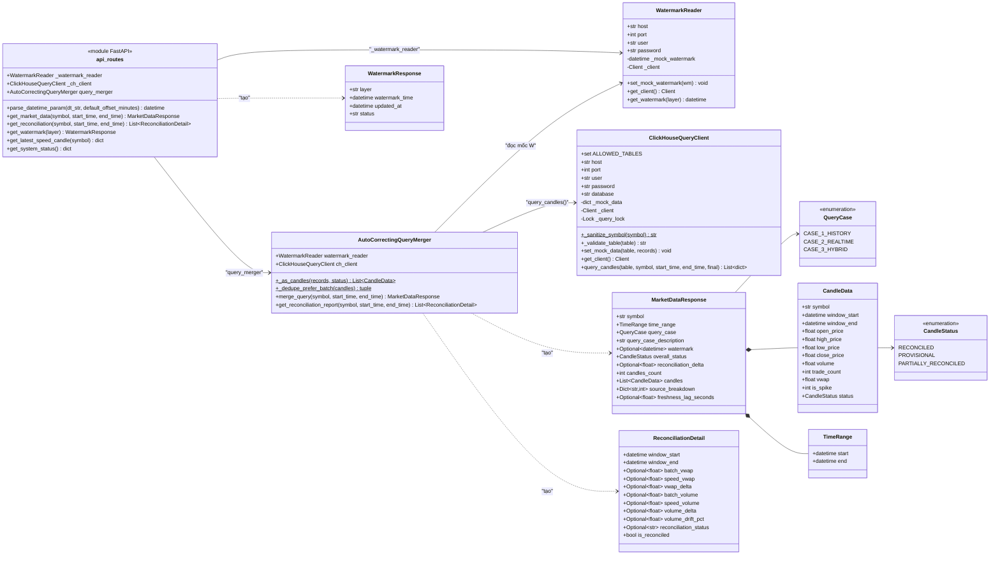

**Hình 3.9: Biểu đồ lớp tầng phục vụ và bộ hợp nhất truy vấn tự động (UML Class Diagram)**

Về đóng gói, `Dockerfile.serving` dựng từ `python:3.10-slim` và cài trực tiếp bảy gói có ghim phiên bản, trong đó có `fastapi==0.110.0`, `uvicorn==0.27.0` và `clickhouse-connect==0.7.0`. Tệp `requirements.txt` được sao chép vào ảnh nhưng không được cài. Pydantic không được ghim mà đi theo ràng buộc của FastAPI, trong khi mã gọi `model_dump()` của Pydantic 2. Lệnh khởi động chạy `uvicorn` với cờ `--reload`, và Docker Compose gắn thư mục `./src` vào container `lakehouse-fastapi` giới hạn 512 MB. Mã sửa trên máy chủ vì vậy có hiệu lực ngay. Đổi lại, dịch vụ chạy ở chế độ phát triển với một tiến trình làm việc duy nhất.

Mọi hàm xử lý đều khai báo `async def`, nhưng bên trong gọi `clickhouse-connect` và `redis-py` theo kiểu đồng bộ. Mỗi truy vấn ClickHouse vì vậy chặn vòng lặp sự kiện trong suốt thời gian chờ mạng. Với một người dùng Streamlit, ảnh hưởng này không đáng kể. Khi có nhiều yêu cầu đồng thời, các yêu cầu sẽ phải xếp hàng.

### 3.6.2. Thuật toán Auto-Correcting Query Merger phân tách 3 trường hợp truy vấn theo Watermark

Phương thức `merge_query()` là lõi của tầng phục vụ. Trước khi định tuyến, nó kiểm tra `start_time < end_time` và ném `ValueError` nếu điều kiện sai, rồi đưa cả hai mốc về UTC bằng hàm `_to_utc()` và viết hoa ký hiệu cặp giao dịch. Bước tiếp theo đọc mốc $W$ bằng `self.watermark_reader.get_watermark(layer="batch_layer")`. Mốc này được đọc lại ở mỗi yêu cầu, không lưu giữa các yêu cầu.

Ba nhánh `if`, `elif`, `else` được viết theo thứ tự sau:

$$\text{Trường hợp 1: } T_{\text{end}} \le W \qquad \text{Trường hợp 2: } T_{\text{start}} \ge W \qquad \text{Trường hợp 3: } T_{\text{start}} < W < T_{\text{end}}$$

Điều kiện của Trường hợp 3 không được viết tường minh trong mã. Nó là phần bù của hai điều kiện đầu, vì nhánh `else` chỉ chạy khi $T_{\text{end}} > W$ và $T_{\text{start}} < W$. Một chi tiết dễ bị bỏ qua là dấu bằng ở Trường hợp 2. Mã dùng `start_time >= watermark`, nên truy vấn bắt đầu đúng tại $W$ đi thẳng sang khung nhìn tốc độ, trong khi docstring đầu tệp `query_merger.py` và chú thích của `QueryCase` trong `schemas.py` vẫn ghi $T_{\text{start}} > W$ và $T_{\text{start}} \le W < T_{\text{end}}$. Phần mô tả trong luận văn theo mã, không theo chú thích.

Mọi lời gọi xuống ClickHouse đều qua `query_candles()`, với điều kiện lọc `window_start >= start` và `window_start < end`. Khoảng truy vấn vì vậy là nửa mở $[\,T_{\text{start}}, T_{\text{end}})$ theo thời điểm mở nến. Trường hợp 1 đọc `batch_agg` trên toàn khoảng, gán nhãn `Reconciled` và đặt `reconciliation_delta = 0.0`. Trường hợp 2 đọc `speed_agg`, gán nhãn `Provisional` và để sai số là `None`. Trường hợp 3 gọi tuần tự hai truy vấn: `batch_agg` trên $[\,T_{\text{start}}, W)$ và `speed_agg` trên $[\,W, T_{\text{end}})$. Nếu phần lô có ít nhất một nến, mã gửi thêm truy vấn thứ ba vào `speed_agg` trên $[\,T_{\text{start}}, W)$ để lấy nến tốc độ đối chiếu. Hai truy vấn đầu không chạy song song.

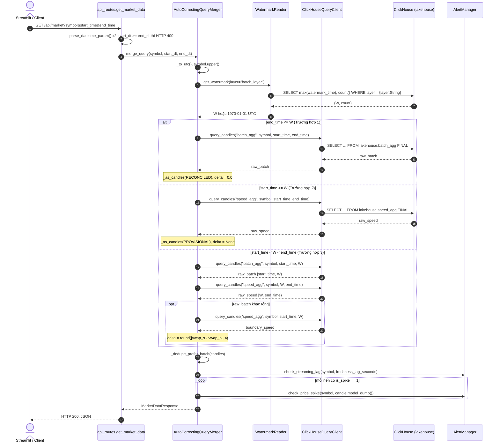

**Hình 3.10: Biểu đồ tuần tự thuật toán hợp nhất truy vấn lai ghép `AutoCorrectingQueryMerger` (UML Sequence Diagram)**

Hình 3.10 cũng cho thấy chi phí của Trường hợp 3. Một yêu cầu ở trường hợp này cần bốn lượt khứ hồi tới ClickHouse: một lượt đọc mốc và ba lượt đọc nến. Hai trường hợp còn lại chỉ cần hai lượt. Kết quả đo ở Chương 4 phù hợp với cơ chế này, và chiến lược `lambda` không nhanh hơn truy vấn trực tiếp một bảng.

Sau ba nhánh, mã tính `freshness_lag_seconds` $= \max(T_{\text{end}} - W, 0)$, gửi giá trị đó cho `check_streaming_lag()`, và phát cảnh báo đột biến giá cho từng nến có `is_spike = 1`. Ca kiểm thử `test_case_3_hybrid_query_and_zero_double_counting` minh họa trọn vẹn nhánh lai. Với $W$ = 12:00 UTC và khoảng 11:58–12:02, kết quả có bốn nến: hai nến `Reconciled` lúc 11:58 và 11:59, hai nến `Provisional` lúc 12:00 và 12:01. Sai số biên bằng 15,0, `source_breakdown` ghi 2 nến lô, 2 nến tốc độ, 0 bản trùng, và độ trễ là 120 giây.

Thuật toán chọn nguồn theo vị trí thời gian, không theo dữ liệu nào đang có. Nếu `batch_agg` thiếu một phút nằm dưới $W$, phút đó vắng mặt trong kết quả dù `speed_agg` có nến tương ứng. Lựa chọn này nhất quán với vai trò "nguồn sự thật" của khung nhìn lô [7], nhưng nó đặt trách nhiệm đầy đủ lên tầng lô. Kết hợp với quy tắc chỉ tăng của $W$ (mục 3.4), một phút đã chuyển sang `Reconciled` sẽ không quay lại `Provisional` ở các lần đọc sau, gần với bảo đảm đọc đơn điệu (monotonic reads) mà Kleppmann mô tả [5].

### 3.6.3. Cơ chế khử trùng lặp ưu tiên Batch (Zero Double-Counting) và tính sai lệch đối soát Delta

Phương thức tĩnh `_dedupe_prefer_batch()` duyệt danh sách nến theo đúng thứ tự đã ghép: các nến lô trước, các nến tốc độ sau. Khóa của mỗi nến là cặp (`symbol.upper()`, `window_start`). Nến đầu tiên mang một khóa được giữ lại. Mỗi lần gặp lại khóa đó, bộ đếm `duplicate_count` tăng một, và nến mới chỉ thay nến cũ khi nến cũ không mang nhãn `Reconciled` còn nến mới có nhãn này. Danh sách cuối cùng được sắp theo `window_start`, còn số bản trùng được ghi vào `source_breakdown["deduplicated"]`. Quy tắc này tất định: với cùng một khóa, nến lô luôn thắng nến tốc độ, bất kể thứ tự xuất hiện.

Trong luồng chạy thực tế, bước khử trùng này hầu như không loại được bản ghi nào. Phần lô lấy `window_start` trong $[\,T_{\text{start}}, W)$, phần tốc độ lấy `window_start` trong $[\,W, T_{\text{end}})$; hai khoảng nửa mở này rời nhau, nên không có khóa nào xuất hiện ở cả hai phía. Mốc $W$ luôn là đầu một phút (mục 3.4), vì vậy cũng không có nến nào vắt qua ranh giới. Ca kiểm thử nhánh lai ở mục 3.6.2 xác nhận điều này với `deduplicated = 0`. Ca `test_dedupe_prefers_reconciled_batch_at_same_window` phải dựng thủ công một cặp nến trùng khóa mới kích hoạt được nhánh thay thế. Bảo đảm không đếm trùng (zero double-counting) vì vậy đến từ việc chia khoảng; `_dedupe_prefer_batch()` là lớp phòng vệ thứ hai, giữ đúng tính chất này nếu ranh giới bị đổi thành khoảng đóng trong tương lai.

Sai số đối soát tại biên chỉ được tính ở Trường hợp 3 và chỉ khi `raw_batch` khác rỗng:

$$\varepsilon_{\text{VWAP}}^{\text{biên}} = \operatorname{round}\big(\,\lvert \text{VWAP}_{\text{speed}}(w^{*}) - \text{VWAP}_{\text{batch}}(w^{*}) \rvert,\ 4\big)$$

trong đó $w^{*}$ là `window_start` muộn nhất có mặt ở cả nến lô lẫn nến tốc độ của truy vấn thứ ba. Khi hai tập không có phút chung, mã dùng nến cuối của mỗi tập, và hai nến này có thể thuộc hai phút khác nhau. Giá trị 0,0 của Trường hợp 1 là quy ước, không phải phép đo. Không có lệnh đọc `speed_agg` nào được thực hiện ở nhánh đó.

Phép so sánh đầy đủ thuộc về `get_reconciliation_report()`, hàm phục vụ `/api/reconciliation`. Hàm đọc cả `batch_agg` và `speed_agg` trên cùng khoảng, lấy hợp các `window_start`, rồi với mỗi phút tính `vwap_delta` làm tròn bốn chữ số, `volume_delta` làm tròn sáu chữ số và độ lệch khối lượng tương đối qua hàm `volume_drift_pct()` của `src/utils/reconciliation.py`:

$$\Delta V_{\%} = \frac{\lvert V_{\text{speed}} - V_{\text{batch}} \rvert}{V_{\text{batch}}} \times 100$$

Khi $V_{\text{batch}} = 0$, hàm trả 0 nếu $V_{\text{speed}}$ cũng bằng 0, và trả `None` trong trường hợp còn lại. Trạng thái của từng phút do `classify_window()` quyết định. Phút có cả hai phía được gán `MATCHED` khi $\varepsilon_{\text{VWAP}} < 10^{-4}$ và $\Delta V_{\%} < 10^{-4}$, ngược lại là `RECONCILED_AND_HEALED`. Phút chỉ có phía lô nhận `BATCH_ONLY`, phút chỉ có phía tốc độ nhận `PROVISIONAL_ONLY`. Bảng kiểm toán `reconciliation_audit_metrics` của tầng lô dùng chung mô-đun này, nên cùng một phút không thể mang hai trạng thái khác nhau ở hai nơi. Mỗi giá trị $\Delta V_{\%}$ xác định được còn được chuyển cho `check_volume_drift()` để so với ngưỡng cảnh báo 5 %.

Hai phép so sánh trên chỉ có nghĩa khi mỗi khóa (`symbol`, `window_start`) trả về đúng một phiên bản. Câu lệnh do `query_candles()` sinh ra bảo đảm điều đó:

```sql
SELECT symbol, window_start, window_end, open_price, high_price, low_price,
       close_price, volume, trade_count, vwap, is_spike
FROM lakehouse.batch_agg FINAL
WHERE symbol = 'BTCUSDT'
  AND window_start >= toDateTime64('2026-09-04 11:58:00.000', 3, 'UTC')
  AND window_start <  toDateTime64('2026-09-04 12:02:00.000', 3, 'UTC')
ORDER BY window_start ASC
```

Cả hai bảng dùng `ReplacingMergeTree(created_at)`, chỉ gộp các phiên bản trùng khóa khi trộn phần dữ liệu ở chế độ nền [4]. Từ khóa `FINAL`, bật mặc định qua tham số `final=True`, buộc ClickHouse chọn phiên bản mới nhất ngay lúc đọc. Nếu thiếu nó, một nến vừa được tầng lô tính lại có thể xuất hiện hai lần và làm sai cả khối lượng lẫn VWAP. Câu lệnh được dựng bằng f-string sau hai lớp kiểm tra: tên bảng phải thuộc `ALLOWED_TABLES`, ký hiệu phải khớp `^[A-Z0-9_-]{1,32}$`. Mọi ngoại lệ bị bắt và đổi thành danh sách rỗng, nên người gọi không phân biệt được "không có dữ liệu" với "ClickHouse lỗi".

### 3.6.4. Module quản lý trạng thái mốc thời gian đối soát (Watermark Reader)

Lớp `WatermarkReader` trong `watermark_reader.py` chỉ làm một việc: trả về mốc $W$ của một tầng dưới dạng `datetime` có múi giờ UTC. Hàm khởi tạo lấy thông tin kết nối từ `get_clickhouse_config()`. Thuộc tính `_mock_watermark` cho phép kiểm thử ghim một mốc cố định, và `set_mock_watermark()` đổi mốc đó khi đang chạy. Toàn bộ mười bảy ca kiểm thử trong `tests/test_query_merger.py` dựa vào cơ chế này để đặt $W$ = 12:00 UTC mà không cần ClickHouse.

Phương thức `get_client()` chỉ tạo kết nối ở lần gọi đầu tiên. Nếu kết nối thất bại, phương thức trả `None` và lần gọi sau sẽ thử lại từ đầu. Lời gọi không truyền `database` và không đặt thời hạn kết nối riêng, nên câu truy vấn ghi đầy đủ tên `lakehouse.system_watermark`.

Phương thức `get_watermark(layer="batch_layer")` đi qua ba bước. Nếu có mốc giả lập, phương thức trả ngay mốc đó. Nếu có kết nối, phương thức gửi truy vấn:

```sql
SELECT max(watermark_time), count()
FROM lakehouse.system_watermark
WHERE layer = {layer:String}
```

Tham số `layer` được truyền qua cơ chế ràng buộc tham số phía máy chủ của ClickHouse, không nối chuỗi. Hai hàm tổng hợp trong câu lệnh có vai trò khác nhau. Hàm `max(watermark_time)` lấy mốc lớn nhất từng được ghi, thay vì dòng có `updated_at` mới nhất. Bảng `system_watermark` dùng `ReplacingMergeTree(updated_at)` [4], nên nếu đọc theo `updated_at`, một lần ghi mốc nhỏ hơn có thể kéo $W$ lùi lại. Cách đọc theo `max` bổ sung cho quy tắc chỉ ghi khi mốc mới lớn hơn của `update_watermark()` ở mục 3.4: phía ghi và phía đọc cùng giữ bất biến $W$ không giảm. Hàm `count()` phân biệt "bảng chưa có dòng nào" với "mốc thật". Một truy vấn tổng hợp không có `GROUP BY` trên tập rỗng vẫn trả về một dòng mang giá trị mặc định của kiểu dữ liệu, nên mã chỉ nhận kết quả khi `count() > 0`. Giá trị trả về không mang múi giờ sẽ được gắn UTC.

Bước cuối là phương án dự phòng. Khi không có thư viện, không kết nối được, truy vấn ném ngoại lệ, bảng không có dòng nào của tầng được hỏi, hoặc giá trị đọc được không phải `datetime`, phương thức trả `datetime(1970, 1, 1, 0, 0, 0, tzinfo=timezone.utc)`. Lỗi kết nối và lỗi truy vấn được ghi cảnh báo vào nhật ký, còn trường hợp bảng rỗng thì không. Hệ quả lên bộ hợp nhất có thể suy ra trực tiếp từ các bất đẳng thức ở mục 3.6.2. Với $W$ = 1970, mọi truy vấn có $T_{\text{start}}$ sau năm 1970 đều thỏa $T_{\text{start}} \ge W$ và rơi vào Trường hợp 2, nên toàn bộ kết quả lấy từ `speed_agg` với nhãn `Provisional`. Khi hệ thống mới khởi động và tầng lô chưa chạy lượt nào, đây là hành vi đúng: người dùng thấy dữ liệu tạm thời thay vì một biểu đồ trống.

Phương án dự phòng này không làm hệ thống chịu được lỗi của ClickHouse. Bảng `speed_agg` cũng nằm trong ClickHouse, nên khi ClickHouse ngừng hoạt động, truy vấn nến của Trường hợp 2 trả về danh sách rỗng. Mốc 1970 cũng không được báo cho người gọi: `/api/watermark` vẫn trả `status = ACTIVE` với `updated_at` là thời điểm phục vụ, còn `/api/system/status` báo độ trễ tính từ năm 1970. Người dùng không có cách nào tách "chưa có mốc" khỏi "không đọc được mốc". Đây là hạn chế đã được ghi nhận, phù hợp để đưa vào phần hạn chế của đề tài.

Mã không có bộ nhớ đệm cho mốc $W$. Mỗi yêu cầu `/api/market`, `/api/watermark` hay `/api/system/status` đều gửi một truy vấn mới tới `system_watermark`. Cái giá là thêm một lượt khứ hồi cho mọi yêu cầu (Hình 3.10). Đổi lại, ngay sau khi `system_watermark_sync` của Dagster nâng mốc (mục 3.5.2), yêu cầu kế tiếp đã được định tuyến theo mốc mới.

## 3.7. HIỆN THỰC GIAO DIỆN GIÁM SÁT (DASHBOARD UI) VÀ CẢNH BÁO CHỦ ĐỘNG

Kiến trúc Lambda chỉ có ý nghĩa với người dùng khi ranh giới giữa khung nhìn lô và khung nhìn tốc độ được nhìn thấy [7]. Mục này trình bày giao diện Streamlit trong thư mục `dashboard/` và mô-đun cảnh báo `src/utils/alerting.py`. Giao diện cho thấy ranh giới đó. Mô-đun cảnh báo phát tín hiệu khi dữ liệu lệch khỏi ngưỡng.

### 3.7.1. Xây dựng Dashboard tương tác thời gian thực với Streamlit

Điểm vào là hàm `main()` trong `dashboard/app.py`. Hàm này gọi `_configure_page()` để đặt tiêu đề trang, bố cục rộng và nạp bảng định kiểu chung bằng `inject_global_css()` của `theme.py`. Tệp `theme.py` giữ các mã màu dùng chung trong từ điển `COLORS`: nền `#0B0E11`, màu `reconciled` `#3FB68B`, màu `provisional` `#E3A008`, màu `hybrid` `#4C8DF6`, màu nến tăng `#26A69A` và nến giảm `#EF5350`. Tệp này cũng đăng ký mẫu Plotly tên `lakehouse` dựa trên `plotly_dark`. Mọi biểu đồ của các mô-đun con đều dùng chung mẫu đó, nên màu trạng thái chỉ được định nghĩa ở một nơi.

Thanh bên do `render_sidebar()` dựng có năm điều khiển. Hộp chọn cặp giao dịch liệt kê mười cặp trong `TOP_COINS`, mặc định `BTCUSDT`. Nút chọn khung thời gian có năm mức `15m`, `30m`, `1H`, `3H`, `6H`, mặc định `1H`. Ô nhập địa chỉ Serving API lấy giá trị đầu từ biến `FASTAPI_URL`. Công tắc tự động làm mới mặc định tắt, đi kèm thanh trượt chu kỳ từ 3 đến 30 giây với giá trị mặc định 5 giây. Nút "Làm mới ngay" gọi `st.rerun()`.

Cơ chế làm mới nằm ở cuối `main()`: khi công tắc bật, kịch bản gọi `time.sleep(refresh_rate)` rồi `st.rerun()`. Streamlit chạy lại toàn bộ kịch bản từ đầu ở mỗi chu kỳ. Không có tiến trình nền nào giữ kết nối. Mỗi lần chạy, `main()` lấy khoảng $[\,now - \text{minutes\_back},\ now\,]$ và gửi tuần tự năm yêu cầu HTTP bằng thư viện `requests` tới `/api/market`, `/api/watermark`, `/api/system/status`, `/api/speed/latest` và `/api/system/alerts`. Thời hạn chờ là 4 giây cho dữ liệu thị trường và 3 giây cho bốn yêu cầu còn lại. Thẻ "Đối soát" gửi thêm yêu cầu thứ sáu tới `/api/reconciliation`. Thẻ "Data quality" là ngoại lệ duy nhất: nó truy vấn ClickHouse trực tiếp, không qua FastAPI.

**Bảng 3.7: Ánh xạ các mô-đun thành phần giao diện giám sát Streamlit và nguồn dữ liệu phục vụ**

| Mô-đun | Hàm kết xuất chính | Nguồn dữ liệu | Cơ chế dự phòng |
| :--- | :--- | :--- | :--- |
| `app.py` | `render_sidebar()`, `render_topbar()`, `render_spike_tab()`, `render_architecture_tab()` | `GET /api/market`, `/api/watermark`, `/api/system/status`, `/api/speed/latest`, `/api/system/alerts` | `/api/market` trả 4xx: `data_source = error`, không có nến; 5xx hoặc lỗi kết nối: `generate_fallback_market_data()`, `data_source = demo` |
| `theme.py` | `inject_global_css()`, `section_header()`, `chip()`, `register_plotly_template()` | Hằng số `COLORS`, `CATEGORICAL` | Không cần |
| `metrics_cards.py` | `render_metrics_cards()` | Danh sách `candles` của `/api/market` | Hiển thị `--` khi không có nến |
| `watermark_status.py` | `render_watermark_status_bar()`, `resolve_watermark()` | `watermark_time` của `/api/watermark`, nếu thiếu thì lấy `watermark` của `/api/market` | Hiển thị "Chưa có mốc chốt sổ" |
| `candlestick.py` | `render_candlestick_chart()` | `candles` và mốc W đã phân giải | Hình trống kèm chú thích khi không có nến |
| `reconciliation_view.py` | `render_reconciliation_table()` | `GET /api/reconciliation` | `build_demo_reconciliation()` chỉ khi `data_source = demo` |
| `dq_panel.py` | `render_dq_quarantine_panel()` | ClickHouse trực tiếp, `lakehouse.dq_quarantine`, thông tin kết nối từ biến `CLICKHOUSE_*` | Bảng rỗng: "0 bản ghi lỗi (100% dữ liệu sạch)"; chỉ khi mất kết nối mới dùng `_generate_fallback_quarantine_records()` |
| `system_status.py` | `render_system_status_panel()`, `render_alerts_panel()` | `/api/system/status`, `/api/speed/latest`, `/api/system/alerts` | Thông báo khi API không trả trạng thái hoặc danh sách cảnh báo |
| `benchmark_charts.py` | `render_benchmark_overview()`, `render_benchmark1_latency()` và các hàm cùng nhóm | Tệp CSV trong `results/logs/`, ảnh trong `results/plots/` | Không áp dụng |

*Nguồn: dashboard/app.py và dashboard/components/*.py; "demo" là nhãn `data_source` mà `fetch_api_data()` gắn khi FastAPI không trả lời được.*

```mermaid
flowchart TB
    subgraph ST["Container lakehouse-streamlit (cổng 8501)"]
        APP["app.py · main()"]
        CFG["_configure_page()<br>theme.inject_global_css()"]
        SB["render_sidebar()<br>symbol, preset, API URL, auto_refresh, refresh_rate"]
        FETCH["fetch_api_data() · fetch_watermark()<br>fetch_system_status() · fetch_latest_speed_candle()<br>fetch_system_alerts()"]
        FB["generate_fallback_market_data()<br>data_source = demo"]
        ERR["payload rỗng, data_source = error<br>st.error()"]
        TOP["render_topbar()"]
        MC["metrics_cards.render_metrics_cards()"]
        WS["watermark_status.render_watermark_status_bar()"]
        CS["candlestick.render_candlestick_chart()<br>watermark = resolve_watermark()"]
        TABS["st.tabs: 6 thẻ"]
        T1["Đối soát: fetch_reconciliation_report()<br>reconciliation_view.render_reconciliation_table()"]
        DEMO["build_demo_reconciliation()"]
        T2["Benchmark: benchmark_charts.render_benchmark_*()"]
        T3["Data quality: dq_panel.render_dq_quarantine_panel()"]
        T4["Hệ thống: system_status.render_system_status_panel()<br>render_alerts_panel()"]
        T5["Biến động: render_spike_tab()"]
        T6["Kiến trúc: render_architecture_tab()"]
        APP --> CFG
        APP --> SB
        APP --> FETCH
        FETCH -. "5xx hoặc lỗi kết nối" .-> FB
        FETCH -. "4xx" .-> ERR
        APP --> TOP
        APP --> MC
        APP --> WS
        APP --> CS
        APP --> TABS
        TABS --> T1
        T1 -. "chỉ khi data_source = demo" .-> DEMO
        TABS --> T2
        TABS --> T3
        TABS --> T4
        TABS --> T5
        TABS --> T6
        APP -. "auto_refresh: time.sleep(refresh_rate), st.rerun()" .-> APP
    end
    API[("FastAPI lakehouse-fastapi :8000")]
    CH[("ClickHouse lakehouse.dq_quarantine")]
    FILES[("results/logs/*.csv, results/plots/")]
    FETCH --> API
    T1 --> API
    T3 --> CH
    T2 --> FILES
```

**Hình 3.11: Sơ đồ phân cấp thành phần giao diện giám sát thời gian thực (UI Component Diagram)**

Hình 3.11 cho thấy toàn bộ phần thân trang được dựng lại ở mỗi chu kỳ, kể cả các thẻ đang ẩn, vì Streamlit thực thi mã của mọi khối `with tab_...` chứ không chỉ thẻ đang mở. Một chu kỳ vì vậy luôn gồm sáu yêu cầu HTTP, một truy vấn ClickHouse và các lần đọc tệp CSV.

Hàm `fetch_api_data()` phân biệt ba loại phản hồi. Mã 200 cho dữ liệu thật với nhãn `live`. Mã 4xx nghĩa là tham số truy vấn sai, nên hàm trả một tập nến rỗng với nhãn `error`, thanh trên cùng hiện "API error" và trang hiện hộp `st.error` kèm chi tiết lỗi. Chỉ khi gặp lỗi máy chủ 5xx hoặc lỗi kết nối mạng, hàm mới chuyển sang dữ liệu mô phỏng với nhãn "Demo data · API offline". Dữ liệu mô phỏng đặt $W$ cách hiện tại 15 phút, sinh giá theo bước ngẫu nhiên Gauss và gắn cờ đột biến theo đúng hai ngưỡng của `SpikeDetector`: biên độ đóng–mở từ 2 % hoặc biên độ đỉnh–đáy từ 3 %. Lỗi do người dùng nhập vì vậy không bị che sau dữ liệu giả.

`Dockerfile.dashboard` dựng từ `python:3.10-slim`, ghim `streamlit==1.30.0`, `plotly==5.18.0`, `requests==2.31.0`, và chỉ sao chép thư mục `dashboard/`. Docker Compose gắn thêm `./dashboard` và `./results` vào container `lakehouse-streamlit` giới hạn 512 MB, đặt `FASTAPI_URL=http://fastapi:8000` và `CLICKHOUSE_HOST=clickhouse`.

### 3.7.2. Trực quan hóa nến OHLCV, đường VWAP và nhãn đối soát

Hàm `render_candlestick_chart()` trong `candlestick.py` nhận danh sách nến và mốc $W$ đã phân giải. Hàm `make_subplots` dựng hai hàng dùng chung trục thời gian với tỷ lệ chiều cao 0,78 và 0,22, khoảng cách dọc 0,02, tổng chiều cao 540 điểm ảnh. Hàng trên chứa ba lớp vẽ. Lớp `go.Candlestick` tô nến tăng màu `#26A69A` và nến giảm màu `#EF5350`. Lớp `go.Scatter` vẽ đường VWAP màu `#C9A227`, nét 1,25. Lớp cuối đánh dấu các nến có `is_spike = 1` bằng tam giác chúc xuống cỡ 9, màu `#EF5350`, đặt tại `high_price × 1,0015`. Hàng dưới là biểu đồ cột khối lượng `go.Bar` với độ mờ 0,45.

Ranh giới $W$ được vẽ bằng hai hình và một chú thích. Hàm chỉ vẽ khi $W$ nằm trong khoảng từ `window_start` nhỏ nhất đến `window_start` lớn nhất cộng một phút. Một hình chữ nhật phủ từ $W$ tới mép phải với màu `provisional`, độ mờ 0,05, đặt ở lớp dưới cùng. Một đường chấm cùng màu, nét 1, chạy dọc tại $W$. Màu nến không phụ thuộc trạng thái đối soát. Trạng thái chỉ được thể hiện bằng vị trí của nến so với vùng tô và bằng dòng `Status: ...` trong nhãn di chuột. Khi $W$ là mốc dự phòng năm 1970, điều kiện vẽ không thỏa, nên biểu đồ không có vùng tô nào dù mọi nến đều là `Provisional`.

Phía trên biểu đồ là hai dải thông tin. Dải đầu do `render_metrics_cards()` dựng, hiển thị giá đóng của nến cuối, mức thay đổi so với giá mở của nến đầu, cùng sáu thống kê Open, High, Low, VWAP, Volume và Trades tính trên toàn khung. VWAP lại là giá trị của riêng nến cuối, không phải VWAP gộp của cả khung.

Dải thứ hai do `render_watermark_status_bar()` dựng, gồm bốn ô. Ô "Serving route" ghi `Case 1`, `2` hoặc `3` kèm huy hiệu trạng thái tổng thể và một thanh tỷ lệ chia số nến `Reconciled` với số nến `Provisional`. Ô thứ hai ghi mốc $W$ theo giờ UTC. Ô thứ ba ghi độ trễ $now - W$ và đổi sang màu `provisional` khi vượt 1.800 giây. Ô cuối hiển thị `reconciliation_delta` và xét Trường hợp 1 trước tiên. Mục 3.6.3 đã chỉ ra giá trị 0,0 của trường hợp này là quy ước, không phải phép đo, nên ô ghi `N/A` kèm dòng "Dữ liệu Lịch sử Chuẩn tắc (100% Batch - Không phát sinh đối soát)". Ở hai trường hợp còn lại, `None` thành "Chưa có vùng giao thoa", giá trị 0 đo được tại biên thành "Khớp hoàn toàn tại biên W", còn giá trị dương được tô màu `provisional`.

Thẻ "Đối soát" dùng `render_reconciliation_table()`. Thẻ này không dùng biểu đồ Plotly mà dùng bốn ô tóm tắt và một bảng. Bốn ô ghi số cửa sổ so sánh, số cửa sổ có `is_reconciled = True` cùng tỷ lệ bao phủ và số phút `MATCHED`, `RECONCILED_AND_HEALED`, cuối cùng là trung bình và giá trị lớn nhất của $\lvert \Delta \text{VWAP} \rvert$ theo USDT. Bảng có mười một cột: hai mốc thời gian, trạng thái `reconciliation_status`, VWAP hai phía, `vwap_delta`, khối lượng hai phía, `volume_delta`, độ lệch tương đối `volume_drift_pct` và cờ "Đã chốt". Nhãn trạng thái do `classify_window()` của tầng phục vụ tính, nên bảng trên giao diện và bảng kiểm toán của tầng lô dùng cùng một tiêu chí. Dòng chú thích cuối bảng ghi nguồn `lakehouse.batch_agg FINAL` đối chiếu `lakehouse.speed_agg`, đúng với câu lệnh đọc của mục 3.6.3 [4].

Thẻ "Kiến trúc" in đúng ba điều kiện của `merge_query()`: `T_end ≤ W`, `T_start ≥ W`, và `T_start < W < T_end` với hai khoảng nửa mở `[T_start, W)` trên `batch_agg`, `[W, T_end)` trên `speed_agg`.

### 3.7.3. Bảng điều khiển giám sát Data Quality Gate, Quarantine và cảnh báo Price Spike

Thẻ "Data quality" gọi `render_dq_quarantine_panel()`, và hàm này gọi `fetch_quarantine_data_from_clickhouse()` để mở kết nối `clickhouse_connect` riêng với thời hạn 3 giây. Truy vấn lấy tối đa 1.000 bản ghi mới nhất của `lakehouse.dq_quarantine` theo `quarantined_at` giảm dần. Bảng cách ly nằm trên cùng máy chủ ClickHouse với hai khung nhìn nến [4], nên thẻ này phụ thuộc trực tiếp vào cơ sở dữ liệu thay vì vào tầng phục vụ. Máy chủ, cổng, tài khoản, mật khẩu và cơ sở dữ liệu được đọc từ các biến `CLICKHOUSE_*`, vì container Streamlit không chứa thư mục `src/` để gọi `get_clickhouse_config()`.

Hai trạng thái được tách rõ. Kết nối thành công nhưng bảng không có dòng nào nghĩa là dữ liệu sạch: thẻ hiện "0 bản ghi lỗi (100% dữ liệu sạch)" kèm hai chỉ số 0 và 100 %. Chỉ khi không kết nối được, hàm `_generate_fallback_quarantine_records()` mới trả ba mươi bản ghi mẫu, và thẻ gắn nhãn "Chế độ Demo/Offline". Mã lỗi mẫu trùng tên với `dq_checks.py`.

Thẻ có bốn tầng: bốn chỉ số `st.metric` (số bản ghi, số loại vi phạm, số cặp bị ảnh hưởng, lần cách ly gần nhất); biểu đồ vành khuyên theo `dq_error` và biểu đồ cột theo cặp; bảng bản ghi với bộ lọc loại lỗi, cặp và từ khóa trong `trade_id` hoặc `batch_run_id`; cuối cùng là `raw_record` của bản ghi đầu tiên dưới dạng JSON và nút xuất CSV.

Thẻ "Hệ thống" mở đầu bằng `render_alerts_panel()`, gồm năm ô đếm cảnh báo theo loại (Price Spike, Volume Drift, Watermark Lag, Quarantine Spike) và số cảnh báo `CRITICAL`, rồi tới bảng cảnh báo lấy từ `/api/system/alerts`. Phần sau gồm năm ô trạng thái cho Serving API, ClickHouse, Kafka, Redis và độ trễ watermark.

Thẻ "Biến động" lọc các nến có `is_spike = 1` và tính hai cột cùng lúc, theo nâng cấp ở mục 3.3.3. Cột "Biên độ |Đóng–Mở|" bằng $\lvert \text{close} - \text{open} \rvert / \text{open} \times 100$, đúng công thức của `SpikeDetector` và `AlertManager`; chiều tăng hay giảm nằm ở cột riêng với ký hiệu ▲ hoặc ▼. Cột "Biên độ Đỉnh–Đáy" bằng $(\text{high} - \text{low}) / \text{low} \times 100$. Một nến có thể bị gắn cờ chỉ vì biên độ đỉnh–đáy vượt 3 % trong khi giá đóng gần bằng giá mở. Hiển thị cả hai cột giúp người xem thấy được trường hợp đó.

Lớp `AlertManager` trong `alerting.py` chạy trong tiến trình FastAPI, không chạy trong Streamlit. Mỗi `AnomalyAlert` được lưu vào hàng đợi `deque` tối đa 200 phần tử, ghi nhật ký mức `WARNING` hoặc `CRITICAL`, và gửi qua webhook trên luồng phụ nếu `ALERT_WEBHOOK_URL` được đặt. Bốn quy tắc được gọi trong tiến trình FastAPI. Ba quy tắc đầu nằm trong `query_merger.py`:

- `check_streaming_lag()`: độ trễ Watermark $T_{\text{end}} - W$ vượt 900 giây, tức một chu kỳ Batch, là `WARNING`; từ 1.800 giây là `CRITICAL`. Hai ngưỡng đặt được qua `ALERT_LAG_WARNING_SECONDS` và `ALERT_LAG_CRITICAL_SECONDS`.
- `check_price_spike()`: mức `CRITICAL` khi biên độ đóng–mở tuyệt đối từ 5 % hoặc biên độ đỉnh–đáy từ 6 %, còn lại là `WARNING`. Mỗi cặp (`symbol`, `window_start`) chỉ phát một lần, và bộ nhớ khử trùng giữ tối đa `MAX_SPIKE_ALERT_KEYS = 5000` khóa.
- `check_volume_drift()`: cảnh báo khi $\Delta V_{\%}$ vượt 5 %, tăng lên `CRITICAL` khi chuỗi vượt liên tiếp của một cặp đạt 3.

Quy tắc thứ tư, `check_quarantine_spike()`, chạy trong `GET /api/system/alerts`. Điểm cuối này đếm bản ghi cách ly của lô mới nhất theo `batch_run_id`, lấy tổng bằng số đó cộng `sum(batch_count)` của lô trong `reconciliation_audit_metrics`, và phát `CRITICAL` khi số cách ly đạt 100. Mỗi lô chỉ phát một lần dù Dashboard gọi lặp lại. Ngưỡng 900 giây khớp lịch mười lăm phút của tầng lô, nên cảnh báo độ trễ chỉ xuất hiện khi một lượt Batch bị lỡ. Loại `SEQUENCE_GAP` vẫn chỉ có trong chú thích.

## 3.8. ĐÓNG GÓI HỆ THỐNG VÀ QUẢN LÝ TÀI NGUYÊN CỤC BỘ (RESOURCE BUDGETING)

Kiến trúc Lambda vốn được mô tả cho cụm nhiều máy, trong đó tầng lô, tầng tốc độ và tầng phục vụ nằm trên các nhóm máy chủ riêng [7]. Đề tài đặt cả ba tầng lên một máy cá nhân 16 GB RAM bằng Docker Compose. Mục này trình bày cách tệp `docker-compose.yml` và sáu tệp `Dockerfile.*` chia mạng, chia bộ nhớ và đóng gói mã nguồn, cùng những chỗ cấu hình thực tế chưa khớp với ngân sách đã đặt ra.

### 3.8.1. Thiết kế mạng ảo lakehouse-net và phân bổ tài nguyên 14 dịch vụ

Tệp `docker-compose.yml` khai báo đúng mười bốn dịch vụ. Tất cả cùng gia nhập một mạng `lakehouse-net` dùng trình điều khiển `bridge` với dải địa chỉ `172.20.0.0/16`. Trong mạng này, Docker phân giải tên dịch vụ thành địa chỉ IP, nên các thành phần gọi nhau bằng tên như `kafka:9092`, `clickhouse:8123` hay `http://minio:9000`, không cần biết địa chỉ thật. Tên dịch vụ cũng là `hostname` của container, còn `container_name` mang tiền tố `lakehouse-`.

Kafka là ví dụ rõ nhất về việc một dịch vụ phải phục vụ hai phía. Broker mở ba listener: `PLAINTEXT://0.0.0.0:9092` cho các container, `CONTROLLER://0.0.0.0:9093` cho chế độ KRaft, và `EXTERNAL://0.0.0.0:9094` quảng bá dưới tên `localhost:9094` cho tiến trình chạy trên máy chủ. Cổng native của ClickHouse được ánh xạ `9009:9000` để tránh trùng với cổng 9000 của MinIO. Mã nguồn không phải cấu hình hai lần: khi phát hiện `os.name == "nt"`, `src/utils/config.py` tự đổi tên máy trong `.env` sang `localhost` và Kafka sang `localhost:9094`. Bảng 3.8 tóm tắt cấu hình của từng dịch vụ.

**Bảng 3.8: Cấu hình chi tiết và phân bổ ngân sách bộ nhớ của 14 dịch vụ Container (`docker-compose.yml`)**

| STT | Dịch vụ (`container_name`) | Image / Dockerfile | Cổng Host:Container | `mem_limit` | `restart` | `depends_on` (điều kiện) | `healthcheck` | Nhóm |
| :-: | :--- | :--- | :--- | :-: | :-: | :--- | :--- | :-: |
| 1 | `kafka` (`lakehouse-kafka`) | `apache/kafka:3.7.0` | 9092:9092, 9094:9094 | 1g | – | – | `kafka-topics.sh --list`, 30 s | 24/7 |
| 2 | `minio` (`lakehouse-minio`) | `quay.io/minio/minio:latest` | 9000:9000, 9001:9001 | 768m | – | – | `curl /minio/health/live`, 30 s | 24/7 |
| 3 | `minio-setup` (`lakehouse-minio-setup`) | `amazon/aws-cli:latest` | – | – | – | `minio` healthy | – | Phiên |
| 4 | `iceberg-rest` (`lakehouse-iceberg-rest`) | `tabulario/iceberg-rest:latest` | 8181:8181 | 512m | – | `minio` healthy | – | 24/7 |
| 5 | `spark-master` (`lakehouse-spark-master`) | `Dockerfile.spark-thrift` | 7077:7077, 8080:8080 | 768m | – | – | – | Phiên |
| 6 | `spark-worker` (`lakehouse-spark-worker`) | `Dockerfile.spark-thrift` | 8081:8081 | 4g | – | `spark-master` started | – | Phiên |
| 7 | `spark-thrift` (`lakehouse-spark-thrift`) | `Dockerfile.spark-thrift` | 10000:10000, 4040:4040 | 6g | – | `iceberg-rest`, `minio-setup` started | – | Phiên |
| 8 | `speed-layer` (`lakehouse-speed-layer`) | `Dockerfile.speed` | – | 2g | `unless-stopped` | `kafka`, `clickhouse`, `redis` healthy | – | 24/7 |
| 9 | `batch-pipeline` (`lakehouse-batch-pipeline`) | `Dockerfile.batch` | – | 3g | `"no"` | `minio`, `clickhouse` healthy; `iceberg-rest` started | – | Phiên |
| 10 | `clickhouse` (`lakehouse-clickhouse`) | `clickhouse/clickhouse-server:latest` | 8123:8123, 9009:9000 | 1500m | – | – | `wget --spider /ping`, 30 s | 24/7 |
| 11 | `redis` (`lakehouse-redis`) | `redis:7.2-alpine` | 6379:6379 | 384m | – | – | `redis-cli ping`, 20 s | 24/7 |
| 12 | `fastapi` (`lakehouse-fastapi`) | `Dockerfile.serving` | 8000:8000 | 512m | – | `clickhouse`, `redis` healthy | – | 24/7 |
| 13 | `streamlit` (`lakehouse-streamlit`) | `Dockerfile.dashboard` | 8501:8501 | 512m | – | `fastapi` started | – | 24/7 |
| 14 | `dagster` (`lakehouse-dagster`) | `Dockerfile.dagster` | 3000:3000 | 1g | – | `clickhouse` healthy; `spark-thrift` started | – | 24/7 |

*Nguồn: docker-compose.yml; "–" là không khai báo (với `restart` nghĩa là mặc định `no`); "started" gồm cả dạng `depends_on` rút gọn; không dịch vụ nào dùng `service_completed_successfully`.*

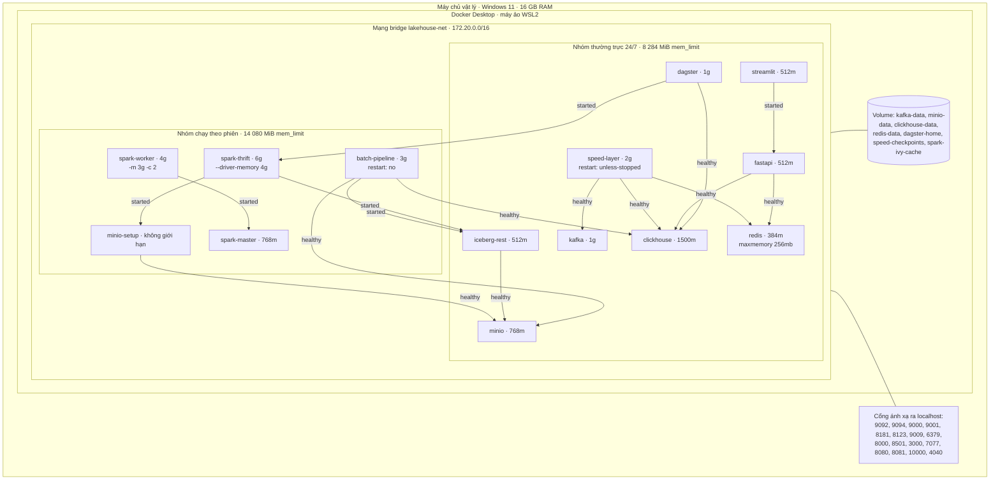

**Hình 3.12: Biểu đồ triển khai vật lý 14 dịch vụ Container trên mạng ảo `lakehouse-net` (UML Deployment Diagram)**

Các mũi tên trong Hình 3.12 là quan hệ `depends_on`, và chúng chỉ có hai mức ngữ nghĩa. Điều kiện `service_healthy` buộc Compose chờ lệnh `healthcheck` của dịch vụ đích thành công. Chỉ bốn dịch vụ có lệnh này: `kafka`, `minio`, `clickhouse` và `redis`. Điều kiện `service_started` chỉ chờ container được tạo, không chờ tiến trình bên trong sẵn sàng. Vì vậy `spark-thrift` có thể chạy trước khi `minio-setup` tạo xong bốn bucket, và `batch-pipeline` có thể gọi `iceberg-rest` khi danh mục chưa trả lời. Không dịch vụ nào dùng `service_completed_successfully`.

Bảy volume có tên giữ dữ liệu qua các lần tạo lại container. Riêng `redis-data` gần như rỗng, vì Redis chạy với `--save ""` nên không ghi bản chụp xuống đĩa. Phần lớn container gắn thư mục mã `./src` (Streamlit gắn `./dashboard`), nên sửa mã trên máy chủ có hiệu lực mà không phải dựng lại image.

Mười sáu cổng được ánh xạ ra máy chủ, kể cả những cổng chỉ có ý nghĩa nội bộ như 7077 của Spark Master hay 9000 của MinIO. Lựa chọn này phục vụ việc phát triển: kịch bản `scripts/verify_services.ps1` kiểm tra bảy điểm cuối HTTP và ba cổng TCP từ `localhost`, còn các bài đo chạy trên máy chủ gọi thẳng ClickHouse ở cổng 8123. Cái giá là mọi cổng đều mở trên các giao diện mạng của máy. ClickHouse dùng tài khoản `default` với mật khẩu rỗng và bật `CLICKHOUSE_DEFAULT_ACCESS_MANAGEMENT=1`, nên cấu hình này chỉ phù hợp với môi trường thử nghiệm cục bộ.

Hai cơ chế khởi tạo dữ liệu chạy một lần. ClickHouse gắn `configs/clickhouse/init.sql` vào `/docker-entrypoint-initdb.d/` ở chế độ chỉ đọc, và tệp này được thực thi khi volume `clickhouse-data` còn trống. Dịch vụ `minio-setup` chạy `aws s3 mb` cho bốn bucket `warehouse`, `bronze`, `silver`, `gold`. Mỗi lệnh kết thúc bằng `|| true`, nên chạy lại khi bucket đã tồn tại vẫn thành công.

Ngoài bộ nhớ, dung lượng đĩa cũng có trần. Kafka giữ nhật ký 24 giờ, tối đa 1 GB cho mỗi phân vùng, với đoạn 100 MB, và tự tạo topic với ba phân vùng. Nhật ký của `speed-layer` dùng trình ghi `json-file` giới hạn ba tệp, mỗi tệp 50 MB.

### 3.8.2. Chiến lược tối ưu ngân sách bộ nhớ ~8GB trên phần cứng 16GB RAM

Trường `mem_limit` đặt trần bộ nhớ cho nhóm điều khiển (cgroup) của container. Đây là trần, không phải lượng bộ nhớ đặt trước. Container dùng ít hơn thì phần dư vẫn thuộc về hệ điều hành. Khi một container vượt trần, nhân Linux kết thúc tiến trình trong container đó bằng cơ chế OOM killer, còn các container khác không bị ảnh hưởng. Ngân sách của đề tài vì vậy được xây trên giả định các dịch vụ không cùng chạm trần.

Chín dịch vụ thường trực có tổng trần:

$$1024 + 768 + 512 + 1500 + 384 + 2048 + 512 + 512 + 1024 = 8\,284\ \text{MiB} \approx 8{,}09\ \text{GiB}$$

Con số 8,125 GB trước đây trong tài liệu dự án có được do coi `1500m` của ClickHouse là 1,5 GiB. Năm dịch vụ chạy theo phiên cộng thêm 14 080 MiB: `batch-pipeline` 3072, `spark-master` 768, `spark-worker` 4096, `spark-thrift` 6144, còn `minio-setup` không đặt trần và thoát ngay sau khi tạo bucket. Tổng trần của cả mười bốn dịch vụ là 22 364 MiB, vượt dung lượng vật lý của máy.

Kiểm toán phát hiện một ràng buộc làm hai nhóm không còn tách bạch. Dịch vụ `dagster` khai báo `depends_on: spark-thrift` với điều kiện `service_started`, nên lệnh `docker compose up -d dagster` sẽ dựng cả `spark-thrift`, `iceberg-rest`, `minio` và `minio-setup`. Khi tính cả Dagster, nhóm thường trực thực chất có trần 8 284 + 6 144 = 14 428 MiB. Lệnh `docker compose up -d` không chỉ định dịch vụ còn khởi động toàn bộ mười bốn dịch vụ, kể cả `batch-pipeline`. Muốn giữ đúng ngân sách khoảng 8 GiB, người vận hành phải liệt kê tường minh các dịch vụ cần chạy.

Trần của container chỉ có tác dụng khi tiến trình bên trong được cấu hình nhỏ hơn nó. Redis chạy với `--maxmemory 256mb --maxmemory-policy allkeys-lru` trong container 384m. Khi đầy, nó loại khóa lâu nhất chưa được truy cập thay vì để container bị kết thúc; phần 128 MiB còn lại dành cho kết nối và phân mảnh bộ nhớ. Spark cần tính kỹ hơn, vì ngoài vùng heap do `driver-memory` quy định, máy ảo Java còn dùng metaspace, ngăn xếp luồng và bộ nhớ ngoài heap [8]. `spark-thrift` đặt `--driver-memory 4g` và `-XX:MaxMetaspaceSize=512m` trong container 6g. `spark-worker` nhận `-m 3g -c 2` trong container 4g. `batch-pipeline` đặt `SPARK_DRIVER_MEMORY = 768m` ở chế độ `local[2]` trong container 3g, đủ chỗ cho tiến trình Python giữ danh sách bản ghi của đường lô thuần Python. `speed-layer` không đặt `spark.driver.memory`, nên driver nhận mặc định 1g của Spark. Bộ lưu trạng thái RocksDB nằm ngoài heap và dùng phần còn lại của container 2g.

ClickHouse không có tệp cấu hình bộ nhớ riêng trong kho mã; container chỉ được nâng giới hạn số tệp mở lên 262 144. Compose không đặt giới hạn CPU cho dịch vụ nào, nên các tiến trình Spark `local[2]`, `local[*]` và ClickHouse [4] cạnh tranh trực tiếp trên số lõi của máy ảo.

Mọi container chạy bên trong máy ảo WSL2 của Docker Desktop. Bộ nhớ của máy ảo này do cấu hình WSL trên Windows quyết định, không phải do `docker-compose.yml`. Kho mã không kèm tệp `.wslconfig`, nên trần thực sự của toàn hệ thống phụ thuộc máy của người chạy. Chính sách khởi động lại cũng mỏng: chỉ `speed-layer` có `restart: unless-stopped`. Kafka, ClickHouse hay FastAPI dừng vì hết bộ nhớ sẽ không tự lên lại.

### 3.8.3. Đóng gói Container Linux Spark tối ưu hóa chạy độc lập (Self-contained images)

Sáu Dockerfile chia thành hai họ. Họ Spark gồm `Dockerfile.speed`, `Dockerfile.batch` và `Dockerfile.spark-thrift`, cùng dựng từ `apache/spark:3.5.9-scala2.12-java17-python3-r-ubuntu`; image của `Dockerfile.spark-thrift` còn được dùng chung cho `spark-master` và `spark-worker`. Họ Python gồm `Dockerfile.serving`, `Dockerfile.dashboard` và `Dockerfile.dagster`, cùng dựng từ `python:3.10-slim`.

`Dockerfile.speed` và `Dockerfile.batch` có cấu trúc giống nhau. Cả hai chuyển sang `root`, tạo liên kết `python → python3`, cài các gói Python có ghim phiên bản, sao chép `src/` và `scripts/`, đặt `PYTHONPATH` trỏ tới `pyspark` và `py4j-0.10.9.7` trong `/opt/spark/python`. Lệnh khởi động lần lượt là `spark_streaming.py --trigger "5 seconds"` và `spark_batch_jobs.py --write-iceberg --iceberg-strict`. `Dockerfile.batch` còn sao chép `configs/` và `datasets/`, và ghi sẵn tài khoản MinIO mặc định `minioadmin` trong lệnh `ENV`. Docker Compose ghi đè các giá trị này bằng biến của `.env`, nhưng việc để giá trị mặc định trong image trái với quy tắc không ghi cứng thông tin bí mật của dự án.

Ba image Spark nạp thư viện Java theo ba cách khác nhau. Chỉ `Dockerfile.spark-thrift` tải sẵn JAR vào `/opt/spark/jars/` lúc dựng image, bằng `wget` từ Maven Central: `iceberg-spark-runtime-3.5_2.12:1.5.2`, `iceberg-aws-bundle:1.5.2`, `hadoop-aws:3.3.4` và `aws-java-sdk-bundle:1.12.262`. Các JAR này luôn nằm trên classpath khi `start-thriftserver.sh` khởi động, nên dbt đọc được bảng Iceberg [2] mà không cần mạng. Speed Layer khai báo `spark.jars.packages = spark-sql-kafka-0-10_2.12:3.5.1` và tải gói lúc khởi động. Service này không có volume Ivy, nên mỗi lần container được tạo lại đều phải tải lại. Batch Layer khai báo bốn gói Iceberg và S3 cùng loại, nhưng có volume `spark-ivy-cache:/root/.ivy2` giữ bộ đệm qua các lần chạy. Hai lưu ý nhỏ: trình kết nối Kafka bản 3.5.1 chạy trên Spark 3.5.9, và tệp `configs/spark/spark-defaults.conf` không được container nào nạp.

Lý do đưa toàn bộ Spark vào container Linux là Windows. Hadoop trên Windows cần tệp nhị phân `winutils.exe` và thư viện `hadoop.dll` cho các lời gọi hệ thống tệp gốc như `NativeIO$Windows.access0`. Thiếu chúng, Spark Structured Streaming có thể ném `UnsatisfiedLinkError` khi ghi checkpoint. Trong container, Spark dùng hệ thống tệp POSIX của nhân Linux nên vấn đề này không xuất hiện. Mã nguồn có thêm một lớp dự phòng cho người muốn chạy trên Windows. Hàm `_configure_windows_hadoop()` trong `spark_streaming.py` tìm `hadoop/bin/winutils.exe` trong thư mục dự án và đặt `HADOOP_HOME`, `PATH` nếu tìm thấy. Nếu không tìm thấy, hàm ghi cảnh báo và trỏ `HADOOP_HOME` tới thư mục giả `%TEMP%\hadoop_fake`. Trên Windows, RocksDB bị tắt và trình ghi tệp dùng thuật toán `fileoutputcommitter` phiên bản 2. Lớp dự phòng này không xử lý `NativeIO$Windows.access0`, và thư mục `hadoop/bin` chỉ chứa tệp hướng dẫn. Đường lô tránh hẳn vấn đề: lõi Bronze → Silver → Gold viết bằng Python thuần, nên chạy trên máy chủ Windows không cần Spark, và chỉ bước ghi Iceberg tùy chọn mới cần container.

Họ Python đơn giản hơn. `Dockerfile.serving` và `Dockerfile.dashboard` cài trực tiếp danh sách gói có ghim phiên bản. Từ bản đồng bộ 2026-11-12, `Dockerfile.serving` không còn sao chép `requirements.txt` vô dụng và có ghim `pydantic==2.6.4`. Năm Dockerfile cài gói bằng pip dùng cùng phiên bản `clickhouse-connect==0.7.0`, `redis==5.0.0`, `kafka-python==2.0.2`, `python-dotenv==1.0.0` và `pyyaml==6.0.0`. `Dockerfile.dagster` là ngoại lệ: nó cài `default-jre-headless`, `curl`, rồi `pip install -r requirements.txt`, trong đó các gói chỉ ràng buộc bằng `>=`. Bốn image bên ngoài là MinIO, AWS CLI, Iceberg REST và ClickHouse dùng nhãn `latest`, nên hai lần dựng ở hai thời điểm có thể cho hai phiên bản khác nhau. Đây là rủi ro tái lập cần ghi nhận.
