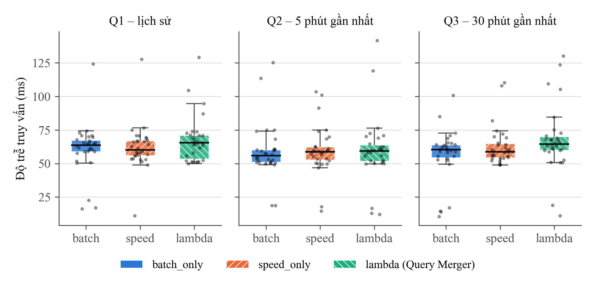
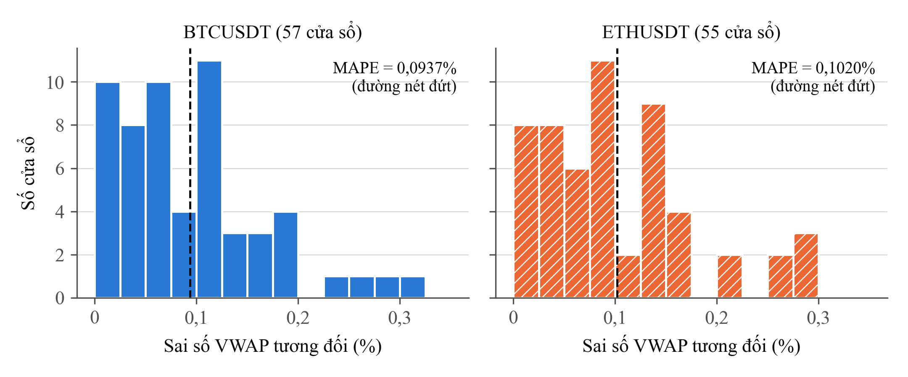
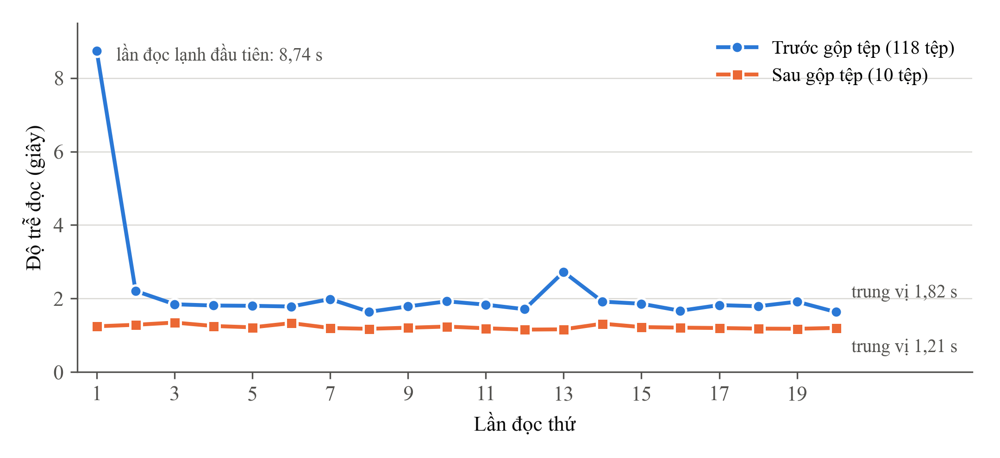

# CHƯƠNG 4: TRIỂN KHAI THỰC NGHIỆM, ĐÁNH GIÁ HIỆU NĂNG VÀ KIỂM TOÁN ĐỐI SOÁT

Chương này trình bày bốn thực nghiệm định lượng và bốn kịch bản kiểm thử hỗn loạn, qua đó trả lời ba câu hỏi nghiên cứu nêu ở Mục 1.2.4. Mọi con số trong chương được nhóm tính lại trực tiếp từ các tệp nhật ký thô trong `results/logs/`. Mỗi bảng ghi rõ tệp nguồn và đợt đo được dùng. Khi một đợt đo bị loại, chương nêu lý do. Khi kết quả không ủng hộ giả thuyết ban đầu, chương trình bày kết quả đúng như đo được.

## 4.1. THIẾT LẬP MÔI TRƯỜNG KIỂM THỬ VÀ KỊCH BẢN ĐO ĐẠC

### 4.1.1. Cấu hình phần cứng, phần mềm và bộ dữ liệu thực nghiệm

Toàn bộ thực nghiệm chạy trên một máy tính xách tay cá nhân, với các dịch vụ được đóng gói bằng Docker Compose trong máy ảo WSL2 của Docker Desktop. Bảng 4.1 tóm tắt môi trường.

**Bảng 4.1: Môi trường phần cứng và phần mềm của thực nghiệm**

| Thành phần | Cấu hình |
| :---: | :---: |
| Bộ xử lý | Intel Core i5-12500H, 12 nhân, 16 luồng |
| Bộ nhớ | 16 GB (15,6 GB hệ điều hành sử dụng được) |
| Lưu trữ | SSD NVMe WD PC SN560, 1 TB |
| Hệ điều hành máy chủ | Windows 11 Home Single Language, bản 10.0.26200 |
| Ảo hóa | Docker Desktop với máy ảo WSL2; 14 dịch vụ trên mạng `lakehouse-net` |
| Phần mềm chính | Kafka 3.7.0 (KRaft), Spark 3.5 (ảnh `apache/spark:3.5.9`), Iceberg 1.5.2, ClickHouse (nhãn `latest`), Redis 7.2, Python 3.10 |

*Nguồn: thông số phần cứng và hệ điều hành đọc từ máy chủ ngày 2026-11-16; phiên bản phần mềm lấy từ docker-compose.yml và các tệp Dockerfile.\*.*

Thông số phần cứng được đọc lại từ máy chủ lưu nhật ký thực nghiệm, sau khi các đợt đo đã hoàn tất. Đề tài không ghi lại phiên bản Docker Desktop và cấu hình bộ nhớ WSL2 tại thời điểm đo. Mục 3.8.2 đã chỉ ra rằng trần bộ nhớ thực sự của toàn hệ thống phụ thuộc vào cấu hình WSL2, nên đây là một biến số chưa được kiểm soát.

Thực nghiệm dùng ba nhóm dữ liệu, tóm tắt trong Bảng 4.2. Nhóm thứ nhất là tập dữ liệu tổng hợp cho tầng lô, do `scripts/generate_mock_data.py` sinh ra. Script khớp phân phối thống kê của nến một phút Binance thật trong `datasets/raw/klines/`, rồi sinh giao dịch theo mô hình chuyển động Brown hình học và tiêm lỗi ở mức nhẹ. Nhóm thứ hai là dữ liệu Binance thật, dùng để mô tả thị trường ở Chương 1. Nhóm thứ ba do từng script thực nghiệm tự sinh để kiểm soát chính xác lượng lỗi.

**Bảng 4.2: Các nhóm dữ liệu dùng trong thực nghiệm**

| Nhóm dữ liệu | Quy mô | Dùng cho |
| :---: | :---: | :---: |
| Dữ liệu tổng hợp `datasets/mock/aggtrades/` | 1 275 230 bản ghi, 14 cặp; `BTCUSDT` có 97 112 bản ghi trong 7 ngày | Tầng lô, ClickHouse, Thực nghiệm 1 và 2 |
| Dữ liệu Binance thật `datasets/raw/` | 500 giao dịch tổng hợp mỗi cặp cho 5 cặp; ảnh chụp ticker 24 giờ | Mô tả thị trường (Mục 1.1.1) |
| Dữ liệu sinh trong script thực nghiệm | 3 × 5 000 sự kiện (Thực nghiệm 4); 200 đến 5 000 sự kiện mỗi kịch bản hỗn loạn; 68 khối × tối đa 25 bản ghi (Thực nghiệm 3) | Thực nghiệm 3, 4 và kiểm thử hỗn loạn |

*Nguồn: datasets/mock/summary_20261017_081458.json, results/logs/batch_pipeline_runs.csv, results/logs/small_file_preparation.csv.*

Lượt chạy lô trên toàn bộ dữ liệu tổng hợp, ghi trong `batch_pipeline_runs.csv`, cho kết quả ổn định qua 16 lần chạy từ 2026-10-27 đến 2026-11-12: 1 275 230 bản ghi đầu vào, 1 059 840 bản ghi hợp lệ, 27 016 bản ghi bị cách ly (2,12%), 188 374 bản trùng bị khử (14,77%), và 132 494 cây nến một phút. Ba con số đầu cộng lại đúng bằng tổng đầu vào, nghĩa là không bản ghi nào bị mất ngoài hai đường cách ly và khử trùng. Đề cương ban đầu dự kiến dùng hơn 5 triệu giao dịch `BTCUSDT` thật. Đề tài không đạt quy mô này: dữ liệu tầng lô là dữ liệu tổng hợp và nhỏ hơn khoảng bốn lần.

### 4.1.2. Phương pháp thu thập số liệu và lựa chọn đợt đo chính thức

Bốn thực nghiệm được điều phối bởi `scripts/benchmarks/run_all_benchmarks.py`. Mỗi script ghi từng lần đo thành một dòng trong tệp CSV riêng, kèm dấu thời gian. Do đó các tệp nhật ký tích lũy kết quả của mọi đợt chạy từ tháng 9 đến tháng 11/2026. Trước khi phân tích, nhóm nhóm các dòng theo dấu thời gian để tách từng đợt, rồi chọn một đợt chính thức cho mỗi thực nghiệm theo ba tiêu chí: đợt chạy trên mã nguồn đã sửa các lỗi ảnh hưởng tới phép đo, đợt có khối lượng truy vấn thực sự (truy vấn trả về dữ liệu), và với thực nghiệm gộp tệp, đợt đo ở chế độ `mode = real` trên bảng Iceberg thật. Bảng 4.3 ghi lại lựa chọn và lý do loại các đợt khác.

**Bảng 4.3: Đợt đo chính thức và các đợt bị loại của từng thực nghiệm**

| Thực nghiệm | Đợt chính thức | Đợt bị loại và lý do |
| :---: | :---: | :---: |
| 1. Độ trễ truy vấn | 2026-11-11 18:59 UTC, 540 lượt | 2026-11-12: phần lớn truy vấn trả về 0 nến (300/360 truy vấn Q2); các đợt tháng 9 và 10 chạy trên trạng thái ClickHouse khác |
| 2. Độ chính xác tái xử lý | 2026-11-11 19:00 UTC, 112 cửa sổ | 2026-11-12: chỉ một cặp, cho cùng MAPE với đợt chính thức vì cùng hạt giống nhiễu |
| 3. Gộp tệp nhỏ | 2026-11-11 19:02 UTC, `mode = real`, 20 lần đọc mỗi pha | 2026-10-23: chỉ 2 lần đọc mỗi pha; các đợt `mode = simulation` |
| 4. Cổng chất lượng | `bm_fault_20261111_185324` | `bm_fault_20261027_*`: chạy trên bộ tiêm lỗi có ngưỡng không cộng dồn |
| Kiểm thử hỗn loạn | 2026-11-08 13:45 UTC | Năm đợt tháng 10: thời gian hội tụ bị cộng hằng số cố định (Mục 4.6.2) |

*Nguồn: nhóm thực hiện phân loại theo cột thời gian của các tệp trong results/logs/ và lịch sử commit của scripts/benchmarks/.*

Các biểu đồ trong chương do nhóm vẽ lại trực tiếp từ dòng dữ liệu của đợt chính thức. Các hình có sẵn trong `results/plots/` được tạo ngày 2026-10-27 từ các đợt cũ nên không được dùng.

## 4.2. THỰC NGHIỆM 1: ĐO LƯỜNG VÀ ĐÁNH GIÁ ĐỘ TRỄ TRUY VẤN

### 4.2.1. Thiết kế kịch bản: Batch-only, Speed-only và Lambda Merge

Script `bench_latency.py` so sánh ba chiến lược truy vấn trên cùng một máy chủ ClickHouse. Chiến lược `batch_only` gọi `query_candles()` trên bảng `batch_agg`. Chiến lược `speed_only` gọi cùng hàm đó trên `speed_agg`. Chiến lược `lambda` gọi `AutoCorrectingQueryMerger.merge_query()`. Cả ba đều đọc với `FINAL`. Mốc thời gian tham chiếu T~now~ là giá trị `window_start` lớn nhất của `batch_agg`, ở đợt chính thức là 2026-10-17 09:59 UTC. Watermark được giả lập bằng T~now~ − 24 giờ và truyền thẳng vào `WatermarkReader`, nên việc đọc watermark không tốn lượt khứ hồi tới ClickHouse. Mỗi tổ hợp được đo 30 lần cho mỗi cặp `BTCUSDT` và `ETHUSDT`, ba chiến lược chạy xen kẽ trong cùng một vòng lặp.

**Bảng 4.4: Ba loại truy vấn và trường hợp định tuyến thực tế của Query Merger**

| Truy vấn | Khoảng thời gian | Số nến trả về | Trường hợp của Query Merger |
| :---: | :---: | :---: | :---: |
| Q1 – lịch sử | [T~now~ − 48 h, T~now~ − 24 h) | 105 | Trường hợp 1: T~end~ ≤ W, chỉ đọc `batch_agg` |
| Q2 – 5 phút gần nhất | [T~now~ − 5 phút, T~now~) | 5 | Trường hợp 2: T~start~ ≥ W, chỉ đọc `speed_agg` |
| Q3 – 30 phút gần nhất | [T~now~ − 30 phút, T~now~) | 30 | Trường hợp 2: T~start~ ≥ W, chỉ đọc `speed_agg` |

*Nguồn: scripts/benchmarks/bench_latency.py (hàm build_time_ranges, run_benchmark); src/serving_layer/query_merger.py; số nến lấy từ cột rows_returned của results/logs/bench_latency.csv, cặp BTCUSDT.*

Bảng 4.4 chứa một phát hiện quan trọng về thiết kế thực nghiệm. Q3 được đặt tên là truy vấn lai (`Q3_hybrid`), với ý định cắt ngang watermark. Tuy nhiên, với W = T~now~ − 24 giờ, khoảng 30 phút cuối nằm hoàn toàn sau W. Query Merger vì vậy xử lý Q3 theo Trường hợp 2, giống Q2. Trường hợp 3, trong đó thuật toán gửi ba truy vấn và tính độ lệch tại ranh giới, chưa được đo trong thực nghiệm này. Muốn đo Trường hợp 3, watermark giả lập phải nằm trong khoảng 30 phút cuối, ví dụ đặt tham số `--watermark-offset-hours` nhỏ hơn 0,5 giờ. Script hiện chỉ nhận giá trị nguyên cho tham số này.

Hệ quả thứ hai là mỗi lượt `lambda` trong thực nghiệm gồm đúng một truy vấn ClickHouse, cộng phần xử lý Python của Query Merger: chọn trường hợp, chuyển dòng thành đối tượng `CandleData`, khử trùng theo (`symbol`, `window_start`) và kiểm tra cảnh báo đột biến. Phép so sánh giữa `lambda` và hai chiến lược còn lại vì vậy đo chi phí của phần xử lý này, không đo chi phí của việc ghép hai bảng.

### 4.2.2. Phân tích kết quả phân phối độ trễ P50, P95, P99

Bảng 4.5 trình bày kết quả của cặp `BTCUSDT`. Phân vị được tính bằng nội suy tuyến tính trên 30 lần đo mỗi ô. Tệp `bench_latency_summary.csv` do script sinh ra dùng phương pháp hạng dưới nên lệch vài phần trăm mili-giây so với bảng này.

**Bảng 4.5: Độ trễ truy vấn theo loại truy vấn và chiến lược (BTCUSDT, đợt 2026-11-11, 30 lần mỗi ô)**

| Truy vấn | Chiến lược | Trung bình (ms) | P50 (ms) | P95 (ms) | P99 (ms) | Nhỏ nhất – lớn nhất (ms) |
| :---: | :---: | :---: | :---: | :---: | :---: | :---: |
| Q1 | `batch_only` | 60,91 | 63,66 | 73,67 | 109,65 | 16,24 – 124,12 |
| Q1 | `speed_only` | 62,08 | 60,09 | 75,80 | 112,84 | 11,17 – 127,68 |
| Q1 | `lambda` | 67,54 | 65,42 | 100,05 | 122,02 | 50,01 – 129,18 |
| Q2 | `batch_only` | 59,07 | 55,88 | 96,17 | 121,85 | 18,64 – 125,26 |
| Q2 | `speed_only` | 59,69 | 58,74 | 96,70 | 102,78 | 14,71 – 103,49 |
| Q2 | `lambda` | 59,76 | 59,44 | 99,79 | 135,07 | 12,15 – 141,63 |
| Q3 | `batch_only` | 56,64 | 60,28 | 79,51 | 96,30 | 10,55 – 100,89 |
| Q3 | `speed_only` | 62,91 | 58,73 | 96,21 | 109,58 | 48,82 – 110,26 |
| Q3 | `lambda` | 67,63 | 64,51 | 117,19 | 128,15 | 11,17 – 130,05 |

*Nguồn: nhóm thực hiện tính từ results/logs/bench_latency.csv, các dòng có ts 2026-11-11T18 và symbol BTCUSDT.*

*Nguồn: nhóm thực hiện vẽ từ results/logs/bench_latency.csv, đợt 2026-11-11; hộp là khoảng tứ phân vị, vạch đen là trung vị, chấm là từng lần đo.*

Gộp chung ba loại truy vấn, mỗi chiến lược có 90 lần đo với `BTCUSDT` và 180 lần đo khi tính cả `ETHUSDT`. Bảng 4.6 cho kết quả tổng hợp và so sánh với một đợt đo cũ.

**Bảng 4.6: Độ trễ tổng hợp theo chiến lược**

| Chiến lược | P50 BTCUSDT (ms) | P95 BTCUSDT (ms) | P99 BTCUSDT (ms) | P50 hai cặp (ms) | P50 đợt 2026-10-23 (ms) |
| :---: | :---: | :---: | :---: | :---: | :---: |
| `batch_only` | 60,12 | 80,54 | 124,24 | 60,26 | 58,35 |
| `speed_only` | 58,94 | 96,70 | 112,18 | 58,08 | 51,58 |
| `lambda` | 62,84 | 114,71 | 131,32 | 62,35 | 50,92 |

*Nguồn: nhóm thực hiện tính từ results/logs/bench_latency.csv; cột đợt 2026-10-23 lấy từ cùng tệp, chỉ dùng để đối chiếu.*

Có bốn nhận xét.

Thứ nhất, ba chiến lược cho độ trễ gần như bằng nhau. Chênh lệch P50 giữa chiến lược nhanh nhất và chậm nhất chỉ 3,9 ms với `BTCUSDT` và 4,3 ms khi tính cả hai cặp. Mức này nhỏ hơn biến động của chính một chiến lược giữa hai đợt đo: P50 của `speed_only` đổi từ 51,58 ms lên 58,94 ms giữa đợt 2026-10-23 và đợt 2026-11-11.

Thứ hai, `lambda` luôn chậm hơn một chút ở P50 và chậm hơn rõ ở P95, P99. Điều này khớp với thiết kế ở Mục 4.2.1: `lambda` làm cùng một truy vấn ClickHouse như hai chiến lược kia, cộng thêm phần xử lý Python. Phần chênh lệch ở đuôi phân phối (P95 114,71 ms so với 80,54 ms của `batch_only`) nhiều khả năng đến từ việc tạo đối tượng và kiểm tra cảnh báo cho từng nến. Thực nghiệm chưa tách riêng phần thời gian này.

Thứ ba, độ trễ không tăng theo số nến. Q1 trả về 105 nến, Q2 chỉ 5 nến, nhưng P50 của hai loại truy vấn gần nhau. Với lượng dữ liệu nhỏ như vậy, thời gian bị chi phối bởi chi phí cố định của mỗi lượt khứ hồi, gồm thư viện `clickhouse-connect` qua HTTP, chuyển tiếp cổng từ Windows vào WSL2, và bước khử trùng `FINAL`. Hình 4.1 còn cho thấy phân phối có hai cụm: phần lớn lần đo nằm trong khoảng 50 đến 75 ms, nhưng mỗi chiến lược có vài lần chỉ mất 10 đến 20 ms. Đề tài chưa xác định nguyên nhân của cụm nhanh này.

Thứ tư, ưu thế của `lambda` ghi nhận ở đợt 2026-10-23 (P50 50,92 ms, nhanh nhất trong ba chiến lược) không tái lập được ở đợt chính thức. Vì ở cả hai đợt, `lambda` đều chỉ gửi một truy vấn như hai chiến lược kia, thứ tự nhanh chậm giữa các chiến lược nằm trong phạm vi nhiễu đo. Không thể kết luận chiến lược nào nhanh hơn.

### 4.2.3. Trả lời câu hỏi nghiên cứu RQ1

RQ1 hỏi kiến trúc Lambda có giúp giảm độ trễ truy vấn so với Batch-only hay không. Dữ liệu không ủng hộ khẳng định này. Ở đợt chính thức, P50 của Query Merger là 62,84 ms so với 60,12 ms của `batch_only`, tức chậm hơn 2,72 ms. Kết luận có thể bảo vệ được hẹp hơn: thuật toán hợp nhất truy vấn thêm một chi phí nhỏ, cỡ vài mili-giây ở P50, so với truy vấn trực tiếp một bảng ClickHouse, trong khi trả về kết quả đã được định tuyến theo watermark và gắn nhãn trạng thái đối soát.

Cần nói rõ ý nghĩa của "Batch-only" trong phép so sánh này. Ở đây `batch_only` là truy vấn bảng `batch_agg` đã tổng hợp sẵn trên ClickHouse, không phải một hệ thống xử lý lô thuần túy theo nghĩa của Mục 1.2.1. Lợi ích độ trễ thật của kiến trúc Lambda, theo đúng mục đích của tầng tốc độ trong mô hình gốc [17, Ch. 1], là độ tươi của dữ liệu: dữ liệu của phút vừa qua có mặt trong `speed_agg` sau một chu kỳ micro-batch 5 giây, trong khi `batch_agg` chỉ có nó sau chu kỳ lô 15 phút. Thực nghiệm này đo thời gian phản hồi truy vấn, không đo độ tươi. Vì vậy nó không trả lời được phần quan trọng nhất của RQ1. Đây là một hạn chế của thiết kế thực nghiệm, cùng với việc Trường hợp 3 chưa được đo.

## 4.3. THỰC NGHIỆM 2: ĐÁNH GIÁ ĐỘ CHÍNH XÁC TÁI XỬ LÝ

### 4.3.1. Thiết kế kịch bản đo độ lệch giữa Speed View và Batch View

Script `bench_reprocess.py` so sánh VWAP của hai khung nhìn trên các cửa sổ trong khoảng [T~ref~ − 2 h, T~ref~ − 1 h), với T~ref~ là `window_start` lớn nhất của `batch_agg`. Ở chế độ mặc định `force_seed = True`, trước khi đo, script gọi `seed_speed_view.py` để tạo lại khung nhìn tốc độ của khoảng này từ chính khung nhìn lô. Khối lượng được nhân với một hệ số ngẫu nhiên phân phối đều U(0,95; 0,985), còn VWAP được dịch theo một tỷ lệ phân phối chuẩn N(0,0002; 0,0012). Bộ sinh số ngẫu nhiên được khởi tạo bằng hạt giống `42 + tổng mã ký tự của symbol`, nên cùng một cặp luôn nhận cùng một dãy nhiễu. Sau đó script tính MAE, MAPE và RMSE của sai số VWAP theo các công thức ở Mục 2.2.3.

Thiết kế này kiểm tra được đường đo: truy vấn hai bảng, ghép theo `window_start`, tính sai số và ghi vào `reconciliation_audit_metrics`. Nó không đo được sai số thật của tầng tốc độ, vì sai số đã được quyết định bởi tham số nhiễu. Kỳ vọng của sai số tương đối tuyệt đối khi sai số tuân theo N(μ = 0,0002; σ = 0,0012) là:

$$E\left|X\right| = \sigma \sqrt{\frac{2}{\pi}} e^{-\mu^2 / 2\sigma^2} + \mu \left(1 - 2\Phi\left(-\frac{\mu}{\sigma}\right)\right) \approx 0,0971\%$$

### 4.3.2. Phân tích sai số định lượng MAE, MAPE, RMSE

**Bảng 4.7: Sai số VWAP giữa khung nhìn tốc độ mô phỏng và khung nhìn lô (đợt 2026-11-11)**

| Cặp | Khoảng đo (UTC) | Số cửa sổ khớp | MAE (USDT) | MAPE (%) | RMSE (USDT) | Sai số lớn nhất (%) |
| :---: | :---: | :---: | :---: | :---: | :---: | :---: |
| `BTCUSDT` | 2026-10-17 07:59 – 08:59 | 57 | 61,27 | 0,0937 | 77,19 | 0,3221 |
| `ETHUSDT` | 2026-10-17 07:59 – 08:59 | 55 | 3,21 | 0,1020 | 3,96 | 0,2916 |

*Nguồn: nhóm thực hiện tính từ results/logs/bench_reprocess.csv (các dòng ts 2026-11-11T19), đối chiếu khớp với results/logs/bench_reprocess_summary.csv.*

*Nguồn: nhóm thực hiện vẽ từ results/logs/bench_reprocess.csv, đợt 2026-11-11.*

MAPE đo được là 0,0937% với `BTCUSDT` và 0,1020% với `ETHUSDT`. Cả hai giá trị nằm sát kỳ vọng lý thuyết 0,0971% của tham số nhiễu. Đợt đo 2026-11-12 trên một khung giờ khác của `BTCUSDT` cho đúng MAPE 0,0937%, vì cùng hạt giống sinh ra cùng dãy nhiễu. Hai quan sát này xác nhận rằng MAPE của Thực nghiệm 2 phản ánh tham số mô phỏng, không phản ánh hành vi của Spark Structured Streaming. Tỷ lệ RMSE trên MAE là khoảng 1,26 với `BTCUSDT` và 1,23 với `ETHUSDT`, gần giá trị √(π/2) ≈ 1,25 của phân phối chuẩn, nghĩa là sai số trải đều trên các cửa sổ, không tập trung ở vài điểm.

Khoảng đo một giờ chỉ có 57 và 55 cửa sổ khớp. Ba và năm phút còn lại không có nến trong `batch_agg`, nên bị loại khỏi phép so sánh. Cột tỷ lệ bao phủ trong tệp tổng hợp ghi 100% vì được tính trên các phút có nến ở tầng lô.

Đề cương ban đầu dự kiến báo cáo sai số của giá đóng cửa và khối lượng. Script hiện chỉ tính sai số VWAP. Khối lượng của khung nhìn tốc độ mô phỏng lệch 1,5% đến 5% theo cấu hình, nhưng độ lệch này không được ghi vào nhật ký của Thực nghiệm 2.

## 4.4. THỰC NGHIỆM 3: ĐÁNH GIÁ HIỆU QUẢ GỘP TỆP NHỎ TRÊN APACHE ICEBERG

### 4.4.1. Thiết kế kịch bản sinh tệp nhỏ và gộp tệp

Đợt chính thức chạy trong container `batch-pipeline` ngày 2026-11-11. Trước hết, `prepare_small_files.py --chunk-size 25 --max-records 1000 --repeat 2` ghi nối 68 khối nhỏ vào bảng Bronze, tổng cộng 1 664 bản ghi. Mỗi khối là một lần cam kết Iceberg riêng, mất từ 0,58 đến 16,76 giây. Sau bước này, bảng có 118 tệp Parquet. Tiếp theo, `bench_compaction.py --runs 20` đọc bảng 20 lần với điều kiện lọc `symbol = 'BTCUSDT'`, gọi `CompactionJob.run_bin_packing_compaction()`, tức thủ tục `rewrite_data_files` với chiến lược `binpack` [5] và cấu hình mặc định ở Mục 2.3.3, rồi đọc thêm 20 lần. Thực nghiệm không chạy `expire_snapshots` và `remove_orphan_files`, nên không đánh giá phần thu hồi dung lượng.

### 4.4.2. Phân tích số lượng tệp và tốc độ đọc

**Bảng 4.8: Kết quả gộp tệp nhỏ (đợt 2026-11-11, `mode = real`, 20 lần đọc mỗi pha)**

| Chỉ số | Trước gộp tệp | Sau gộp tệp | Thay đổi |
| :---: | :---: | :---: | :---: |
| Số tệp Parquet | 118 | 10 | Giảm 91,5% |
| Kích thước tệp trung bình | 0,97 MB | 10,60 MB | Tăng 10,9 lần |
| Tổng dung lượng dữ liệu | 114,37 MB | 105,97 MB | Giảm 7,3% |
| Lần đọc đầu tiên | 8 740,5 ms | 1 245,1 ms | – |
| Trung bình 20 lần | 2 220,0 ms | 1 226,1 ms | 1,81 lần |
| Trung bình bỏ lần đầu (19 lần) | 1 876,8 ms | 1 225,1 ms | 1,53 lần |
| Trung vị bỏ lần đầu | 1 821,8 ms | 1 206,4 ms | 1,51 lần |
| Độ lệch chuẩn 20 lần | 1 553,1 ms | 55,5 ms | – |
| Thời gian gộp tệp | – | 17,54 s | – |

*Nguồn: nhóm thực hiện tính từ results/logs/bench_compaction.csv, 40 dòng mode = real có ts 2026-11-11T19:02; kích thước tệp lấy từ nhật ký hàm get_file_stats() của cùng đợt chạy.*

*Nguồn: nhóm thực hiện vẽ từ results/logs/bench_compaction.csv, đợt 2026-11-11, mode = real.*

Cột `speedup_ratio` trong CSV ghi 1,81 lần, là tỷ số giữa hai giá trị trung bình có tính cả lần đọc đầu tiên. Hình 4.2 cho thấy lần đọc đầu tiên của pha trước là một lần đọc lạnh: 8,74 giây, gấp khoảng 4,8 lần các lần sau. Lần đọc này gồm cả chi phí khởi động bộ đệm siêu dữ liệu và tải 118 tệp lần đầu từ MinIO. Pha sau chạy khi bộ đệm đã nóng, nên không có lần đọc lạnh tương ứng. Do đó con số 1,81 lần bị thổi phồng bởi một điều kiện không cân xứng giữa hai pha. Con số so sánh được là khoảng 1,5 lần (trung vị 1,51 lần, trung bình bỏ lần đầu 1,53 lần).

Các đợt đo ngày 2026-10-23 báo hệ số khoảng 2,1 lần với chỉ 2 lần đọc mỗi pha, và lần đọc thứ nhất của pha trước luôn là lần đọc lạnh (7,9 đến 8,8 giây). Với 2 lần đọc, lần đọc lạnh chiếm một nửa giá trị trung bình, nên hệ số 2,1 lần cũng không dùng được làm kết luận.

Lợi ích rõ nhất của gộp tệp không nằm ở tốc độ trung bình mà ở độ ổn định. Độ lệch chuẩn giảm từ 1 553,1 ms xuống 55,5 ms. Ngay cả khi bỏ lần đọc lạnh, pha trước vẫn có một lần đọc 2,7 giây ở lần thứ 13, còn pha sau dao động trong khoảng hẹp 1,16 đến 1,35 giây.

### 4.4.3. Đánh giá chi phí và trả lời câu hỏi nghiên cứu RQ3

Gộp 118 tệp mất 17,54 giây. Mỗi lần đọc sau gộp tệp nhanh hơn khoảng 615 ms theo trung vị. Như vậy chi phí gộp tệp được bù lại sau khoảng 29 lần đọc kiểu này. Với lịch bảo trì hai giờ một lần của Dagster, một bảng chỉ được đọc vài lần mỗi chu kỳ sẽ không bù được chi phí, còn một bảng được truy vấn thường xuyên sẽ có lợi. Trong hệ thống của đề tài, tầng phục vụ đọc ClickHouse chứ không đọc Bronze, nên bảng Bronze chủ yếu được đọc khi tái xử lý. Lợi ích về tốc độ đọc của gộp tệp vì vậy có giá trị nhất cho các lượt tái xử lý lịch sử.

Câu trả lời cho RQ3: trên bảng Bronze 118 tệp của đề tài, gộp tệp bin-packing giảm 91,5% số tệp, tăng tốc đọc khoảng 1,5 lần ở trạng thái bộ đệm nóng, và giảm độ lệch chuẩn của thời gian đọc khoảng 28 lần, với chi phí 17,54 giây. Kết quả có hai giới hạn. Bảng thực nghiệm chỉ khoảng 106 MB, nên 10 tệp sau khi gộp có kích thước trung bình 10,6 MB, vẫn xa mục tiêu 128 MB vì dữ liệu không đủ để lấp đầy. Ngoài ra, hệ số tăng tốc chỉ được đo cho một kiểu truy vấn lọc theo một cặp giao dịch.

## 4.5. THỰC NGHIỆM 4: ĐÁNH GIÁ CỔNG KIỂM SOÁT CHẤT LƯỢNG VÀ CÁCH LY LỖI

### 4.5.1. Thiết lập ma trận tiêm lỗi

Script `bench_fault.py` chạy ba lượt. Mỗi lượt sinh 5 000 sự kiện gốc `BTCUSDT` với hạt giống `42 + iteration`. Script tạo trước 2% sự kiện có giá âm (`negative_price`), rồi cho toàn bộ đi qua `FaultInjector` với tỷ lệ lỗi tổng 20%, chia thành `schema_invalid` 4%, `late_data` 5%, `out_of_order` 4% và `duplicate` 7%. Kết quả được đưa qua `clean_and_deduplicate()`. Lớp dương gồm các bản ghi `schema_invalid` và `negative_price`, là hai loại lỗi mà cổng chất lượng phải cách ly. Các bản ghi `late_data` và `out_of_order` có nội dung hợp lệ nên thuộc lớp âm, theo quy ước ở Mục 2.6.3.

### 4.5.2. Ma trận nhầm lẫn và các chỉ số phân loại

**Bảng 4.9: Kết quả phân loại của cổng chất lượng qua ba lượt (`bm_fault_20261111_185324`)**

| Lượt | Tổng bản ghi | TP | FP | FN | TN | Bản trùng bị khử | Accuracy | Thời gian (ms) | Thông lượng (bản ghi/s) |
| :---: | :---: | :---: | :---: | :---: | :---: | :---: | :---: | :---: | :---: |
| 1 | 5 318 | 309 | 0 | 0 | 4 691 | 318 | 0,9402 | 12,51 | 425 100 |
| 2 | 5 354 | 274 | 0 | 0 | 4 726 | 354 | 0,9339 | 30,27 | 176 875 |
| 3 | 5 346 | 291 | 0 | 0 | 4 709 | 346 | 0,9353 | 14,26 | 374 895 |
| Tổng | 16 018 | 874 | 0 | 0 | 14 126 | 1 018 | 0,9365 (trung bình) | 14,26 (trung vị) | 374 895 (trung vị) |

*Nguồn: results/logs/bench_fault_results.csv và results/logs/bench_fault_summary.csv, run_id bm_fault_20261111_185324.*

Qua cả ba lượt, cổng chất lượng không cách ly nhầm bản ghi hợp lệ nào (FP = 0) và không để lọt bản ghi lỗi nào (FN = 0). Precision, Recall và F1 đều bằng 1,0. Accuracy chỉ là 0,9365 vì mẫu số gồm cả 1 018 bản trùng đã bị khử, vốn không thuộc ô nào của ma trận nhầm lẫn: (874 + 14 126) / 16 018 = 0,9364. Tỷ lệ bản ghi được cho qua là 88,19% và tỷ lệ bị cách ly là 5,46%. Đợt `bm_fault_20261111_181102` chạy trước đó 42 phút cho đúng các số đếm này, chỉ khác thời gian xử lý, xác nhận kết quả phân loại là tất định.

Kết quả hoàn hảo này cần được đọc đúng phạm vi. Hai loại lỗi thuộc lớp dương đều vi phạm một luật đơn giản (giá hoặc khối lượng không dương), và chính các luật đó được dùng để phát hiện. Thực nghiệm chứng minh cổng chất lượng được cài đặt đúng và ổn định. Nó không chứng minh khả năng phát hiện những lỗi tinh vi hơn, ví dụ một giá dương nhưng lệch xa giá thị trường, vì hệ thống không có luật cho loại lỗi đó. Ở đợt cũ `bm_fault_20261027_072857`, Recall chỉ đạt 0,6744 với 262 bản ghi lỗi lọt qua. Đợt `bm_fault_20261027_073031` chạy khoảng hai phút sau đó trên cùng số bản ghi lại đạt Recall 1,0. Nhật ký không ghi lại thay đổi nào giữa hai đợt. Cả hai đợt đều bị loại vì chạy trên bộ tiêm lỗi cũ (Bảng 4.3), nhưng sự khác biệt này cho thấy kết quả của cổng chất lượng nhạy với phiên bản mã nguồn, và cần chạy lại thực nghiệm sau mỗi thay đổi.

### 4.5.3. Chi phí trễ bổ sung của tầng kiểm tra chất lượng

Thời gian xử lý trung vị là 14,26 ms cho khoảng 5 300 bản ghi, tức khoảng 2,7 µs cho mỗi bản ghi, bao gồm cả chuẩn hóa, kiểm tra bảy luật và khử trùng. Thông lượng thay đổi đáng kể giữa các lượt, từ 176 875 đến 425 100 bản ghi mỗi giây, do tải của máy, trong khi các chỉ số phân loại không đổi. Nếu ngoại suy theo thông lượng trung vị, việc kiểm tra toàn bộ 1 275 230 bản ghi của tập dữ liệu tổng hợp mất khoảng 3,4 giây. Con số này nhỏ so với chu kỳ lô 15 phút. Đây là ước lượng, không phải số đo, vì `batch_pipeline_runs.csv` không ghi thời lượng của từng bước.

## 4.6. KIỂM TOÁN BỐN KỊCH BẢN KIỂM THỬ HỖN LOẠN VÀ PHÂN TÍCH ĐÁNH ĐỔI KỸ THUẬT

### 4.6.1. Thiết kế và kết quả bốn kịch bản

Bốn kịch bản trong `run_chaos_smoke_tests.py` kiểm tra bốn bài toán biên ở Mục 2.4.3. Theo nguyên tắc của kỹ thuật hỗn loạn [10], mỗi kịch bản đặt giả thuyết về một trạng thái ổn định đo được, cụ thể là độ lệch trở về 0 sau đối soát, rồi kiểm tra giả thuyết đó theo cùng một khuôn: tạo dữ liệu sạch, đưa vào một dị thường, đo độ lệch của "khung nhìn tốc độ", cho dữ liệu đi qua đường xử lý lô, rồi đo lại. Như đã nêu ở Mục 1.3.3, hành vi của tầng tốc độ được mô phỏng bằng quy tắc trong Python, còn đường xử lý lô dùng đúng mã của hệ thống, gồm `clean_and_deduplicate()`, `aggregate_gold_candles()` và `AutoCorrectingQueryMerger` với ClickHouse giả lập.

**Bảng 4.10: Kết quả bốn kịch bản kiểm thử hỗn loạn (đợt chính thức 2026-11-08)**

| Kịch bản | Dị thường đưa vào | Trước đối soát | Sau đối soát | T~conv~ (s) | Kết quả |
| :---: | :---: | :---: | :---: | :---: | :---: |
| TC1: mất chuỗi | Bỏ 50 trong 200 mã giao dịch liên tiếp | R~gap~ = 25,0%, ΔV~%~ = 23,58% | R~gap~ = 0%, ΔV~%~ = 0% | 0,0035 | Đạt |
| TC2: sự kiện trễ | 40 trong 200 giao dịch trễ 120 giây (gấp đôi watermark) | ΔV~%~ = 21,15% | ΔV~%~ = 0% | 0,0094 | Đạt |
| TC3: trùng hàng loạt | Phát lại 1 000 sự kiện hai lần | R~dup~ = 50,0% | R~dup~ = 0%, ΔV~%~ = 0% | 0,0123 | Đạt |
| TC4: bùng tải | 5 000 sự kiện trong một đợt | 5 000 sự kiện cần xử lý | 5 000 sự kiện được xử lý | 0,0618 | Đạt |

*Nguồn: results/logs/chaos_smoke_tests.csv, bốn dòng có ts 2026-11-08T13:45:47.*

Độ lệch trước đối soát của TC1 và TC2 thay đổi giữa các lần chạy, vì khối lượng của từng giao dịch được sinh ngẫu nhiên không theo hạt giống cố định. Qua cả sáu đợt chạy có trong nhật ký, ΔV~%~ trước đối soát nằm trong khoảng 23,41% đến 25,90% với TC1 và 19,70% đến 22,18% với TC2. Sau đối soát, độ lệch luôn bằng 0. R~gap~ của TC1 luôn là 25%, đúng bằng 50/200 mã bị bỏ. R~dup~ của TC3 luôn là 50%, đúng bằng tỷ lệ bản sao.

TC4 có một giới hạn cần nêu. Script đặt giới hạn mỗi đợt `max_offsets = 20000`, trong khi chỉ có 5 000 sự kiện, nên toàn bộ được xử lý trong một đợt duy nhất và cơ chế chia đợt không được kích hoạt. Kịch bản cũng không chạy Spark, nên kết luận "không tràn bộ nhớ" chỉ áp dụng cho các hàm Python được gọi, không áp dụng cho truy vấn Structured Streaming với `maxOffsetsPerTrigger = 50000`.

### 4.6.2. Thời gian hội tụ và một lỗi trong phiên bản đo cũ

Trong phiên bản đầu của script (commit `c4ea6f2`, 2026-10-17), thời gian hội tụ được tính bằng thời gian chạy thật cộng một hằng số cố định: 0,12 s cho TC1, 0,25 s cho TC2, 0,18 s cho TC3 và 0,08 s cho TC4. Vì vậy năm đợt chạy tháng 10 trong nhật ký đều ghi T~conv~ xấp xỉ 0,12; 0,25; 0,185 và 0,08 giây, bất kể máy chạy nhanh hay chậm. Commit `19e554c` ngày 2026-11-08 đã bỏ các hằng số này. Đợt chạy cùng ngày là đợt duy nhất có T~conv~ phản ánh thời gian tính toán thật: từ 3,5 ms đến 61,8 ms.

Ngay cả ở đợt chính thức, T~conv~ chỉ là thời gian tính toán trong bộ nhớ của bước tái xử lý, không phải thời gian hội tụ đầu-cuối theo định nghĩa ở Mục 2.2.3. Trong hệ thống thật, một cây nến lệch pha chỉ được sửa khi chu kỳ lô kế tiếp chạy xong và watermark W vượt qua nó. Với lịch Dagster 15 phút một lần, và ở chế độ đọc Kafka thêm khoảng trễ 60 giây của watermark tầng lô, thời gian hội tụ thật của một cửa sổ có thể lên tới khoảng 16 phút, cộng thêm thời lượng của lượt chạy lô. Đây là cận trên ước lượng từ cấu hình, chưa được đo.

### 4.6.3. Tổng hợp trả lời câu hỏi nghiên cứu RQ2

RQ2 hỏi khung nhìn tốc độ sai lệch bao nhiêu so với khung nhìn lô, và quá trình tự đối soát diễn ra như thế nào. Câu trả lời của đề tài gồm ba phần, với mức độ chắc chắn khác nhau.

Phần thứ nhất là cơ chế đối soát hoạt động đúng. Trong cả bốn kịch bản và sáu đợt chạy, đường xử lý lô đưa mọi độ lệch về 0: dữ liệu trễ được tính lại theo thời gian sự kiện, bản trùng được khử, khoảng trống chuỗi được lấp khi dữ liệu bị thiếu được bổ sung. Query Merger trả về khối lượng khớp chuẩn đối chiếu ở TC2. Kết luận này được hỗ trợ tốt bởi số liệu, trong phạm vi kiểm thử logic.

Phần thứ hai là độ lớn của sai lệch khi có lỗi. Với tỷ lệ lỗi được mô phỏng, 20% giao dịch đến trễ quá watermark hoặc 25% giao dịch bị mất, khối lượng của khung nhìn tốc độ lệch khoảng 20% đến 26%. Độ lệch này tỷ lệ gần như trực tiếp với phần giao dịch bị loại, đúng như mong đợi.

Phần thứ ba là sai lệch của tầng tốc độ khi chạy thật trên luồng dữ liệu thật. Đề tài chưa đo được phần này. Thực nghiệm 2 dùng khung nhìn tốc độ mô phỏng bằng nhiễu, còn các kịch bản hỗn loạn mô phỏng hành vi của tầng tốc độ bằng quy tắc. Muốn đo, cần chạy tầng tốc độ trên một luồng có lỗi đã biết, cho tầng lô xử lý cùng luồng đó, rồi đọc cột `volume_drift_pct` và `vwap_error` của bảng kiểm toán, vốn đã được tính cho từng cửa sổ thật (Bảng 2.3).

### 4.6.4. Thảo luận các đánh đổi kỹ thuật

Bốn thực nghiệm cho thấy bốn đánh đổi chính của kiến trúc.

**Độ trễ và độ đúng.** Tầng tốc độ cho số liệu sau khoảng 5 giây nhưng chấp nhận bỏ sự kiện trễ hơn 1 phút, đúng kiểu đánh đổi giữa độ đúng và độ trễ mà mô hình Dataflow mô tả [2]. Tầng lô cho số liệu đúng nhưng chỉ sau chu kỳ 15 phút. Người dùng luôn thấy trạng thái này qua nhãn `Provisional` và `Reconciled`, nhưng trong khoảng thời gian tới 16 phút, một cây nến có thể sai tới cỡ phần giao dịch bị bỏ. Các kịch bản hỗn loạn cho thấy phần này có thể lên tới hơn 20% khối lượng khi lỗi xảy ra dồn dập. Rút ngắn chu kỳ lô làm giảm khoảng sai này nhưng làm tăng số lần ghi Bronze, tức làm bài toán tệp nhỏ ở Thực nghiệm 3 nặng hơn.

**Chi phí cài đặt hai lần.** Logic tổng hợp tồn tại hai lần, một trên Spark và một bằng Python. Đề tài giảm rủi ro hai bản cài đặt lệch nhau bằng cách cho chúng dùng chung các mô-đun tính nến, phát hiện đột biến và tiêu chí đối soát. Thực nghiệm 2 và các kịch bản hỗn loạn chưa kiểm chứng việc hai bản cài đặt cho cùng kết quả trên cùng dữ liệu sạch, vì không có thực nghiệm nào chạy cả hai tầng thật trên cùng một luồng. Đây là phép kiểm chứng còn thiếu quan trọng nhất của đề tài.

**Tính nhất quán khi đọc.** Mọi truy vấn của tầng phục vụ dùng `FINAL` để luôn thấy phiên bản mới nhất của mỗi cây nến [11]. Đổi lại, mỗi truy vấn phải khử trùng lúc đọc. Với lượng dữ liệu nhỏ của Thực nghiệm 1, chi phí này không tách được khỏi chi phí khứ hồi. Ở quy mô lớn hơn, nó có thể trở nên đáng kể.

**Tài nguyên.** Hai đường xử lý cộng các dịch vụ hỗ trợ tạo thành 14 container với tổng trần bộ nhớ 22 364 MiB, vượt dung lượng 16 GB của máy (Mục 3.8.2). Các thực nghiệm chạy được vì không phải mọi dịch vụ đều chạy cùng lúc ở mức trần. Đây là cái giá trực tiếp của việc giữ hai đường xử lý so với một kiến trúc Kappa chỉ có một [15].

**Bảng 4.11: Tổng hợp câu trả lời cho ba câu hỏi nghiên cứu**

| Câu hỏi | Kết luận | Mức độ chắc chắn | Giới hạn chính |
| :---: | :---: | :---: | :---: |
| RQ1 | Query Merger không giảm độ trễ phản hồi; chi phí thêm khoảng 2,7 ms ở P50 so với truy vấn trực tiếp `batch_agg` | Trung bình: chênh lệch nằm trong biên nhiễu giữa các đợt | Chưa đo Trường hợp 3 và độ tươi của dữ liệu |
| RQ2 | Đối soát đưa độ lệch 20% – 26% về 0 trong mọi kịch bản; MAPE 0,09% – 0,10% của Thực nghiệm 2 là tham số nhiễu | Cao cho logic đối soát; thấp cho sai số thật của tầng tốc độ | Tầng tốc độ được mô phỏng ở cả hai nguồn bằng chứng |
| RQ3 | Gộp tệp giảm 91,5% số tệp, tăng tốc đọc khoảng 1,5 lần, giảm độ lệch chuẩn khoảng 28 lần, tốn 17,54 s | Cao trong điều kiện đã đo | Bảng nhỏ (khoảng 106 MB), một kiểu truy vấn |

*Nguồn: tổng hợp từ Mục 4.2 đến 4.6.*
