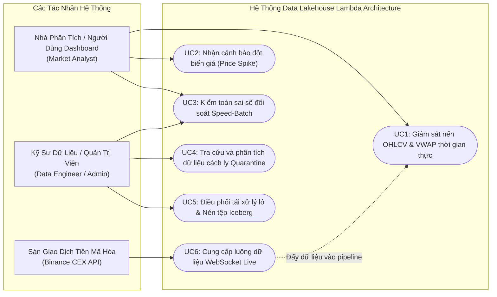
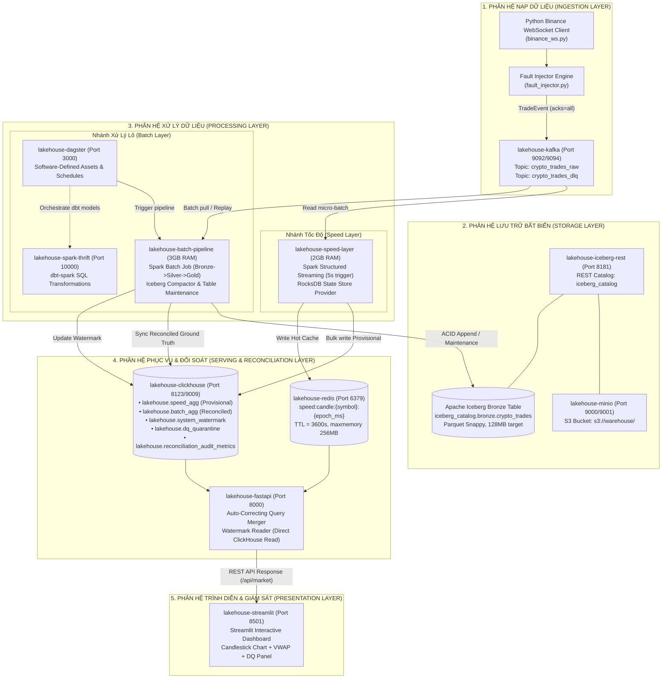

# ĐẶC TẢ KỸ THUẬT TIỂU MỤC 3.1: PHÂN TÍCH YÊU CẦU NGHIỆP VỤ VÀ LUỒNG DỮ LIỆU TỔNG THỂ
# (TECHNICAL SPECIFICATION: SECTION 3.1)

> **Mục lục liên kết:** Thuộc Chương 3 trong [master_outline.md](file:///thesis_workspace/master_outline.md)  
> **Các tiểu mục bao hàm:**  
> - `3.1.1. Đặc tả luồng dữ liệu WebSocket sàn Binance và Data Contract JSON Schema`  
> - `3.1.2. Định nghĩa các chỉ số tài chính nghiệp vụ (OHLCV, VWAP, Price Spike)`  
> - `3.1.3. Thiết kế kiến trúc tổng thể 5 phân hệ & Hồ sơ UML tổng quát`  
> **Nguồn mã nguồn & tệp cấu hình trích xuất:**  
> - [src/ingestion/models.py](file:///src/ingestion/models.py)  
> - [datasets/schemas/trade_event_schema.json](file:///datasets/schemas/trade_event_schema.json)  
> - [docs/process/01_ingestion_data_contract.md](file:///docs/process/01_ingestion_data_contract.md)  
> - [src/speed_layer/metrics_calculator.py](file:///src/speed_layer/metrics_calculator.py)  
> - [src/speed_layer/spike_detector.py](file:///src/speed_layer/spike_detector.py)  
> - [docs/md/sys-arch.md](file:///docs/md/sys-arch.md)  
> - [docker-compose.yml](file:///docker-compose.yml)  
> - [thesis_workspace/specs/00_global_constants.md](file:///thesis_workspace/specs/00_global_constants.md)

---

## 1. TIỂU MỤC 3.1.1: ĐẶC TẢ LUỒNG DỮ LIỆU WEBSOCKET BINANCE VÀ DATA CONTRACT JSON SCHEMA

### 1.1. Cơ Chế Kết Nối & Ánh Xạ Gói Tin Binance WebSocket
Dòng dữ liệu giao dịch trực tiếp được thu nhận từ luồng WebSocket công khai của sàn Binance qua kênh `@aggTrade` hoặc `@trade` đối với cặp giao dịch chuẩn `BTCUSDT` (URL: `wss://stream.binance.com:9443/ws/btcusdt@aggTrade`). 

Mỗi bản tin nhận được từ sàn là một payload JSON chứa các khóa ký hiệu ngắn gọn nhằm tối ưu băng thông mạng. Lớp `TradeEvent` trong [src/ingestion/models.py](file:///src/ingestion/models.py) thông qua phương thức `from_binance_raw()` thực hiện phân tích cú pháp (*parsing*), chuẩn hóa kiểu dữ liệu (*type coercion*), và gán nhãn thời gian tiếp nhận:

$$\text{Binance Raw Tick } \{\texttt{s, a, p, q, T, m}\} \xrightarrow{\text{from\_binance\_raw()}} \text{Normalized } \texttt{TradeEvent}$$

#### Bảng Ánh Xạ Chi Tiết Giữa Gói Tin Binance và Model Chuẩn Hóa:

| Khóa Gốc Binance (`Raw JSON`) | Thuộc Tính Model (`TradeEvent`) | Kiểu Dữ Liệu | Cơ Chế Chuyển Đổi & Ràng Buộc | Ý Nghĩa Nghiệp Vụ Thực Tế |
| :--- | :--- | :--- | :--- | :--- |
| `s` | `symbol` | `str` | `str(tick["s"]).upper()` | Cặp tiền giao dịch (luôn chuẩn hóa IN HOA: `BTCUSDT`). |
| `a` (hoặc `t`) | `trade_id` | `int` | `int(tick.get("a", tick.get("t")))` | Aggregate Trade ID duy nhất, đơn điệu tăng, làm khóa khử trùng lặp. |
| `p` | `price` | `float` | `float(tick["p"])`, điều kiện $> 0$ | Mức giá khớp lệnh (chuyển đổi từ chuỗi số thập phân sang số thực). |
| `q` | `quantity` | `float` | `float(tick["q"])`, điều kiện $> 0$ | Khối lượng coin cơ sở trong giao dịch khớp lệnh. |
| `T` (hoặc `E`) | `trade_time` | `int` | `int(tick.get("T", tick.get("E")))` | Thời điểm khớp lệnh thực tế trên Matching Engine (Epoch Unix ms UTC). |
| `m` | `is_buyer_maker` | `bool` | `bool(tick["m"])` | `True`: Bên mua là Maker (Taker bán); `False`: Bên mua là Taker (Taker mua). |
| *(Tự sinh nội bộ)* | `ingestion_time` | `int` | `int(time.time() * 1000)` | Dấu thời gian hệ thống Ingestion tiếp nhận gói tin (Epoch ms UTC). |
| *(Tự sinh nội bộ)* | `is_injected` | `bool` | Mặc định `False` | Cờ đánh dấu bản ghi được tiêm lỗi có kiểm soát bởi `FaultInjector`. |
| *(Tự sinh nội bộ)* | `fault_type` | `str` / `None` | Mặc định `None` | Định danh loại lỗi tiêm: `duplicate`, `late_data`, `schema_invalid`. |

---

### 1.2. Đặc Tả Hợp Đồng Dữ Liệu Sự Kiện Giao Dịch (`trade_event_schema.json`)
Data Contract được quản lý tập trung bằng chuẩn JSON Schema Draft 2020-12 tại [datasets/schemas/trade_event_schema.json](file:///datasets/schemas/trade_event_schema.json), đóng vai trò là bản đặc tả kỹ thuật ràng buộc nghiêm ngặt giữa tầng Ingestion và các tầng xử lý hạ nguồn (Speed Layer, Batch Layer).

**Bảng 3.1: Đặc tả hợp đồng dữ liệu sự kiện giao dịch khớp lệnh (`trade_event_schema.json`)**

| Tên Trường (`Field`) | Kiểu Dữ Liệu (`Data Type`) | Ràng Buộc Kỹ Thuật Trong Schema (`Schema Constraints`) | Bắt Buộc (`Required`) | Diễn Giải Ngữ Nghĩa & Kiểm Tra Nghiệp Vụ Tại Silver Layer |
| :--- | :---: | :--- | :---: | :--- |
| `trade_id` | `integer` | Khai báo kiểu `integer` trong JSON Schema | **Có** | Mã giao dịch khớp lệnh từ Binance; kiểm tra $> 0$ và đơn điệu tăng được thực hiện tại tầng Data Quality (`dq_checks.py`). |
| `symbol` | `string` | Khai báo kiểu `string` trong JSON Schema | **Có** | Cặp giao dịch; chuẩn hóa in hoa tại Ingestion và kiểm tra `len > 0` tại tầng Data Quality. |
| `price` | `number` | `minimum: 1e-8`, giá trị dương tuyệt đối | **Có** | Mức giá khớp lệnh (đơn vị: USDT); `from_binance_raw()` gán mặc định `0.0` nếu lỗi, sau đó `dq_checks.py` cách ly nếu $\le 0$. |
| `quantity` | `number` | `minimum: 1e-8`, giá trị dương tuyệt đối | **Có** | Khối lượng tài sản cơ sở; cách ly tại tầng Data Quality nếu $\le 0$. |
| `trade_time` | `integer` | Khai báo kiểu `integer` trong JSON Schema | **Có** | Thời điểm khớp lệnh từ sàn (Event-time ms); kiểm tra hợp lệ $\ge 0$ tại tầng Data Quality. |
| `is_buyer_maker` | `boolean` | Khai báo kiểu `boolean` trong JSON Schema | **Có** | Xác định vị thế chủ động/bị động của lệnh khớp (Market Maker/Taker). |
| `ingestion_time` | `integer` | Khai báo kiểu `integer` trong JSON Schema | **Có** | Thời điểm hệ thống tiếp nhận gói tin (System-time ms). |
| `is_injected` | `boolean` | `default: false` | **Có** | Cờ metadata nhận diện bản ghi mô phỏng lỗi kiểm thử thực nghiệm. |
| `fault_type` | `string` / `null` | Kiểu `string` hoặc `null` (không giới hạn enum tĩnh) | Không | Nhãn loại lỗi tiêm phục vụ Benchmark (`duplicate`, `late_data`, `out_of_order`, `schema_invalid`). |

*Nguồn: Trích xuất trực tiếp từ tệp cấu hình datasets/schemas/trade_event_schema.json và src/ingestion/models.py*

---

### 1.3. Cơ Chế Đóng Gói Sự Kiện Lỗi Sang Dead-Letter Queue (`DLQEvent`)
Để bảo đảm đường ống thu thập hoạt động liên tục 24/7 không bị gián đoạn khi nhận phải các gói tin hỏng, biến dạng JSON hoặc lỗi kết nối, hệ thống thiết kế lớp cấu trúc `DLQEvent` trong [src/ingestion/models.py](file:///src/ingestion/models.py). Các bản ghi lỗi này lập tức được phân luồng sang topic Kafka riêng biệt `crypto_trades_dlq`:

* **`raw_payload`** (`str`): Nội dung chuỗi thô của bản tin không thể phân tích cú pháp.
* **`error_reason`** (`str`): Thông báo ngoại lệ chi tiết (Ví dụ: `JSONDecodeError`, `missing required fields: price`).
* **`source_stream`** (`str`): Định danh kênh nguồn phát sinh lỗi (Giá trị truyền thực tế khi chạy luồng là `"binance_ws"`; `"binance_websocket"` là giá trị mặc định trong khai báo lớp).
* **`received_at`** (`int`): Thời điểm phát hiện sự cố (Unix Epoch mili-giây UTC).

---

## 2. TIỂU MỤC 3.1.2: ĐỊNH NGHĨA CÁC CHỈ SỐ TÀI CHÍNH NGHIỆP VỤ (OHLCV, VWAP, PRICE SPIKE)

Trong phân hệ giám sát tài chính thời gian thực, dữ liệu dạng tick giao dịch rời rạc được tổng hợp thành các nến thời gian (*Candlesticks*) theo cửa sổ thời gian cố định Tumbling Window (khung 1 phút và 5 phút).

### 2.1. Thuật Toán Tổng Hợp Nến OHLCV Thời Gian Thực
Trong [src/speed_layer/metrics_calculator.py](file:///src/speed_layer/metrics_calculator.py), việc trích xuất các chỉ số nến từ tập hợp các giao dịch trong một cửa sổ $W = [T_{\text{start}}, T_{\text{end}})$ tuân theo các nguyên tắc:

1. **Giá Mở Cửa (`open_price`):** Là mức giá của giao dịch phát sinh sớm nhất trong cửa sổ:
   $$\text{Open} = P_k \quad \text{với } k = \arg\min_{i} (\text{trade\_time}_i)$$
2. **Giá Đóng Cửa (`close_price`):** Là mức giá của giao dịch phát sinh muộn nhất trong cửa sổ:
   $$\text{Close} = P_m \quad \text{với } m = \arg\max_{i} (\text{trade\_time}_i)$$
3. **Giá Cao Nhất (`high_price`) & Giá Thấp Nhất (`low_price`):**
   $$\text{High} = \max_{i} (P_i), \quad \text{Low} = \min_{i} (P_i)$$
4. **Tổng Khối Lượng Giao Dịch (`volume`) & Tổng Số Lệnh (`trade_count`):**
   $$V = \sum_{i=1}^{N} Q_i, \quad N = \sum_{i=1}^{N} 1$$

#### Kỹ Thuật Struct Tie-Breaking Trong PySpark Structured Streaming:
Khi xử lý luồng phân tán tần suất cao trên Apache Spark, nhiều giao dịch có thể xảy ra trong cùng một mili-giây (`trade_time`). Để loại bỏ tính bất định (non-deterministic) khi chọn `open_price` và `close_price`, phương thức `get_spark_aggregation_exprs()` đóng gói cấu trúc struct gồm 3 trường:

```python
# Kỹ thuật kết hợp struct(trade_time, trade_id, price) để tie-break tuyệt đối
time_price_struct = F.struct(
    F.col("trade_time"),
    F.col("trade_id"),
    F.col("price"),
)

spark_agg_exprs = [
    F.min(time_price_struct).getItem("price").alias("open_price"),
    F.max(F.col("price")).alias("high_price"),
    F.min(F.col("price")).alias("low_price"),
    F.max(time_price_struct).getItem("price").alias("close_price"),
    F.sum(F.col("quantity")).alias("volume"),
    F.count(F.lit(1)).alias("trade_count"),
    (F.sum(F.col("price") * F.col("quantity")) / F.sum(F.col("quantity"))).alias("vwap"),
]
```

> [!NOTE]
> **Lưu ý sự khác biệt kiểu `trade_id` giữa hai tầng:** Trong `src/speed_layer/trade_schema.py`, `trade_id` được khai báo là `StringType()`. Do đó, khi hai giao dịch có cùng mili-giây `trade_time`, Spark so sánh `trade_id` theo thứ tự từ điển chuỗi ký tự (ví dụ `"999" > "1000"`), trong khi tầng Batch Layer so sánh theo số nguyên (`1000 > 999`).

---

### 2.2. Công Thức & Hiện Thực Hóa Chỉ Số VWAP (Volume-Weighted Average Price)
Chỉ số giá trung bình gia quyền theo khối lượng (VWAP) là thước đo quan trọng phản ánh giá trị giao dịch thực tế của thị trường, triệt tiêu ảnh hưởng của các lệnh ảo khối lượng nhỏ:

$$\text{VWAP} = \frac{\sum_{i=1}^{N} \left(P_i \times Q_i\right)}{\sum_{i=1}^{N} Q_i}$$

* **Trong Pure Python (`calculate_vwap_python`):**
  $$\text{total\_value} = \sum (P_i \times Q_i), \quad \text{total\_volume} = \sum Q_i \implies \text{VWAP} = \text{round}\left(\frac{\text{total\_value}}{\text{total\_volume}}, 6\right)$$
* **Xử lý biên an toàn:** Nếu trong cửa sổ không có khối lượng ($\text{total\_volume} \le 0$), hàm trả về giá trị an toàn `0.0` để chống lỗi chia cho 0 (`ZeroDivisionError`).

---

### 2.3. Thuật Toán Phát Hiện Đột Biến Giá Tức Thời (Price Spike Detector)
Được triển khai trong [src/speed_layer/spike_detector.py](file:///src/speed_layer/spike_detector.py), thuật toán phát hiện đột biến giá dựa trên hai tiêu chí biến động tương đối độc lập:

1. **Bước nhảy giá tức thời giữa Close và Open (`price_change`):**
   $$\Delta P_{\text{step}} = \frac{|\text{Close} - \text{Open}|}{\text{Open}}$$
2. **Biên độ dao động cực đại trong phiên (`volatility_range`):**
   $$\Delta P_{\text{range}} = \frac{\text{High} - \text{Low}}{\text{Low}}$$

#### Quy Tắc Quyết Định Gắn Cờ `is_spike`:
Một nến bị xác định là có đột biến bất thường (`is_spike = 1`) nếu thỏa mãn ít nhất một trong hai điều kiện:

$$\text{is\_spike} = \begin{cases} 1 & \text{nếu } \Delta P_{\text{step}} \ge \theta_{\text{change}} \quad \text{hoặc} \quad \Delta P_{\text{range}} \ge \theta_{\text{range}} \\ 0 & \text{ngược lại} \end{cases}$$

Trong đó, các hằng số cấu hình mặc định là:
* **`DEFAULT_PRICE_CHANGE_THRESHOLD`** ($\theta_{\text{change}}$): `0.02` (tương ứng biến động giá tức thời vượt quá **$2.0\%$** trong 1 phút).
* **`DEFAULT_RANGE_THRESHOLD`** ($\theta_{\text{range}}$): `0.03` (tương ứng biên độ dao động High - Low vượt quá **$3.0\%$** trong 1 phút).

Biểu thức Spark Column tối ưu hóa trong streaming:
```python
price_change_cond = (
    F.abs(F.col("close_price") - F.col("open_price")) / F.col("open_price")
    >= self.price_change_threshold
)
range_cond = (
    (F.col("high_price") - F.col("low_price")) / F.col("low_price")
    >= self.range_threshold
)
spike_col = F.when(price_change_cond | range_cond, F.lit(1)).otherwise(F.lit(0)).cast("int").alias("is_spike")
```

---

## 3. TIỂU MỤC 3.1.3: THIẾT KẾ KIẾN TRÚC TỔNG THỂ 5 PHÂN HỆ & HỒ SƠ UML TỔNG QUÁT

Hệ thống được tổ chức thành **5 phân hệ kiến trúc chặt chẽ**:
1. **Phân hệ Nạp Dữ liệu (Ingestion Layer):** Thu nhận dòng WebSocket trực tiếp và chuyển đổi giao thức.
2. **Phân hệ Lưu trữ Dữ liệu Bất biến (Storage Layer):** Lưu trữ Data Lakehouse trên Apache Iceberg và MinIO S3.
3. **Phân hệ Xử lý Phân tán (Processing Layer):** Gồm nhánh Tốc độ (Speed Layer - Spark Streaming) và nhánh Xử lý Lô (Batch Layer - Spark Batch / Dagster).
4. **Phân hệ Phục vụ & Đối soát (Serving & Reconciliation Layer):** Kho dữ liệu OLAP ClickHouse, Redis Cache và Gateway FastAPI Query Merger.
5. **Phân hệ Trình diễn & Giám sát (Presentation Layer):** Giao diện Streamlit Dashboard và bộ phát cảnh báo bất thường.

---

### 3.1. Biểu Đồ Use Case Tổng Quát (UML Use Case Diagram)
Biểu đồ mô tả sự tương tác giữa 3 tác nhân chính (*Actors*) và 6 ca sử dụng cốt lõi của hệ thống đối soát.



**Hình 3.1: Biểu đồ Use Case tổng quát của hệ thống đối soát dữ liệu thời gian thực (UML Use Case Diagram)**

---

### 3.2. Biểu Đồ Thành Phần Kiến Trúc Tổng Thể 5 Phân Hệ (UML Component Diagram)
Biểu đồ thể hiện chi tiết mối quan hệ giữa 14 container Docker, các topic Kafka, bảng Apache Iceberg, bảng ClickHouse và bộ nhớ đệm Redis trên mạng ảo `lakehouse-net`.



**Hình 3.2: Biểu đồ thành phần kiến trúc tổng thể 5 phân hệ (UML Component Diagram)**

---

### 3.3. Ma Trận Tương Tác Dữ Liệu Giữa 14 Container Trên Mạng `lakehouse-net`

| Tên Container | Container Phụ Thuộc (`depends_on`) | Giao Thức & Cổng Giao Tiếp | Tệp Nguồn / Điểm Thực Thi Cốt Lõi | Luồng Dữ Liệu Đầu Vào / Đầu Ra |
| :--- | :--- | :--- | :--- | :--- |
| `lakehouse-kafka` | Không | TCP `9092` (nội bộ), `9094` (host) | `apache/kafka:3.7.0` | Nhận `TradeEvent` từ Ingestion; phát luồng cho Speed và Batch. |
| `lakehouse-minio` | Không | HTTP `9000` (API), `9001` (Web) | `quay.io/minio/minio:latest` | Lưu trữ các tệp Parquet và siêu dữ liệu snapshot của bảng Iceberg. |
| `lakehouse-minio-setup` | `lakehouse-minio` | AWS CLI S3 | `amazon/aws-cli:latest` | Tạo các bucket: `warehouse`, `bronze`, `silver`, `gold` lúc khởi động. |
| `lakehouse-iceberg-rest` | `lakehouse-minio` | HTTP `8181` | `tabulario/iceberg-rest:latest` | REST Catalog quản lý phân cấp metadata pointer của Iceberg trên MinIO. |
| `lakehouse-speed-layer` | `kafka`, `clickhouse`, `redis` | Spark Local[2] | [src/speed_layer/spark_streaming.py](file:///src/speed_layer/spark_streaming.py) | Đọc `crypto_trades_raw`; ghi `speed_agg` (ClickHouse) và Redis key. |
| `lakehouse-batch-pipeline`| `minio`, `iceberg-rest`, `clickhouse` | Spark Local[2] | [src/batch_layer/spark_batch_jobs.py](file:///src/batch_layer/spark_batch_jobs.py) | Đọc raw events; ghi Iceberg Bronze; đồng bộ `batch_agg` & Watermark. |
| `lakehouse-clickhouse` | Không | HTTP `8123`, Native `9000` | [configs/clickhouse/init.sql](file:///configs/clickhouse/init.sql) | Lưu trữ các bảng ReplacingMergeTree phục vụ truy vấn OLAP tức thời. |
| `lakehouse-redis` | Không | TCP `6379` | `redis:7.2-alpine` | Lưu trữ bộ đệm nến tức thời cho Dashboard và Serving Layer. |
| `lakehouse-fastapi` | `clickhouse`, `redis` | HTTP REST `8000` | [src/serving_layer/api_routes.py](file:///src/serving_layer/api_routes.py) | Cung cấp API đối soát tự động theo mốc Watermark (`QueryMerger`). |
| `lakehouse-streamlit` | `fastapi` | HTTP `8501` | [dashboard/app.py](file:///dashboard/app.py) | Giao diện người dùng trực quan hóa nến, đối soát và cảnh báo lỗi. |
| `lakehouse-dagster` | `clickhouse`, `spark-thrift` | HTTP Web `3000` | [dagster_project/repository.py](file:///dagster_project/repository.py) | Điều phối luồng xử lý lô Medallion tự động và kích hoạt Compaction. |
| `lakehouse-spark-master` | Không | Spark RPC `7077`, Web `8080`| `Dockerfile.spark-thrift` | Điều phối cụm Spark độc lập khi chạy tiến trình ngoài container. |
| `lakehouse-spark-worker` | `lakehouse-spark-master`| Spark Internal `8081` | `Dockerfile.spark-thrift` | Thực thi tính toán phân tán (2 CPU Cores, 3GB RAM). |
| `lakehouse-spark-thrift` | `iceberg-rest`, `minio-setup` | Hive Thrift `10000`, Web `4040`| `Dockerfile.spark-thrift` | Cung cấp giao diện Thrift JDBC kết nối cho `dbt-spark`. |

---

## 4. ĐIỂM NGHẼN VÀ ĐÁNH ĐỔI KỸ THUẬT (TRADE-OFFS & ARCHITECTURAL BOTTLENECKS)

1. **Đánh đổi giữa Độ Trôi Dạt Thời Gian Sự Kiện (Clock Drift) và Độ Bền Trạng Thái:**
   * *Hiện tượng thực tế:* Giữa thời điểm khớp lệnh tại sàn Binance (`trade_time`) và thời điểm gói tin đi vào hệ thống (`ingestion_time`) luôn có độ trôi dạt mạng (transport skew từ $16\text{ ms}$ đến $347\text{ ms}$). Nếu chọn Watermark quá ngắn ($< 30\text{s}$), các giao dịch trễ hợp lệ sẽ bị Speed Layer loại bỏ oan, gây sụt giảm thể tích tức thời ($\Delta V_{\%} > 0$). Ngược lại, nếu nới rộng Watermark ($> 5\text{m}$), bộ nhớ trạng thái state store sẽ tăng vọt, đe dọa giới hạn bộ nhớ $2.0\text{ GB}$ của container `speed-layer`.
   * *Giải pháp đã chọn:* Cấu hình `watermark_duration = 1 minute` kết hợp `RocksDBStateStoreProvider` để đẩy bộ nhớ trạng thái từ Java JVM Heap xuống disk volume `speed-checkpoints`.
2. **Chi Phí Tính Toán Của Kỹ Thuật Struct Tie-Breaking:**
   * *Hiện tượng thực tế:* Việc khởi tạo cấu trúc `F.struct(trade_time, trade_id, price)` cho hàng chục ngàn sự kiện trong mỗi micro-batch đòi hỏi chi phí serialization và cấp phát bộ nhớ phụ trợ trong Catalyst Optimizer.
   * *Đánh đổi:* Chấp nhận tiêu hao thêm khoảng $3\% - 5\%$ thời gian tính toán micro-batch để đổi lấy **tính tất định 100% (Absolute Determinism)** của giá Open và Close, bảo đảm không bao giờ bị phụ thuộc vào trật tự ngẫu nhiên của partition khi nhiều giao dịch có cùng mili-giây.
3. **Mâu Thuẫn Khóa Trùng Lặp Giữa WebSocket Kênh AggTrade và Trade Thường:**
   * *Hiện tượng thực tế:* Gói tin `aggTrade` sử dụng mã `a` (Aggregate Trade ID), trong khi luồng trade lẻ sử dụng mã `t` (Trade ID). Khi chuyển tiếp hoặc trộn nguồn dữ liệu, mã `trade_id` có thể không cùng một không gian định danh nếu không kiểm soát chặt chẽ.
   * *Giải pháp đã chọn:* Hệ thống chuẩn hóa ưu tiên đọc Aggregate Trade ID `int(tick.get("a", tick.get("t", 0)))` và áp dụng hợp đồng dữ liệu nghiêm ngặt `datasets/schemas/trade_event_schema.json` ngay tại cửa ngõ Ingestion.

