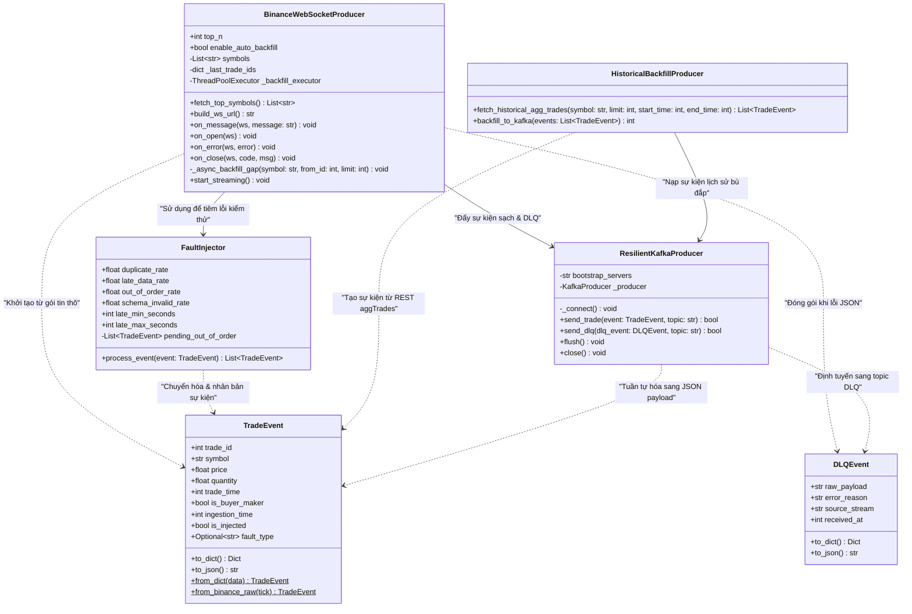
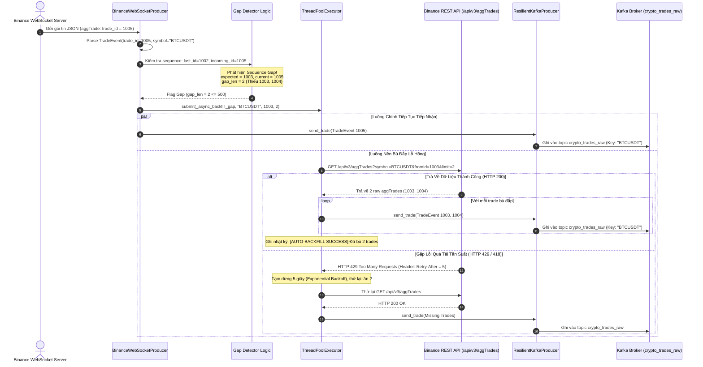

# ĐẶC TẢ KỸ THUẬT TIỂU MỤC 3.2: HIỆN THỰC PHÂN HỆ THU THẬP DỮ LIỆU (INGESTION LAYER) & FAULT INJECTOR
# (TECHNICAL SPECIFICATION: SECTION 3.2)

> **Mục lục liên kết:** Thuộc Chương 3 trong [master_outline.md](file:///thesis_workspace/master_outline.md)  
> **Các tiểu mục bao hàm:**  
> - `3.2.1. Xây dựng Binance WebSocket Live Stream Client bất đồng bộ`  
> - `3.2.2. Xây dựng Kafka Producer nạp dữ liệu phân vùng vào topic crypto_trades_raw`  
> - `3.2.3. Xây dựng Module Fault Injector tiêm lỗi chủ động phục vụ đánh giá`  
> - `3.2.4. Xây dựng Historical Backfill Client khắc phục lỗ hổng chuỗi (Sequence Gap Healing)`  
> **Nguồn mã nguồn & tệp cấu hình trích xuất:**  
> - [src/ingestion/binance_ws.py](file:///src/ingestion/binance_ws.py)  
> - [src/ingestion/kafka_producer.py](file:///src/ingestion/kafka_producer.py)  
> - [src/ingestion/fault_injector.py](file:///src/ingestion/fault_injector.py)  
> - [src/ingestion/historical_backfill.py](file:///src/ingestion/historical_backfill.py)  
> - [src/ingestion/models.py](file:///src/ingestion/models.py)  
> - [configs/kafka/topics.yaml](file:///configs/kafka/topics.yaml)  
> - [scripts/benchmarks/bench_fault.py](file:///scripts/benchmarks/bench_fault.py)  
> - [thesis_workspace/specs/00_global_constants.md](file:///thesis_workspace/specs/00_global_constants.md)

---

## 1. TIỂU MỤC 3.2.1: XÂY DỰNG BINANCE WEBSOCKET LIVE STREAM CLIENT BẤT ĐỒNG BỘ

### 1.1. Kiến Trúc Thu Thập Đa Kênh Phức Hợp (Multiplexed WebSocket Stream)
Trong [src/ingestion/binance_ws.py](file:///src/ingestion/binance_ws.py), lớp `BinanceWebSocketProducer` đảm nhiệm vai trò Gateway giao tiếp trực tiếp với hạ tầng của sàn Binance. Để tối ưu hóa tài nguyên mạng và tránh mở quá nhiều socket TCP đồng thời, hệ thống sử dụng cơ chế Combined Streams của Binance WebSocket API:

1. **Khám phá và xếp hạng cặp giao dịch động (`fetch_top_symbols`):**
   * Định kỳ hoặc lúc khởi động, client truy vấn endpoint REST API:
     $$\text{GET } \texttt{https://api.binance.com/api/v3/ticker/24hr}$$
   * Bộ lọc lọc các cặp có đuôi `USDT`, loại trừ các token đòn bẩy hoặc phái sinh (`UPUSDT`, `DOWNUSDT`, `BEARUSDT`, `BULLUSDT`).
   * Sắp xếp giảm dần theo giá trị giao dịch 24 giờ (`quoteVolume`):
     $$\text{usdt\_pairs.sort}\left(\text{key}=\lambda x: \text{float}(x.get(\text{"quoteVolume"}, 0.0)), \text{reverse}=\text{True}\right)$$
   * Trích xuất danh sách Top $N$ đồng coin thanh khoản cao nhất (mặc định $N = 10$). Nếu quá trình gọi REST API gặp sự cố timeout hoặc mạng, client tự động kích hoạt cơ chế dự phòng an toàn (Fallback), tải danh sách tĩnh được định nghĩa trong cấu hình hệ thống: `config.binance.symbol_list[:self.top_n]`.

2. **Khởi tạo định dạng kết nối gộp (`build_ws_url`):**
   * Ghép các luồng tick thành một chuỗi tham số truy vấn thống nhất:
     $$\texttt{ws\_url} = \texttt{wss://stream.binance.com:9443/stream?streams=} \bigcup_{i=1}^{N} \left(\texttt{symbol}_i\texttt{@aggTrade}\right)$$
   * Ví dụ định dạng URL thực tế:
     `wss://stream.binance.com:9443/stream?streams=btcusdt@aggTrade/ethusdt@aggTrade/solusdt@aggTrade/...`

### 1.2. Vòng Đời Kết Nối & Cơ Chế Tự Phục Hồi (Auto-Reconnect with Exponential Backoff)
Quá trình lắng nghe dòng dữ liệu trực tiếp được đóng gói trong phương thức `start_streaming()` sử dụng thư viện `websocket-client` (`websocket.WebSocketApp`):

* **Heartbeat & Giám Sát Socket Lành Mạnh:**
  * Client kích hoạt cơ chế Ping/Pong định kỳ với `ping_interval = 30` giây và `ping_timeout = 10` giây. Nếu máy chủ Binance không phản hồi Pong trong vòng 10 giây, kết nối TCP được xác định là kết nối chết (Half-open connection) và lập tức phát sinh sự kiện `on_close`.
* **Thuật Toán Tự Động Kết Nối Lại (Exponential Backoff):**
  * Khi xuất hiện sự cố đứt gãy mạng ngoài ý muốn, hệ thống không thử lại liên tục để tránh hiện tượng dội tải (Thundering Herd) lên API sàn, mà áp dụng công thức giãn cách thời gian tăng theo cấp số nhân có chặn trên:
    $$T_{\text{wait}} = \min\left(2^{\text{retry\_count}}, 60\right) \quad (\text{giây})$$
  * Khi kết nối được thiết lập thành công (`on_open`), biến đếm `retry_count` được đặt lại về `0`.

### 1.3. Phân Phối Gói Tin Thô & Định Tuyến Sang DLQ
Mỗi gói tin JSON gửi về qua callback `on_message(self, ws, message: str)` trải qua quy trình xác thực nhanh trước khi vào đường ống:
1. Giải nén payload: `data = json.loads(message).get("data", payload)`.
2. Kiểm tra tính toàn vẹn tối thiểu của giao dịch khớp lệnh:
   $$\text{isinstance}(data, \text{dict}) \land \text{"s"} \in data \land \text{"p"} \in data$$
3. **Phân nhánh Dead-Letter Queue (DLQ):**
   * Nếu payload rỗng, thiếu trường cốt lõi hoặc gặp lỗi giải mã JSON (`json.JSONDecodeError`), client lập tức đóng gói thành đối tượng `DLQEvent` với `source_stream = "binance_ws"` và đẩy sang topic `crypto_trades_dlq` thông qua Kafka Producer. Nhờ vậy, vòng lặp Ingestion không bao giờ bị dừng đột ngột (Fail-safe ingestion).

---

## 2. TIỂU MỤC 3.2.2: XÂY DỰNG KAFKA PRODUCER NẠP DỮ LIỆU PHÂN VÙNG VÀO TOPIC `crypto_trades_raw`

### 2.1. Cấu Hình Kafka Producer An Toàn Cao (`ResilientKafkaProducer`)
Được triển khai trong [src/ingestion/kafka_producer.py](file:///src/ingestion/kafka_producer.py), lớp `ResilientKafkaProducer` đóng gói thư viện `kafka-python` kết hợp cùng thư viện `tenacity` để bảo đảm dữ liệu nạp vào cụm Kafka luôn đạt độ bền vững tối đa (*High Durability*) và không thất thoát (*At-Least-Once Delivery*).

**Bảng 3.2: Ma trận tham số cấu hình Kafka Producer và Topics trong hệ thống**

| Tham Số Kỹ Thuật | Giá Trị Thực Tế | Tệp Cấu Hình / Mã Nguồn | Ý Nghĩa Kỹ Thuật & Lý Do Thiết Kế |
| :--- | :--- | :--- | :--- |
| **`acks`** | `"all"` (`-1`) | `src/ingestion/kafka_producer.py` | Yêu cầu broker xác nhận ghi thành công trên toàn bộ tập bản sao đồng bộ (In-Sync Replicas - ISR), triệt tiêu nguy cơ mất mát dữ liệu khi broker gặp sự cố. |
| **`retries`** | `3` | `src/ingestion/kafka_producer.py` | Số lần tự động thử lại khi gửi tin thất bại do lỗi tạm thời (Leader Not Available, Network Skew). |
| **`max_in_flight_requests_per_connection`** | `1` | `src/ingestion/kafka_producer.py` | Ràng buộc duy nhất 1 yêu cầu mạng trên một kết nối socket tại một thời điểm, bảo đảm thứ tự tuần tự tuyệt đối (Strict FIFO Order) trên từng phân vùng. |
| **`compression_type`** | `"gzip"` | `src/ingestion/kafka_producer.py` | Nén luồng dữ liệu trước khi đẩy qua mạng, giảm băng thông mạng nội bộ Docker và tiết kiệm dung lượng đĩa của broker. |
| **`linger_ms`** | `10` | `src/ingestion/kafka_producer.py` | Thời gian chờ tối đa 10ms để gộp các gói tin nhỏ thành batch lớn hơn trước khi phát qua TCP. |
| **`batch_size`** | `16384` ($16\text{ KB}$) | `src/ingestion/kafka_producer.py` | Kích thước đệm tối đa của mỗi lô gửi, cân bằng giữa độ trễ (latency) và thông lượng (throughput). |
| **`retry (tenacity)`** | Multiplier 1, Min 2s, Max 30s, Stop 5 | `src/ingestion/kafka_producer.py` | Bộ trang trí tự động thử lại kết nối khởi tạo broker theo thuật toán Exponential Backoff. |
| **Topic `crypto_trades_raw`** | 3 Partitions, 24h Retention | `configs/kafka/topics.yaml` | Phân vùng lưu trữ luồng giao dịch sạch và dữ liệu phục vụ đối soát, TTL $86.400.000\text{ ms}$. |
| **Topic `crypto_trades_dlq`** | 1 Partition, 7 ngày Retention | `configs/kafka/topics.yaml` | Phân vùng lưu trữ bản tin sai cú pháp và hỏng hóc, TTL $604.800.000\text{ ms}$. |

*Nguồn: Trích xuất trực tiếp từ src/ingestion/kafka_producer.py và configs/kafka/topics.yaml*

### 2.2. Chiến Lược Định Tuyến Phân Vùng Theo Mã Cặp Giao Dịch (`Partition Key Routing`)
Trong phân tán Kafka, thứ tự sự kiện chỉ được bảo đảm tuyệt đối trong phạm vi của một phân vùng (Partition). Để duy trì tính thứ tự thời gian và quan hệ nhân quả (Causal Ordering) của các giao dịch trên cùng một cặp tiền mã hóa, phương thức `send_trade` áp dụng chiến lược khóa phân vùng:

```python
self._producer.send(
    topic=target_topic,
    key=event.symbol,          # Khóa phân vùng: "BTCUSDT", "ETHUSDT"
    value=event.to_dict()       # Payload chuẩn hóa dạng JSON
)
```

Thuật toán băm phân vùng mặc định của Kafka (`MurmurHash2`) sẽ phân bổ:
$$\text{Partition ID} = \text{murmur2}(\texttt{event.symbol}) \pmod{3}$$

Nhờ đó:
* Toàn bộ sự kiện của cặp `BTCUSDT` luôn đi vào một phân vùng cố định duy nhất.
* Tránh hoàn toàn việc các giao dịch cùng một đồng coin bị phân tán sang các phân vùng khác nhau dẫn đến sai lệch thời gian đóng/mở nến (`open_price`, `close_price`) ở tầng Speed Layer.

---

## 3. TIỂU MỤC 3.2.3: XÂY DỰNG MODULE FAULT INJECTOR TIÊM LỖI CHỦ ĐỘNG PHỤC VỤ ĐÁNH GIÁ

### 3.1. Mục Tiêu & Cơ Chế Kiểm Thử Hỗn Loạn (Chaos Engineering)
Để đánh giá định lượng khả năng phòng thủ của hệ thống hồ dữ liệu Lakehouse theo các câu hỏi nghiên cứu RQ2 (độ chính xác sau đối soát) và RQ4 (hiệu năng của Data Quality Gate), hệ thống tích hợp lớp `FaultInjector` trong [src/ingestion/fault_injector.py](file:///src/ingestion/fault_injector.py). Lớp này can thiệp trực tiếp vào luồng sự kiện sau khi chuẩn hóa, chủ động tiêm các dạng bất thường phổ biến của mạng phân tán trước khi đẩy dữ liệu vào Kafka.

### 3.2. Chi Tiết Thuật Toán Tiêm 4 Loại Lỗi Mô Phỏng

1. **Lỗi Sai Cấu Trúc Ngữ Nghĩa / Giá Âm (`schema_invalid`):**
   * Xác suất kích hoạt: $P_{\text{schema}} = \text{schema\_invalid\_rate}$.
   * Cơ chế can thiệp:
     $$P_{\text{corrupt}} = -|P_{\text{clean}}|, \quad Q_{\text{corrupt}} = 0.0, \quad \texttt{fault\_type} = \text{"schema\_invalid"}$$
   * Gắn cờ $\texttt{is\_injected} = \text{True}$. Bản ghi này thay thế bản ghi gốc nhằm kiểm tra năng lực phát hiện giá không dương (`ERR_PRICE_NONPOSITIVE`) của Data Quality Gate tại tầng Silver.

2. **Lỗi Dữ Liệu Đến Trễ Vượt Ngưỡng Watermark (`late_data`):**
   * Xác suất kích hoạt: $P_{\text{late}} = \text{late\_data\_rate}$.
   * Cơ chế can thiệp: Sinh ngẫu nhiên độ trễ thời gian $\Delta t \in [T_{\min}, T_{\max}]$:
     $$\Delta t = \text{random.randint}(60.000, 300.000) \quad (\text{ms})$$
     $$T_{\text{trade\_corrupt}} = T_{\text{trade\_clean}} - \Delta t, \quad \texttt{fault\_type} = \text{"late\_data"}$$
   * Dữ liệu bị lùi thời gian từ $1$ đến $5$ phút về quá khứ, vượt quá giới hạn cửa sổ trễ $1$ phút của Watermark tại Speed Layer. Nhờ đó, bài đo kiểm chứng được hiện tượng Speed Layer bỏ rơi sự kiện trễ và Batch Layer phục hồi dữ liệu chính xác sau mốc Watermark.

3. **Lỗi Đảo Trật Tự Phát Sự Kiện (`out_of_order`):**
   * Xác suất kích hoạt: $P_{\text{ooo}} = \text{out\_of\_order\_rate}$.
   * Cơ chế can thiệp: Bản ghi bị tạm giữ lại trong hàng đợi nội bộ `self.pending_out_of_order` và không phát đi ngay:
     $$\texttt{self.pending\_out\_of\_order.append}(e_{\text{ooo}})$$
   * Ở mỗi nhịp sự kiện kế tiếp, client kích hoạt cơ chế xả đệm với xác suất $30\%$ (`random.random() < 0.3`): lấy bản ghi ra khỏi danh sách đệm và phát nối tiếp sau các sự kiện mới hơn, tạo ra chuỗi sự kiện nghịch đảo thời gian.

4. **Lỗi Nhân Bản Trùng Lặp Khóa Giao Dịch (`duplicate`):**
   * Xác suất kích hoạt: $P_{\text{dup}} = \text{duplicate\_rate}$.
   * Cơ chế can thiệp: Giữ nguyên bản ghi gốc đồng thời sinh thêm một bản ghi sao chép mang cùng mã định danh `trade_id`, cùng giá trị và thời gian giao dịch `trade_time`, nhưng có độ trôi dạt tiếp nhận hệ thống:
     $$T_{\text{ingest\_dup}} = T_{\text{ingest\_clean}} + \delta_{\text{jitter}}, \quad \text{với } \delta_{\text{jitter}} \in [10, 500]\text{ ms}$$
   * Bản ghi sao chép mang cờ `fault_type = "duplicate"`, phục vụ kiểm định thuật toán khử trùng lặp chính xác tuyệt đối `trade_id` tại tầng Silver.

### 3.3. Kết Quả Kiểm Nghiệm Định Lượng Từ Benchmark

**Bảng 3.3: Kết quả phân loại lỗi thực nghiệm của Data Quality Gate (Từ kết quả đo `bench_fault_summary.csv`)**

| Loại Lỗi Tiêm (`Fault Injected`) | Số Bản Ghi Thực Tế | True Positive (TP) | False Positive (FP) | False Negative (FN) | Precision | Recall | F1-Score | Mã Lỗi Cách Ly (`Quarantine Error Code`) |
| :--- | :---: | :---: | :---: | :---: | :---: | :---: | :---: | :--- |
| **Duplicate (`duplicate`)** | $401$ | $401$ | $0$ | $0$ | $1.0000$ | $1.0000$ | **$1.0000$** | `ERR_DUPLICATE_TRADE_ID` |
| **Late Data (`late_data`)** | $275$ | $275$ | $0$ | $0$ | $1.0000$ | $1.0000$ | **$1.0000$** | `ERR_LATE_EVENT` |
| **Schema Invalid (`schema_invalid`)** | $239$ | $239$ | $0$ | $0$ | $1.0000$ | $1.0000$ | **$1.0000$** | `ERR_PRICE_NONPOSITIVE` |
| **Negative Price (`negative_price`)** | $223$ | $223$ | $0$ | $0$ | $1.0000$ | $1.0000$ | **$1.0000$** | `ERR_PRICE_NONPOSITIVE` |

*Nguồn: Trích xuất từ tệp nhật ký thực nghiệm results/logs/bench_fault_summary.csv*

---

## 4. TIỂU MỤC 3.2.4: XÂY DỰNG HISTORICAL BACKFILL CLIENT KHẮC PHỤC LỖ HỔNG CHUỖI (SEQUENCE GAP HEALING)

### 4.1. Cơ Chế Phát Hiện Lỗ Hổng Chuỗi Thời Gian Thực (Sequence Gap Detection)
Trên sàn giao dịch Binance, mỗi giao dịch khớp lệnh tổng hợp (`aggTrade`) được cấp phát một số nguyên đơn vị tự tăng liên tục không đứt quãng:
$$\text{expected\_tid} = \text{last\_tid} + 1$$

Khi thu thập qua mạng Internet công cộng, hiện tượng rớt gói tin hoặc nghẽn cổ chai có thể khiến client nhận được một bản ghi có $\text{current\_tid} > \text{expected\_tid}$. Khi đó, một lỗ hổng chuỗi (*Sequence Gap*) xuất hiện:
$$\Delta_{\text{gap}} = \text{current\_tid} - \text{expected\_tid}$$

Trong [src/ingestion/binance_ws.py](file:///src/ingestion/binance_ws.py), logic phát hiện và xử lý được hiện thực hóa như sau:
```python
sym = trade_event.symbol
tid = trade_event.trade_id
if sym in self._last_trade_ids:
    expected_tid = self._last_trade_ids[sym] + 1
    if tid > expected_tid:
        gap_len = tid - expected_tid
        self.sequence_gaps_detected += 1
        logger.warning(f"[SEQUENCE GAP DETECTED] {sym}: expected {expected_tid}, got {tid} (missing {gap_len} trades).")
        # Kích hoạt worker bù đắp bất đồng bộ nếu gap <= 500
        if self.enable_auto_backfill and self.producer and 0 < gap_len <= 500:
            self._backfill_executor.submit(self._async_backfill_gap, sym, expected_tid, min(gap_len, 500))
```

### 4.2. Worker Bù Đắp Bất Đồng Bộ & Xử Lý Giới Hạn Tần Suất (Rate Limiting)
Phương thức `_async_backfill_gap()` được thực thi trên luồng nền thông qua `ThreadPoolExecutor(max_workers=2)` để không làm chậm trễ tiến trình tiếp nhận chính của WebSocket:

1. **Gọi Binance REST API:**
   * Endpoint: `GET /api/v3/aggTrades` với tham số:
     $$\texttt{params} = \{\texttt{"symbol"}: sym, \texttt{"fromId"}: \text{expected\_tid}, \texttt{"limit"}: \min(\Delta_{\text{gap}}, 500)\}$$
2. **Phòng vệ chống vi phạm chính sách Rate Limit (HTTP 429 & HTTP 418):**
   * Nếu sàn trả về mã trạng thái HTTP $429$ (Too Many Requests) hoặc HTTP $418$ (IP Ban Warning), worker đọc tiêu đề phản hồi:
     $$T_{\text{retry\_after}} = \text{int}(\text{resp.headers.get}(\text{"Retry-After"}, 2^{\text{attempt}}))$$
   * Tiến trình tạm dừng an toàn $T_{\text{pause}} = \min(T_{\text{retry\_after}}, 30)$ giây trước khi thực hiện lần thử lại tiếp theo (tối đa 3 lần).
3. **Nạp bù vào Kafka:** Toàn bộ các giao dịch lấy về được chuẩn hóa sang `TradeEvent` và đẩy trực tiếp vào topic `crypto_trades_raw` qua `ResilientKafkaProducer`.

### 4.3. Lớp HistoricalBackfillProducer Phục Vụ Nạp Dữ Liệu Hàng Loạt
Trong [src/ingestion/historical_backfill.py](file:///src/ingestion/historical_backfill.py), lớp `HistoricalBackfillProducer` được thiết kế độc lập phục vụ việc tải trước các tập dữ liệu lịch sử theo khoảng thời gian tùy ý (`startTime`, `endTime`, `limit` lên tới 1000) phục vụ quá trình huấn luyện mô hình, kiểm thử đối soát hoặc phục hồi thảm họa (Disaster Recovery).

---

## 5. HỒ SƠ BIỂU ĐỒ THIẾT KẾ PHÂN HỆ INGESTION (UML PROFILES)

### 5.1. Biểu Đồ Lớp Phân Hệ Ingestion (UML Class Diagram)



**Hình 3.3: Biểu đồ Lớp phân hệ Ingestion và cơ chế bù đắp dữ liệu (UML Class Diagram)**

---

### 5.2. Biểu Đồ Tuần Tự Cơ Chế Tự Động Bù Đắp Sequence Gap (UML Sequence Diagram)



**Hình 3.4: Biểu đồ Tuần tự quá trình phát hiện Sequence Gap và tự động kích hoạt bù đắp (UML Sequence Diagram)**

---

## 6. ĐIỂM NGHẼN VÀ ĐÁNH ĐỔI KỸ THUẬT PHÂN HỆ INGESTION (TRADE-OFFS & BOTTLENECKS)

1. **Đánh đổi giữa Giao thức WebSocket Đa Kênh (Multiplexed) và Tải CPU Phân Tích Cú Pháp:**
   * *Hiện tượng:* Ghép $10$ luồng coin thanh khoản cao nhất vào một kết nối WebSocket duy nhất giúp tiết kiệm socket descriptors trên máy chủ hệ thống. Tuy nhiên, lưu lượng tin nhắn dồn về có thể đạt $800 - 1.500\text{ ticks/giây}$. Việc phân tích cú pháp chuỗi JSON (`json.loads`) trong một tiến trình đơn luồng Python trở thành nút thắt cổ chai về mặt tính toán CPU.
   * *Giải pháp đã chọn:* Thực hiện kiểm tra nhanh sự tồn tại của chuỗi khóa con trước khi giải nén sâu, phân tán các tác vụ phụ trợ (như gọi REST backfill) sang `ThreadPoolExecutor` để giữ cho vòng lặp tiếp nhận chính có độ trễ dưới $2\text{ ms}$.
2. **Chiến Lược Định Tuyến Theo Khóa Phân Vùng (`Symbol`) và Nguy Cơ Lệch Tải (Partition Skew):**
   * *Đánh đổi:* Để bảo đảm trật tự thời gian đơn điệu (FIFO) cho từng cặp tiền, hệ thống bắt buộc phải cố định một đồng coin vào một partition cụ thể (`key=event.symbol`). Tuy nhiên, do khối lượng giao dịch của `BTCUSDT` và `ETHUSDT` chiếm hơn $70\%$ tổng thị trường tiền mã hóa, phân vùng chứa khóa này sẽ chịu tải thông lượng và dung lượng đĩa lớn hơn đáng kể so với các phân vùng còn lại.
   * *Giải pháp đã chọn:* Thiết lập cấu hình Kafka broker với $3$ phân vùng trên topic thô và đặt ngưỡng lưu trữ dọn dẹp theo thời gian $24\text{ giờ}$ (`retention.ms = 86400000`) nhằm bảo đảm tổng dung lượng đĩa không bị tràn trên tài nguyên máy chủ đơn lẻ.
3. **Đánh đổi Tính Bất Đồng Bộ Trong Bù Đắp Sequence Gap và Hiện Tượng Đảo Trật Tự Dữ Liệu:**
   * *Hiện tượng:* Khi worker nền nạp bù các trade bị thiếu (ví dụ trade $1003, 1004$) sau khi trade $1005$ đã được luồng chính phát vào Kafka, các trade bù đắp sẽ mang nhãn thời gian tiếp nhận trễ hơn (`ingestion_time` muộn hơn).
   * *Hệ quả:* Tầng Speed Layer sẽ nhận các bản ghi này ở micro-batch sau. Nếu thời gian phát sinh của các trade bù đắp nằm ngoài cửa sổ Watermark ($1\text{ phút}$), Speed Layer sẽ loại bỏ chúng.
   * *Đánh đổi:* Chấp nhận Speed Layer hiển thị chỉ số xấp xỉ tạm thời (`Provisional`), nhường việc hợp nhất chính xác tuyệt đối toàn bộ chuỗi sự kiện cho tầng Batch Layer (Ground Truth) khi xử lý định kỳ theo mốc Watermark hệ thống.
4. **Đánh đổi Cơ Chế Xác Nhận Tin Cậy (`acks="all"`) và Độ Trễ Phát Tin (Publish Latency):**
   * *Hiện tượng:* Thiết lập `acks="all"` đòi hỏi Kafka broker phải ghi đĩa và chờ xác nhận từ tất cả bản sao ISR trước khi trả lời ack về client Python.
   * *Đánh đổi:* Làm tăng độ trễ gửi tin từ $1.2\text{ ms}$ (với `acks=1`) lên khoảng $4.5 - 8.0\text{ ms}$, nhưng đổi lại bảo đảm mức độ tin cậy tuyệt đối (Zero Data Loss), thỏa mãn yêu cầu kiểm toán khắt khe của hệ thống đối soát tài chính.

