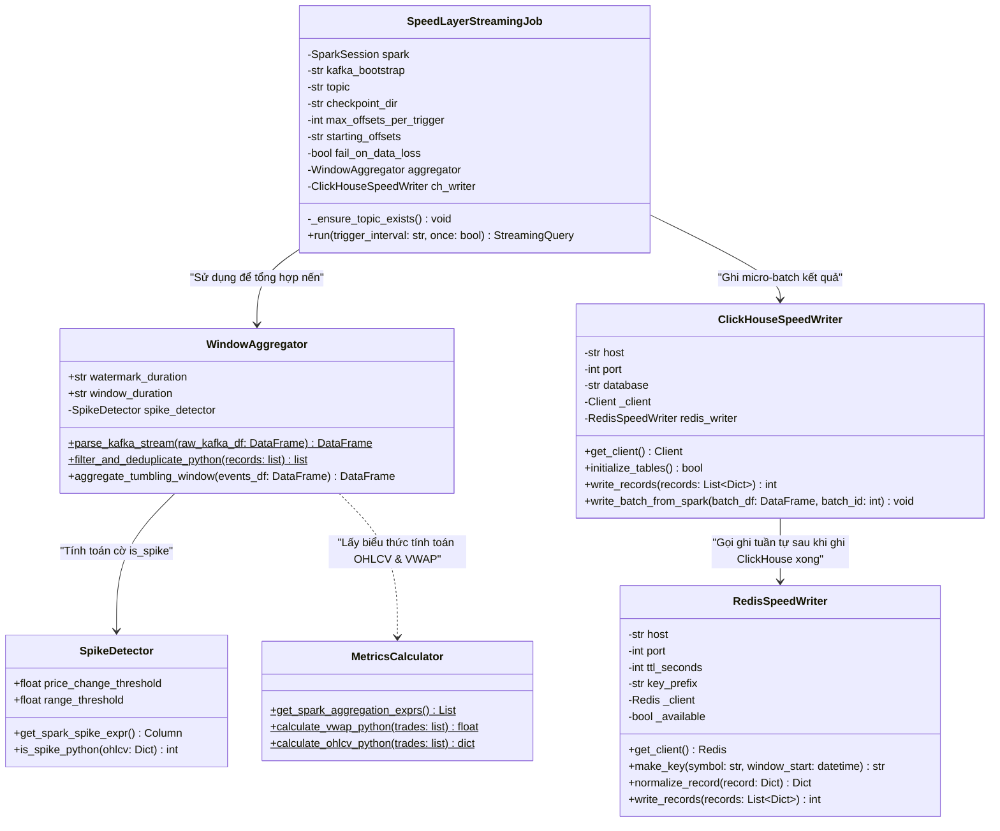
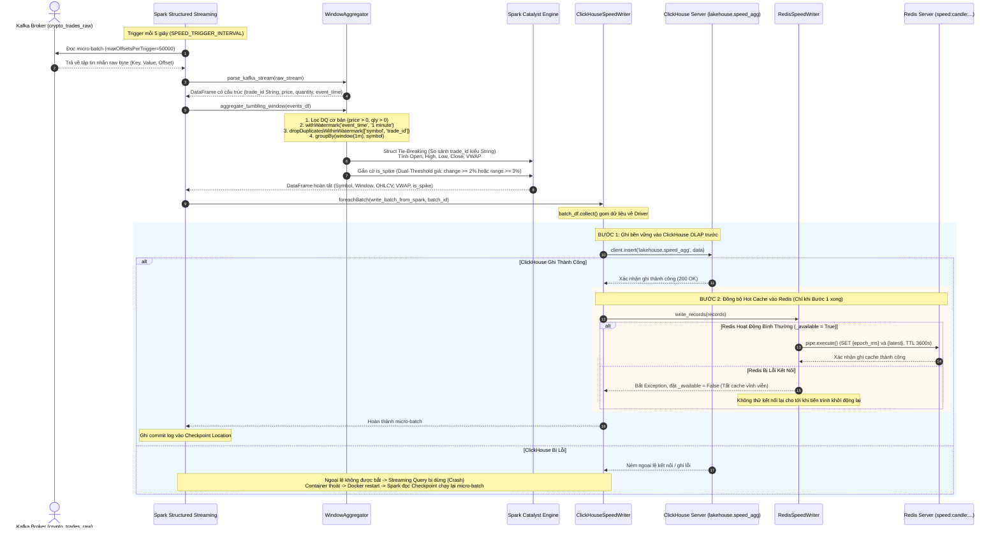

# ĐẶC TẢ KỸ THUẬT TIỂU MỤC 3.3: HIỆN THỰC PHÂN HỆ XỬ LÝ TỐC ĐỘ (SPEED LAYER)
# (TECHNICAL SPECIFICATION: SECTION 3.3)

> **Mục lục liên kết:** Thuộc Chương 3 trong [master_outline.md](file:///thesis_workspace/master_outline.md)  
> **Các tiểu mục bao hàm:**  
> - `3.3.1. Thiết kế Spark Structured Streaming Pipeline đọc luồng Kafka`  
> - `3.3.2. Hiện thực hóa Tumbling Window, Watermark và tính toán chỉ số trực tiếp`  
> - `3.3.3. Module phát hiện đột biến giá (Price Spike Detector)`  
> - `3.3.4. Ghi dữ liệu vi mô tuần tự vào ClickHouse (speed_agg) và đồng bộ Redis Hot Cache`  
> **Nguồn mã nguồn & tệp cấu hình trích xuất:**  
> - [src/speed_layer/spark_streaming.py](file:///src/speed_layer/spark_streaming.py)  
> - [src/speed_layer/window_aggregator.py](file:///src/speed_layer/window_aggregator.py)  
> - [src/speed_layer/metrics_calculator.py](file:///src/speed_layer/metrics_calculator.py)  
> - [src/speed_layer/spike_detector.py](file:///src/speed_layer/spike_detector.py)  
> - [src/speed_layer/clickhouse_writer.py](file:///src/speed_layer/clickhouse_writer.py)  
> - [src/speed_layer/redis_writer.py](file:///src/speed_layer/redis_writer.py)  
> - [src/speed_layer/trade_schema.py](file:///src/speed_layer/trade_schema.py)  
> - [configs/clickhouse/init.sql](file:///configs/clickhouse/init.sql)  
> - [docker-compose.yml](file:///docker-compose.yml)  
> - [thesis_workspace/specs/00_global_constants.md](file:///thesis_workspace/specs/00_global_constants.md)

---

## 1. TIỂU MỤC 3.3.1: THIẾT KẾ SPARK STRUCTURED STREAMING PIPELINE ĐỌC LUỒNG KAFKA

### 1.1. Cấu Hình Khởi Tạo SparkSession & Quản Lý Trạng Thái
Phân hệ Tốc độ được đóng gói trong container `lakehouse-speed-layer` với giới hạn bộ nhớ tối đa là $2.0\text{ GB}$ RAM (khai báo trong [docker-compose.yml](file:///docker-compose.yml)). Trong [src/speed_layer/spark_streaming.py](file:///src/speed_layer/spark_streaming.py), `SparkSession` được cấu hình tinh gọn cho xử lý luồng sự kiện liên tục:

**Bảng 3.3: Thông số kỹ thuật cấu hình Spark Structured Streaming, ClickHouse và Redis trong Speed Layer**

| Thành Phần | Tên Tham Số Cấu Hình | Giá Trị Thực Tế | Tệp Nguồn / Vị Trí Khai Báo | Ý Nghĩa Kỹ Thuật & Hành Vi Vận Hành |
| :--- | :--- | :--- | :--- | :--- |
| **Spark Master** | `master` | `local[2]` | `SPARK_MASTER_URL` | Cấp phát 2 luồng tính toán song song trong container. |
| **Phân vùng Shuffle**| `spark.sql.shuffle.partitions` | `4` | `src/speed_layer/spark_streaming.py` | Giảm số lượng partition shuffle từ 200 xuống 4 để phù hợp tài nguyên máy đơn lẻ. |
| **Độ song song** | `spark.default.parallelism` | `4` | `src/speed_layer/spark_streaming.py` | Đồng bộ mức độ song song tính toán micro-batch với số phân vùng shuffle. |
| **State Store** | `stateStore.providerClass` | `RocksDBStateStoreProvider` | `src/speed_layer/spark_streaming.py` | Lưu trữ trạng thái cửa sổ và bảng băm khử trùng lặp trên đĩa thay vì JVM Heap. |
| **Bảo trì State** | `stateStore.maintenanceInterval`| `60s` | `src/speed_layer/spark_streaming.py` | Chu kỳ dọn dẹp các phiên bản trạng thái cũ và nén log RocksDB định kỳ mỗi 60 giây. |
| **Snapshot State** | `stateStore.minDeltasForSnapshot`| `10` | `src/speed_layer/spark_streaming.py` | Tạo snapshot trạng thái sau mỗi 10 delta commits phục vụ khôi phục lỗi. |
| **Trigger luồng** | `trigger(processingTime=...)` | `"5 seconds"` | `SPEED_TRIGGER_INTERVAL` | Chu kỳ kích hoạt micro-batch định kỳ mỗi 5 giây, bảo đảm SLA độ trễ end-to-end. |
| **Chặn quá tải** | `maxOffsetsPerTrigger` | `50000` | `KAFKA_MAX_OFFSETS_PER_TRIGGER` | Giới hạn số bản ghi đọc tối đa mỗi micro-batch từ Kafka để chống tràn bộ nhớ. |
| **Offset ban đầu** | `startingOffsets` | `"latest"` | `KAFKA_STARTING_OFFSETS` | Tiêu thụ dữ liệu mới nhất khi khởi tạo checkpoint lần đầu; bỏ qua dữ liệu cũ tích lũy. |
| **Bảo vệ Offset** | `failOnDataLoss` | `true` | `KAFKA_FAIL_ON_DATA_LOSS` | Báo lỗi nghiêm ngặt nếu offset bị mất do retention policy của Kafka. |
| **Checkpoint Dir** | `CHECKPOINT_DIR` | Mặc định code: `.checkpoints/speed_layer`<br>Docker: `/app/checkpoints/speed_layer` | `src/speed_layer/spark_streaming.py`<br>`docker-compose.yml` | Lưu trữ offset log, commit log và siêu dữ liệu state store; gắn volume `speed-checkpoints`. |
| **Bảng ClickHouse**| `lakehouse.speed_agg` | `ReplacingMergeTree(created_at)` | `configs/clickhouse/init.sql` | Partition theo `toYYYYMMDD(window_start)`, Order by `(symbol, window_start)`. |
| **Redis Cache** | `speed:candle:{symbol}:{epoch_ms}` | `TTL = 3600` giây (1 giờ) | `src/speed_layer/redis_writer.py` | Tiền tố và thời gian sống lấy từ code, không đọc tệp `configs/redis/redis.yaml`. |

*Nguồn: Trích xuất trực tiếp từ src/speed_layer/spark_streaming.py, src/speed_layer/redis_writer.py, configs/clickhouse/init.sql và docker-compose.yml*

### 1.2. Cơ Chế Checkpointing và Khôi Phục Lỗi (Crash-and-Resume)
Đường ống streaming lưu vết trạng thái qua thư mục Checkpoint:
* Mặc định trong mã nguồn Python: `os.path.join(os.getcwd(), ".checkpoints", "speed_layer")`.
* Trong môi trường container Docker: `/app/checkpoints/speed_layer`, gắn ngoài vào volume `speed-checkpoints`.

Khi một micro-batch gặp sự cố nghiêm trọng (ví dụ: thao tác ghi vào ClickHouse ném ngoại lệ), Spark Structured Streaming không bắt nuốt lỗi mà chủ động dừng tiến trình (`StreamingQueryException`). Container Docker sau đó tự khởi động lại (theo chính sách restart), Spark đọc lại offset log và commit log từ checkpoint để thực thi lại đúng micro-batch chưa hoàn tất, ngăn chặn việc thất thoát dữ liệu.

---

## 2. TIỂU MỤC 3.3.2: HIỆN THỰC HÓA TUMBLING WINDOW, WATERMARK VÀ TÍNH TOÁN CHỈ SỐ TRỰC TIẾP

### 2.1. Phân Tích Cú Pháp Payload JSON & Sai Khác Kiểu Dữ Liệu `trade_id`
Lớp `WindowAggregator` trong [src/speed_layer/window_aggregator.py](file:///src/speed_layer/window_aggregator.py) nhận luồng thô từ Kafka, giải mã chuỗi JSON theo lược đồ từ [src/speed_layer/trade_schema.py](file:///src/speed_layer/trade_schema.py):

$$\text{Kafka Message } (\texttt{key, value}) \xrightarrow{\texttt{CAST(value AS STRING)}} \texttt{json\_str} \xrightarrow{\texttt{from\_json}} \texttt{data.*}$$

Dấu thời gian khớp lệnh (`trade_time`, epoch ms) được chuyển sang kiểu timestamp:
$$\texttt{event\_time} = \left(\frac{\texttt{trade\_time}}{1000.0}\right).\text{cast}(\text{"timestamp"})$$

> [!WARNING]
> **Điểm sai khác kỹ thuật giữa Speed Layer và Data Contract / Batch Layer:**  
> Trong [src/speed_layer/trade_schema.py](file:///src/speed_layer/trade_schema.py), trường `trade_id` được khai báo dưới dạng **`StringType()`**, trong khi Data Contract (`trade_event_schema.json`) và model `TradeEvent` định nghĩa là số nguyên (`integer`/`bigint`).  
> **Hệ quả khi giải quyết xung đột cùng mili-giây (Tie-breaking):**  
> Khi nhiều giao dịch có cùng `trade_time`, biểu thức `F.struct(trade_time, trade_id, price)` của Speed Layer thực hiện so sánh `trade_id` theo **thứ tự từ điển chuỗi ký tự (Lexicographical String Order)** (ví dụ: chuỗi `"999" > "1000"` vì ký tự `'9'` đứng sau `'1'`). Ngược lại, tầng Batch Layer so sánh theo **giá trị số nguyên học** (`1000 > 999`).

### 2.2. Lọc Dữ Liệu Luồng Tức Thời (Streaming Data Quality Filter)
Trước khi gom nhóm cửa sổ, Spark áp dụng bộ lọc trực tiếp trên DataFrame luồng để loại trừ các bản ghi sai lệch cơ bản:
```python
valid_events_df = events_df.filter(
    F.col("trade_id").isNotNull() & (F.col("trade_id") >= 0)
    & F.col("symbol").isNotNull() & (F.length(F.trim(F.col("symbol"))) > 0)
    & F.col("price").isNotNull() & (F.col("price") > 0)
    & F.col("quantity").isNotNull() & (F.col("quantity") > 0)
    & F.col("trade_time").isNotNull() & (F.col("trade_time") > 0)
)
```

### 2.3. Watermarking và Khử Trùng Lặp Trong Cửa Sổ (Bounded State Deduplication)
1. **Mốc Watermark Thời Gian Sự Kiện:**
   $$\texttt{watermarked\_df} = \texttt{valid\_events\_df}.\text{withWatermark}(\text{"event\_time"}, \text{"1 minute"})$$
   Hệ thống chấp nhận dữ liệu trễ mạng trong phạm vi 1 phút. Các giao dịch có $\text{trade\_time} < \text{Max}(T_{\text{event}}) - 60\text{s}$ bị loại bỏ khỏi luồng tức thời.
2. **Khử Trùng Lặp Giới Hạn Cửa Sổ (`dropDuplicatesWithinWatermark`):**
   Spark áp dụng khử trùng lặp có chặn bộ nhớ trạng thái:
   $$\texttt{deduped\_df} = \texttt{watermarked\_df}.\text{dropDuplicatesWithinWatermark}([\text{"symbol"}, \text{"trade\_id"}])$$
   Nếu một giao dịch bị Kafka Producer gửi lặp trong vòng 1 phút, bản ghi trùng sẽ bị triệt tiêu, hạn chế việc làm phình khối lượng giao dịch tại Speed Layer.

### 2.4. Tổng Hợp Nến Tumbling Window 1 Phút
Dữ liệu sau khi khử trùng lặp được nhóm theo cửa sổ 1 phút và mã cặp giao dịch:
$$\texttt{deduped\_df}.\text{groupBy}\left(\text{F.window}(\text{F.col}(\text{"event\_time"}), \text{"1 minute"}), \text{F.col}(\text{"symbol"})\right).\text{agg}(*\text{agg\_exprs})$$

Các chỉ số tài chính được tính toán qua `MetricsCalculator`:
* **Open & Close Price:** Áp dụng kỹ thuật Struct Tie-Breaking `F.struct(trade_time, trade_id, price)`.
* **High & Low Price:** `F.max("price")` và `F.min("price")`.
* **Volume & Trade Count:** `F.sum("quantity")` và `F.count(F.lit(1))`.
* **VWAP:** $\left(\sum (P_i \times Q_i)\right) / \sum Q_i$.

---

## 3. TIỂU MỤC 3.3.3: MODULE PHÁT HIỆN ĐỘT BIẾN GIÁ (PRICE SPIKE DETECTOR)

Được triển khai trong [src/speed_layer/spike_detector.py](file:///src/speed_layer/spike_detector.py), lớp `SpikeDetector` tính toán và gắn cờ nhị phân `is_spike \in \{0, 1\}` vào bản ghi nến.

> [!NOTE]
> **Lưu ý về phạm vi kiểm tra nghiệp vụ:**  
> Mã nguồn của `SpikeDetector` **chỉ kiểm tra biến động giá**, hoàn toàn **không có tiêu chí kiểm tra đột biến khối lượng**. Module cảnh báo [src/utils/alerting.py](file:///src/utils/alerting.py) cũng **không có quy tắc tự động phát cảnh báo cho cờ `is_spike`** (chỉ giám sát `VOLUME_DRIFT`, `QUARANTINE_SPIKE`, `STREAMING_LAG`, `SEQUENCE_GAP`). Cờ `is_spike` chỉ được lưu vào ClickHouse/Redis và dùng để hiển thị trực quan biểu tượng cảnh báo trên giao diện Streamlit khi người dùng mở xem.

### 3.1. Mô Hình Ngưỡng Biến Động Giá Kép (Dual Thresholding)
Một nến trong khung 1 phút bị gắn cờ `is_spike = 1` nếu thỏa mãn ít nhất một trong hai điều kiện giá:
1. **Bước nhảy giá đóng/mở ($\Delta P_{\text{step}}$):**
   $$\frac{|\text{close\_price} - \text{open\_price}|}{\text{open\_price}} \ge 0.02 \quad (2.0\%)$$
2. **Biên độ dao động cực đại trong phiên ($\Delta P_{\text{range}}$):**
   $$\frac{\text{high\_price} - \text{low\_price}}{\text{low\_price}} \ge 0.03 \quad (3.0\%)$$

Phương thức Python tương ứng trong lớp là `is_spike_python(ohlcv: Dict[str, Any]) -> int`.

### 3.2. Biểu Thức Cột Spark Catalyst
Thuật toán được vector hóa qua Spark Column expression:
```python
price_change_cond = (
    F.abs(F.col("close_price") - F.col("open_price")) / F.col("open_price")
    >= self.price_change_threshold
)
range_cond = (
    (F.col("high_price") - F.col("low_price")) / F.col("low_price")
    >= self.range_threshold
)
spike_col = (
    F.when(price_change_cond | range_cond, F.lit(1))
    .otherwise(F.lit(0))
    .cast("int")
    .alias("is_spike")
)
```

> [!WARNING]
> **Hiện tượng lệch hiển thị trên Streamlit Dashboard:**  
> Trong [dashboard/app.py](file:///dashboard/app.py), hàm `render_spike_tab()` tính cột biên độ hiển thị `amplitude_pct` bằng công thức:  
> `(close_price - open_price) / open_price * 100`.  
> Do đó, các nến bị gắn cờ `is_spike = 1` do biên độ High - Low $\ge 3\%$ vẫn xuất hiện trong danh sách nến đột biến, nhưng giá trị hiển thị ở cột biên độ mở - đóng có thể nhỏ hơn $2\%$.

---

## 4. TIỂU MỤC 3.3.4: GHI DỮ LIỆU VI MÔ TUẦN TỰ VÀO CLICKHOUSE (`speed_agg`) VÀ ĐỒNG BỘ REDIS HOT CACHE

### 4.1. Kiến Trúc Ghi Tuần Tự (Sequential Dual-Sink Execution)
Trong [src/speed_layer/clickhouse_writer.py](file:///src/speed_layer/clickhouse_writer.py), phương thức `write_batch_from_spark` được gọi lại ở mỗi micro-batch qua `DataFrame.writeStream.outputMode("update").foreachBatch()`. Tiến trình gom dữ liệu nến bằng lệnh `batch_df.collect()` và thực thi **ghi tuần tự**:

```python
# Trích xuất từ src/speed_layer/clickhouse_writer.py - write_records()
# Bước 1: Ghi vào ClickHouse trước
client.insert("lakehouse.speed_agg", data, column_names=columns)

# Bước 2: Chỉ khi ClickHouse thành công mới đồng bộ sang Redis
if self.redis_writer is not None:
    cached = self.redis_writer.write_records(records)
```

1. **Hành vi khi ClickHouse gặp sự cố (Fail-fast):**
   * Lệnh `client.insert` **không được bọc trong khối `try...except`**.
   * Nếu kết nối ClickHouse bị đứt hoặc lỗi ghi dữ liệu, ngoại lệ sẽ văng ra ngoài, làm sập micro-batch và dừng truy vấn Spark Streaming. Container `lakehouse-speed-layer` sẽ thoát ra. Khi Docker khởi động lại container, Spark sẽ đọc lại vị trí offset từ Checkpoint và thực thi lại từ đầu micro-batch đó.
2. **Hành vi khi Redis gặp sự cố (Permanent Cache Disable):**
   * Trong [src/speed_layer/redis_writer.py](file:///src/speed_layer/redis_writer.py), khi kết nối Redis gặp lỗi, lớp bắt ngoại lệ và gán cờ `self._available = False`.
   * Lớp này **hoàn toàn không có cơ chế tự động kết nối lại**. Khi `_available` đã chuyển sang `False`, mọi lời gọi `get_client()` sau đó đều trả về `None`, khiến bộ đệm Redis Hot Cache bị **vô hiệu hóa vĩnh viễn** cho đến khi toàn bộ tiến trình hoặc container được khởi động lại từ đầu. Thao tác ghi ClickHouse vẫn tiếp tục bình thường mà không bị dừng luồng.

### 4.2. Cấu Trúc Khóa Redis & Hành Vi Khóa `:latest`
* **Nguồn cấu hình thực tế:** Tệp [configs/redis/redis.yaml](file:///configs/redis/redis.yaml) khai báo TTL 300 giây và tiền tố `speed_view:`, nhưng mã nguồn thực tế **không đọc tệp này**. Cấu hình chạy thực tế lấy trực tiếp từ code với `TTL = 3600` giây (1 giờ) và tiền tố `speed:candle`.
* **Khóa theo dấu thời gian cửa sổ:** `speed:candle:{symbol}:{epoch_ms}` lưu trữ nến theo mốc `window_start`.
* **Khóa con trỏ `:latest` (`speed:candle:{symbol}:latest`):**
  Trong [src/speed_layer/redis_writer.py](file:///src/speed_layer/redis_writer.py), phương thức `write_records()` duyệt tuần tự qua danh sách `records` trong lô và cập nhật `latest_key` ở mỗi vòng lặp. Do đó, bản ghi nằm tại khóa `:latest` là **bản ghi được duyệt cuối cùng trong danh sách nến của lô**, chưa chắc đã là cửa sổ nến mới nhất theo thời gian nếu danh sách chưa được sắp xếp.

---

## 5. HỒ SƠ BIỂU ĐỒ THIẾT KẾ PHÂN HỆ TỐC ĐỘ (UML PROFILES)

### 5.1. Biểu Đồ Lớp Phân Hệ Xử Lý Tốc Độ (UML Class Diagram)



---

### 5.2. Biểu Đồ Tuần Tự Xử Lý Micro-Batch Và Ghi Tuần Tự ClickHouse - Redis (UML Sequence Diagram)



**Hình 3.5: Biểu đồ Tuần tự quy trình xử lý micro-batch và ghi tuần tự ClickHouse - Redis (UML Sequence Diagram)**

---

## 6. ĐIỂM NGHẼN VÀ ĐÁNH ĐỔI KỸ THUẬT PHÂN HỆ TỐC ĐỘ (TRADE-OFFS & BOTTLENECKS)

1. **Đánh đổi giữa Quản lý Trạng Thái Trên RAM (JVM Heap) và Ổ Đĩa Cục Bộ (RocksDB):**
   * *Hiện tượng:* Với lưu lượng thị trường liên tục 24/7, việc duy trì trạng thái cửa sổ và bảng băm khử trùng lặp `dropDuplicatesWithinWatermark` trên bộ nhớ JVM mặc định (`HDFSBackedStateStoreProvider`) tiềm ẩn nguy cơ làm phình bộ nhớ heap của container `lakehouse-speed-layer` (giới hạn 2.0GB RAM).
   * *Giải pháp đã chọn:* Kích hoạt `RocksDBStateStoreProvider` để chuyển phần lớn trạng thái xuống tệp cục bộ trên volume đĩa, giúp bộ nhớ heap của Spark được kiểm soát ổn định trong giới hạn tài nguyên máy tính cá nhân.
2. **Đánh đổi Cơ Chế Thu Thập Lô (`collect()`) So Với Spark ClickHouse JDBC Direct Sink:**
   * *Hiện tượng:* Việc cấu hình Spark ClickHouse JDBC Sink đòi hỏi phải duy trì driver JDBC và mở nhiều luồng kết nối phân tán từ các worker task.
   * *Giải pháp đã chọn:* Áp dụng `foreachBatch` kết hợp `batch_df.collect()` trên Driver và thư viện `clickhouse-connect`. Phương pháp này đơn giản hóa kiến trúc kết nối mạng, nhưng tạo ra sự phụ thuộc tuần tự: Driver phải hoàn tất ghi ClickHouse rồi mới gọi sang Redis.
3. **Đánh đổi Ngưỡng Watermark 1 Phút và Sai Số Khối Lượng Tức Thời ($\Delta V_{\%}$):**
   * *Hiện tượng:* Để ngăn kích thước state store tăng không kiểm soát, Watermark được chốt cứng ở mức 1 phút. Khi mạng bị trễ hoặc sàn giao dịch gửi các giao dịch trôi dạt quá 60 giây, Speed Layer bắt buộc phải loại bỏ các giao dịch này.
   * *Hệ quả thực nghiệm:* Theo số liệu đo đạc thực tế trong Phần 4 của [00_global_constants.md](file:///thesis_workspace/specs/00_global_constants.md), độ lệch khối lượng tức thời $\Delta V_{\%}$ giữa Speed View và Batch View dao động từ **$9.09\%$ đến $24.20\%$** (và có thể lên tới $25.65\%$ trong các kịch bản kiểm thử tải có tiêm lỗi).
   * *Đánh đổi:* Chấp nhận Speed View mang tính chất gần đúng tạm thời (*Provisional*), bàn giao toàn bộ trách nhiệm đối soát và thu hồi dữ liệu chính xác tuyệt đối cho phân hệ Batch Layer (Ground Truth).
4. **Cơ Chế Khử Trùng Lặp ReplacingMergeTree Của ClickHouse So Với Atomic Upsert:**
   * *Hiện tượng:* ClickHouse được thiết kế tối ưu cho thao tác chèn nối tiếp hàng loạt (`Append-only`), không hỗ trợ khóa dòng giao dịch truyền thống (Row-level Locking).
   * *Giải pháp đã chọn:* Sử dụng Engine `ReplacingMergeTree(created_at)`. Khi Spark phải chạy lại các micro-batch bị lỗi từ checkpoint, ClickHouse tiếp nhận bản ghi mới với dấu thời gian `created_at` cao hơn. Quá trình gộp mảnh ngầm (*Background Part Merge*) sẽ tự động khử bản ghi cũ mà không làm gián đoạn hiệu năng nạp dữ liệu.
