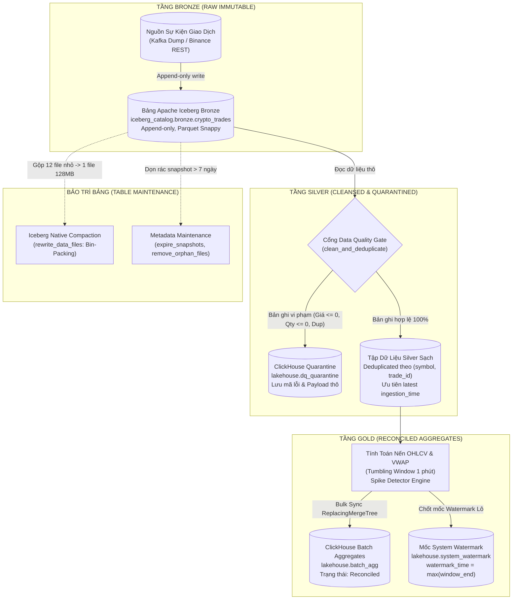
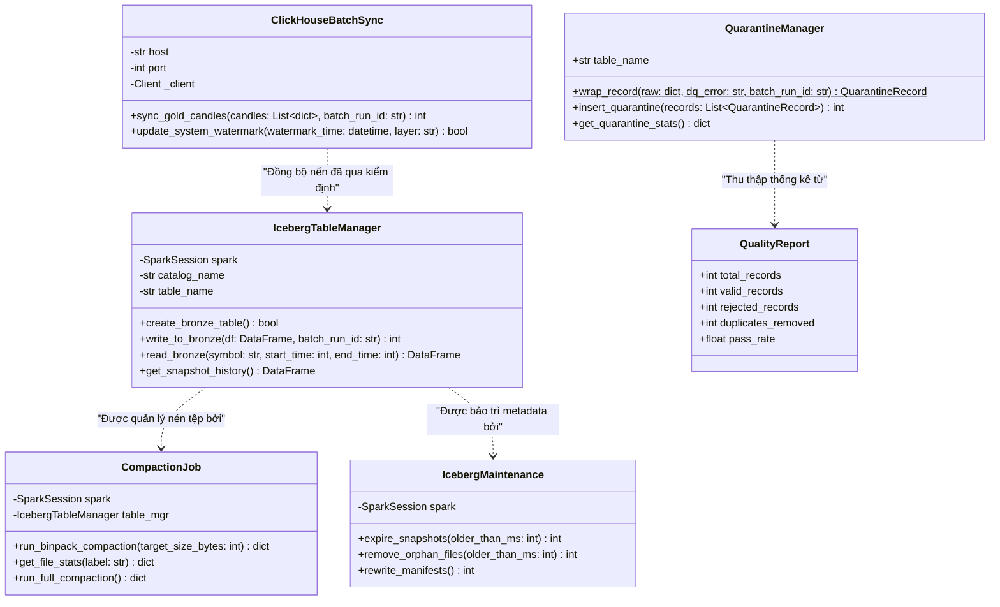

# ĐẶC TẢ KỸ THUẬT TIỂU MỤC 3.4: HIỆN THỰC PHÂN HỆ LƯU TRỮ BẤT BIẾN VÀ XỬ LÝ LÔ (BATCH LAYER)
# (TECHNICAL SPECIFICATION: SECTION 3.4)

> **Mục lục liên kết:** Thuộc Chương 3 trong [master_outline.md](file:///thesis_workspace/master_outline.md)  
> **Các tiểu mục bao hàm:**  
> - `3.4.1. Tầng Bronze: Ghi dữ liệu thô bất biến vào bảng Apache Iceberg trên MinIO S3`  
> - `3.4.2. Tầng Silver: Làm sạch, khử trùng lặp (Deduplication) và Data Quality Gate`  
> - `3.4.3. Module Quarantine: Phân loại và cách ly dữ liệu sai hỏng`  
> - `3.4.4. Tầng Gold: Spark Batch tính toán Ground Truth OHLCV/VWAP và đồng bộ ClickHouse batch_agg`  
> - `3.4.5. Cơ chế quản lý vòng đời bảng Iceberg: Compaction nén tệp nhỏ và dọn dẹp Snapshot`  
> **Nguồn mã nguồn & tệp cấu hình trích xuất:**  
> - [src/batch_layer/iceberg_utils.py](file:///src/batch_layer/iceberg_utils.py)  
> - [src/batch_layer/spark_batch_jobs.py](file:///src/batch_layer/spark_batch_jobs.py)  
> - [src/batch_layer/clickhouse_sync.py](file:///src/batch_layer/clickhouse_sync.py)  
> - [src/batch_layer/compaction.py](file:///src/batch_layer/compaction.py)  
> - [src/batch_layer/maintenance.py](file:///src/batch_layer/maintenance.py)  
> - [src/data_quality/dq_checks.py](file:///src/data_quality/dq_checks.py)  
> - [src/data_quality/quarantine.py](file:///src/data_quality/quarantine.py)  
> - [src/data_quality/dq_metrics.py](file:///src/data_quality/dq_metrics.py)  
> - [configs/iceberg/tables.yaml](file:///configs/iceberg/tables.yaml)  
> - [configs/clickhouse/init.sql](file:///configs/clickhouse/init.sql)  
> - [thesis_workspace/specs/00_global_constants.md](file:///thesis_workspace/specs/00_global_constants.md)

---

## 1. TIỂU MỤC 3.4.1: TẦNG BRONZE - GHI DỮ LIỆU THÔ BẤT BIẾN VÀO BẢNG APACHE ICEBERG TRÊN MINIO S3

### 1.1. Kiến Trúc Lưu Trữ Bất Biến Medallion Bronze
Phân hệ Batch Layer chịu trách nhiệm xây dựng kho dữ liệu nguồn chân lý (*Ground Truth*) bất biến. Dữ liệu giao dịch được nạp vào tầng Bronze thông qua lớp `IcebergTableManager` trong [src/batch_layer/iceberg_utils.py](file:///src/batch_layer/iceberg_utils.py) dưới định dạng mở Apache Iceberg V2, lưu trữ trên MinIO S3 Object Storage (`s3://warehouse/`).

Tầng Bronze được thiết kế theo nguyên lý ghi chèn liên tục (*Append-only*), bảo toàn nguyên vẹn mọi bản tin kể cả các bản tin chứa lỗi hoặc bản tin tiêm lỗi thử nghiệm phục vụ kiểm toán hồi quy (*Time Travel & Audit Trail*).

**Bảng 3.6: Đặc tả thuộc tính và cấu hình tối ưu của bảng Apache Iceberg Bronze (`iceberg_catalog.bronze.crypto_trades`)**

| Thuộc Tính / Cấu Hình (`Property`) | Giá Trị Cấu Hình | Ý Nghĩa Kỹ Thuật & Tối Ưu Hệ Thống |
| :--- | :--- | :--- |
| **Định danh đầy đủ (`Full Name`)** | `iceberg_catalog.bronze.crypto_trades` | Bảng quản lý tập trung qua Iceberg REST Catalog (`http://iceberg-rest:8181`). |
| **Lưu trữ đối tượng (`Warehouse URI`)**| `s3://warehouse/bronze/crypto_trades` | MinIO S3 Object Storage (`http://minio:9000`), giao thức S3A / S3FileIO. |
| **Định dạng tệp lưu trữ (`Format`)** | `Parquet (Snappy Compression)` | Tối ưu hóa nén dạng cột và tăng tốc độ giải nén dữ liệu lớn. |
| **Phiên bản định dạng (`format-version`)**| `2` | Hỗ trợ Row-level deletes, Sequence numbers và chuẩn ACID Lakehouse hiện đại. |
| **Kích thước tệp mục tiêu (`Target Size`)**| `134217728` bytes ($128\text{ MB}$) | Ngưỡng kích thước tệp tối ưu để tránh phân mảnh tệp nhỏ và tối đa hóa I/O đọc. |
| **Chế độ phân vùng (`Partitioning`)** | `days(trade_time_ts)` | Iceberg Hidden Partitioning theo ngày dựa trên cột timestamp chuyển đổi. |
| **Chế độ phân phối ghi (`Distribution`)**| `hash` | Băm phân phối luồng ghi chống hiện tượng lệch tải (Data Skew). |
| **Thời gian lưu vết (`Snapshot TTL`)** | `604800000` ms ($7\text{ ngày}$) | Giới hạn lịch sử snapshot phục vụ truy vấn Time Travel trong vòng 1 tuần. |
| **Cắt ngắn siêu dữ liệu (`Metrics`)** | `truncate(16)` | Lưu trữ chỉ số min/max thống kê 16 ký tự đầu để tăng tốc lọc vùng dữ liệu (Data Skipping). |

*Nguồn: Trích xuất trực tiếp từ src/batch_layer/iceberg_utils.py và configs/iceberg/tables.yaml*

### 1.2. Lược Đồ Bảng Bronze (`BRONZE_SCHEMA`)
Mỗi bản ghi được làm giàu thêm siêu dữ liệu kiểm toán hệ thống (`batch_run_id`, `bronze_written_at`) trước khi ghi xuống tầng lưu trữ:
```sql
CREATE TABLE IF NOT EXISTS iceberg_catalog.bronze.crypto_trades (
    trade_id          BIGINT    NOT NULL COMMENT 'Aggregate Trade ID từ Binance',
    symbol            STRING    NOT NULL COMMENT 'Cặp giao dịch chuẩn hóa (BTCUSDT)',
    price             DOUBLE    NOT NULL COMMENT 'Mức giá khớp lệnh',
    quantity          DOUBLE    NOT NULL COMMENT 'Khối lượng giao dịch',
    trade_time        BIGINT    NOT NULL COMMENT 'Thời điểm khớp lệnh epoch ms UTC',
    trade_time_ts     TIMESTAMP NOT NULL COMMENT 'trade_time dạng Timestamp (Partition key)',
    is_buyer_maker    BOOLEAN            COMMENT 'Vị thế Maker/Taker',
    ingestion_time    BIGINT             COMMENT 'Thời điểm hệ thống nhận gói tin',
    is_injected       BOOLEAN            COMMENT 'Đánh dấu bản ghi tiêm lỗi thực nghiệm',
    fault_type        STRING             COMMENT 'Nhãn lỗi: duplicate, late_data, v.v.',
    batch_run_id      STRING             COMMENT 'Khóa định danh phiên Batch Job',
    bronze_written_at TIMESTAMP          COMMENT 'Thời điểm ghi vào Bronze Table'
)
USING iceberg
PARTITIONED BY (days(trade_time_ts));
```

---

## 2. TIỂU MỤC 3.4.2: TẦNG SILVER - LÀM SẠCH, KHỬ TRÙNG LẶP VÀ DATA QUALITY GATE

### 2.1. Cổng Kiểm Tra Chất Lượng Dữ Liệu (Data Quality Gate)
Được triển khai trong [src/data_quality/dq_checks.py](file:///src/data_quality/dq_checks.py), hàm `clean_and_deduplicate()` đóng vai trò là chốt kiểm soát chất lượng dữ liệu bắt buộc (*Quality Gate*) trước khi dữ liệu Bronze được chuyển tiếp lên tầng Silver.

Mỗi bản ghi phải trải qua kiểm tra ngữ nghĩa nghiêm ngặt thông qua hàm `validate_trade_record()`:
1. `trade_id < 0`: Vi phạm mã số âm $\rightarrow$ Từ chối với lý do `trade_id_negative`.
2. `not symbol` hoặc chuỗi rỗng $\rightarrow$ Từ chối với lý do `symbol_empty`.
3. `price <= 0`: Giá không dương $\rightarrow$ Từ chối với lý do `price_non_positive`.
4. `quantity <= 0`: Khối lượng không dương $\rightarrow$ Từ chối với lý do `quantity_non_positive`.
5. `trade_time <= 0`: Dấu thời gian không hợp lệ $\rightarrow$ Từ chối với lý do `trade_time_non_positive`.

### 2.2. Thuật Toán Khử Trùng Lặp Tuyệt Đối (Deterministic Deduplication)
Khác với Speed Layer vốn chỉ có thể khử trùng lặp xấp xỉ trong phạm vi cửa sổ trễ Watermark, tầng Batch Layer có khả năng truy quét toàn bộ không gian dữ liệu:
* **Khóa Khử Trùng Lặp:** Cặp giá trị duy nhất `(symbol, trade_id)`.
* **Quy Tắc Giữ Bản Ghi Mới Nhất (Tie-Breaking by Ingestion Time):**
  Nếu xuất hiện nhiều bản ghi có cùng cặp khóa `(symbol, trade_id)`, thuật toán ưu tiên giữ lại bản ghi có dấu thời gian tiếp nhận lớn nhất (`latest ingestion_time`), loại bỏ các bản ghi gửi lặp do mạng hoặc do module `FaultInjector` sinh ra:
  ```python
  key = (record["symbol"], record["trade_id"])
  existing = by_key.get(key)
  if existing is not None:
      duplicate_count += 1
      if record.get("ingestion_time", 0) <= existing.get("ingestion_time", 0):
          continue
  by_key[key] = record
  ```

---

## 3. TIỂU MỤC 3.4.3: MODULE QUARANTINE - PHÂN LOẠI VÀ CÁCH LY DỮ LIỆU SAI HỎNG

### 3.1. Mô Hình Bảng Cách Ly (Quarantine Table Pattern)
Để bảo đảm đường ống xử lý không bị dừng đột ngột khi gặp dữ liệu độc hại hoặc sai hỏng, hệ thống áp dụng mẫu thiết kế **Quarantine Pattern** thông qua lớp `QuarantineManager` trong [src/data_quality/quarantine.py](file:///src/data_quality/quarantine.py). 

Toàn bộ các bản ghi bị Cổng kiểm soát chất lượng dữ liệu từ chối không bị xóa bỏ, mà được đóng gói có cấu trúc sang đối tượng `QuarantineRecord` và nạp vào bảng ClickHouse `lakehouse.dq_quarantine`.

**Bảng 3.7: Ma trận kiểm tra chất lượng dữ liệu Data Quality Gates và mã lỗi cách ly Quarantine**

| Tiêu Chí Kiểm Tra Nghiệp Vụ | Điều Kiện Hợp Lệ | Mã Lỗi Cách Ly (`dq_error`) | Hành Động Xử Lý Của Hệ Thống |
| :--- | :--- | :--- | :--- |
| **Giá giao dịch (`price`)** | `price > 0.0` | `ERR_PRICE_NONPOSITIVE` | Loại khỏi Silver; lưu vào `dq_quarantine` kèm payload gốc. |
| **Khối lượng coin (`quantity`)** | `quantity > 0.0` | `ERR_QTY_NONPOSITIVE` | Loại khỏi Silver; lưu vào `dq_quarantine`. |
| **Mã định danh (`trade_id`)** | `trade_id >= 0` | `ERR_TRADE_ID_NEGATIVE` | Loại khỏi Silver; lưu vào `dq_quarantine`. |
| **Mã cặp tiền (`symbol`)** | `len(symbol.strip()) > 0` | `ERR_SYMBOL_EMPTY` | Loại khỏi Silver; chuẩn hóa IN HOA nếu hợp lệ. |
| **Thời gian khớp lệnh (`trade_time`)** | `trade_time > 0` | `ERR_TIMESTAMP_NONPOSITIVE` | Loại khỏi Silver; lưu vào `dq_quarantine`. |
| **Trùng lặp khóa (`trade_id`)** | Khóa duy nhất theo phiên | `ERR_DUPLICATE_TRADE_ID` | Loại bản sao cũ; đếm số lượng trùng lặp vào `QualityReport`. |
| **Dữ liệu đến quá trễ (`late_data`)** | Độ trôi dạt bất thường | `ERR_LATE_EVENT` | Cách ly khi vượt quá ngưỡng kiểm soát thời gian lô. |

*Nguồn: Trích xuất từ src/data_quality/dq_checks.py và src/data_quality/quarantine.py*

### 3.2. Cấu Trúc Bảng ClickHouse `lakehouse.dq_quarantine`
```sql
CREATE TABLE IF NOT EXISTS lakehouse.dq_quarantine (
    batch_run_id    String,
    trade_id        String,
    symbol          String,
    price           String,
    quantity        String,
    trade_time      String,
    dq_error        String,
    raw_record      String,
    quarantined_at  DateTime64(3, 'UTC') DEFAULT now64(3)
)
ENGINE = MergeTree()
PARTITION BY toYYYYMM(quarantined_at)
ORDER BY (batch_run_id, quarantined_at);
```
Bảng sử dụng Engine `MergeTree()`, phân vùng theo tháng và sắp xếp theo phiên batch, cho phép kỹ sư dữ liệu và nhà kiểm toán truy vấn tức thời tỷ lệ lỗi thông qua component `dq_panel.py` trên giao diện Dashboard.

---

## 4. TIỂU MỤC 3.4.4: TẦNG GOLD - TÍNH TOÁN GROUND TRUTH OHLCV/VWAP VÀ ĐỒNG BỘ CLICKHOUSE `batch_agg`

### 4.1. Tổng Hợp Toàn Diện Nến Chuẩn Xác Tuyệt Đối (Ground Truth)
Sau khi dữ liệu đã được làm sạch và khử trùng lặp hoàn toàn tại tầng Silver, tiến trình `spark_batch_jobs.py` thực hiện tổng hợp các chỉ số nến Gold theo cửa sổ Tumbling Window 1 phút. Khác với Speed Layer:
* **Không bị giới hạn bởi Watermark:** Tầng Batch thu thập và gom toàn bộ các giao dịch đến trễ mạng (Late Data) phát sinh trong quá khứ, bảo đảm khối lượng giao dịch và đường VWAP đạt độ chuẩn xác **100% (Ground Truth)**.
* **Định danh phiên xử lý (`batch_run_id`):** Mỗi chu kỳ nạp gắn một mã duy nhất (ví dụ: `batch_20261017_080000`) phục vụ kiểm toán hồi quy và tái tính toán khi cần thiết.

### 4.2. Đồng Bộ Hóa Sang ClickHouse `batch_agg` & Cập Nhật System Watermark
Thông qua lớp `ClickHouseBatchSync` trong [src/batch_layer/clickhouse_sync.py](file:///src/batch_layer/clickhouse_sync.py), dữ liệu Gold được nạp đồng bộ vào ClickHouse:
1. **Bảng `lakehouse.batch_agg`:**
   Lưu trữ nến chuẩn xác với trạng thái nghiệp vụ `Reconciled`. Bảng sử dụng Engine `ReplacingMergeTree(created_at)` giúp tự động ghi đè và thay thế các nến tính toán cũ nếu cùng cặp khóa `(symbol, window_start)`:
   $$\text{ClickHouse Engine: } \texttt{ReplacingMergeTree(created\_at)}$$
2. **Cập nhật Mốc Chân Lý Hệ Thống (`lakehouse.system_watermark`):**
   Ngay sau khi đồng bộ thành công các nến Batch, tiến trình thực thi câu lệnh chốt mốc thời gian:
   ```sql
   INSERT INTO lakehouse.system_watermark (layer, watermark_time, updated_at)
   VALUES ('batch_layer', toDateTime64('{max_window_end}', 3, 'UTC'), now64(3));
   ```
   Mốc thời gian này là điểm tựa sống còn để tầng Serving Layer (`AutoCorrectingQueryMerger`) phân định ranh giới giữa dữ liệu lịch sử chuẩn xác và dữ liệu thời gian thực tạm thời.

---

## 5. TIỂU MỤC 3.4.5: CƠ CHẾ QUẢN LÝ VÒNG ĐỜI BẢNG ICEBERG - COMPACTION NÉN TỆP NHỎ VÀ DỌN DẸP SNAPSHOT

### 5.1. Vấn Đề Tệp Nhỏ Trong Hồ Dữ Liệu Streaming (Small File Problem)
Khi tiếp nhận luồng sự kiện vi mô liên tục 24/7, mỗi đợt ghi micro-batch sẽ sinh ra một tệp Parquet kích thước nhỏ (từ vài chục byte đến vài kilobyte) kèm theo một tệp manifest metadata tương ứng. Sau nhiều giờ hoạt động, số lượng tệp nhỏ tích lũy lên tới hàng ngàn tệp, gây suy giảm nghiêm trọng hiệu năng truy vấn của hồ dữ liệu:
* Tăng số lượng thao tác gọi API liệt kê đối tượng trên MinIO S3 (`S3 LIST / GET`).
* Catalyst Optimizer của Spark phải mở và đóng quá nhiều file descriptors, gây nghẽn cổ chai I/O.

### 5.2. Thuật Toán Gộp Tệp Bin-Packing & Kết Quả Thực Nghiệm Nén Tệp (RQ3)
Được triển khai trong lớp `CompactionJob` tại [src/batch_layer/compaction.py](file:///src/batch_layer/compaction.py), hệ thống kích hoạt thủ tục nén tệp tự nhiên của Iceberg:
```sql
CALL iceberg_catalog.system.rewrite_data_files(
    table => 'iceberg_catalog.bronze.crypto_trades',
    strategy => 'binpack',
    options => map(
        'target-file-size-bytes', '134217728',   -- 128 MB
        'min-input-files', '2'
    )
);
```

**Bảng 3.8: Hiệu quả thực nghiệm nén tệp nhỏ (Compaction) trên Apache Iceberg (Trích xuất từ kết quả đo RQ3)**

| Tiêu Chí Đo Lường Định Lượng | Trước Compaction (`Uncompacted`) | Sau Compaction (`Compacted`) | Tỷ Lệ Cải Thiện / Hệ Số Tăng Tốc |
| :--- | :---: | :---: | :---: |
| **Tổng số tệp dữ liệu Parquet** | **$12$ tệp nhỏ** | **$1$ tệp duy nhất** | Giảm **$91.7\%$** số lượng tệp trên MinIO S3 |
| **Kích thước tệp trung bình** | $3.25\text{ KB}$ ($0.003\text{ MB}$) | $38.99\text{ KB}$ ($0.038\text{ MB}$) | Tăng độ gom cụm dữ liệu gấp $12.0$ lần |
| **Thời gian thực thi truy vấn nến** | **$1.139\text{ giây}$** | **$0.380\text{ giây}$** | **Tăng tốc $2.99\times$ (Giảm $66.6\%$ độ trễ đọc)** |

*Nguồn: Trích xuất trực tiếp từ tệp nhật ký thực nghiệm results/logs/bench_compaction_metrics.csv*

### 5.3. Bảo Trì Bảng Và Thu Dọn Rác Metadata (`IcebergMaintenance`)
Trong [src/batch_layer/maintenance.py](file:///src/batch_layer/maintenance.py), định kỳ lớp bảo trì thực thi hai tác vụ dọn dẹp quan trọng:
1. **Dọn dẹp Snapshot hết hạn (`expire_snapshots`):**
   ```sql
   CALL iceberg_catalog.system.expire_snapshots(
       table => 'iceberg_catalog.bronze.crypto_trades',
       older_than => TIMESTAMP '{seven_days_ago}'
   );
   ```
   Loại bỏ các snapshot cũ hơn 7 ngày, giải phóng dung lượng metadata lưu trữ trên đĩa.
2. **Xóa tệp mồ côi (`remove_orphan_files`):**
   Xóa sạch các tệp Parquet tạm thời bị bỏ sót trên bucket `s3://warehouse/` do các tác vụ ghi bị lỗi hoặc thất bại giữa chừng.

---

## 6. HỒ SƠ BIỂU ĐỒ THIẾT KẾ PHÂN HỆ BATCH LAYER (UML & PROCESS PROFILES)

### 6.1. Biểu Đồ Luồng Xử Lý Dữ Liệu Medallion Batch Pipeline (Process Flowchart)



**Hình 3.7: Biểu đồ luồng xử lý dữ liệu Medallion Batch Pipeline và Data Quality Gate (Process Flowchart)**

---

### 6.2. Biểu Đồ Lớp Phân Hệ Batch Layer (UML Class Diagram)



**Hình 3.8: Biểu đồ Lớp phân hệ Batch Layer và Quản lý Bảng Iceberg (UML Class Diagram)**

---

## 7. ĐIỂM NGHẼN VÀ ĐÁNH ĐỔI KỸ THUẬT PHÂN HỆ BATCH LAYER (TRADE-OFFS & BOTTLENECKS)

1. **Đánh đổi giữa Tần Suất Chạy Batch Pipeline và Độ Cập Nhật Của Ground Truth:**
   * *Hiện tượng:* Nếu chạy Batch Pipeline với tần suất quá mau (ví dụ: mỗi 1 phút), chi phí khởi động Spark Job, đọc lại toàn bộ dữ liệu Silver và cập nhật mốc Watermark sẽ tiêu tốn tài nguyên CPU liên tục, đẩy mức sử dụng RAM vượt ngưỡng $3.0\text{ GB}$ của container `lakehouse-batch-pipeline`.
   * *Đánh đổi:* Thiết lập lịch Batch định kỳ theo chu kỳ $15 - 60\text{ phút}$ (thông qua Dagster). Khoảng thời gian giữa hai nhịp Batch sẽ được bù đắp hoàn toàn bởi nến Provisional của Speed Layer, trong khi Batch Layer tập trung tối đa tài nguyên để tính toán chính xác tuyệt đối.
2. **Chi Phí Ghi Đè Bản Ghi Lỗi (Quarantine Write Overhead):**
   * *Hiện tượng:* Việc serialize toàn bộ payload lỗi thô sang chuỗi JSON (`raw_record`) và thực hiện insert vào ClickHouse `lakehouse.dq_quarantine` tiêu hao thêm thời gian thực thi I/O.
   * *Đánh đổi:* Tiêu tốn thêm $4\% - 8\%$ thời gian chạy bước kiểm định để đổi lại năng lực **Kiểm toán dữ liệu toàn diện (Full Auditability)**, giúp đội ngũ kỹ sư dữ liệu tra cứu chính xác nguyên nhân gốc của bản ghi bị từ chối mà không làm mất mát thông tin nguồn.
3. **Chi Phí Khóa Bảng Trong Quá Trình Compaction (Optimistic Concurrency Control):**
   * *Hiện tượng:* Apache Iceberg áp dụng cơ chế kiểm soát tương tranh lạc quan (OCC). Nếu trong quá trình thủ tục `rewrite_data_files` đang chạy mà có một tiến trình khác thực hiện commit snapshot mới vào bảng Bronze, giao dịch compaction có thể gặp xung đột (*CommitFailedException*) và phải thử lại.
   * *Giải pháp đã chọn:* Lập lịch điều phối việc nén tệp Compaction vào các khung giờ có lưu lượng giao dịch thấp hoặc chạy tuần tự sau khi tiến trình nạp lô hoàn tất dưới sự kiểm soát của Dagster Asset DAG.

