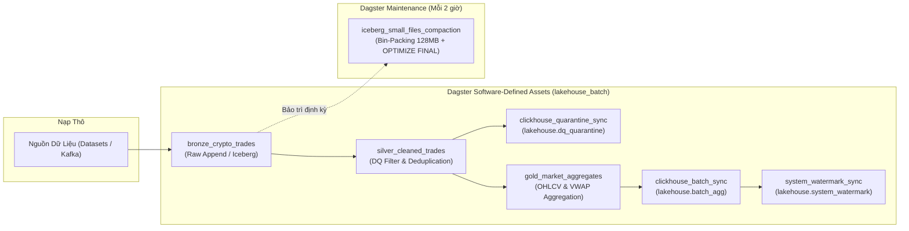

# ĐẶC TẢ KỸ THUẬT TIỂU MỤC 3.5: ĐIỀU PHỐI LUỒNG XỬ LÝ TỰ ĐỘNG VỚI DAGSTER VÀ BIẾN ĐỔI DBT
# (TECHNICAL SPECIFICATION: SECTION 3.5)

> **Mục lục liên kết:** Thuộc Chương 3 trong [master_outline.md](file:///thesis_workspace/master_outline.md)  
> **Các tiểu mục bao hàm:**  
> - `3.5.1. Thiết lập Software-Defined Assets trong Dagster`  
> - `3.5.2. Lập lịch tự động (Schedules) và đồng bộ System Watermark`  
> - `3.5.3. Tích hợp mô hình biến đổi dữ liệu dbt-spark (Medallion models)`  
> **Nguồn mã nguồn & tệp cấu hình trích xuất:**  
> - [dagster_project/repository.py](file:///dagster_project/repository.py)  
> - [configs/dagster/workspace.yaml](file:///configs/dagster/workspace.yaml)  
> - [dbt_project/dbt_project.yml](file:///dbt_project/dbt_project.yml)  
> - [dbt_project/profiles.yml](file:///dbt_project/profiles.yml)  
> - [dbt_project/models/bronze/bronze_crypto_trades.sql](file:///dbt_project/models/bronze/bronze_crypto_trades.sql)  
> - [dbt_project/models/silver/silver_cleaned_trades.sql](file:///dbt_project/models/silver/silver_cleaned_trades.sql)  
> - [dbt_project/models/gold/gold_market_aggregates.sql](file:///dbt_project/models/gold/gold_market_aggregates.sql)  
> - [thesis_workspace/specs/00_global_constants.md](file:///thesis_workspace/specs/00_global_constants.md)

---

## 1. TIỂU MỤC 3.5.1: THIẾT LẬP SOFTWARE-DEFINED ASSETS TRONG DAGSTER

### 1.1. Triết Lý Điều Phối Dựa Trên Tài Sản Dữ Liệu (Asset-Based Orchestration)
Khác với các công cụ điều phối luồng công việc truyền thống (như Apache Airflow vốn quản lý dựa trên các Task rời rạc), hệ thống triển khai điều phối trên **Dagster** (`lakehouse-dagster`, cổng 3000) theo mô hình **Software-Defined Assets (SDA)** trong [dagster_project/repository.py](file:///dagster_project/repository.py).

Mỗi nút trong đồ thị DAG đại diện cho một tài sản dữ liệu hữu hình có phiên bản, siêu dữ liệu và trạng thái chất lượng xác định:

**Bảng 3.9: Danh mục tài sản dữ liệu Dagster, tầng Medallion và siêu dữ liệu quản lý**

| Tên Tài Sản Dữ Liệu (`Asset Name`) | Nhóm (`Group`) | Tầng Kiến Trúc | Tài Sản Đầu Vào (`Input Assets`) | Mục Đích & Đầu Ra Thực Tế |
| :--- | :--- | :--- | :--- | :--- |
| **`bronze_crypto_trades`** | `lakehouse_batch` | Bronze | Nguồn ngoài (Kafka / Datasets) | Nạp bản ghi thô; tùy chọn append vào Iceberg `bronze.crypto_trades`. |
| **`silver_cleaned_trades`** | `lakehouse_batch` | Silver | `bronze_crypto_trades` | Lọc Data Quality Gate; khử trùng lặp `(symbol, trade_id)` giữ bản ghi mới nhất. |
| **`clickhouse_quarantine_sync`** | `lakehouse_batch` | Quarantine | `silver_cleaned_trades` | Nạp các bản ghi vi phạm chất lượng vào ClickHouse `lakehouse.dq_quarantine`. |
| **`gold_market_aggregates`** | `lakehouse_batch` | Gold | `silver_cleaned_trades` | Gom nhóm Tumbling Window 1m; tính nến OHLCV, VWAP và cờ `is_spike`. |
| **`clickhouse_batch_sync`** | `lakehouse_batch` | Serving | `gold_market_aggregates` | Ghi nến Gold Reconciled vào ClickHouse bảng `lakehouse.batch_agg`. |
| **`system_watermark_sync`** | `lakehouse_batch` | Serving | `clickhouse_batch_sync` | Cập nhật mốc `batch_layer` vào bảng `lakehouse.system_watermark`. |
| **`iceberg_small_files_compaction`**| `lakehouse_maintenance` | Bảo trì | Không phụ thuộc trực tiếp | Chạy Iceberg Bin-Packing nén tệp nhỏ và ClickHouse `OPTIMIZE TABLE FINAL`. |

*Nguồn: Trích xuất trực tiếp từ dagster_project/repository.py*

---

## 2. TIỂU MỤC 3.5.2: LẬP LỊCH TỰ ĐỘNG (SCHEDULES) VÀ ĐỒNG BỘ SYSTEM WATERMARK

### 2.1. Lập Lịch Thực Thi Định Kỳ (Schedules & Asset Jobs)
Hệ thống đóng gói toàn bộ quy trình vận hành thành hai Asset Jobs độc lập nhằm tối ưu hóa chu kỳ sử dụng tài nguyên CPU và bộ nhớ:

1. **`batch_lakehouse_pipeline_job`:**
   * Tập hợp tài sản: `bronze` $\rightarrow$ `silver` $\rightarrow$ `quarantine` $\rightarrow$ `gold` $\rightarrow$ `clickhouse_batch` $\rightarrow$ `system_watermark`.
   * Bộ thực thi: `in_process_executor` (thực thi gọn nhẹ trong tiến trình container).
   * Lịch chạy tự động:
     $$\texttt{cron\_schedule} = \text{"*/15 * * * *"} \quad (\text{Mỗi 15 phút một lần})$$
2. **`iceberg_compaction_job`:**
   * Tập hợp tài sản: `iceberg_small_files_compaction`.
   * Lịch chạy tự động:
     $$\texttt{cron\_schedule} = \text{"0 */2 * * *"} \quad (\text{Mỗi 2 giờ một lần vào đầu giờ})$$

### 2.2. Cơ Chế Thúc Đẩy Mốc Chân Lý Hệ Thống (`System Watermark Advance`)
Tài sản `system_watermark_sync` là chốt chặn quan trọng nhất của phân hệ điều phối. Khi toàn bộ các nến Gold đã được xác nhận ghi thành công vào `lakehouse.batch_agg`, tài sản này trích xuất mốc thời gian lớn nhất:
$$W_{\text{new}} = \max_{c \in \text{Gold}} (\text{window\_end}_c)$$

Tiến trình gọi phương thức `ClickHouseBatchSync().update_watermark(watermark)` ghi đè mốc mới vào ClickHouse:
$$\text{ClickHouse: } \texttt{INSERT INTO lakehouse.system_watermark (layer, watermark_time, updated_at)}$$

Việc nâng mốc $W_{\text{new}}$ kích hoạt sự dịch chuyển biên giới đối soát trong Serving Layer: Toàn bộ các nến thời gian thực trước mốc $W_{\text{new}}$ lập tức được thay thế bằng nến chuẩn xác `Reconciled`, khép lại chu trình tự sửa sai (*Auto-Correction*).

---

## 3. TIỂU MỤC 3.5.3: TÍCH HỢP MÔ HÌNH BIẾN ĐỔI DỮ LIỆU DBT-SPARK (MEDALLION MODELS)

### 3.1. Cấu Hình dbt-spark Qua Apache Spark Thrift Server
Song song với Dagster, hệ thống tích hợp bộ công cụ biến đổi dữ liệu chuẩn doanh nghiệp **dbt** (`dbt-spark`) trong [dbt_project/](file:///dbt_project). dbt kết nối tới container `lakehouse-spark-thrift` qua giao thức HiveServer2/Thrift JDBC trên cổng `10000`:

```yaml
# Trích xuất từ dbt_project/profiles.yml
lambda_spark:
  target: dev
  outputs:
    dev:
      type: spark
      method: thrift
      host: "{{ env_var('DBT_SPARK_HOST', 'localhost') }}"
      port: 10000
      schema: default
      connect_timeout: 120
      connect_retries: 5
```

**Bảng 3.10: Đặc tả các mô hình dbt-spark và chiến lược hiện thực hóa (Materialization)**

| Tên Model dbt | Tầng Medallion | Chiến Lược Lưu Trữ (`Materialization`) | Cơ Chế Xử Lý & Khử Trùng Lặp SQL |
| :--- | :--- | :--- | :--- |
| **`bronze_crypto_trades.sql`** | Bronze | `view` | Ánh xạ trực tiếp từ bảng gốc Iceberg `iceberg_catalog.bronze.crypto_trades`, ép kiểu dữ liệu chuẩn hóa. |
| **`silver_cleaned_trades.sql`** | Silver | `incremental` (`insert_overwrite`) | Lọc bỏ dữ liệu âm; áp dụng `row_number() over (partition by symbol, trade_id order by ingestion_time desc)` khử trùng lặp; phân vùng theo `trade_date`. |
| **`gold_market_aggregates.sql`** | Gold | `table` | Nhóm theo `window(trade_time_ts, '1 minute')`; tính toán nến OHLCV qua struct tie-breaking, tính VWAP và gắn cờ `is_spike`. |

*Nguồn: Trích xuất từ dbt_project/dbt_project.yml và dbt_project/models/*

### 3.2. Cú Pháp Biến Đổi Dữ Liệu SQL Khử Trùng Lặp & Tính Chỉ Số Nến
Mô hình `silver_cleaned_trades.sql` thể hiện sự kết hợp giữa logic lọc dữ liệu sạch và cửa sổ phân vùng tăng dần (`incremental`):
```sql
{{ config(
    materialized='incremental',
    incremental_strategy='insert_overwrite',
    partition_by=['trade_date']
) }}

with valid_records as (
    select *,
        row_number() over (
            partition by symbol, trade_id
            order by ingestion_time desc, bronze_written_at desc
        ) as dedupe_rank
    from {{ ref('bronze_crypto_trades') }}
    where trade_id is not null and symbol is not null
      and price > 0 and quantity > 0 and trade_time > 0
)
select * from valid_records where dedupe_rank = 1
```

Nhờ cơ chế `insert_overwrite`, dbt chỉ ghi đè lại các partition ngày có phát sinh giao dịch mới, giúp tối ưu hóa hiệu năng tính toán trên cụm Spark Thrift.

---

## 4. HỒ SƠ BIỂU ĐỒ ĐIỀU PHỐI VÀ BIẾN ĐỔI (DAGSTER LINEAGE GRAPH)



**Hình 3.9: Biểu đồ phụ thuộc tài sản dữ liệu Dagster Software-Defined Assets (Dagster Asset Lineage Graph)**

---

## 5. ĐIỂM NGHẼN VÀ ĐÁNH ĐỔI KỸ THUẬT PHÂN HỆ ĐIỀU PHỐI (TRADE-OFFS & BOTTLENECKS)

1. **Đánh đổi giữa dbt-spark và Dagster Native Python Execution:**
   * *Hiện tượng:* `dbt-spark` yêu cầu khởi chạy một Spark Thrift Server chạy nền liên tục (`lakehouse-spark-thrift`, chiếm $1.5\text{ GB}$ RAM). Trong khi đó, Dagster asset có thể gọi trực tiếp hàm Python/PySpark nội bộ với chi phí nhẹ hơn nhiều.
   * *Đánh đổi:* Dự án duy trì cả hai hướng tiếp cận: Dagster native assets được chọn làm động cơ điều phối chính thức 24/7 nhằm bảo đảm ngân sách $8.125\text{ GB}$ RAM máy chủ, trong khi `dbt-spark` đóng vai trò chuẩn hóa mã nguồn SQL cho các kỹ sư dữ liệu muốn tái hiện mô hình phân tích độc lập.
2. **Chi Phí Ghi Đè Phân Vùng Trong dbt Incremental (`insert_overwrite`):**
   * *Hiện tượng:* Khi có giao dịch trễ rơi vào các ngày trước đó, chiến lược `insert_overwrite` buộc phải viết lại toàn bộ phân vùng ngày đó trong bảng Silver.
   * *Đánh đổi:* Chấp nhận chi phí I/O ghi lại phân vùng để đổi lấy tính nhất quán dữ liệu tuyệt đối (Zero Duplicates), tránh việc phải quản trị các bảng băm trung gian phức tạp.

