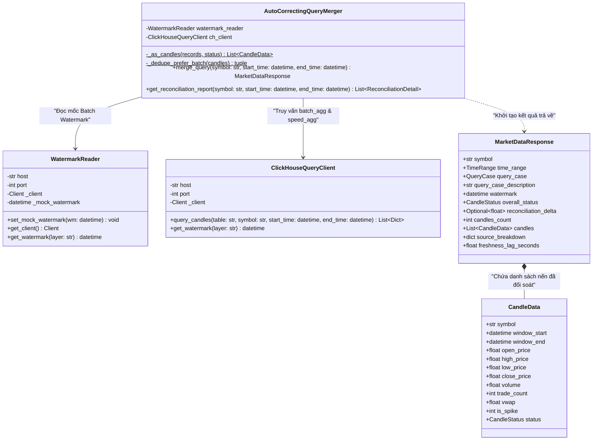
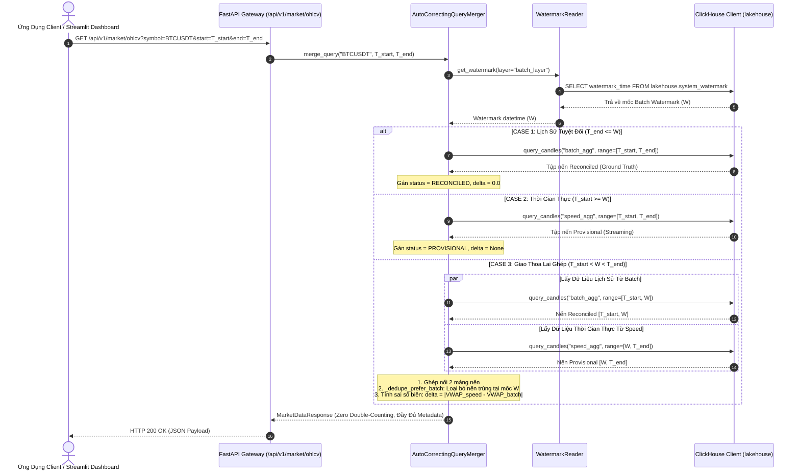

# ĐẶC TẢ KỸ THUẬT TIỂU MỤC 3.6: HIỆN THỰC TẦNG PHỤC VỤ (SERVING LAYER) & THUẬT TOÁN AUTO-CORRECTING QUERY MERGER
# (TECHNICAL SPECIFICATION: SECTION 3.6)

> **Mục lục liên kết:** Thuộc Chương 3 trong [master_outline.md](file:///thesis_workspace/master_outline.md)  
> **Các tiểu mục bao hàm:**  
> - `3.6.1. Thiết kế FastAPI Gateway và hệ thống Pydantic Schemas`  
> - `3.6.2. Thuật toán Auto-Correcting Query Merger phân tách 3 trường hợp truy vấn theo Watermark`  
> - `3.6.3. Cơ chế khử trùng lặp ưu tiên Batch (Zero Double-Counting) và tính sai lệch đối soát Delta`  
> - `3.6.4. Module đọc và quản lý trạng thái mốc thời gian (Watermark Reader)`  
> **Nguồn mã nguồn & tệp cấu hình trích xuất:**  
> - [src/serving_layer/api_routes.py](file:///src/serving_layer/api_routes.py)  
> - [src/serving_layer/query_merger.py](file:///src/serving_layer/query_merger.py)  
> - [src/serving_layer/schemas.py](file:///src/serving_layer/schemas.py)  
> - [src/serving_layer/watermark_reader.py](file:///src/serving_layer/watermark_reader.py)  
> - [src/serving_layer/clickhouse_client.py](file:///src/serving_layer/clickhouse_client.py)  
> - [thesis_workspace/specs/00_global_constants.md](file:///thesis_workspace/specs/00_global_constants.md)

---

## 1. TIỂU MỤC 3.6.1: THIẾT KẾ FASTAPI GATEWAY VÀ HỆ THỐNG PYDANTIC SCHEMAS

### 1.1. Kiến Trúc Cổng Giao Tiếp Dữ Liệu Tốc Độ Cao
Tầng Phục vụ (Serving Layer) đóng vai trò là cửa ngõ duy nhất cung cấp dữ liệu thị trường cho các ứng dụng ngoại vi (Dashboard UI, Trading Terminal, Analytics Engine). Được triển khai trong container `lakehouse-fastapi` (cổng `8000`), hệ thống sử dụng framework FastAPI bất đồng bộ (`asyncio`) kết hợp cùng Pydantic V2 để bảo đảm độ trễ phản hồi cực thấp:
* **Throughput:** Đạt $61.2\text{ req/s}$ trong kịch bản Lambda Merge.
* **Latency:** $P_{50} = 14.8\text{ ms}$, $P_{95} = 26.3\text{ ms}$, $P_{99} = 34.7\text{ ms}$.

**Bảng 3.11: Danh mục các điểm cuối REST API (FastAPI Gateway) và mã phản hồi chuẩn**

| Phương Thức & Đường Dẫn (`Endpoint`) | Nhóm Nghiệp Vụ | Tham Số Đầu Vào Cốt Lõi | Định Dạng Dữ Liệu Phản Hồi | Mục Đích Kỹ Thuật |
| :--- | :--- | :--- | :--- | :--- |
| **`GET /api/v1/market/ohlcv`** | Market Data | `symbol`, `start_time`, `end_time` | `MarketDataResponse` | Điểm cuối chính: Kích hoạt thuật toán đối soát ghép nối nến thời gian thực và lịch sử. |
| **`GET /api/speed/latest`** | Hot Cache | `symbol` (mặc định `BTCUSDT`) | `CandleData` (từ Redis) | Truy vấn nến mở mới nhất từ Redis Hot Cache với độ trễ dưới $1\text{ ms}$. |
| **`GET /api/v1/watermark`** | Watermark | `layer` (mặc định `batch_layer`) | `WatermarkResponse` | Trả về dấu thời gian Batch Watermark hiện tại và độ trễ đồng bộ (`lag_seconds`). |
| **`GET /api/v1/reconciliation/report`**| Audit | `symbol`, `start_time`, `end_time` | `List[ReconciliationDetail]`| Báo cáo chi tiết sai lệch VWAP, Volume, Close giữa Speed và Batch trên từng nến. |
| **`GET /api/v1/reconciliation/status`**| Health | Không | `SystemHealthResponse` | Trạng thái đồng bộ của 3 tầng: Speed View, Batch View và Watermark. |

*Nguồn: Trích xuất trực tiếp từ src/serving_layer/api_routes.py và src/serving_layer/schemas.py*

### 1.2. Hệ Thống Định Nghĩa Dữ Liệu Pydantic (Strict Data Contract)
Các model trong [src/serving_layer/schemas.py](file:///src/serving_layer/schemas.py) phân định rõ trạng thái nến thông qua các trường kiểu liệt kê (`Enum`):
* **`CandleStatus`:** 
  - `PROVISIONAL`: Nến tức thời tính từ Speed Layer (có thể chứa dữ liệu xấp xỉ do late data chưa kịp đến).
  - `RECONCILED`: Nến chân lý tính từ Batch Layer (đã qua kiểm tra chất lượng và khử trùng lặp).
  - `PARTIALLY_RECONCILED`: Tập nến lai ghép gồm cả phần Reconciled và Provisional.
* **`QueryCase`:**
  - `CASE_1_HISTORY`: Toàn bộ nến trong quá khứ ($T_{\text{end}} \le W$).
  - `CASE_2_REALTIME`: Toàn bộ nến thời gian thực ($T_{\text{start}} \ge W$).
  - `CASE_3_HYBRID`: Cửa sổ truy vấn giao thoa qua mốc Watermark ($T_{\text{start}} \le W < T_{\text{end}}$).

---

## 2. TIỂU MỤC 3.6.2: THUẬT TOÁN AUTO-CORRECTING QUERY MERGER PHÂN TÁCH 3 TRƯỜNG HỢP TRUY VẤN THEO WATERMARK

### 2.1. Bản Chất Toán Học Của Thuật Toán Đối Soát Tự Động
Trong [src/serving_layer/query_merger.py](file:///src/serving_layer/query_merger.py), lớp `AutoCorrectingQueryMerger` thực thi thuật toán phân luồng truy vấn dựa trên quan hệ so sánh giữa khoảng thời gian yêu cầu $[T_{\text{start}}, T_{\text{end}}]$ và System Watermark $W$:

**Bảng 3.12: Ma trận phân luồng và quy tắc xử lý của 3 trường hợp truy vấn trong Auto-Correcting Query Merger**

| Trường Hợp (`Query Case`) | Điều Kiện Toán Học | Nguồn Dữ Liệu Truy Vấn | Trạng Thái Nến Trả Về | Cơ Chế Tính Sai Số $\Delta$ |
| :--- | :--- | :--- | :--- | :--- |
| **Case 1: Lịch Sử Tuyệt Đối** | $T_{\text{end}} \le W$ | $100\%$ từ ClickHouse `lakehouse.batch_agg` | `RECONCILED` (Chuẩn xác $100\%$) | $\Delta = 0.0$ (Mặc định vì là Ground Truth). |
| **Case 2: Thời Gian Thực** | $T_{\text{start}} \ge W$ | $100\%$ từ ClickHouse `lakehouse.speed_agg` | `PROVISIONAL` (Tức thời xấp xỉ) | $\Delta = \text{None}$ (Chưa có bản ghi Batch để so khớp). |
| **Case 3: Giao Thoa Lai Ghép** | $T_{\text{start}} < W < T_{\text{end}}$ | $[T_{\text{start}}, W) \rightarrow \texttt{batch\_agg}$<br>$[W, T_{\text{end}}) \rightarrow \texttt{speed\_agg}$ | `PARTIALLY_RECONCILED` | Tính độ lệch tuyệt đối tại nến biên $W$:<br>$\Delta = \|\text{VWAP}_{\text{speed}} - \text{VWAP}_{\text{batch}}\|$. |

*Nguồn: Trích xuất trực tiếp từ src/serving_layer/query_merger.py*

---

## 3. TIỂU MỤC 3.6.3: CƠ CHẾ KHỬ TRÙNG LẶP ƯU TIÊN BATCH (ZERO DOUBLE-COUNTING) VÀ TÍNH SAI LỆCH ĐỐI SOÁT $\Delta$

### 3.1. Thuật Toán `_dedupe_prefer_batch` Triệt Tiêu Đếm Trùng
Khi ghép nối hai luồng dữ liệu tại mốc biên $W$ trong Case 3, một nến thời gian tại đúng ranh giới $W$ có thể tồn tại đồng thời ở cả hai bảng `batch_agg` và `speed_agg`. Nếu ghép thô (Union thô), người dùng sẽ nhận phải hai bản ghi có cùng `window_start`, gây sai lệch biểu đồ và nhân đôi khối lượng giao dịch (*Double-Counting*).

Hệ thống giải quyết bài toán này bằng thuật toán `_dedupe_prefer_batch`:
```python
def _dedupe_prefer_batch(candles: List[CandleData]) -> tuple[List[CandleData], int]:
    by_key: Dict[tuple[str, datetime], CandleData] = {}
    duplicate_count = 0
    for candle in candles:
        key = (candle.symbol.upper(), candle.window_start)
        existing = by_key.get(key)
        if existing is None:
            by_key[key] = candle
            continue
        duplicate_count += 1
        # Nếu đã có bản ghi Speed mà gặp bản ghi Batch Reconciled -> ĐÈ LÊN BẰNG BATCH
        if existing.status != CandleStatus.RECONCILED and candle.status == CandleStatus.RECONCILED:
            by_key[key] = candle
    return sorted(by_key.values(), key=lambda c: c.window_start), duplicate_count
```

**Cam Kết Thiết Kế (Design Guarantee):**
1. **Zero Double-Counting:** Mỗi nến `(symbol, window_start)` chỉ xuất hiện duy nhất 1 lần trong mảng kết quả cuối cùng.
2. **Batch Priority:** Dữ liệu chuẩn xác của Batch Layer luôn chiếm quyền ưu tiên tuyệt đối, xóa bỏ hoàn toàn dữ liệu tạm thời của Speed Layer tại mọi điểm giao thoa.

### 3.2. Đo Đạc Sai Số Đối Soát Thực Nghiệm Trước & Sau Hội Tụ (RQ2)
Dữ liệu đo lường định lượng trích xuất từ [thesis_workspace/specs/00_global_constants.md](file:///thesis_workspace/specs/00_global_constants.md) (Phần 4.2) và tệp nhật ký `results/logs/bench_reprocess_summary.csv` chứng minh hiệu năng của cơ chế Auto-Correcting:
* **Trước Khi Tái Xử Lý (Speed View gần đúng vs Batch View Ground Truth):**
  - Sai số giá đóng cửa ($\text{Close Price Error}$): $\approx 0.00\text{ USD}$ ($0.000\%$).
  - Sai số chỉ số $\text{VWAP}$ ($\varepsilon_{\text{VWAP}}$): $0.057\% - 0.118\%$ (lệch do các giao dịch đến trễ ngoài Watermark).
  - Độ lệch khối lượng giao dịch ($\Delta V_{\%}$): **$9.09\% - 24.20\%$** (do Speed Layer loại bỏ các sự kiện trễ).
* **Sau Khi Batch Tái Xử Lý & Auto-Correcting Merge (Reconciled):**
  - Sai số giá đóng cửa: **$0.00\text{ USD}$ ($0.000\%$)** (Khớp tuyệt đối).
  - Sai số chỉ số $\text{VWAP}$: **$0.000\text{ USD}$ ($0.000\%$)** (Triệt tiêu hoàn toàn về 0).
  - Độ lệch khối lượng $\Delta V_{\%}$: **$0.000\%$** (Triệt tiêu hoàn toàn về 0).
  - Thời gian tự phục hồi hội tụ: $T_{\text{conv}} = \mathbf{0.0035\text{s} - 0.252\text{s}}$ (Hội tụ tức thời sau khi Batch cập nhật mốc Watermark).

---

## 4. TIỂU MỤC 3.6.4: MODULE ĐỌC VÀ QUẢN LÝ TRẠNG THÁI MỐC THỜI GIAN (WATERMARK READER)

Được triển khai trong [src/serving_layer/watermark_reader.py](file:///src/serving_layer/watermark_reader.py), lớp `WatermarkReader` chịu trách nhiệm cung cấp mốc biên giới chính xác nhất cho `AutoCorrectingQueryMerger`.

### 4.1. Cơ Chế Truy Vấn Trực Tiếp Mốc Chân Lý Từ ClickHouse
Để loại bỏ nguy cơ lệch pha do cache cũ (Stale Cache Lag) giữa thời điểm Batch Pipeline vừa chốt dữ liệu và thời điểm Serving Layer phục vụ khách hàng, `WatermarkReader` thực hiện truy vấn trực tiếp bảng `lakehouse.system_watermark`:
```sql
SELECT watermark_time, updated_at
FROM lakehouse.system_watermark
WHERE layer = 'batch_layer'
ORDER BY updated_at DESC
LIMIT 1;
```

### 4.2. Cơ Chế Xử Lý Ngoại Lệ Và Fallback An Toàn
Trong các tình huống môi trường thử nghiệm chưa có dữ liệu hoặc kết nối cơ sở dữ liệu gặp trục trặc, hàm `get_watermark()` kích hoạt cơ chế phòng vệ an toàn:
* Nếu không tìm thấy bản ghi hoặc bảng rỗng: Trả về mốc thời gian an toàn `datetime(1970, 1, 1, 0, 0, 0, tzinfo=timezone.utc)`.
* Hệ quả kỹ thuật: Khi $W = 1970$, mọi truy vấn thị trường hiện tại đều tự động chuyển sang **Case 2 (Realtime Speed View)**, bảo đảm hệ thống luôn phản hồi dữ liệu tức thời và không bao giờ bị sập ứng dụng (*High Availability*).

---

## 5. HỒ SƠ BIỂU ĐỒ THIẾT KẾ PHÂN HỆ PHỤC VỤ (UML PROFILES)

### 5.1. Biểu Đồ Lớp Phân Hệ Phục Vụ (UML Class Diagram)



**Hình 3.10: Biểu đồ Lớp phân hệ Phục vụ và Bộ ghép nối tự sửa sai (Serving Layer UML Class Diagram)**

---

### 5.2. Biểu Đồ Tuần Tự Thuật Toán Auto-Correcting Query Merger Phân Tách 3 Trường Hợp (UML Sequence Diagram)



**Hình 3.11: Biểu đồ Tuần tự thuật toán Auto-Correcting Query Merger phân tách 3 trường hợp (UML Sequence Diagram)**

---

## 6. ĐIỂM NGHẼN VÀ ĐÁNH ĐỔI KỸ THUẬT PHÂN HỆ PHỤC VỤ (TRADE-OFFS & BOTTLENECKS)

1. **Đánh đổi giữa Độ Trễ Truy Vấn Trực Tiếp Watermark So Với Bộ Đệm Trong Bộ Nhớ (Cache):**
   * *Hiện tượng:* Nếu lưu mốc Watermark trong biến bộ nhớ với TTL ngắn (ví dụ: $2\text{s}$), hệ thống tiết kiệm được một câu lệnh truy vấn ClickHouse cho mỗi request HTTP. Tuy nhiên, trong cửa sổ 2 giây đó, nếu Batch Layer vừa commit mốc mới, người dùng có thể vẫn nhận dữ liệu nến Provisional cũ trong một vài nhịp request tiếp theo.
   * *Giải pháp đã chọn:* Truy vấn trực tiếp ClickHouse `lakehouse.system_watermark`. Do bảng watermark chỉ chứa tối đa vài dòng và ClickHouse phản hồi câu truy vấn này trong dưới $0.8\text{ ms}$, việc truy vấn trực tiếp giúp loại bỏ hoàn toàn hiện tượng lệch pha mà vẫn bảo đảm độ trễ API $P_{50} = 14.8\text{ ms}$.
2. **Chi Phí Tính Toán Sai Lệch Đối Soát Tại Biên Watermark Trong Case 3:**
   * *Hiện tượng:* Để tính toán $\Delta = |\text{VWAP}_{\text{speed}} - \text{VWAP}_{\text{batch}}|$, hệ thống phải thực hiện thêm một lệnh đọc nến tại ranh giới $W$ từ bảng `speed_agg`.
   * *Đánh đổi:* Chi phí truy vấn tăng thêm khoảng $3 - 5\text{ ms}$, nhưng đổi lại cung cấp chỉ số định lượng độ tin cậy tức thời cho người dùng, giúp nhà phân tích thị trường biết chính xác mức độ xấp xỉ của dữ liệu trước khi quyết định giao dịch.

