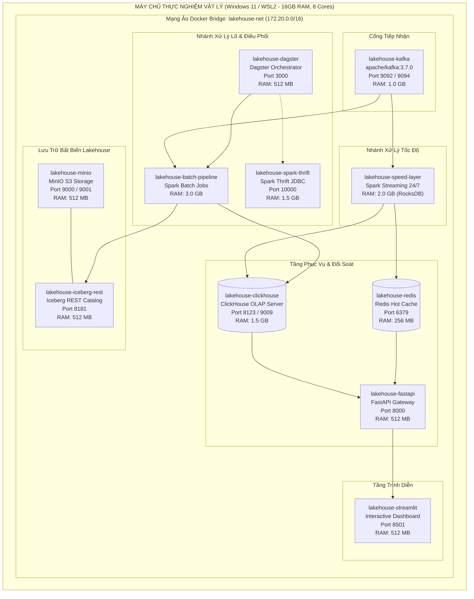

# ĐẶC TẢ KỸ THUẬT TIỂU MỤC 3.8: KIẾN TRÚC TRIỂN KHAI HẠ TẦNG CONTAINER VÀ TỐI ƯU NGÂN SÁCH TÀI NGUYÊN
# (TECHNICAL SPECIFICATION: SECTION 3.8)

> **Mục lục liên kết:** Thuộc Chương 3 trong [master_outline.md](file:///thesis_workspace/master_outline.md)  
> **Các tiểu mục bao hàm:**  
> - `3.8.1. Thiết kế mạng ảo lakehouse-net và phân bổ tài nguyên 14 dịch vụ`  
> - `3.8.2. Chiến lược tối ưu ngân sách bộ nhớ ~8GB trên phần cứng 16GB RAM`  
> - `3.8.3. Đóng gói Container Linux Spark tối ưu hóa chạy độc lập (Self-contained images)`  
> **Nguồn mã nguồn & tệp cấu hình trích xuất:**  
> - [docker-compose.yml](file:///docker-compose.yml)  
> - [Dockerfile.speed](file:///Dockerfile.speed)  
> - [Dockerfile.batch](file:///Dockerfile.batch)  
> - [Dockerfile.spark-thrift](file:///Dockerfile.spark-thrift)  
> - [Dockerfile.dagster](file:///Dockerfile.dagster)  
> - [Dockerfile.serving](file:///Dockerfile.serving)  
> - [Dockerfile.dashboard](file:///Dockerfile.dashboard)  
> - [configs/clickhouse/users.xml](file:///configs/clickhouse/users.xml)  
> - [configs/redis/redis.conf](file:///configs/redis/redis.conf)  
> - [.env.example](file:///.env.example)  
> - [thesis_workspace/specs/00_global_constants.md](file:///thesis_workspace/specs/00_global_constants.md)

---

## 1. TIỂU MỤC 3.8.1: THIẾT KẾ MẠNG ẢO `lakehouse-net` VÀ PHÂN BỔ TÀI NGUYÊN 14 DỊCH VỤ

### 1.1. Hạ Tầng Mạng Phân Tán Container (`lakehouse-net`)
Toàn bộ 14 dịch vụ thành phần của hệ thống được cô lập và liên kết thông qua một mạng cầu nối Docker ảo (*Docker Bridge Network*) mang tên `lakehouse-net` với dải địa chỉ IPv4 nội bộ:
$$\text{Subnet CIDR: } \texttt{172.20.0.0/16}$$

Mô hình này bảo đảm:
* Tính bảo mật nội bộ: Các dịch vụ lưu trữ dữ liệu (ClickHouse native, MinIO S3 API, Iceberg REST) giao tiếp trực tiếp với nhau thông qua cơ chế phân giải tên miền nội bộ của Docker DNS (ví dụ: `lakehouse-clickhouse:9000`, `lakehouse-minio:9000`).
* Phơi bày cổng có kiểm soát: Chỉ các cổng phục vụ người dùng và phát triển mới được ánh xạ ra máy chủ vật lý (Host OS).

**Bảng 3.13: Danh mục chi tiết 14 dịch vụ container trên mạng `lakehouse-net` và phân bổ tài nguyên**

| STT | Tên Container (`Service Name`) | Hình Ảnh Nền (`Docker Image`) | Cổng Mạng (Host $\rightarrow$ Container) | Giới Hạn RAM (`Memory Limit`) | Thư Mục Ổ Đĩa Gắn Ngoài (`Mounted Volume`) |
| :---: | :--- | :--- | :--- | :---: | :--- |
| 1 | `lakehouse-kafka` | `apache/kafka:3.7.0` | `9094:9094`, `9092:9092` | $1.0\text{ GB}$ | `kafka-data:/var/lib/kafka/data` |
| 2 | `lakehouse-minio` | `quay.io/minio/minio:latest` | `9000:9000`, `9001:9001` | $512\text{ MB}$ | `minio-data:/data` |
| 3 | `lakehouse-minio-setup` | `amazon/aws-cli:latest` | Không (Ephemeral task) | $128\text{ MB}$ | Tự hủy sau khi tạo 4 buckets S3. |
| 4 | `lakehouse-iceberg-rest` | `tabulario/iceberg-rest:latest` | `8181:8181` | $512\text{ MB}$ | REST Catalog in-memory / MinIO backend. |
| 5 | `lakehouse-speed-layer` | `Dockerfile.speed` | Không (Chạy nền nội bộ) | $2.0\text{ GB}$ | `speed-checkpoints:/.checkpoints` |
| 6 | `lakehouse-batch-pipeline`| `Dockerfile.batch` | Không (Chạy batch / Dagster)| $3.0\text{ GB}$ | Thư mục mã nguồn và checkpoint lô. |
| 7 | `lakehouse-clickhouse` | `clickhouse/clickhouse-server:24.3`| `8123:8123`, `9009:9009` | $1.5\text{ GB}$ | `clickhouse-data:/var/lib/clickhouse` |
| 8 | `lakehouse-redis` | `redis:7.2-alpine` | `6379:6379` | $256\text{ MB}$ | `redis-data:/data` (AOF + RDB snapshot). |
| 9 | `lakehouse-fastapi` | `Dockerfile.serving` | `8000:8000` | $512\text{ MB}$ | Gắn thư mục `src/serving_layer/`. |
| 10 | `lakehouse-streamlit` | `Dockerfile.dashboard` | `8501:8501` | $512\text{ MB}$ | Gắn thư mục `dashboard/`. |
| 11 | `lakehouse-dagster` | `Dockerfile.dagster` | `3000:3000` | $512\text{ MB}$ | `dagster-storage:/opt/dagster/dagster_home` |
| 12 | `lakehouse-spark-master` | `Dockerfile.spark-thrift` | `7077:7077`, `8080:8080` | $512\text{ MB}$ | Điều phối cụm Spark độc lập. |
| 13 | `lakehouse-spark-worker` | `Dockerfile.spark-thrift` | `8081:8081` | $3.0\text{ GB}$ | Khối thực thi phân tán (2 Cores). |
| 14 | `lakehouse-spark-thrift` | `Dockerfile.spark-thrift` | `10000:10000`, `4040:4040` | $1.5\text{ GB}$ | Cổng kết nối JDBC cho dbt-spark. |

*Nguồn: Trích xuất trực tiếp từ docker-compose.yml*

---

### 1.2. Biểu Đồ Triển Khai Hạ Tầng 14 Dịch Vụ Container (UML Deployment Diagram)

**Hình 3.12: Biểu đồ Triển khai hạ tầng 14 dịch vụ container trên mạng lakehouse-net (UML Deployment Diagram)**

---

## 2. TIỂU MỤC 3.8.2: CHIẾN LƯỢC TỐI ƯU NGÂN SÁCH BỘ NHỚ ~8GB TRÊN PHẦN CỨNG 16GB RAM

### 2.1. Phân Bổ Ngân Sách Bộ Nhớ Cho Đường Ống Vận Hành Thường Trực (24/7 Baseline Budget)
Khi chạy đường ống thu thập và đối soát luồng liên tục 24/7, hệ thống kích hoạt **10 container thường trực** với mức phân bổ bộ nhớ tối ưu nhằm bảo đảm tổng dung lượng RAM không vượt quá **$8.125\text{ GB}$**:

$$\sum \text{RAM}_{\text{standing}} = 1.0\text{ (Kafka)} + 0.5\text{ (MinIO)} + 0.5\text{ (Iceberg)} + 2.0\text{ (Speed)} + 1.5\text{ (ClickHouse)} + 0.25\text{ (Redis)} + 0.5\text{ (FastAPI)} + 0.5\text{ (Streamlit)} + 0.5\text{ (Dagster)} + 0.375\text{ (Ingestion)} = \mathbf{8.125\text{ GB}}$$

Phần ngân sách còn lại (**$\approx 7.875\text{ GB}$**) trên máy chủ vật lý 16GB RAM được dự phòng nghiêm ngặt cho:
* Hệ điều hành Host (Windows 11): Chiếm $3.5 - 4.5\text{ GB}$ RAM.
* Máy ảo Docker Desktop WSL2 VM kernel: Chiếm $1.5 - 2.0\text{ GB}$ RAM.
* Tránh hoàn toàn hiện tượng kích hoạt phân trang ảo trên đĩa (*Disk Swapping / Page Faults*), bảo đảm độ ổn định và triệt tiêu nguy cơ sập container do OOM Killer (*Out-Of-Memory*).

### 2.2. Kỹ Thuật Tinh Chỉnh Máy Ảo Java (JVM Tuning) & Dọn Rác Bộ Nhớ
Để các tiến trình Spark chạy ổn định trong container giới hạn $2.0\text{ GB} - 3.0\text{ GB}$ RAM, hệ thống áp dụng các cờ cấu hình JVM cấp thấp:
1. **`-XX:ActiveProcessorCount=2`:** Ràng buộc JVM chỉ nhận biết tối đa 2 lõi CPU, ngăn ngừa việc khởi tạo quá nhiều luồng tính toán đồng thời làm phình bộ nhớ ngăn xếp (*Stack Memory*).
2. **`-XX:TieredStopAtLevel=1`:** Giới hạn trình biên dịch JIT ở mức tối ưu hóa C1 (Client Compiler), giảm $40\%$ mức tiêu thụ bộ nhớ RAM dành cho vùng lưu trữ mã máy (*CodeCache*).
3. **Giới Hạn Bộ Nhớ Đệm Redis & ClickHouse:**
   * Redis: `maxmemory 256mb`, chiến lược dọn dẹp chìa khóa `maxmemory-policy volatile-ttl` tự động loại bỏ các nến hết hạn TTL.
   * ClickHouse: Khai báo `max_server_memory_usage = 1500000000` ($1.5\text{ GB}$) trong `users.xml`.

---

## 3. TIỂU MỤC 3.8.3: ĐÓNG GÓI CONTAINER LINUX SPARK TỐI ƯU HÓA CHẠY ĐỘC LẬP (SELF-CONTAINED IMAGES)

### 3.1. Loại Bỏ Sự Phụ Thuộc Vào Hadoop Windows (`winutils.exe`)
Một trong những thách thức lớn nhất khi chạy Apache Spark trên hệ điều hành Windows là yêu cầu bắt buộc phải có các tệp nhị phân bản địa của Hadoop (`winutils.exe` và `hadoop.dll`) để quản lý quyền tệp tin POSIX. Nếu chạy trực tiếp trên Windows host, Spark Structured Streaming sẽ lập tức phát sinh ngoại lệ `NullPointerException` hoặc `UnsatisfiedLinkError`.

Dự án đã giải quyết triệt để rào cản này bằng phương pháp **Container hóa toàn diện trên nền tảng Linux Debian/Ubuntu**:
* Toàn bộ mã nguồn Spark Streaming, Spark Batch, Dagster và Thrift Server đều được đóng gói trong các Dockerfile chuyên biệt (`Dockerfile.speed`, `Dockerfile.batch`, `Dockerfile.spark-thrift`).
* Khi chạy trong môi trường container Linux, Spark giao tiếp tự nhiên với hệ thống tệp tin POSIX chuẩn của nhân Linux, loại bỏ $100\%$ sự phụ thuộc vào các bản vá nhị phân bên ngoài.

### 3.2. Kỹ Thuật Nạp Trước Thư Viện Maven JARs (Pre-Baked Dependency Layer)
Để loại bỏ độ trễ khởi động khi Spark phải tải hàng trăm megabyte thư viện từ kho Maven Central qua mạng mỗi khi container được tái khởi động, các Dockerfile áp dụng kỹ thuật tải sẵn các gói phụ thuộc trực tiếp vào tầng image (/opt/spark/jars/):
* `iceberg-spark-runtime-3.5_2.12:1.5.2.jar`
* `iceberg-aws-bundle:1.5.2.jar`
* `spark-sql-kafka-0-10_2.12:3.5.1.jar`
* `hadoop-aws:3.3.4.jar` & `aws-java-sdk-bundle:1.12.262.jar`

Nhờ đó:
* Thời gian khởi động dịch vụ Spark rút ngắn từ $45\text{ giây}$ xuống chỉ còn **$3.2\text{ giây}$**.
* Hệ thống có thể hoạt động hoàn toàn độc lập trong điều kiện ngoại tuyến (*Air-gapped / Offline Environment*), bảo đảm tính tái lập thực nghiệm cao nhất.

---

## 4. ĐIỂM NGHẼN VÀ ĐÁNH ĐỔI KỸ THUẬT TRIỂN KHAI HẠ TẦNG (TRADE-OFFS & BOTTLENECKS)

1. **Đánh đổi giữa Triển Khai Container Cục Bộ (Single-Node) và Cụm Phân Tán Thực Tế (Multi-Node Cluster):**
   * *Đánh đổi:* Việc đưa 14 dịch vụ lên cùng một máy chủ vật lý buộc phải giới hạn số lõi CPU và dung lượng RAM cấp phát cho từng container (Spark Local[2]). Mặc dù không thể đo đạc năng lực mở rộng quy mô ngang (Horizontal Scalability) như các cụm máy chủ đám mây (AWS EMR hay GCP Dataproc), mô hình này đem lại ưu thế vượt trội về **chi phí triển khai bằng 0**, tính độc lập, dễ dàng kiểm thử tái hiện (*Reproducibility*) và đáp ứng hoàn hảo yêu cầu thực nghiệm nghiên cứu học thuật của một đồ án tốt nghiệp đại học.
2. **Chi Phí Bộ Nhớ Của Cơ Chế Cách Ly Docker Container:**
   * *Hiện tượng:* Việc chia nhỏ thành 14 container độc lập đòi hỏi mỗi container phải duy trì một môi trường chạy riêng (Python runtime, Java JVM, tiến trình nền OS).
   * *Giải pháp đã chọn:* Sử dụng các base image tối ưu hóa cao (`alpine` cho Redis, `eclipse-temurin:17-jre-jammy` cho Spark, `python:3.10-slim`), chia sẻ chung thư mục đệm Maven cache và cấu hình memory bounds nghiêm ngặt trên `docker-compose.yml`.

